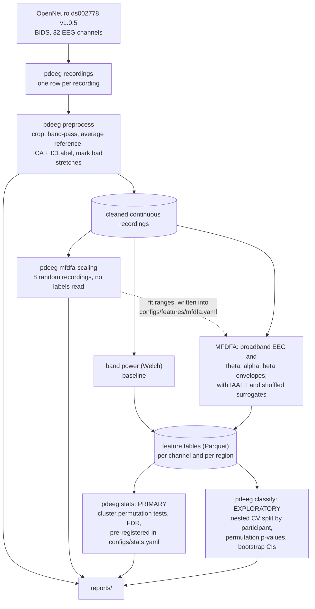

# pdeeg: multifractal analysis of resting-state EEG in Parkinson's disease

> **Research code, not a diagnostic tool.** Nothing in this repository is validated for deciding
> whether a person has Parkinson's disease, and it must not be used that way. See
> [Limitations](#limitations) and [MODEL_CARD.md](MODEL_CARD.md).

`pdeeg` asks whether the temporal structure of resting-state EEG differs between people with
Parkinson's disease (PD) and healthy controls (HC), and, within patients, between sessions off and
on medication. The main features come from multifractal detrended fluctuation analysis (MFDFA) of
the EEG and of its theta, alpha and beta amplitude envelopes, each judged against surrogate data.
Spectral band power is the baseline. The primary analysis is a set of pre-registered,
cluster-based permutation tests between groups. Classification is secondary and exploratory, and
every one of its splits is made by participant.

**Status.** Preprocessing and the label-blind scaling inspection are complete, and their reports
are in [`reports/`](reports/). The MFDFA feature extraction, the group statistics and the
classification have not been run yet, so this README has no group-level or classification
results.

## Credit

This project re-engineers
[`Sankhadip-007/Detecttion-of-Parkinson-s-Disease-using-machine-learning-and-deep-learning`](https://github.com/Sankhadip-007/Detecttion-of-Parkinson-s-Disease-using-machine-learning-and-deep-learning)
by [Sankhadip Bera](https://github.com/Sankhadip-007). The question, the choice of dataset and the
first pipeline come from that repository. This one started as a byte-identical copy of its
notebooks (commit `1ab0029`). They were moved to `legacy/` in `5d3d758` and removed in `e3820f3`,
and are still in the history. [What changed](#what-changed-from-the-original-project) below says
what was rebuilt and why.

## Dataset

[OpenNeuro ds002778](https://openneuro.org/datasets/ds002778/versions/1.0.5), version 1.0.5:
*UC San Diego Resting State EEG Data from Patients with Parkinson's Disease*, by Alexander P.
Rockhill, Nicko Jackson, Jobi George, Adam Aron and Nicole C. Swann
(doi:10.18112/openneuro.ds002778.v1.0.5, licence CC0). It has 16 controls with one session each
and 15 patients with an off- and an on-medication session: 46 recordings with 32 scalp channels at
512 Hz. The data is not tracked in git. `pdeeg download` fetches it into `data/raw/ds002778/`.

The dataset's README (`data/raw/ds002778/README`) makes three requests of anyone using it:

- **Contact the curators before submitting a manuscript.** The address is in that README.
- **Do not classify patients against controls and present it as a finding.** With this few
  patients, a proper test split holds fewer than 8 of them, and the curators "strongly advise
  against any such approach because it would mislead patients". For that reason the group
  statistics are this project's primary result, and the classification is exploratory.
- **Cite the papers below.** The dataset README also notes that the UPDRS ratings were collected
  by trained laboratory staff rather than a board-certified neurologist. This project does not use
  them.

### Citations requested by the dataset

Reproduced as `data/raw/ds002778/README` gives them:

1. Nicko Jackson, Scott R. Cole, Bradley Voytek, Nicole C. Swann. Characteristics of Waveform Shape
   in Parkinson's Disease Detected with Scalp Electroencephalography. eNeuro 20 May 2019, 6 (3)
   ENEURO.0151-19.2019; DOI: 10.1523/ENEURO.0151-19.2019.
2. Swann NC, de Hemptinne C, Aron AR, Ostrem JL, Knight RT, Starr PA. Elevated synchrony in
   Parkinson disease detected with electroencephalography. Ann Neurol. 2015 Nov;78(5):742-50. doi:
   10.1002/ana.24507. Epub 2015 Sep 2. PMID: 26290353; PMCID: PMC4623949.
3. George JS, Strunk J, Mak-McCully R, Houser M, Poizner H, Aron AR. Dopaminergic therapy in
   Parkinson's disease decreases cortical beta band coherence in the resting state and increases
   cortical beta band power during executive control. Neuroimage Clin. 2013 Aug 8;3:261-70. doi:
   10.1016/j.nicl.2013.07.013. PMID: 24273711; PMCID: PMC3814961.
4. Appelhoff, S., Sanderson, M., Brooks, T., Vliet, M., Quentin, R., Holdgraf, C., Chaumon, M.,
   Mikulan, E., Tavabi, K., Höchenberger, R., Welke, D., Brunner, C., Rockhill, A., Larson, E.,
   Gramfort, A. and Jas, M. (2019). MNE-BIDS: Organizing electrophysiological data into the BIDS
   format and facilitating their analysis. Journal of Open Source Software 4: (1896).
5. Pernet, C. R., Appelhoff, S., Gorgolewski, K. J., Flandin, G., Phillips, C., Delorme, A.,
   Oostenveld, R. (2019). EEG-BIDS, an extension to the brain imaging data structure for
   electroencephalography. Scientific Data, 6, 103. https://doi.org/10.1038/s41597-019-0104-8.

The dataset itself, as `dataset_description.json` describes it: Rockhill, A. P., Jackson, N.,
George, J., Aron, A. and Swann, N. C. *UC San Diego Resting State EEG Data from Patients with
Parkinson's Disease*. OpenNeuro. doi:10.18112/openneuro.ds002778.v1.0.5.

## Pipeline



- **Preprocessing** keeps each recording continuous, because MFDFA needs unbroken data. Each
  recording is cropped to 180 s from trigger `1` (or the file start where it is missing),
  band-passed 0.5 to 50 Hz and re-referenced to the average. Extended infomax ICA is fitted on a
  1 to 100 Hz copy, and ICLabel removes components it calls eye blink, muscle, heart or line noise
  with probability at least 0.8. Remaining bad stretches are marked, not cut out.
- **MFDFA** uses q from -5 to 5 in steps of 0.5, detrending order 1 and 12 log-spaced scales per
  fit range. The fit ranges are 0.045 to 0.09 s and 0.3 to 1 s for the broadband EEG, and 2 to
  17.8 s for the envelopes. They were read from a [scaling inspection](reports/mfdfa_scaling.md)
  of 8 recordings chosen at random, with no subject, session or group label loaded. The spectrum
  width of every channel is compared with 20 IAAFT and 20 shuffled surrogates.
- **Statistics** were fixed in [`configs/stats.yaml`](configs/stats.yaml) before any feature was
  compared between groups. The three primary features are the beta-envelope `h2` and
  `delta_alpha` and the broadband `delta_alpha` on the 0.3 to 1 s range. They are tested PD OFF
  against HC (also adjusted for age and sex) and OFF against ON within patients, with cluster-based
  permutation tests over channels (10000 permutations, cluster-forming p 0.05) and
  Benjamini-Hochberg across the family.
- **Classification** was fixed in [`configs/model.yaml`](configs/model.yaml) before any classifier
  was run. It uses nested cross-validation with every split grouped by participant (see
  [How evaluation works now](#how-evaluation-works-now)).

The full methods, including how every parameter was chosen, are in
[`reports/methods.md`](reports/methods.md).

## Quick start

Requires Python 3.11 or 3.12.

```bash
python -m venv .venv
source .venv/bin/activate       # Windows: .venv\Scripts\activate
pip install -e .[dev]
pytest -m "not dataset"         # synthetic data only, nothing is downloaded

pdeeg all                       # download -> preprocess -> features -> stats -> classify -> reports
```

`pdeeg all` skips every step whose settings, inputs and outputs are unchanged, so it is safe to
re-run. Preprocessing and the MFDFA surrogates take hours. Each step is also its own command:

| Command | Does |
|---|---|
| `pdeeg download`, `pdeeg recordings` | Fetch and verify the dataset; index its recordings |
| `pdeeg preprocess` | Clean every recording; writes `reports/qc_preprocessing.md` |
| `pdeeg mfdfa-scaling` | Label-blind scaling inspection; writes `reports/mfdfa_scaling.md` |
| `pdeeg features` | Band power, MFDFA with surrogates, and h(q) / f(alpha) curves |
| `pdeeg stats` | Group statistics; writes `reports/stats_results.md` |
| `pdeeg classify` | Classification; writes `reports/classification_results.md`, tracked in MLflow |
| `pdeeg report` | Rewrite every report from stored results without recomputing |
| `pdeeg config` | Print the resolved configuration |

Every step except `report` takes `--force`, and the parallel ones take `--n-jobs N`. The same commands are available as
`make` targets, and `docker build -t pdeeg .` builds an image that runs `pdeeg all` on a mounted
`data/` directory. A Streamlit page (`pip install -e .[app]`, then
`streamlit run app/streamlit_app.py`) checks an uploaded recording, shows what `pdeeg predict`
gives for it with each stage's cross-validated reliability, and shows the recording's MFDFA. It
needs the models of `pdeeg train-final`, and it is a research demo, not a diagnostic tool.

Every setting lives in `configs/`, and nothing is hard-coded in the package:

| File | Covers |
|---|---|
| [`configs/data.yaml`](configs/data.yaml) | Dataset, paths, session labels, scalp regions |
| [`configs/preprocessing.yaml`](configs/preprocessing.yaml) | Crop, filter, reference, ICA, bad-stretch marking, QC limits |
| [`configs/features/mfdfa.yaml`](configs/features/mfdfa.yaml) | Moment orders, detrending, fit ranges and the reasons for them, surrogates |
| [`configs/features/psd.yaml`](configs/features/psd.yaml) | Welch spectrum and band limits |
| [`configs/stats.yaml`](configs/stats.yaml) | Pre-registered primary features, contrasts, cluster tests, FDR, covariates |
| [`configs/model.yaml`](configs/model.yaml) | Tasks, feature sets, model grids, nested CV, permutations, tracking |

## Results

### Data quality

All 46 recordings were cleaned. Of these, 9 are flagged for a closer look in
[`reports/qc_preprocessing.md`](reports/qc_preprocessing.md). A flag is a reason to look, not an
exclusion. Two findings shaped the analysis:

- **Two on-medication sessions were already filtered.** In `sub-pd6` and `sub-pd16` `ses-on`,
  power below 0.5 Hz before filtering is -29 and -27 dB relative to 1-4 Hz (robust z -16.9 and
  -16.3). The QC found this from the signals alone; `participants.tsv` confirms that both sessions
  were exported from preprocessed EEGLAB data. Both are left out of the main OFF against ON
  analyses.
- **Mains is 60 Hz.** A 60 Hz peak is present in 37 recordings and no mains peak in 9, but 9 of
  the sidecar files say 50 Hz. The pipeline takes 60 Hz from the configuration.


### Where the EEG scales

Before any exponent was fitted, the fluctuation functions of 8 recordings, picked at random and
shown only as R1 to R8, were compared with noise put through the same filters
([`reports/mfdfa_scaling.md`](reports/mfdfa_scaling.md)). This sets the fit ranges. It is not a
comparison between groups. Over each chosen range, as median [10th, 90th percentile] over 256
channel fits (EEG) or 40 noise realisations:

| Series | Fit range | Source | h(2) | delta_alpha |
|---|---|---|---|---|
| Broadband | 0.045 to 0.09 s | EEG | 1.13 [0.96, 1.34] | 1.07 [0.57, 1.85] |
| | | filtered 1/f noise | 1.04 [1.02, 1.05] | 1.08 [0.77, 1.71] |
| Broadband | 0.3 to 1 s | EEG | 0.99 [0.13, 1.18] | 0.32 [0.11, 0.66] |
| | | filtered 1/f noise | 0.97 [0.94, 1.00] | 0.12 [0.07, 0.28] |
| Theta envelope | 2 to 17.8 s | EEG | 0.70 [0.56, 0.85] | 0.35 [0.15, 0.63] |
| | | white-noise envelope | 0.54 [0.48, 0.61] | 0.19 [0.08, 0.35] |
| Alpha envelope | 2 to 17.8 s | EEG | 0.74 [0.60, 0.88] | 0.35 [0.18, 0.67] |
| | | white-noise envelope | 0.53 [0.47, 0.59] | 0.17 [0.07, 0.26] |
| Beta envelope | 2 to 17.8 s | EEG | 0.69 [0.59, 0.87] | 0.23 [0.09, 0.55] |
| | | white-noise envelope | 0.52 [0.46, 0.58] | 0.13 [0.05, 0.27] |

- The broadband EEG has no single scaling regime. The band-pass and the alpha rhythm leave two
  short ranges. On the shorter one, filtered monofractal noise is as wide as the EEG (1.07 against
  1.08), so the width there belongs to the filter, and only `h2` from that range is used.
- On the 0.3 to 1 s range and in every band envelope, the median EEG spectrum is wider than that
  of the matched noise. The envelopes also have a higher `h2` (0.70, 0.74 and 0.69 against 0.54, 0.53 and 0.52), so the band
  amplitudes are correlated over seconds beyond what the filter alone produces.


### Group differences (primary)

**Not run yet.** `pdeeg stats` will write `reports/stats_results.md`. The tests and features are
already fixed in `configs/stats.yaml`: the three primary features listed under
[Pipeline](#pipeline), PD OFF against HC with and without age and sex adjustment, and OFF against
ON within patients, with `sub-pd6` and `sub-pd16` left out of the main paired analysis and kept in
a sensitivity analysis.

### Classification (exploratory)

**Not run yet.** `pdeeg classify` will write `reports/classification_results.md`, with balanced
accuracy, ROC AUC, sensitivity and specificity, their 95 % bootstrap intervals and permutation
p-values. These will be reported for band power, MFDFA, both, and age and sex alone.

## What changed from the original project

### The original evaluation leaked

The original notebooks cut each recording into one-second epochs and pooled them.
`main3.ipynb` stacks every subject's epochs into one array, with one label per epoch.
`svm.ipynb`, `cnn3.ipynb` and `1d_cnn3.ipynb` then split that array with `train_test_split`,
`KFold` or `StratifiedKFold`, without groups. Every test fold therefore held epochs from people
whose other epochs were in the training data. Because a person's label never changes, the models
could score well by recognising the person rather than the disease. Accuracies measured this way
say nothing about a new person, and they cannot be compared with anything reported here.
`cnn3.ipynb` also fits its `StandardScaler` on all the data before splitting.

The notebooks in `subject_independent/` do split by subject, but `subject_independent/cnn3.ipynb`
still fits its scaler on all subjects before the split. It also passes the test set as
`validation_data`, so any choice made while watching training was made on test data. No notebook
reports an interval or a permutation test.

### How evaluation works now

- **The participant is the unit.** PD against HC uses one recording per participant. OFF against
  ON centres each patient's features on the mean of their own two recordings, so the question is
  which of a patient's two recordings is OFF.
- **Nested cross-validation.** The outer loop is stratified 5-fold, grouped by participant. The
  inner loop is a grouped, stratified 3-fold grid search over one `Pipeline` of scaling,
  (channel-level) feature selection and model, so every fitted step sees training folds only.
- **Guarded.** A wrapped splitter raises `LeakageError` if any outer or inner split puts one
  participant on both sides, and [`tests/test_leakage.py`](tests/test_leakage.py) checks every
  splitter of every task.
- **Uncertainty is reported.** Balanced accuracy, ROC AUC, sensitivity and specificity come with
  95 % bootstrap intervals over participants (2000 resamples). The permutation p-values come from
  1000 permutations that each repeat the whole nested procedure, with labels permuted within
  patients for OFF against ON. The spread over 10 other outer splits shows how much the split
  alone moves the score.
- **A confound baseline.** Age and sex alone are classified as a feature set of their own.

### Everything else

| | Original notebooks | Here | Why |
|---|---|---|---|
| Primary question | Classify patients against controls | Pre-registered group statistics; classification exploratory | The dataset's curators advise against classification on 15 patients |
| Reference | None set | Average reference | BioSemi recordings are reference-free and need an offline reference |
| Artefact removal | ICA; eye components by correlation with Fp2/F8; T7 used as a stand-in ECG channel | Extended infomax on a 1 to 100 Hz copy; ICLabel classifies the components | T7 is a scalp channel, not an ECG |
| Features | Multitaper band power per epoch; alpha 8-12 Hz and beta 13-30 Hz, so 12-13 Hz was in no band | MFDFA of broadband EEG and band envelopes, tested against surrogates; contiguous Welch band power as the baseline | Contiguous bands; MFDFA is the question this project asks |
| Parameters | Set in the notebooks | In YAML, with the reason next to each; MFDFA fit ranges chosen without labels | No parameter can be tuned towards a group difference |
| Code and data | Functions copied between notebooks; one pickle per band per manual run | One package with a CLI, Parquet tables, cached steps, tests, CI and Docker | Reproducible from one command |
| Second dataset | Iowa recordings | Dropped | Never in the repository, so nothing here can be checked against it |

## Limitations

- **Small sample.** 15 patients and 16 controls from one site. Only large group differences are
  detectable, and every classification estimate has a wide interval. These analyses describe this
  sample. They are not a test that would carry over to new patients.
- **No external validation.** There is one dataset and no held-out cohort. Nothing here supports
  clinical or diagnostic use.
- **Short recordings and short scaling ranges.** Each recording gives 180 s. The broadband EEG
  scales only over two short ranges, and on the shorter one the spectrum width is the filter's.
  MFDFA widths are biased upward at finite length, so they are judged against surrogates rather
  than against zero.
- **Filter-induced memory.** Band-passing gives even white noise an envelope `h2` above 0.5 (0.54,
  0.53 and 0.52 for theta, alpha and beta on the fit range). The bias is the same for every
  recording, so it shifts all groups alike, but the absolute envelope exponents should not be read
  as the brain's alone.
- **Two on-medication sessions were processed differently.** `sub-pd6` and `sub-pd16` `ses-on`
  came pre-filtered. They are excluded from the main OFF against ON analyses, which reduces those
  analyses to 13 pairs.
- **Confounds.** Age and sex are adjusted for in a sensitivity analysis and tested as a classifier
  baseline. Cognition, disease duration and medication dose are not modelled.
- **Judgement in the fit ranges.** The ranges were read by eye from 8 recordings. No label was
  seen, but it remains a choice that other analysts could make differently.
- **No leave-one-subject-out.** With a full nested permutation test it would have taken weeks of
  CPU (the timing is in `configs/model.yaml`). A 5-fold estimate depends on the split, which is
  why 10 other splits are reported.
- **Flagged recordings are kept.** The 9 recordings flagged by QC are in the analysis, apart from
  the two sessions above in the paired tests.

## Documentation

- [`reports/methods.md`](reports/methods.md): preprocessing, MFDFA, surrogates, statistics and the
  classification protocol in full.
- [`MODEL_CARD.md`](MODEL_CARD.md): intended use, evaluation, metrics and ethical considerations.
- [`reports/qc_preprocessing.md`](reports/qc_preprocessing.md) and
  [`reports/mfdfa_scaling.md`](reports/mfdfa_scaling.md): the reports so far.
- [`notebooks/01_mfdfa_validation.ipynb`](notebooks/01_mfdfa_validation.ipynb): the MFDFA code
  checked on synthetic signals with known exponents and against the PyPI `MFDFA` package.

## Layout

```
configs/        YAML configuration: every setting and path
src/pdeeg/      the package: data/, preprocessing/, features/, stats/, models/, viz/, cli.py
app/            Streamlit research demo (the predictions of `pdeeg predict`, MFDFA figures)
tests/          pytest; synthetic data only, except one test marked "dataset"
notebooks/      MFDFA validation
reports/        generated reports and figures
data/           raw/, interim/, processed/ (contents not tracked)
```
