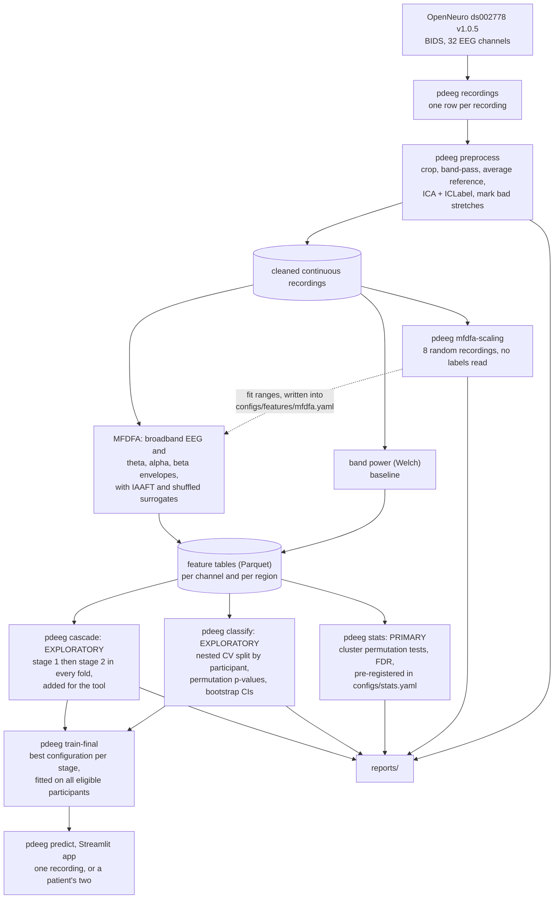

# pdeeg: multifractal EEG analysis for Parkinson's disease research

> **Research code, not a diagnostic tool.** Nothing in this repository is validated for deciding
> whether a person has Parkinson's disease or whether a patient is on medication, and it must not
> be used that way. That includes the two-stage tool below. See [Limitations](#limitations) and
> [MODEL_CARD.md](MODEL_CARD.md).

## Overview

`pdeeg` asks whether the temporal structure of resting-state EEG differs between people with
Parkinson's disease (PD) and healthy controls (HC), and, within patients, between sessions off and
on medication. The main features come from multifractal detrended fluctuation analysis (MFDFA) of
the EEG and of its theta, alpha and beta amplitude envelopes, each judged against surrogate data.
Spectral band power is the baseline. The primary analysis is a set of pre-registered,
cluster-based permutation tests between groups. Classification is secondary and exploratory, and
every one of its splits is made by participant.

On top of the analysis sits a **two-stage research tool** for a single recording: stage 1 asks
whether it is a patient's or a control's, and stage 2, for a patient, whether they were OFF or ON
medication. It is a demonstration of what these features can and cannot do on this dataset, with
each answer shown next to how well that stage did in cross-validation.

**Status.** Every step has been run on ds002778 version 1.0.5. No pre-registered group difference
survived the false discovery rate correction (smallest q = 0.471 in both contrasts). The
exploratory classifiers are uncertain. The two-stage cascade was not shown to beat chance on its
three classes: its macro balanced accuracy was 0.47 [0.32, 0.61],
and that interval includes chance (0.33). Of its two stages, only OFF against ON beat
chance ([Results](#results)).

Everything is one Python package, `pdeeg`, with a command for every step, every setting in YAML
files under `configs/`, generated reports in `reports/`, and a Streamlit application for single
recordings.

## Research objectives

1. **Group differences (primary).** Test, with pre-registered cluster-based permutation tests,
   whether multifractal (MFDFA) features of resting-state EEG differ between patients off
   medication and healthy controls.
2. **Medication (primary).** Test the same features within patients, between their off- and
   on-medication sessions.
3. **Baseline.** Compare them with spectral band power, the standard description of resting EEG.
4. **Classification (exploratory).** Estimate how well the features tell groups and sessions
   apart when every evaluation is split by participant, with intervals and permutation tests.
5. **Demonstration.** Show, through a two-stage research tool and its application, what these
   features can and cannot say about a single recording.

## Key features

- **A reproducible pipeline.** One command per step, or `pdeeg all` for the whole analysis. Each
  step records its settings, inputs and outputs, and is skipped while they are unchanged.
- **Every parameter in YAML,** with the reason for its value written next to it.
- **Continuous preprocessing** with ICA and ICLabel. Bad stretches are marked rather than cut
  out, because MFDFA needs unbroken data.
- **MFDFA** of the broadband EEG and of its theta, alpha and beta amplitude envelopes. The fit
  ranges come from a label-blind scaling inspection, and the spectrum widths are compared with
  IAAFT and shuffled surrogates.
- **Pre-registered group statistics:** cluster-based permutation tests over channels, with
  Benjamini-Hochberg correction across the primary family.
- **Leakage-guarded classification:** nested cross-validation grouped by participant, a splitter
  that raises an error if one participant is on both sides of a split, permutation p-values over
  the whole nested procedure, and bootstrap confidence intervals.
- **A two-stage research tool** (`pdeeg train-final`, `pdeeg predict`) with Platt-scaled
  probabilities, an uncertain band per stage, and each answer shown next to that stage's
  cross-validated performance.
- **A Streamlit application:** one page that checks an upload, shows the processing steps, the
  verdict, how much to trust it and four graphs of the signal, and a research view with every
  check, figure and number.
- **Reports and tracking:** Markdown reports with figures in `reports/`, Parquet feature tables,
  joblib models, and an MLflow run for every evaluation and final model.
- **Tests and packaging:** pytest on synthetic data (leakage across participants, the input
  checks, the app's upload-to-prediction flow), Ruff, GitHub Actions CI and a Docker image.

## Technology stack

| Area | Tools |
|---|---|
| Language and packaging | Python 3.11 or 3.12; the `pdeeg` package and its command-line interface (`pyproject.toml`, hatchling) |
| EEG data and processing | MNE-Python, MNE-BIDS, mne-icalabel (with ONNX Runtime), openneuro-py |
| Numerical computing and data | NumPy, SciPy, pandas, PyArrow (Parquet), PyYAML |
| Machine learning | scikit-learn, joblib |
| Experiment tracking | MLflow |
| Figures | Matplotlib in the reports; Altair (Vega-Lite) in the app |
| Application | Streamlit; edfio writes the app's sample recording |
| Development | pytest, Ruff, the PyPI `MFDFA` package (an independent check of the MFDFA code), GitHub Actions, Docker, Make |

Exact versions are pinned in [`pyproject.toml`](pyproject.toml).

## Dataset and data sources

[OpenNeuro ds002778](https://openneuro.org/datasets/ds002778/versions/1.0.5), version 1.0.5:
*UC San Diego Resting State EEG Data from Patients with Parkinson's Disease*, by Alexander P.
Rockhill, Nicko Jackson, Jobi George, Adam Aron and Nicole C. Swann
(doi:10.18112/openneuro.ds002778.v1.0.5, licence CC0). It has 16 controls with one session each
and 15 patients with an off- and an on-medication session: 46 recordings with 32 scalp channels at
512 Hz. The data is not tracked in git. `pdeeg download` fetches it into `data/raw/ds002778/`.

The dataset's README (`data/raw/ds002778/README`) makes three requests of anyone using it:

- **Contact the curators before submitting a manuscript.** The address is in that README.
- **Do not classify patients against controls and present it as a finding.** With this few
  patients, a proper test split holds fewer than 8 of them, and the curators "strongly advise
  against using any such approach because it would mislead patients". For that reason the group
  statistics are this project's primary result, and the classification and the tool built on it
  are exploratory.
- **Cite the papers it lists.** They are reproduced under
  [Citations requested by the dataset](#citations-requested-by-the-dataset). The dataset README
  also notes that the UPDRS ratings were collected by trained laboratory staff rather than a
  board-certified neurologist. This project does not use them.

No other data are used: the models are trained, and every result below is computed, on
ds002778 alone.

## Analysis pipeline



The full methods, including how every parameter was chosen, are in
[`reports/methods.md`](reports/methods.md).

## EEG preprocessing workflow

`pdeeg preprocess`, with the settings of
[`configs/preprocessing.yaml`](configs/preprocessing.yaml). Each recording is kept continuous,
because MFDFA needs unbroken data:

1. **Crop** to 180 s from trigger `1`, or from the file start where it is missing.
2. **Line noise.** The mains frequency (50 or 60 Hz) is estimated from each recording's spectrum
   and logged next to the sidecar value.
3. **Band-pass** with a zero-phase FIR filter, 0.5 to 50 Hz.
4. **Re-reference** to the average of the 32 channels, since BioSemi recordings are
   reference-free.
5. **ICA.** Extended infomax is fitted on a 1 to 100 Hz copy, notched at the configured mains
   frequency, and applied to the 0.5 to 50 Hz data. ICLabel removes components it calls eye
   blink, muscle, heart or line noise with probability at least 0.8.
6. **Mark bad stretches.** A one-second window is bad when any channel's peak-to-peak amplitude
   in it is above 150 µV or below 1 µV. Bad stretches are marked, not cut out: every feature is
   computed with all windows (`full`) and without the windows that touch a bad stretch (`clean`).
7. **Quality control.** [`reports/qc_preprocessing.md`](reports/qc_preprocessing.md) flags a
   recording with more than 10 % of its time marked bad, no clean stretch of 60 s, or a signal
   metric more than 3 robust standard deviations from the median. A flag is a reason to look,
   not an exclusion.

## Feature extraction

### Band power (baseline)

Welch spectra with 2 s Hann segments overlapping by half, from 1 to 48 Hz
([`configs/features/psd.yaml`](configs/features/psd.yaml)). Each band's power is divided by the
total power from 1 to 48 Hz, and its log10 is taken. The bands are contiguous: delta 1 to 4,
theta 4 to 8, alpha 8 to 13, beta 13 to 30 and gamma 30 to 48 Hz.

### Multifractal detrended fluctuation analysis (MFDFA)

MFDFA measures how the fluctuations of a signal grow with the time scale, separately for small
and large fluctuations (negative and positive moment orders q). The slope h(q) is the
generalised Hurst exponent; how much it changes with q, summarised by the singularity spectrum
f(alpha), says how multifractal the signal is. Settings are in
[`configs/features/mfdfa.yaml`](configs/features/mfdfa.yaml).

- **Series.** The cleaned EEG ("broadband") and its amplitude envelopes in theta (4 to 8 Hz),
  alpha (8 to 13 Hz) and beta (13 to 30 Hz), from the Hilbert transform after a band-pass.
- **Settings.** q from -5 to 5 in steps of 0.5, detrending order 1 and 12 log-spaced scales per
  fit range.
- **Fit ranges.** 0.045 to 0.09 s and 0.3 to 1 s for the broadband EEG, and 2 to 17.8 s for the
  envelopes. They were read from a [scaling inspection](reports/mfdfa_scaling.md) of 8
  recordings chosen at random, with no subject, session or group label loaded.
- **Features.** Five per series and fit range. On the shorter broadband range only `h2` is used,
  because there filtered noise is as wide as the EEG:

  | Feature | Definition |
  |---|---|
  | `h2` | h(2), the Hurst exponent of ordinary DFA |
  | `delta_h` | h(q_min) - h(q_max) |
  | `delta_alpha` | Width of the spectrum, max(alpha) - min(alpha) |
  | `alpha0` | The alpha at which f(alpha) peaks |
  | `asymmetry` | (left - right) / (left + right), with left = alpha0 - min(alpha) and right = max(alpha) - alpha0 |

- **Surrogates.** The spectrum width of every channel is compared with 20 IAAFT and 20 shuffled
  surrogates ([`reports/qc_mfdfa.md`](reports/qc_mfdfa.md)). No model feature uses them.
- **Validation.** The implementation (`pdeeg.features.mfdfa`) is checked on synthetic signals with
  known exponents and against the PyPI `MFDFA` package, in
  [`notebooks/01_mfdfa_validation.ipynb`](notebooks/01_mfdfa_validation.ipynb) and the tests.

### Feature tables

Features are written as Parquet tables, per channel and per scalp region. The group statistics
use one value per channel. The classifiers use the means over 5 scalp regions (frontal, central,
temporal, parietal, occipital; [`configs/data.yaml`](configs/data.yaml)) of the `clean` values:
25 band-power features, 105 MFDFA features, and 130 for both.

## Statistical analysis and machine learning

### Group statistics (primary)

The statistics were fixed in [`configs/stats.yaml`](configs/stats.yaml) before any feature was
compared between groups. The three primary features are the beta-envelope `h2` and
`delta_alpha` and the broadband `delta_alpha` on the 0.3 to 1 s range. They are tested PD OFF
against HC (also adjusted for age and sex) and OFF against ON within patients, with cluster-based
permutation tests over channels (10000 permutations, cluster-forming p 0.05) and
Benjamini-Hochberg across the family.

### Classification

`pdeeg classify` evaluates four tasks, listed under
[Pre-registered and added analyses](#pre-registered-and-added-analyses), with 9 feature set and
model combinations each: band power, MFDFA and both, each with logistic regression, a linear SVM
and gradient boosting. Age and sex alone are classified as a confound baseline. The settings were
fixed in [`configs/model.yaml`](configs/model.yaml) before any classifier was run, and the
evaluation is described under [Model evaluation methodology](#model-evaluation-methodology).

### The cascade

`pdeeg cascade` runs stage 1 and stage 2 together in every outer fold, each tuned and fitted on
the training participants only, and calls every held-out recording HC, PD_OFF or PD_ON. Both
stages use band power and MFDFA with logistic regression, a configuration fixed before any
result.

### Final models for the tool

`pdeeg train-final` fits the models that `pdeeg predict` and the app use. It needs current
results of `pdeeg classify` and `pdeeg cascade`. For every stage it takes the feature set and model
with the best cross-validated balanced accuracy of that stage's task. That choice is written into
`final:` in `configs/model.yaml` first, and `train-final` refuses any other.
The chosen model is tuned by the grouped inner loop on all eligible participants, fitted on all of
them, and given Platt scaling fitted on grouped inner folds. `train-final` also works out each
stage's uncertain band from its out-of-fold probabilities, and saves nothing until
`configs/predict.yaml` holds exactly those bands.

Each stage goes to `models/<stage>/`, which git ignores:

- `model.joblib`, the fitted scikit-learn pipeline (scaling, model, Platt scaling);
- `feature_columns.json`;
- `oof_predictions.parquet`, the out-of-fold predictions;
- `metadata.json`, which holds the configuration digests, the dataset version, the git commit,
  the library versions, the cross-validated metrics with their intervals, the thresholds and a
  model card.

## Model evaluation methodology

- **The participant is the unit.** PD against HC uses one recording per participant. Stage 1 of
  the tool uses both of a patient's recordings, weighted 0.5 each so that every participant counts
  once, and keeps them on the same side of every split. OFF against ON centres each patient's
  features on the mean of their own two recordings, so the question is which of a patient's two
  recordings is OFF. Its single-recording version classifies each recording on its own.
- **Nested cross-validation.** The outer loop is stratified 5-fold, grouped by participant. The
  inner loop is a grouped, stratified 3-fold grid search over one `Pipeline` of scaling,
  (channel-level) feature selection and model, so every fitted step sees training folds only.
- **Guarded.** A wrapped splitter raises `LeakageError` if any outer or inner split puts one
  participant on both sides, and [`tests/test_leakage.py`](tests/test_leakage.py) checks every
  splitter of every task, and of both stages of the cascade.
- **Uncertainty is reported.** Balanced accuracy, ROC AUC, sensitivity and specificity come with
  95 % bootstrap intervals over participants (2000 resamples). The permutation p-values come from
  1000 permutations that each repeat the whole nested procedure, with labels permuted within
  patients for OFF against ON. The spread over 10 other outer splits shows how much the split
  alone moves the score.
- **A confound baseline.** Age and sex alone are classified as a feature set of their own.
- **Calibration.** The cascade's out-of-fold probabilities are checked with the Brier score,
  calibration in the large and the calibration slope, against a rule fixed before any classifier
  was run.
- **Better than chance.** A stage counts as better than chance only when the q-value of its
  balanced accuracy is below 0.05 and the whole 95 % interval is above 0.5
  ([`configs/predict.yaml`](configs/predict.yaml)).
- **An audit threshold.** A rule fixed in advance calls for a leakage and confound audit of any
  balanced accuracy above 0.85, and holds the result back until the audit is written in the
  report.

### Pre-registered and added analyses

Two dates matter. The group statistics and the first two classification tasks were written down on
2026-10-23, before any group was compared and before any classifier was run. Everything the
two-stage tool needs was added on 2026-10-26, after that pre-registration. The new tasks and the
cascade were added before any classifier had been run on the data. The choices that depend on
results were made by rules written down with them, and the configuration files say for each one
what had been seen when it was fixed.

| Analysis | Status | What it is |
|---|---|---|
| Group statistics ([`configs/stats.yaml`](configs/stats.yaml)) | **Pre-registered**, primary | Cluster permutation tests of 3 primary features, PD OFF against HC and OFF against ON |
| `pd_vs_hc` | **Pre-registered**, exploratory | PD OFF against HC, one recording per participant |
| `off_vs_on` | **Pre-registered**, exploratory | Which of a patient's two recordings is OFF; the tool's paired mode |
| `pd_any_vs_hc` | **Added for the tool** | Stage 1: a patient's recording (OFF or ON) or a control's, both of a patient's recordings weighted to count once |
| `off_vs_on_single` | **Added for the tool** | Stage 2: OFF or ON from one recording on its own |
| The cascade (`pdeeg cascade`) | **Added for the tool** | Stage 1 then stage 2 in every outer fold; three classes |
| Final configurations, uncertain bands, "better than chance" | **Added for the tool**, after the classification results | Fixed by rules in [`configs/model.yaml`](configs/model.yaml) and [`configs/predict.yaml`](configs/predict.yaml); see [The final models](#the-final-models) |

## Results

### Data quality

All 46 recordings were cleaned. Of these, 9 are flagged for a closer look in
[`reports/qc_preprocessing.md`](reports/qc_preprocessing.md). A flag is a reason to look, not an
exclusion. Two findings shaped the analysis:

- **Two on-medication sessions were already filtered.** In `sub-pd6` and `sub-pd16` `ses-on`,
  power below 0.5 Hz before filtering is -29 and -27 dB relative to 1-4 Hz (robust z -16.9 and
  -16.3). The QC found this from the signals alone; `participants.tsv` confirms that both sessions
  were exported from preprocessed EEGLAB data. Both are left out of the main OFF against ON
  analyses.
- **Mains is 60 Hz.** A 60 Hz peak is present in 37 recordings and no mains peak in 9, but 9 of
  the sidecar files say 50 Hz. The pipeline takes 60 Hz from the configuration.


### Where the EEG scales

Before any exponent was fitted, the fluctuation functions of 8 recordings, picked at random and
shown only as R1 to R8, were compared with noise put through the same filters
([`reports/mfdfa_scaling.md`](reports/mfdfa_scaling.md)). This sets the fit ranges. It is not a
comparison between groups. Over each chosen range, as median [10th, 90th percentile] over 256
channel fits (EEG) or 40 noise realisations:

| Series | Fit range | Source | h(2) | delta_alpha |
|---|---|---|---|---|
| Broadband | 0.045 to 0.09 s | EEG | 1.13 [0.96, 1.34] | 1.07 [0.57, 1.85] |
| | | filtered 1/f noise | 1.04 [1.02, 1.05] | 1.08 [0.77, 1.71] |
| Broadband | 0.3 to 1 s | EEG | 0.99 [0.13, 1.18] | 0.32 [0.11, 0.66] |
| | | filtered 1/f noise | 0.97 [0.94, 1.00] | 0.12 [0.07, 0.28] |
| Theta envelope | 2 to 17.8 s | EEG | 0.70 [0.56, 0.85] | 0.35 [0.15, 0.63] |
| | | white-noise envelope | 0.54 [0.48, 0.61] | 0.19 [0.08, 0.35] |
| Alpha envelope | 2 to 17.8 s | EEG | 0.74 [0.60, 0.88] | 0.35 [0.18, 0.67] |
| | | white-noise envelope | 0.53 [0.47, 0.59] | 0.17 [0.07, 0.26] |
| Beta envelope | 2 to 17.8 s | EEG | 0.69 [0.59, 0.87] | 0.23 [0.09, 0.55] |
| | | white-noise envelope | 0.52 [0.46, 0.58] | 0.13 [0.05, 0.27] |

- The broadband EEG has no single scaling regime. The band-pass and the alpha rhythm leave two
  short ranges. On the shorter one, filtered monofractal noise is as wide as the EEG (1.07 against
  1.08), so the width there belongs to the filter, and only `h2` from that range is used.
- On the 0.3 to 1 s range and in every band envelope, the median EEG spectrum is wider than that
  of the matched noise. The envelopes also have a higher `h2` (0.70, 0.74 and 0.69 against 0.54,
  0.53 and 0.52), so the band
  amplitudes are correlated over seconds beyond what the filter alone produces.


### Group differences (primary)

From [`reports/stats_results.md`](reports/stats_results.md). **No pre-registered feature showed a
difference that survived the false discovery rate correction**, in either contrast. The smallest
q was 0.471 for PD OFF against HC, and 0.471 for OFF against ON within
13 patients. The analysis adjusted for age and sex, and the one with all 15 pairs, gave the
same answer. Of the 23 exploratory features, 0 survived the correction
within their family in PD OFF against HC, and 0 in OFF against ON. Neither age
nor sex differed between the groups at p < 0.05 (PD OFF: age 63.3 ± 8.2, 7 m / 8 f; HC: age 63.5 ±
9.7, 7 m / 9 f).

The absence of a significant cluster does not show that the groups are alike. With 15 and 16
people a single test has 80 % power only for differences of about g = 1.04 or more, and
with 13 pairs for d_z = 0.85 or more.

| Feature | Analysis | Best cluster | Its p | Its q |
|---|---|---|---|---|
| h2, beta envelope | PD OFF vs HC | no cluster | - | 1.000 |
| h2, beta envelope | PD OFF vs HC, adjusted for age and sex | no cluster | - | 1.000 |
| h2, beta envelope | PD OFF vs PD ON, 13 pairs | PD OFF < PD ON (FC5) | 0.411 | 0.707 |
| h2, beta envelope | PD OFF vs PD ON, all 15 pairs | PD OFF < PD ON (O2, P8) | 0.168 | 0.449 |
| delta_alpha, beta envelope | PD OFF vs HC | PD OFF < HC (CP6, T8) | 0.086 | 0.471 |
| delta_alpha, beta envelope | PD OFF vs HC, adjusted for age and sex | PD OFF < HC (P4, CP6, T8) | 0.045 | 0.353 |
| delta_alpha, beta envelope | PD OFF vs PD ON, 13 pairs | PD OFF > PD ON (O1, Oz) | 0.064 | 0.471 |
| delta_alpha, beta envelope | PD OFF vs PD ON, all 15 pairs | PD OFF > PD ON (O1, Oz, O2) | 0.045 | 0.343 |
| delta_alpha, broadband EEG, long range | PD OFF vs HC | PD OFF > HC (AF3) | 0.611 | 0.707 |
| delta_alpha, broadband EEG, long range | PD OFF vs HC, adjusted for age and sex | PD OFF > HC (Cz) | 0.537 | 0.665 |
| delta_alpha, broadband EEG, long range | PD OFF vs PD ON, 13 pairs | PD OFF > PD ON (P7) | 0.216 | 0.707 |
| delta_alpha, broadband EEG, long range | PD OFF vs PD ON, all 15 pairs | PD OFF > PD ON (FC6) | 0.553 | 0.735 |


### Classification (exploratory)

From [`reports/classification_results.md`](reports/classification_results.md). There are 9 feature
set and model combinations per task (band power, MFDFA and both, each with logistic regression, a
linear SVM and gradient boosting), plus age and sex alone as a baseline. Every split is by
participant, and the p-values come from 1000 permutations of the whole nested procedure.

The middle column is one configuration fixed before any result, the cascade's. The right column
is the best of the 9 combinations. Being picked on the same predictions it is scored on, the best
one flatters itself, so its q-value is the number to read.

| Task | Status | Participants | Band power + MFDFA, logistic regression (fixed in advance): BA [95 % CI], p, q | Best of 9: BA [95 % CI], p, q | p < 0.05 before / after correction |
|---|---|---|---|---|---|
| PD OFF vs HC (`pd_vs_hc`) | pre-registered | 31 | 0.61 [0.43, 0.78], p 0.123, q 0.295 | MFDFA, logistic regression: 0.71 [0.55, 0.86], p 0.025, q 0.295 | 1 / 0 |
| PD OFF vs PD ON, within patients (`off_vs_on`) | pre-registered | 13 | 0.62 [0.38, 0.85], p 0.234, q 0.263 | band power, logistic regression: above 0.85, held back for the audit | 2 / 0 |
| PD OFF / PD ON vs HC (`pd_any_vs_hc`) | added for the tool | 31 | 0.68 [0.52, 0.83], p 0.044, q 0.176 | band power + MFDFA, linear SVM: 0.71 [0.55, 0.85], p 0.020, q 0.176 | 3 / 0 |
| PD OFF vs PD ON, single recordings (`off_vs_on_single`) | added for the tool | 13 | 0.62 [0.46, 0.77], p 0.148, q 0.266 | band power, logistic regression: 0.77 [0.65, 0.92], p < 0.001, q 0.009 | 1 / 1 |

- The last column counts the combinations with p < 0.05, before and after Benjamini-Hochberg
  within the task. After correction, the only combination left was band power with logistic
  regression for PD OFF vs PD ON, single recordings (q 0.009).
- For PD OFF vs PD ON, within patients, band power with logistic regression scored a balanced
  accuracy above 0.85. A rule fixed in advance calls for a leakage and confound audit of any result
  above 0.85, and holds it back as a result until the audit is written in the report. The audit has
  not been written yet, so that score is not reported here.
- Age and sex alone reached 0.58 [0.40,
  0.76] for PD OFF against HC, and 0.51
  [0.35, 0.70] for stage 1's task.

### The two-stage cascade (exploratory)

From [`reports/cascade_results.md`](reports/cascade_results.md). The cascade uses band power and
MFDFA (130 features) with logistic regression for both stages, a configuration
fixed before any result. It covers 31 participants and 44 recordings: HC 16,
PD_OFF 15 and PD_ON 13. The ON sessions of `sub-pd6` and `sub-pd16` are left out.
Intervals are 95 % bootstrap intervals over participants. The p-values come from 1000 relabellings
of participants, each run through the whole cascade.

**Three classes.** Rows are the true class, columns the cascade's call:

| True class \ called | HC | PD_OFF | PD_ON | Sensitivity [95 % CI] |
|---|---|---|---|---|
| HC | 9 | 3 | 4 | 0.56 [0.31, 0.80] |
| PD_OFF | 6 | 7 | 2 | 0.47 [0.21, 0.74] |
| PD_ON | 5 | 3 | 5 | 0.38 [0.12, 0.67] |

Macro balanced accuracy, the mean of the three sensitivities, was 0.47 [0.32,
0.61], with p = 0.035 against chance at 0.33. The p-value is below
0.05, but the interval includes chance, so the cascade is **not shown to beat chance**.

**Each stage inside the cascade.** Stage 2 is scored on the true patients' recordings, whatever
stage 1 said:

| Stage | Balanced accuracy [95 % CI] | p | ROC AUC [95 % CI] | p (AUC) | Null 95th percentile (BA) |
|---|---|---|---|---|---|
| Stage 1: PD OFF / PD ON vs HC | 0.58 [0.40, 0.74] | 0.163 | 0.57 [0.37, 0.76] | 0.226 | 0.66 |
| Stage 2: PD OFF vs PD ON, single recordings (true patients) | 0.71 [0.58, 0.84] | 0.031 | 0.72 [0.52, 0.89] | 0.050 | 0.68 |

Stage 1 did not beat chance. Stage 2 did (p = 0.031, interval clear of 0.5). Of the
patients' recordings, 39 % were called controls' by stage 1, 18 %
were called patients' in the wrong state, and 43 % were called right. Of the controls'
recordings, 44 % were called patients'.

**Calibration.** Out-of-fold probabilities were checked against a rule fixed before any classifier
was run: a stage is poorly calibrated if its Brier score is not below that of predicting the
prevalence, or the interval of its calibration slope leaves out 1, or that of calibration in the
large leaves out 0.

| Stage | Probabilities | Brier | Brier of the prevalence | Brier skill | Calibration in the large | Calibration slope | Rule |
|---|---|---|---|---|---|---|---|
| Stage 1 | raw | 0.277 [0.203, 0.355] | 0.250 | -0.111 [-0.542, 0.158] | -0.207 [-1.184, 0.709] | 0.125 [-0.527, 1.032] | Brier score not below that of predicting the prevalence |
| Stage 1 | Platt | 0.240 [0.191, 0.292] | 0.250 | 0.040 [-0.272, 0.218] | -0.079 [-0.902, 0.720] | 0.683 [-0.424, 1.849] | well calibrated |
| Stage 2 | raw | 0.211 [0.156, 0.267] | 0.249 | 0.152 [-0.076, 0.370] | 0.007 [-0.319, 0.349] | 0.972 [0.048, 3.235] | well calibrated |
| Stage 2 | Platt | 0.260 [0.229, 0.288] | 0.249 | -0.044 [-0.162, 0.078] | -0.096 [-0.508, 0.335] | 0.256 [-0.420, 1.196] | Brier score not below that of predicting the prevalence |

By that rule, stage 1's raw probabilities were poorly calibrated (Brier score not below that of
predicting the prevalence) and its Platt-scaled ones well calibrated. Stage 2's raw probabilities
were well calibrated and its Platt-scaled ones poorly calibrated (Brier score not below that of
predicting the prevalence). The cascade's three-class Brier score was 0.695 with raw
probabilities and 0.687 with Platt-scaled ones, against 0.664 for
predicting the class shares for everyone. Its three-class probabilities are therefore no better
than knowing the class shares.


### The final models

These are the models `pdeeg predict` and the app use. Each is the best combination of its stage's
task, refitted on all eligible participants. The numbers are those of that combination in the
classification ablation, so they are optimistic. The rule in `configs/predict.yaml` decides
whether a stage counts as better than chance; the app says when one is not, and the research
view greys it out. That
rule was fixed after the p- and q-values of the two pre-registered tasks had been seen, and before
any result of the two added tasks.

| Stage | Task | Configuration | Balanced accuracy [95 % CI] | p | q | Better than chance? | Uncertain band | In the cascade (fixed configuration) |
|---|---|---|---|---|---|---|---|---|
| Stage 1 | `pd_any_vs_hc` | band power + MFDFA, linear SVM | 0.71 [0.55, 0.85] | 0.020 | 0.176 | **no**: the app says so | no label from 0.305 to 0.68 | 0.58 [0.40, 0.74], p 0.163 |
| Stage 2, one recording | `off_vs_on_single` | band power, logistic regression | 0.77 [0.65, 0.92] | < 0.001 | 0.009 | yes | 0 to 1: never gives a label | 0.71 [0.58, 0.84], p 0.031 |
| Stage 2, paired | `off_vs_on` | band power, logistic regression | held back for the audit (above 0.85) | - | - | **no**: the app says so | none (labels every input; 0.5 itself is uncertain) | not part of the cascade |

- **Stage 1** is not better than chance by the rule (q = 0.176 is not below 0.05), and the app says
  so. Its raw p-value is 0.020, but it was picked as the best of 9.
- **Stage 2, one recording** is better than chance by the rule (q = 0.009 is below 0.05, and [0.65,
  0.92] is above 0.5). Even so, its out-of-fold probabilities never backed a label, so its uncertain
  band is the whole range from 0 to 1, and it calls every recording uncertain.
- **Stage 2, paired** is not better than chance by the rule, and the app says so. Its
  configuration is the one flagged for the audit, so its scores are not reported here. Its two
  probabilities of a pair always sum to 1, so the band rule only asks whether its recalibration
  slope is positive, and it gives no band.

## Application interface and usage

### Using the two-stage tool

> **Research demo, not a diagnostic tool.** Trained on 31 people from one dataset
> (OpenNeuro ds002778) and not validated on any other recording.

A recording goes through two stages. **Stage 1** gives the probability that it is a patient's
recording rather than a control's. Only if stage 1 calls it a patient's, outside its uncertain
band, does **stage 2** give the probability that the patient was OFF medication rather than ON.
With two recordings of the same patient, a **paired** model says which of the two is the OFF one.

#### From the command line

```bash
pdeeg predict recording.bdf                        # one recording
pdeeg predict first.bdf --paired second.bdf        # two recordings of the same patient
make predict FILE=recording.bdf [PAIRED=second.bdf]
```

A file can be a `.bdf` or `.edf` file, or the EEG file of a BIDS dataset. `--out-dir` sets where
the results and the work files go (default `predictions/`), and `--n-jobs` sets the processes used
for the MFDFA. The result is written as `<name>_prediction.json` and as a readable
`<name>_prediction.txt`, which is also printed.

#### The web app

Started with `make app` (see [The application](#the-application)), it opens at
http://localhost:8501. The page is served on this machine only, because the uploads are people's
EEG.


The app (`app/streamlit_app.py`) is one page, read from top to bottom:

1. **Upload** a `.bdf` or `.edf` recording, or both of one patient's OFF and ON recordings together
   (then tick "these are one patient's two recordings"). **Try a sample recording** makes up a
   signal (`pdeeg.demo.synthetic_recording`) and says that its result means nothing;
   `configs/app.yaml` can name a ds002778 recording instead.
2. **Input check**: channels, sampling rate, length and signal level, in plain words. A file that
   fails one gets what is wrong and how to fix it, and nothing else is done with it.
3. **Processing**: checking, cleaning the signal, measuring the brain-wave patterns, running the
   model, each step shown as `pdeeg predict` reaches it. A file is analysed once and kept by its
   digest, so the page never cleans it again.
4. **The verdict** of stage 1: Parkinson's pattern detected, not detected, or inconclusive (inside
   the uncertain band), with a gauge of the score, the cut-off and the band, and one line on how
   much to trust it, read from the stage's cross-validation. A stage that is not better than chance
   says so, and a score above the audit threshold is not given.
5. **Medication**, only after "detected": stage 2's call (OFF, ON or inconclusive; on one
   recording it is always inconclusive, see [the final models](#the-final-models)), or, for a pair,
   which recording looks like the OFF-medication one.
6. **What we saw in the signal**: a few seconds of the cleaned EEG from one channel per scalp region;
   the band power and the singularity spectrum f(α) of the recording over the ranges of the healthy
   and the Parkinson's group (mean ± 1 SD over people, from the training feature tables); and the
   features that moved stage 1 most, in plain words (`app/restwave/plain.py`).
7. **Report**: the whole analysis as one printable HTML file (print it to PDF from the browser).

A recording of ds002778 gets its out-of-fold result and its true group, never a prediction on
training data. The page calls the same library function as `pdeeg predict` and has no model code of
its own; its display settings are in `configs/app.yaml`.

#### The research view

The research view (NeuroLab, `app/research_app.py`) has every check, figure and number behind the
page. `make research` serves it at http://localhost:8502, where the page's footer links to. Its
eight pages: **Overview** (upload, paired mode, the pipeline's state); **Recording Analysis** (every
input check, the processing timeline, what the cleaning did); **EEG Signal Quality** (the window
before and after cleaning, the spectrum, each channel's amplitude and bad time); **Multifractal
Analysis** (fluctuation functions, h(q) and f(α) of any channel and series, scalp maps, the feature
table); **Scalp Topography**; **Model Evaluation** (each stage's score against the out-of-fold
scores, its uncertain band, its cross-validated balanced accuracy with interval, chance and
permutation p; a stage that is not better than chance is greyed out); **Research Report** (HTML, and
the JSON and text of `pdeeg predict`); and **About & Methodology**.

### What an input must be

Every input is checked before anything else is done with it. The limits come from
[`configs/predict.yaml`](configs/predict.yaml) and
[`configs/preprocessing.yaml`](configs/preprocessing.yaml).

| Check | Requirement | Otherwise |
|---|---|---|
| File | A `.bdf` or `.edf` file, or the EEG file of a BIDS dataset | Refused |
| Channels | All 32 channels of the biosemi32 cap. Names are compared ignoring case, an "EEG " prefix and a reference suffix such as "-REF"; the old names T3, T4, T5 and T6 are read as T7, T8, P7 and P8. Other EEG channels are left out, with a note | Refused, naming the missing channels |
| Sampling rate | 512 Hz, as in training | Resampled to 512 Hz, with a note; the models never saw resampled data |
| Duration | At least 180 s from trigger `1`, or from the file start (with a note) when there is no such trigger | Refused |
| Amplitude | Median channel standard deviation after a 1 to 40 Hz band-pass between 0.1 and 1000 µV | Refused: the units are probably wrong |

The recording is then cleaned, and its MFDFA and band power computed, by the training pipeline's
own code with the training settings. The models refuse to run if those settings have changed since
they were trained. The one difference from training is that no MFDFA surrogates are computed, as
no model feature uses them. A test checks, on a ds002778 recording, that the features come out as
in the training tables.

### What a result says

- **A probability per stage.** It is Platt-scaled, and a stage calls the positive class at 0.5 or
  more. Inside the stage's uncertain band it gives no label, and says "uncertain".
- **How the stage did in cross-validation.** This means the balanced accuracy with its 95 %
  interval, the permutation p-value, and the q-value adjusted for having picked the best of 9
  combinations. A stage counts as better than chance only when q is below 0.05 and the whole
  interval is above 0.5.
- **The features that moved the prediction most.** For a linear model, this is each feature's
  coefficient times its standardised value.
- **Recordings of ds002778 itself get no new prediction.** The final models were trained on them,
  so a recording is recognised by its BIDS subject and session, by the SHA-256 of its file, or by a
  hash of its signal. What it gets instead is its out-of-fold prediction from cross-validation,
  made by models that never saw that participant, with an explanation.

## Installation and setup

Requires Python 3.11 or 3.12. The dataset is not tracked in git; `pdeeg download` fetches it.

```bash
python -m venv .venv
source .venv/bin/activate       # Windows: .venv\Scripts\activate
pip install -e ".[dev]"         # the pipeline and its tests (or: make install)
pip install -e ".[dev,app]"     # the same, with the Streamlit app (or: make install-app)
pytest -m "not dataset"         # synthetic data only, nothing is downloaded
```

With Docker, the image runs every command on a mounted `data/` directory:

```bash
docker build -t pdeeg .         # or: make docker-build
make docker-run                 # the whole pipeline on ./data
```

## Running the project

### The analysis

```bash
pdeeg all                       # download -> preprocess -> features -> stats -> classify -> cascade
pdeeg train-final               # the final models of the two-stage tool, into models/
```

`pdeeg all` skips every step whose settings, inputs and outputs are unchanged, so it is safe to
re-run. Preprocessing and the MFDFA surrogates take hours. Each step is also its own command:

| Command | Does |
|---|---|
| `pdeeg download`, `pdeeg recordings` | Fetch and verify the dataset; index its recordings |
| `pdeeg preprocess` | Clean every recording; writes `reports/qc_preprocessing.md` |
| `pdeeg mfdfa-scaling` | Label-blind scaling inspection; writes `reports/mfdfa_scaling.md` |
| `pdeeg features` | Band power, MFDFA with surrogates, and h(q) / f(alpha) curves |
| `pdeeg stats` | Group statistics; writes `reports/stats_results.md` |
| `pdeeg classify` | Classification; writes `reports/classification_results.md`, tracked in MLflow |
| `pdeeg cascade` | The two-stage cascade; writes `reports/cascade_results.md`, tracked in MLflow |
| `pdeeg train-final` | The final model of every stage, into `models/` |
| `pdeeg predict FILE [--paired FILE2]` | One recording, or a patient's two, through the final models |
| `pdeeg report` | Rewrite every report from stored results without recomputing |
| `pdeeg config` | Print the resolved configuration |

`--force` runs a step again even when it is current (`download`, `recordings`, `preprocess`,
`features`, `stats`, `classify`, `cascade` and `all`). `--n-jobs N` sets the processes of the
parallel ones (`preprocess`, `mfdfa-scaling`, `features`, `stats`, `classify`, `cascade` and
`predict`). The same commands are available as `make` targets.

### The application

```bash
pdeeg train-final               # once: the models the app predicts with
make app                        # the app, at http://localhost:8501
make research                   # the research view, at http://localhost:8502
```

Both are served on this machine only. Without trained models the app checks a recording and
then says that the models are missing. The group ranges in its graphs need the feature tables of
`pdeeg features`.

### Configuration

Every setting lives in `configs/`, and nothing is hard-coded in the package:

| File | Covers |
|---|---|
| [`configs/data.yaml`](configs/data.yaml) | Dataset, paths, session labels, scalp regions |
| [`configs/preprocessing.yaml`](configs/preprocessing.yaml) | Crop, filter, reference, ICA, bad-stretch marking, QC limits |
| [`configs/features/mfdfa.yaml`](configs/features/mfdfa.yaml) | Moment orders, detrending, fit ranges and the reasons for them, surrogates |
| [`configs/features/psd.yaml`](configs/features/psd.yaml) | Welch spectrum and band limits |
| [`configs/stats.yaml`](configs/stats.yaml) | Pre-registered primary features, contrasts, cluster tests, FDR, covariates |
| [`configs/model.yaml`](configs/model.yaml) | Tasks, feature sets, model grids, nested CV, permutations, the cascade, the final models |
| [`configs/predict.yaml`](configs/predict.yaml) | Input checks, thresholds, uncertain bands, the "better than chance" rule |
| [`configs/app.yaml`](configs/app.yaml) | The app's display settings: the channels shown, the group ranges, the series of the complexity graph, the sample recording |

## Project structure

```
configs/        YAML configuration: every setting and path
src/pdeeg/      the package: data/, preprocessing/, features/, stats/, models/, predict/, viz/, cli.py
app/            the Streamlit app: streamlit_app.py (the page) and restwave/ (its theme, charts,
                words); research_app.py, views/ and neurolab/ (the research view);
                .streamlit/config.toml
tests/          pytest; synthetic data only, except the tests marked "dataset"
notebooks/      MFDFA validation
reports/        generated reports and figures, and methods.md
scripts/        download_data.py, the same as `pdeeg download --force`
docker/         the Docker image's entrypoint
.github/        CI: lint, tests on synthetic data, and the Docker image
data/           raw/, interim/, processed/ (contents not tracked)
models/         the final models of `pdeeg train-final` (not tracked)
predictions/    the output of `pdeeg predict` (not tracked)
MODEL_CARD.md   the model card of the two-stage tool
```

## Documentation

- [`reports/methods.md`](reports/methods.md): preprocessing, MFDFA, surrogates, statistics, the
  classification protocol, the cascade, the final models and prediction, in full.
- [`MODEL_CARD.md`](MODEL_CARD.md): the final models' intended use, evaluation, metrics,
  limitations and ethical considerations.
- The reports: [`qc_preprocessing.md`](reports/qc_preprocessing.md),
  [`mfdfa_scaling.md`](reports/mfdfa_scaling.md), [`qc_mfdfa.md`](reports/qc_mfdfa.md),
  [`stats_results.md`](reports/stats_results.md),
  [`classification_results.md`](reports/classification_results.md) and
  [`cascade_results.md`](reports/cascade_results.md).
- [`notebooks/01_mfdfa_validation.ipynb`](notebooks/01_mfdfa_validation.ipynb): the MFDFA code
  checked on synthetic signals with known exponents and against the PyPI `MFDFA` package.

## Limitations and ethical considerations

### Limitations

- **31 participants, one site, one EEG system.** There are 15 patients and 16 controls,
  recorded at one site with one BioSemi system (32 channels, 512 Hz). Only large group differences
  are detectable, and every classification estimate has a wide interval. These analyses describe
  this sample. They are not a test that would carry over to new patients.
- **No external test set.** There is one dataset and no held-out cohort. Every number comes from
  cross-validation within it, and how the tool would do on people or equipment from anywhere else
  is unknown.
- **The curators' warning.** The dataset's README warns that with a proper split there would be
  "fewer than 8 patients in the testing set", and its curators "strongly advise against using any
  such approach because it would mislead patients and people who are interested in knowing if they
  have Parkinson's disease". This project's classifiers and tool are exploratory for that reason.
- **Single-recording OFF against ON is weak.** The best single-recording combination scored 0.77
  [0.65, 0.92] (q 0.009), but it was picked as the best of 9. The configuration fixed in advance
  scored 0.62 [0.46, 0.77] (p 0.148), and stage 2 inside the cascade scored 0.71 [0.58, 0.84] (p
  0.031). Over 10 other outer splits the best combination ranged from 0.58 to 0.77. By the band
  rule, none of its out-of-fold probabilities backed a label, so the tool never labels a single
  recording OFF or ON: it always says uncertain.
- **Training on ON-medication data.** Stage 1 learns what a patient's recording looks like from
  OFF and ON sessions together (15 and 13 recordings). The ON recordings carry the
  effects of whatever medication those patients took, at doses and times this project does not
  model, so stage 1 may partly learn the medication rather than the disease. Stage 2's "ON"
  likewise means "as these 13 patients were in their ON session", not any particular drug or
  dose. A new person's medication is unknown to every model.
- **Not diagnostic.** No output of this repository, the tool included, says whether a person has
  Parkinson's disease or is on medication. The models were picked as the best of several on the
  same cross-validation, which makes their scores optimistic. The paired stage's score is held
  back until its audit is written.
- **Short recordings and short scaling ranges.** Each recording gives 180 s. The broadband EEG
  scales only over two short ranges, and on the shorter one the spectrum width is the filter's.
  MFDFA widths are biased upward at finite length, so they are judged against surrogates rather
  than against zero.
- **Filter-induced memory.** Band-passing gives even white noise an envelope `h2` above 0.5 (0.54,
  0.53 and 0.52 for theta, alpha and beta on the fit range). The bias is the same for every
  recording, so it shifts all groups alike, but the absolute envelope exponents should not be read
  as the brain's alone.
- **Two on-medication sessions were processed differently.** `sub-pd6` and `sub-pd16` `ses-on`
  came pre-filtered. They are excluded from the main OFF against ON analyses and from training
  the tool, which reduces the OFF against ON analyses to 13 pairs.
- **Confounds.** Age and sex are adjusted for in a sensitivity analysis and tested as a classifier
  baseline. Cognition, disease duration and medication dose are not modelled.
- **Judgement in the fit ranges.** The ranges were read by eye from 8 recordings. No label was
  seen, but it remains a choice that other analysts could make differently.
- **No leave-one-subject-out.** With a full nested permutation test it would have taken weeks of
  CPU (the timing is in `configs/model.yaml`). A 5-fold estimate depends on the split, which is
  why 10 other splits are reported.
- **Flagged recordings are kept.** The 9 recordings flagged by QC are in the analysis, apart from
  the two sessions above in the paired tests.

### Ethical considerations

- **Not a diagnostic tool.** No output of this repository says whether a person has Parkinson's
  disease or is on medication. Every output of the tool, in the app and from `pdeeg predict`,
  carries that disclaimer.
- **The curators' requests.** The classification of these patients against controls is not
  presented as a finding, and anyone writing a manuscript with the data is asked to contact the
  curators first (see [Dataset and data sources](#dataset-and-data-sources)).
- **Uncertainty is shown, not hidden.** Every answer comes with its stage's cross-validated
  performance. A stage that is not better than chance says so, a score above the audit threshold
  is not given, and a probability inside the uncertain band gets no label.
- **Health data stays local.** The app is served on the local machine only, and handles uploads
  in a temporary directory that is deleted afterwards. `pdeeg predict` writes its work files
  under its output directory (`predictions/` by default), which git ignores.
- **No predictions on training data.** A recording from ds002778 gets its out-of-fold result,
  from models that never saw that participant.
- **Subgroups.** The sample is too small to evaluate any subgroup, by age, sex, disease stage or
  medication.

The model card, [`MODEL_CARD.md`](MODEL_CARD.md), covers intended use, evaluation and these
considerations in full.

## Acknowledgements and references

### Dataset

The dataset was created and shared by Alexander P. Rockhill, Nicko Jackson, Jobi George, Adam
Aron and Nicole C. Swann, and is published on OpenNeuro under CC0.

### Citations requested by the dataset

Reproduced as `data/raw/ds002778/README` gives them:

1. Nicko Jackson, Scott R. Cole, Bradley Voytek, Nicole C. Swann. Characteristics of Waveform Shape
   in Parkinson's Disease Detected with Scalp Electroencephalography. eNeuro 20 May 2019, 6 (3)
   ENEURO.0151-19.2019; DOI: 10.1523/ENEURO.0151-19.2019.
2. Swann NC, de Hemptinne C, Aron AR, Ostrem JL, Knight RT, Starr PA. Elevated synchrony in
   Parkinson disease detected with electroencephalography. Ann Neurol. 2015 Nov;78(5):742-50. doi:
   10.1002/ana.24507. Epub 2015 Sep 2. PMID: 26290353; PMCID: PMC4623949.
3. George JS, Strunk J, Mak-McCully R, Houser M, Poizner H, Aron AR. Dopaminergic therapy in
   Parkinson's disease decreases cortical beta band coherence in the resting state and increases
   cortical beta band power during executive control. Neuroimage Clin. 2013 Aug 8;3:261-70. doi:
   10.1016/j.nicl.2013.07.013. PMID: 24273711; PMCID: PMC3814961.
4. Appelhoff, S., Sanderson, M., Brooks, T., Vliet, M., Quentin, R., Holdgraf, C., Chaumon, M.,
   Mikulan, E., Tavabi, K., Höchenberger, R., Welke, D., Brunner, C., Rockhill, A., Larson, E.,
   Gramfort, A. and Jas, M. (2019). MNE-BIDS: Organizing electrophysiological data into the BIDS
   format and facilitating their analysis. Journal of Open Source Software 4: (1896).
5. Pernet, C. R., Appelhoff, S., Gorgolewski, K. J., Flandin, G., Phillips, C., Delorme, A.,
   Oostenveld, R. (2019). EEG-BIDS, an extension to the brain imaging data structure for
   electroencephalography. Scientific Data, 6, 103. https://doi.org/10.1038/s41597-019-0104-8.

The dataset itself, as `dataset_description.json` describes it: Rockhill, A. P., Jackson, N.,
George, J., Aron, A. and Swann, N. C. *UC San Diego Resting State EEG Data from Patients with
Parkinson's Disease*. OpenNeuro. doi:10.18112/openneuro.ds002778.v1.0.5.

### Software

The pipeline relies on MNE-Python and MNE-BIDS for reading and cleaning the EEG, on mne-icalabel
for labelling its ICA components, on scikit-learn for the models, and on Streamlit for the
application.
MNE-BIDS is cited above, as the dataset asks. The PyPI `MFDFA` package is used only as an
independent check of this repository's MFDFA implementation.

### Repository history

The first commit of this repository (`1ab0029`) holds analysis notebooks by
[Sankhadip Bera](https://github.com/Sankhadip-007)
([`Sankhadip-007/Detecttion-of-Parkinson-s-Disease-using-machine-learning-and-deep-learning`](https://github.com/Sankhadip-007/Detecttion-of-Parkinson-s-Disease-using-machine-learning-and-deep-learning)),
which also used ds002778. They are not part of the current package and remain only in the git
history.

### Licence

This repository has no licence file. The ds002778 data are released under CC0.
