# pdeeg: the complete project guide

> **Research code, not a diagnostic tool.** Nothing in this repository can tell whether a person
> has Parkinson's disease or whether a patient has taken their medication. This guide explains
> why, among many other things.

This guide teaches the whole `pdeeg` project from zero. It assumes no knowledge of neuroscience,
EEG, signal processing, statistics, machine learning or Python tooling. Every technical term is
explained in one simple sentence the first time it appears, and collected again in the
[Glossary](#16-glossary). By the end you should be able to explain every part of the project in
a job interview, and to open any file and change it with confidence.

Three words before we start. A **repository** is a project's folder of code and documents. **git**
is the version-control tool that records every change made to it. **GitHub** is the website where
this repository is hosted.

## How to use this guide

- **Read it in order.** Each chapter only uses ideas from the chapters before it. Later chapters
  sometimes point forward ("chapter 9 explains this fully"), but you never need the later
  chapter to follow the current one.
- **Toy examples are made up.** They are marked **Toy example** and use tiny, invented numbers so
  you can follow every step with a pencil. They are not results of the project.
- **Real numbers carry their source.** Every result quoted from the project is followed by the
  file it comes from, for example ([stats_results.md](../reports/stats_results.md)). Settings
  come from the files in [`configs/`](../configs/). A few numbers (runtimes, disk space) come
  from files on the development machine that are not in git; they are labelled as such.
- **The numbers are copied, not retyped from memory.** Where two files disagree, or a sentence
  in the repository is slightly off, the guide says so. All of these are collected in the
  [appendix](#appendix-mismatches-and-clarifications).
- **File links are relative.** They work on GitHub and in VS Code. A link such as
  [`src/pdeeg/features/mfdfa.py`](../src/pdeeg/features/mfdfa.py) opens the file.
- **Every chapter ends with "Key takeaways" and "Check yourself".** The answers are directly below
  the questions. Cover them with your hand if you want to test yourself.

## Contents

- [How to use this guide](#how-to-use-this-guide)
- [1. The project in one page](#1-the-project-in-one-page)
  - [1.1 The question](#11-the-question)
  - [1.2 What goes in, and what comes out](#12-what-goes-in-and-what-comes-out)
  - [1.3 What it found](#13-what-it-found)
  - [1.4 What it can and cannot claim](#14-what-it-can-and-cannot-claim)
  - [1.5 The whole project on one map](#15-the-whole-project-on-one-map)
- [2. Parkinson's disease basics](#2-parkinsons-disease-basics)
  - [2.1 What Parkinson's disease is](#21-what-parkinsons-disease-is)
  - [2.2 Levodopa, and what OFF and ON mean](#22-levodopa-and-what-off-and-on-mean)
  - [2.3 Why OFF against ON is interesting](#23-why-off-against-on-is-interesting)
  - [2.4 The basal ganglia and the beta rhythm](#24-the-basal-ganglia-and-the-beta-rhythm)
  - [2.5 Why this is hard](#25-why-this-is-hard)
- [3. EEG from scratch](#3-eeg-from-scratch)
  - [3.1 Voltage over time](#31-voltage-over-time)
  - [3.2 Sampling rate](#32-sampling-rate)
  - [3.3 Channels and the BioSemi 32-electrode layout](#33-channels-and-the-biosemi-32-electrode-layout)
  - [3.4 The reference](#34-the-reference)
  - [3.5 Resting state](#35-resting-state)
  - [3.6 Brain-wave bands](#36-brain-wave-bands)
  - [3.7 Artifacts](#37-artifacts)
- [4. The dataset](#4-the-dataset)
  - [4.1 OpenNeuro and BIDS](#41-openneuro-and-bids)
  - [4.2 Walking through a real path](#42-walking-through-a-real-path)
  - [4.3 The participants](#43-the-participants)
  - [4.4 How the code reads it](#44-how-the-code-reads-it)
  - [4.5 What the curators ask](#45-what-the-curators-ask)
  - [4.6 The two recordings that were already filtered](#46-the-two-recordings-that-were-already-filtered)
  - [4.7 Citations](#47-citations)
- [5. Preprocessing, step by step](#5-preprocessing-step-by-step)
  - [5.1 Why clean, and why keep the data continuous](#51-why-clean-and-why-keep-the-data-continuous)
  - [5.2 Crop](#52-crop)
  - [5.3 Filtering](#53-filtering)
  - [5.4 Re-referencing](#54-re-referencing)
  - [5.5 ICA and ICLabel](#55-ica-and-iclabel)
  - [5.6 Marking bad stretches](#56-marking-bad-stretches)
  - [5.7 Reading the QC report together](#57-reading-the-qc-report-together)
  - [5.8 Where it lives](#58-where-it-lives)
- [6. Band power (spectral features)](#6-band-power-spectral-features)
  - [6.1 Frequencies in a signal](#61-frequencies-in-a-signal)
  - [6.2 The power spectrum, and Welch's method](#62-the-power-spectrum-and-welchs-method)
  - [6.3 Relative power and the log scale](#63-relative-power-and-the-log-scale)
  - [6.4 From 32 channels to 5 regions](#64-from-32-channels-to-5-regions)
  - [6.5 Reading the spectrum figures](#65-reading-the-spectrum-figures)
  - [6.6 Where it lives](#66-where-it-lives)
- [7. MFDFA, the heart of the project](#7-mfdfa-the-heart-of-the-project)
  - [7.1 Fractals and self-similarity](#71-fractals-and-self-similarity)
  - [7.2 Long-range correlation and the Hurst exponent](#72-long-range-correlation-and-the-hurst-exponent)
  - [7.3 DFA step by step, on ten numbers](#73-dfa-step-by-step-on-ten-numbers)
  - [7.4 Going "multi": the moment order q](#74-going-multi-the-moment-order-q)
  - [7.5 From h(q) to the singularity spectrum](#75-from-hq-to-the-singularity-spectrum)
  - [7.6 The five features](#76-the-five-features)
  - [7.7 How to read the plots](#77-how-to-read-the-plots)
  - [7.8 Scales, fit ranges and crossovers](#78-scales-fit-ranges-and-crossovers)
  - [7.9 Why the fit ranges were chosen blind to the labels](#79-why-the-fit-ranges-were-chosen-blind-to-the-labels)
  - [7.10 Amplitude envelopes and the Hilbert transform](#710-amplitude-envelopes-and-the-hilbert-transform)
  - [7.11 Bad windows inside MFDFA](#711-bad-windows-inside-mfdfa)
  - [7.12 Surrogates: is it really multifractal?](#712-surrogates-is-it-really-multifractal)
  - [7.13 How the tests prove the implementation](#713-how-the-tests-prove-the-implementation)
  - [7.14 Where it lives](#714-where-it-lives)
- [8. Statistics](#8-statistics)
  - [8.1 Hypotheses, and the courtroom](#81-hypotheses-and-the-courtroom)
  - [8.2 The p-value](#82-the-p-value)
  - [8.3 Permutation tests](#83-permutation-tests)
  - [8.4 The t statistic](#84-the-t-statistic)
  - [8.5 Multiple comparisons and the false discovery rate](#85-multiple-comparisons-and-the-false-discovery-rate)
  - [8.6 Cluster-based permutation tests over the scalp](#86-cluster-based-permutation-tests-over-the-scalp)
  - [8.7 Effect sizes and power](#87-effect-sizes-and-power)
  - [8.8 Bootstrap confidence intervals](#88-bootstrap-confidence-intervals)
  - [8.9 Pre-registration](#89-pre-registration)
  - [8.10 Confounds: age and sex](#810-confounds-age-and-sex)
  - [8.11 The actual results, in plain words](#811-the-actual-results-in-plain-words)
  - [8.12 Where it lives](#812-where-it-lives)
- [9. Machine learning](#9-machine-learning)
  - [9.1 Features, labels and models](#91-features-labels-and-models)
  - [9.2 Training, testing and overfitting](#92-training-testing-and-overfitting)
  - [9.3 The three models](#93-the-three-models)
  - [9.4 Scaling, and why it must sit inside a Pipeline](#94-scaling-and-why-it-must-sit-inside-a-pipeline)
  - [9.5 Cross-validation, and nested cross-validation](#95-cross-validation-and-nested-cross-validation)
  - [9.6 Grouping by participant](#96-grouping-by-participant)
  - [9.7 Data leakage: recognising the person, not the disease](#97-data-leakage-recognising-the-person-not-the-disease)
  - [9.8 Metrics: reading a 2×2 table](#98-metrics-reading-a-22-table)
  - [9.9 Bootstrap intervals for scores](#99-bootstrap-intervals-for-scores)
  - [9.10 Permutation p-values for a whole pipeline](#910-permutation-p-values-for-a-whole-pipeline)
  - [9.11 The best of nine, q-values and other splits](#911-the-best-of-nine-q-values-and-other-splits)
  - [9.12 Calibration and Platt scaling](#912-calibration-and-platt-scaling)
  - [9.13 The uncertain band](#913-the-uncertain-band)
  - [9.14 The four tasks and their results](#914-the-four-tasks-and-their-results)
  - [9.15 Where it lives](#915-where-it-lives)
- [10. The two-stage prediction tool](#10-the-two-stage-prediction-tool)
  - [10.1 Why two stages](#101-why-two-stages)
  - [10.2 The three stages](#102-the-three-stages)
  - [10.3 The cascade evaluation](#103-the-cascade-evaluation)
  - [10.4 Reading the 3×3 confusion matrix, cell by cell](#104-reading-the-33-confusion-matrix-cell-by-cell)
  - [10.5 The honest results](#105-the-honest-results)
  - [10.6 Calibration in the cascade](#106-calibration-in-the-cascade)
  - [10.7 The final models: pdeeg train-final](#107-the-final-models-pdeeg-train-final)
  - [10.8 pdeeg predict](#108-pdeeg-predict)
  - [10.9 Why training recordings get out-of-fold answers](#109-why-training-recordings-get-out-of-fold-answers)
  - [10.10 Where it lives](#1010-where-it-lives)
- [11. The app](#11-the-app)
  - [11.1 Two apps](#111-two-apps)
  - [11.2 The page, top to bottom](#112-the-page-top-to-bottom)
  - [11.3 Explaining each graph to a non-expert](#113-explaining-each-graph-to-a-non-expert)
  - [11.4 The research view](#114-the-research-view)
  - [11.5 Privacy and caching](#115-privacy-and-caching)
  - [11.6 Where it lives](#116-where-it-lives)
- [12. The code, a guided tour](#12-the-code-a-guided-tour)
  - [12.1 The folder structure](#121-the-folder-structure)
  - [12.2 Every module of src/pdeeg, one row each](#122-every-module-of-srcpdeeg-one-row-each)
  - [12.3 How the configs drive everything](#123-how-the-configs-drive-everything)
  - [12.4 The commands, and the order to run them](#124-the-commands-and-the-order-to-run-them)
  - [12.5 Caching: why rerunning is safe](#125-caching-why-rerunning-is-safe)
  - [12.6 MLflow](#126-mlflow)
  - [12.7 The tests](#127-the-tests)
  - [12.8 Ruff, CI, Docker and the Makefile](#128-ruff-ci-docker-and-the-makefile)
  - [12.9 Recipes: "if you want to change X, edit Y"](#129-recipes-if-you-want-to-change-x-edit-y)
  - [12.10 A short history from git](#1210-a-short-history-from-git)
- [13. Running it yourself](#13-running-it-yourself)
  - [13.1 What you need](#131-what-you-need)
  - [13.2 Windows (PowerShell), from scratch](#132-windows-powershell-from-scratch)
  - [13.3 Linux or macOS, from scratch](#133-linux-or-macos-from-scratch)
  - [13.4 Order and expected runtimes](#134-order-and-expected-runtimes)
  - [13.5 Common errors and fixes](#135-common-errors-and-fixes)
- [14. Limitations and ethics](#14-limitations-and-ethics)
  - [14.1 Sample size](#141-sample-size)
  - [14.2 One site, one system, no external test set](#142-one-site-one-system-no-external-test-set)
  - [14.3 Not diagnostic, and the curators' request](#143-not-diagnostic-and-the-curators-request)
  - [14.4 Medication, and the two pre-filtered sessions](#144-medication-and-the-two-pre-filtered-sessions)
  - [14.5 Method limits](#145-method-limits)
  - [14.6 Ethics](#146-ethics)
  - [14.7 What would make it clinically meaningful](#147-what-would-make-it-clinically-meaningful)
- [15. Interview preparation](#15-interview-preparation)
  - [15.1 The 30-second pitch](#151-the-30-second-pitch)
  - [15.2 The 2-minute walkthrough](#152-the-2-minute-walkthrough)
  - [15.3 Resume bullets (real numbers only)](#153-resume-bullets-real-numbers-only)
  - [15.4 Twenty likely questions, with strong answers](#154-twenty-likely-questions-with-strong-answers)
- [16. Glossary](#16-glossary)
- [17. Further reading](#17-further-reading)
  - [The dataset and the papers it asks you to cite](#the-dataset-and-the-papers-it-asks-you-to-cite)
  - [MFDFA and surrogates](#mfdfa-and-surrogates)
  - [EEG, cleaning and Parkinson's beta](#eeg-cleaning-and-parkinsons-beta)
  - [Statistics and validation](#statistics-and-validation)
  - [Documentation of the tools](#documentation-of-the-tools)
- [Appendix: mismatches and clarifications](#appendix-mismatches-and-clarifications)

---

## 1. The project in one page

### 1.1 The question

**Parkinson's disease (PD)** is a disease of the brain that slowly damages the cells which help
control movement. **EEG (electroencephalography)** records the tiny electrical voltages that
brain activity produces at the scalp, using metal sensors called **electrodes** held against the
head by a cap.

The project asks two questions:

1. **Do the brain signals of people with Parkinson's disease differ from those of healthy
   people?** The healthy people are called **healthy controls (HC)**: people without the disease
   who are recorded the same way, so there is something to compare against.
2. **Within the patients, does medication change the signal?** Every patient was recorded twice:
   once **OFF** medication (they had stopped taking it) and once **ON** medication (they had taken
   it as usual).

### 1.2 What goes in, and what comes out

**What goes in** is one EEG recording per session: 32 electrodes, of which the project keeps
180 seconds (3 minutes), measured 512 times per second
([preprocessing.yaml](../configs/preprocessing.yaml), [data.yaml](../configs/data.yaml)).

**What happens to it**, in plain words:

1. **Clean it.** Remove blinks, muscle noise and other things that are not brain activity.
2. **Measure it.** Turn each recording into 130 numbers. 25 of them describe *how much of each
   kind of brain wave* there is (slow waves, fast waves and so on). The other 105 describe *how
   irregular and how "persistent"* the signal's ups and downs are, using a method called **MFDFA**.
   MFDFA measures how the signal's fluctuations grow as you look at longer and longer stretches of
   it. Chapter 7 teaches it slowly.
3. **Compare groups with statistics.** Ask whether patients and controls differ on these numbers
   more than chance would explain.
4. **Train computer models.** Ask whether a computer, shown these numbers, can learn to tell the
   groups apart for people it has never seen. This is **machine learning**: letting a computer
   find a rule from examples instead of writing the rule by hand.
5. **Build a demonstration tool.** For one new recording, a two-stage tool gives a verdict
   ("Parkinson's-like or not", then "OFF-like or ON-like"), always next to how well that stage
   did when it was tested.

**What comes out** are written reports in [`reports/`](../reports/), saved models in `models/`,
a command-line tool (`pdeeg predict`) and a web page (the app) that runs on your own computer.
All of it is written in **Python**, a widely used programming language, as one package called
`pdeeg`.

### 1.3 What it found

The honest summary, with every number from the reports:

- **No group difference survived correction.** Three measurements were chosen in advance as the
  main test (this is called **pre-registration**: writing the plan down before looking at the
  results). None of them showed a difference between patients and controls, or between OFF and
  ON, that survived the adjustment for testing many things at once. The smallest adjusted value
  (a "q-value", explained in chapter 8) was 0.471 in both comparisons, where a result would need
  to be below 0.05 ([stats_results.md](../reports/stats_results.md)).
- **The classifiers are uncertain.** A **classifier** is a model that sorts things into groups.
  The best one for telling patients from controls scored a balanced accuracy (explained below) of
  0.71 on people it had not seen. With only 31 people the uncertainty around such a score is
  wide: its 95 % range of plausible values ran from 0.55 to 0.86. After adjusting for having tried
  many models, only one combination remained convincing: telling OFF from ON on a single
  recording, at 0.77 ([classification_results.md](../reports/classification_results.md)).
- **The two-stage tool was not shown to beat chance overall.** Sorting a recording into three
  classes (healthy, patient OFF, patient ON), it scored a "macro balanced accuracy" of 0.47, with
  a 95 % range of plausible values from 0.32 to 0.61. Pure guessing would score 0.33, and 0.33
  lies inside that range ([cascade_results.md](../reports/cascade_results.md)). Of its two
  stages, only the second one (OFF against ON) beat chance.

**Balanced accuracy** is the average, over the groups, of how often the model is right on each
group. With two groups, a coin flip scores 0.5, however unequal the group sizes. Chapter 9 works
through it.

### 1.4 What it can and cannot claim

It **can** claim to be a careful, reproducible description of this one dataset: 31 people
recorded at one university with one EEG system. It shows a method that guards against the usual
ways such studies fool themselves, and it shows clearly what these measurements could *not* do
here.

It **cannot** claim to diagnose anyone, to monitor anyone's medication, or to work on recordings
from other hospitals or EEG systems. The people who shared the data warn explicitly against
presenting this kind of classification as a finding, because there are far too few patients
(chapter 4 quotes them).

### 1.5 The whole project on one map

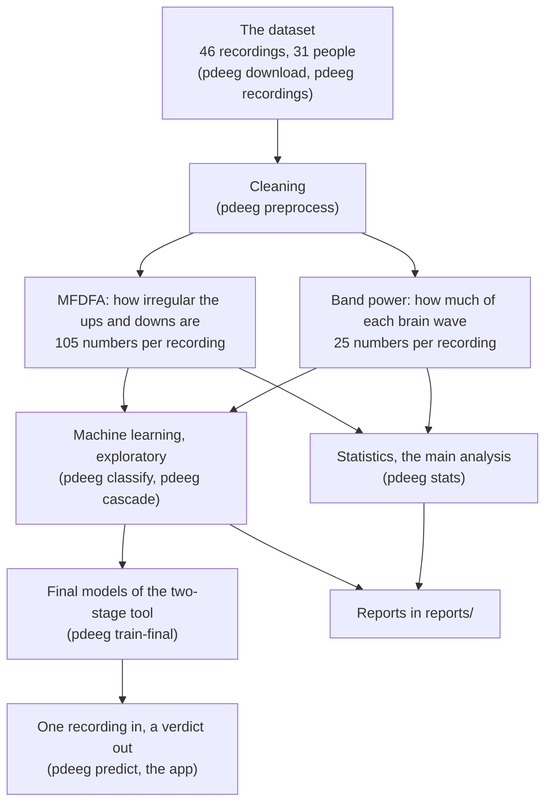

Each box in brackets names the command that runs that part. Chapter 12 lists all of them.

### Key takeaways

- The project compares EEG of 15 Parkinson's patients (each OFF and ON medication) with 16 healthy
  controls.
- Each recording becomes 130 numbers: 25 about brain-wave amounts, 105 from MFDFA.
- Statistics are the main analysis and found no difference that survived correction.
- Machine learning is exploratory. Only single-recording OFF against ON was convincing.
- It is a research demonstration, not a medical test.

### Check yourself

**Q1. What are the two questions the project asks?**
*Answer:* Whether patients' EEG differs from healthy controls' EEG, and whether, within patients,
being OFF or ON medication changes the EEG.

**Q2. Why does a balanced accuracy of 0.71 not settle anything here?**
*Answer:* With 31 people the plausible range around it is wide (0.55 to 0.86), and the best of
many models looks better than it really is. After adjusting for that, most results were not
convincing.

**Q3. What does a balanced accuracy of 0.5 mean for two groups?**
*Answer:* It is what a coin flip would score: the model is no better than guessing.

---

## 2. Parkinson's disease basics

### 2.1 What Parkinson's disease is

Deep in the brain is a small region called the **substantia nigra**. Its cells make **dopamine**,
a **neurotransmitter**: a chemical that one nerve cell releases to pass a signal to the next.
Dopamine is essential for smooth, well-timed movement.

In Parkinson's disease these cells slowly die. When enough are lost, the classic movement
symptoms appear:

- **slowness of movement** (doctors call it bradykinesia),
- **tremor**, a rhythmic shaking, typically when the limb is at rest,
- **stiffness** of the muscles (rigidity),
- later, problems with **balance**.

There are also non-movement symptoms, such as sleep problems, low mood and changes in thinking.
The disease differs a lot from one patient to the next. The dataset's own README puts it as
"Parkinson's disease presents heterogeneously across patients".

The dataset records a little about each patient: how many years since diagnosis
(`disease_duration`) and which side of the body is more affected (`rl_deficits`), in
`data/raw/ds002778/participants.tsv` (present once you have downloaded the data; the data is not
in git). This project does not use those columns.

### 2.2 Levodopa, and what OFF and ON mean

The main treatment is **levodopa**, a drug the brain converts into dopamine, which replaces some
of what was lost. Its effect wears off over hours, so patients take it several times a day.

That makes two states possible for the same patient:

- **OFF**: the medication has been withheld long enough to wear off.
- **ON**: the patient has taken their medication as usual.

The paper that first described this dataset (Jackson et al. 2019, the first citation the dataset
asks for) states: "For the off-medication state, patients discontinued medication use at least
12 h before the session" and "For the on-medication recordings, patients continued their typical
medication regimen." The files in this repository do not record which drugs or what doses each
patient took. The project does not model dose at all (see chapter 14).

### 2.3 Why OFF against ON is interesting

Comparing patients with controls compares *different people*. People differ in a thousand ways
that affect EEG: skull thickness, age, hair, how the cap sat. Comparing a patient OFF with *the
same patient* ON removes most of those differences, because the person is the same. This is a
**paired design**: every measurement in one condition has a partner, from the same person, in the
other condition.

**Toy example.** You want to know whether lunch makes people heavier. Comparing your weight after
lunch with a stranger's weight before lunch tells you almost nothing: the stranger might just be
taller. Weighing *yourself* before and after lunch answers the question directly. OFF against ON
is the "weigh yourself twice" comparison.

### 2.4 The basal ganglia and the beta rhythm

The **basal ganglia** are a group of structures deep in the brain that work with the outer layer
of the brain (the **cortex**) in a loop, helping to select and start movements. The substantia
nigra's dopamine is one of the main inputs to this loop.

Brain cells often fire in step with each other, and when large groups do, the activity
**oscillates**: it rises and falls rhythmically, like a pendulum. Speed of oscillation is measured
in **hertz (Hz)**, cycles per second. A **brain rhythm** is such an oscillation in a particular
speed range, and the **beta rhythm** is the one between roughly 13 and 30 Hz.

In Parkinson's disease, beta activity in the basal ganglia–cortex loop becomes abnormally strong
and too **synchronised** (too many cells marching in step), and dopamine treatment reduces it
(see Little and Brown 2014 in [Further reading](#17-further-reading)). The basal ganglia are too
deep for scalp electrodes to see directly, but the loop runs through the motor cortex, which sits
just under the scalp. The dataset's own citations report traces of this at the scalp: "Elevated
synchrony in Parkinson disease detected with electroencephalography" (Swann et al. 2015) and
"Dopaminergic therapy in Parkinson's disease decreases cortical beta band coherence in the
resting state" (George et al. 2013).

That is why two of the project's three main pre-registered measurements are about the beta
rhythm ([stats.yaml](../configs/stats.yaml)).

### 2.5 Why this is hard

- **Patients differ.** The disease affects people differently, so a group average can hide a lot.
- **Few patients.** This dataset has 15. Small samples can only reveal large effects.
- **Medication gets mixed in.** ON recordings carry the effect of the drugs, and anything else
  that differed between the two sessions.
- **The scalp blurs everything.** Each electrode picks up a smeared mixture of activity from large
  areas of cortex, plus noise from muscles and eyes.

### Key takeaways

- Parkinson's disease is the loss of dopamine-making cells, and it shows mainly in movement.
- Levodopa replaces dopamine. OFF means it was withheld for at least 12 h, ON means taken as usual.
- OFF against ON is a paired, within-person comparison, which removes person-to-person
  differences.
- Too much synchronised beta (13–30 Hz) activity is a well-studied feature of Parkinson's disease,
  and the main measurements target it.

### Check yourself

**Q1. What does dopamine do, and where is it made?**
*Answer:* It is a chemical messenger between nerve cells that is essential for movement, made by
cells in the substantia nigra.

**Q2. Why is OFF against ON a stronger comparison than patients against controls?**
*Answer:* It compares each patient with themselves, so differences between people (anatomy, age,
cap fit) largely cancel out.

**Q3. Why might scalp EEG show anything about the basal ganglia, which are deep in the brain?**
*Answer:* The basal ganglia work in a loop with the motor cortex, which is near the scalp, so
abnormal rhythms in the loop can leave traces the electrodes can pick up.

---

## 3. EEG from scratch

### 3.1 Voltage over time

Nerve cells communicate with small electrical currents. One cell is far too weak to detect from
outside the head, but in the cortex millions of similarly oriented cells are active together, and
their currents add up to voltages that reach the scalp.

A **voltage** is a difference in electrical "pressure" between two points, measured in volts.
Scalp EEG voltages are tiny, so they are measured in **microvolts (µV)**, millionths of a volt. In
this dataset the typical size of a channel's fluctuations after cleaning (its standard deviation,
a measure of spread) is a few microvolts. The quality-check table lists, for each recording, the
**median** over its channels (the middle value when they are sorted), and those medians range from
3.2 to 9.8 µV ([qc_preprocessing.md](../reports/qc_preprocessing.md)).

An EEG recording is simply a list of voltages over time for each electrode. Drawn, it looks like
a wobbly line:

```
 µV
 +10 |      /\        /\
   0 |-/\--/  \/\  /\/  \--/\---
 -10 |   \/      \/          \/
     +------------------------------> time
```

### 3.2 Sampling rate

The EEG amplifier does not record a smooth line. It measures the voltage at regular instants.
The number of measurements per second is the **sampling rate**, in hertz. This dataset was
recorded at **512 Hz** ([data.yaml](../configs/data.yaml), and the sidecar file
`sub-pd3_ses-off_task-rest_eeg.json` says `"SamplingFrequency": 512.0`).

- One sample every 1/512 s, about 2 milliseconds.
- 180 s × 512 samples/s = **92160 samples** per channel, the length of every cleaned recording
  ([mfdfa.yaml](../configs/features/mfdfa.yaml)).
- The **Nyquist frequency** is half the sampling rate, here 256 Hz: the fastest oscillation a
  recording at that rate can represent. Everything this project analyses is far below it (the
  cleaning keeps 0.5 to 50 Hz).

### 3.3 Channels and the BioSemi 32-electrode layout

A **channel** is the recorded signal of one electrode. This dataset used a **BioSemi ActiveTwo**
system with 32 scalp electrodes (Jackson et al. 2019). The files also hold 8 extra channels named
`EXG1` to `EXG8`, for electrodes placed off the scalp, which the code drops (chapter 4).

Electrodes are named by the **10-20 system**, a standard way of placing and naming electrodes:

- The letters say *where*: **Fp** front pole (forehead), **AF** between Fp and F, **F** frontal,
  **FC** fronto-central, **C** central (top of the head), **CP** centro-parietal, **T** temporal
  (above the ears), **P** parietal (upper back), **PO** parieto-occipital, **O** occipital (back of
  the head).
- The number says *which side*: **odd numbers on the left**, **even on the right**, larger numbers
  further from the midline.
- **z** (for "zero") means on the midline, from nose to neck: Fz, Cz, Pz, Oz.

A **montage** is the map from electrode names to positions on the head. The project uses
MNE's standard montage called `biosemi32` ([data.yaml](../configs/data.yaml), key
`dataset.montage`). Seen from above, nose at the top:

```
                      (nose)
                 Fp1           Fp2
            AF3                     AF4
       F7        F3      Fz      F4       F8
            FC5      FC1     FC2      FC6
    T7           C3      Cz      C4           T8
            CP5      CP1     CP2      CP6
       P7        P3      Pz      P4       P8
              PO3                 PO4
                    O1   Oz   O2
                      (neck)
```

For the machine-learning part, the 32 channels are grouped into five **regions**, and a region's
value is the average of its channels ([data.yaml](../configs/data.yaml), key `regions`):

| Region | Channels |
|---|---|
| frontal | Fp1, Fp2, AF3, AF4, F7, F3, Fz, F4, F8 |
| central | FC1, FC2, C3, Cz, C4, CP1, CP2 |
| temporal | FC5, FC6, T7, T8, CP5, CP6 |
| parietal | P7, P3, Pz, P4, P8 |
| occipital | PO3, PO4, O1, Oz, O2 |

The comment in `data.yaml` explains two choices. The whole side row (FC5/6, T7/8, CP5/6) counts
as "temporal", because T7 and T8 alone "would be a two-channel average of the channels most
exposed to muscle". P7 and P8 count as parietal.

### 3.4 The reference

Since a voltage is always a difference between two points, every EEG channel is "electrode minus
something". That something is the **reference**.

**Toy example.** Height is the same: a hill is "300 m high" only relative to sea level. Change the
reference to the valley floor and the same hill is "100 m high". Nothing about the hill changed.

BioSemi records without a fixed reference, and the recordings "must be re-referenced offline"
([preprocessing.yaml](../configs/preprocessing.yaml), key `reference`). The project uses the
**average reference**: at every instant, it subtracts the mean of all 32 channels from each
channel.

**Toy example.** Three channels read 10, 4 and 1 µV at one instant. Their mean is 5. Re-referenced,
they read 5, −1 and −4. Notice that they now sum to zero.

That last point has a consequence. After average referencing, any one channel can be computed
from the other 31 (it is minus their sum), so the data holds only 31 independent signals. The
number of independent signals is called the **rank** of the data, and here it is 31
([qc_preprocessing.md](../reports/qc_preprocessing.md): "Data rank before ICA: 31"). Chapter 5
uses this.

### 3.5 Resting state

A **resting-state** recording is one in which the person does no task: they sit still and let
their mind wander. It is easy to record and easy to compare across people. In this dataset,
"Resting data were recorded for at least 3 min", while "the participants were seated comfortably
and told to fixate on a cross presented on a screen" (Jackson et al. 2019). The BIDS task name is
`rest` ([data.yaml](../configs/data.yaml)).

### 3.6 Brain-wave bands

Brain activity is usually described by speed range. A **frequency band** is a range of
frequencies, and the classic bands have Greek-letter names. The project's exact edges are in
[psd.yaml](../configs/features/psd.yaml) (a band includes its lower edge and excludes its upper
edge):

| Band | Range in this project | What it is usually associated with |
|---|---|---|
| delta | 1 to 4 Hz | deep sleep; in awake adults, slow activity |
| theta | 4 to 8 Hz | drowsiness, memory and attention processes |
| alpha | 8 to 13 Hz | relaxed wakefulness. The strongest rhythm of the resting brain, largest at the back of the head |
| beta | 13 to 30 Hz | active, alert states and the motor system (and the Parkinson's story of chapter 2) |
| gamma | 30 to 48 Hz | fast local processing. At the scalp it is easily swamped by muscle activity |

The associations in the right-hand column are the textbook picture, not results of this project.
The gamma band stops at 48 Hz because cleaning removes everything above 50 Hz (chapter 5).

### 3.7 Artifacts

An **artifact** is anything in the recording that does not come from the brain. The main ones:

| Artifact | Where it comes from | What it looks like | How this project handles it |
|---|---|---|---|
| Eye blinks and eye movements | The eye is electrically charged front to back, so moving it changes the voltage at nearby electrodes | Big, slow bumps, largest at the forehead (Fp1, Fp2) | ICA, a method that splits the recording into separate sources (chapter 5), removes them |
| Muscle activity | Jaw, forehead and neck muscles produce their own electrical signals | Fast, spiky, high-frequency noise, largest at the edges (T7, T8, F7, F8) | ICA removes most of it. The quality checks (chapter 5) flag what is left |
| Heartbeat | The heart's electrical signal reaches the head | Small regular spikes, about once per second | ICA would remove it. In this dataset no heartbeat component was removed |
| Mains ("line") noise | Power lines and devices hum at the mains frequency, 60 Hz in the USA | A sharp spike at exactly 60 Hz in the spectrum | The 0.5 to 50 Hz band-pass filter removes it |
| Slow drift | Sweat and electrode movement | Very slow wandering of the baseline | The filter's 0.5 Hz lower edge removes it |
| Loose or bad electrode | Poor contact | One channel much noisier, or flat | Bad stretches are marked. The QC report flags noisy channels |

You can see the mains noise in this figure, which shows every recording's spectrum (how its power
is spread over frequencies, chapter 6) before and after cleaning. The sharp spike at 60 Hz in the
left panel is gone in the right one:

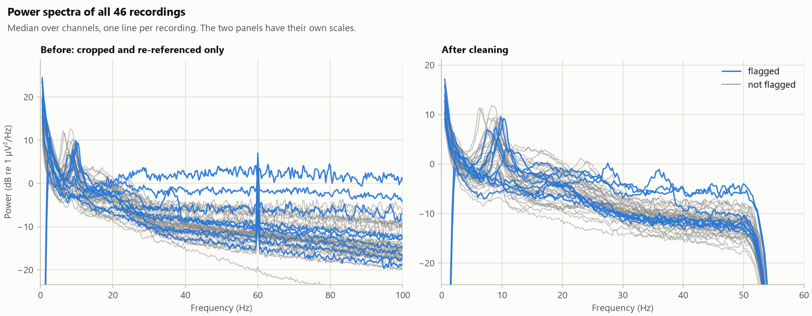

### Key takeaways

- EEG is voltage over time at each electrode, in microvolts, sampled here 512 times per second
  (92160 samples in 180 s).
- The 32 electrodes follow the 10-20 naming: letters for the area, odd numbers left, even right,
  z for the midline. They are grouped into 5 regions.
- Voltages need a reference. The project uses the average of all channels, which leaves rank 31.
- Brain activity is described in bands from delta (1–4 Hz) to gamma (30–48 Hz).
- Artifacts (eyes, muscle, heart, mains, drift) must be removed or marked before analysis.

### Check yourself

**Q1. Why does an average-referenced 32-channel recording have rank 31?**
*Answer:* The channels then sum to zero at every instant, so any one of them is determined by the
other 31.

**Q2. Is Fp1 on the left or right, and where on the head is it?**
*Answer:* Left (odd number), on the forehead (Fp is the front pole).

**Q3. Which artifact makes a sharp spike at 60 Hz?**
*Answer:* Mains (power line) noise. The dataset was recorded in the USA, where mains is 60 Hz.

**Q4. How many samples are in 180 s at 512 Hz?**
*Answer:* 92160.

---

## 4. The dataset

### 4.1 OpenNeuro and BIDS

**OpenNeuro** is a free public website where researchers share brain-imaging and EEG data. This
project uses one of its datasets: **ds002778, version 1.0.5**, "UC San Diego Resting State EEG
Data from Patients with Parkinson's Disease", by Alexander P. Rockhill, Nicko Jackson, Jobi
George, Adam Aron and Nicole C. Swann (doi:10.18112/openneuro.ds002778.v1.0.5). Its licence is
**CC0**, a "no rights reserved" dedication that puts the data in the public domain
(`dataset_description.json`, [README.md](../README.md#dataset-and-data-sources)).

**BIDS (Brain Imaging Data Structure)** is a standard for naming files and folders, so that any
tool can read any dataset without being told where things are. **EEG-BIDS** is its extension for
EEG. Because ds002778 follows BIDS, the project reads it with **MNE-BIDS**, a Python library that
understands the layout. MNE-BIDS is built on **MNE-Python**, the main open-source Python library
for EEG and MEG (magnetoencephalography, which records the brain's magnetic fields), which the
project uses throughout.

The data is not stored in git. `pdeeg download` fetches it into `data/raw/ds002778/`
([data.yaml](../configs/data.yaml), key `paths.raw`).

### 4.2 Walking through a real path

Here is one recording, patient 3 OFF medication:

```
data/raw/ds002778/sub-pd3/ses-off/eeg/sub-pd3_ses-off_task-rest_eeg.bdf
```

Piece by piece:

| Piece | Meaning |
|---|---|
| `data/raw/ds002778/` | Where `pdeeg download` put the dataset (`paths.raw` in `data.yaml`) |
| `sub-pd3/` | The **subject** (participant) called `pd3`. The dataset's names start with `pd` or `hc`, but the code never reads the group from the name (see 4.4) |
| `ses-off/` | The **session**: `off`, `on` or `hc` |
| `eeg/` | The kind of data |
| `sub-pd3_ses-off_task-rest_eeg.bdf` | The file name repeats subject, session and task (`rest`), and ends with the data type (`eeg`) and format (`.bdf`) |

**BDF** (BioSemi Data Format) is the file format BioSemi amplifiers write. Its close relative
**EDF** (European Data Format) is common too, and `pdeeg predict` accepts both.

Next to the `.bdf` file sit small **sidecar** files that describe it:

- `sub-pd3_ses-off_task-rest_eeg.json` holds the recording's settings in **JSON**, a plain-text
  format for structured data (`"name": value` pairs inside braces). It includes
  `"SamplingFrequency": 512.0`, `"PowerLineFrequency": 60`,
  `"RecordingDuration": 199.998046875` (seconds) and `"EEGChannelCount": 40` (32 scalp channels
  and the 8 `EXG` channels).
- `sub-pd3_ses-off_task-rest_channels.tsv` lists every channel with its type and units (`µV`).
  A **TSV** file is a table in plain text, with columns separated by tabs.
- `sub-pd3_ses-off_task-rest_events.tsv` lists the markers in the recording. For this file it has
  one with value `1` at `10.880859375` s (sample 5571). That **trigger** marks where the
  project's 3-minute window starts (chapter 5), and the QC report lists this recording's start as
  10.9 s ([qc_preprocessing.md](../reports/qc_preprocessing.md)).

At the top of the dataset are `participants.tsv` (one row per person), `participants.json`
(what each column means), `dataset_description.json` (name, authors, DOI, licence), `README`
(the curators' notes, section 4.5) and `CHANGES` (version history).

### 4.3 The participants

| Group | People | Sessions each | Recordings |
|---|---|---|---|
| Parkinson's patients | 15: pd3, pd5, pd6, pd9, pd11, pd12, pd13, pd14, pd16, pd17, pd19, pd22, pd23, pd26, pd28 | 2 (`off`, `on`) | 30 |
| Healthy controls | 16: hc1, hc2, hc4, hc7, hc8, hc10, hc18, hc20, hc21, hc24, hc25, hc29, hc30, hc31, hc32, hc33 | 1 (`hc`) | 16 |
| **Total** | **31** | | **46** |

`participants.tsv` has the columns `participant_id`, `age`, `gender`, `hand`, `MMSE` (a test of
thinking skills), `NAART` (a reading test), `disease_duration`, `rl_deficits` and `notes`. The
project renames `gender` to `sex`, as BIDS does ([data.yaml](../configs/data.yaml), key
`participants_rename`), and uses only age and sex.

The groups are similar in age and sex ([stats_results.md](../reports/stats_results.md)):

| | PD OFF (n = 15) | HC (n = 16) | Test | p |
|---|---|---|---|---|
| Age, mean ± standard deviation in years | 63.3 ± 8.2 | 63.5 ± 9.7 | Welch's t-test, t(28.7) = −0.07 | 0.943 |
| Sex | 7 m / 8 f | 7 m / 9 f | Fisher's exact test, odds ratio = 1.12 | 1.000 |

The tests and the p column are explained in chapter 8. For now, the large p-values mean there is
no sign that the groups differ in age or sex. The odds ratio compares the two groups' balance of
men to women, and 1 would mean exactly the same balance.

### 4.4 How the code reads it

`pdeeg recordings` builds a table with one row per recording and saves it as
`data/interim/recordings.parquet`. **Parquet** is a compact file format for tables. The function
that builds it is `list_recordings` in [`src/pdeeg/data/bids.py`](../src/pdeeg/data/bids.py).

`participants.tsv` has no column saying who is a patient. The project takes the group from the
**session label**, using this mapping ([data.yaml](../configs/data.yaml), key `sessions`):

| Session label | group | condition |
|---|---|---|
| `hc` | HC | HC |
| `off` | PD | PD_OFF |
| `on` | PD | PD_ON |

A small trap is documented in that file: `"off"` and `"on"` must be quoted in YAML, because
unquoted YAML reads them as the true/false values `False` and `True`.

`list_recordings` refuses a dataset that does not make sense: an unknown session label, a person
whose sessions disagree about the group, two recordings for one session, or a recording with no
row in `participants.tsv`.

`load_raw` (same file) reads one recording. It keeps only channels typed EEG, then drops
EEG-typed channels that the `biosemi32` montage has no position for (the sidecars type `EXG1`–`EXG8`
as EEG), and refuses a recording that lacks any of the 32 montage channels.

### 4.5 What the curators ask

The dataset's `README` (in `data/raw/ds002778/README` once downloaded) makes three requests of
anyone who uses it.

1. **Contact them before publishing.** "Please email arockhil@uoregon.edu before submitting a
   manuscript to be published in a peer-reviewed journal using this data".
2. **Do not present patient-versus-control classification as a finding.** In their words: "An
   example of an analysis that we could consider problematic and would strongly advice to be
   corrected before submission to a publication would be using machine learning to classify
   Parkinson's patients from healthy controls using this dataset. This is because there are far
   too few patients for proper statistics." They add that "with a proper test-training split,
   there would be fewer than 8 patients in the testing set", that "if multiple machine learning
   algorithms were desired to be tested, a third split would be required to choose the best
   method, further lowering the number of patients in the testing set", and: "We strongly advise
   against using any such approach because it would mislead patients and people who are
   interested in knowing if they have Parkinson's disease."
3. **Cite their papers.** The list is in [Further reading](#17-further-reading).

They also note that "UPDRS rating scales were collected by laboratory personnel who had completed
online training and not a board-certified neurologist". UPDRS is a standard rating of Parkinson's
symptoms. This project does not use it.

**How the project responds.** The group statistics are the primary analysis. Every
classification, and the tool built on it, is labelled exploratory. The "third split to choose the
best method" is exactly what nested cross-validation provides (chapter 9). Even so, no
classification here is presented as a finding.

### 4.6 The two recordings that were already filtered

Two recordings were not like the others: the ON sessions of `sub-pd6` and `sub-pd16`. The
`notes` column of `participants.tsv` says of both: "Used preprocessed data from EEGLAB .mat file
instead of raw data for pd on". EEGLAB is another EEG toolbox, so these two files had already
been processed by someone else before they were shared.

The project's quality checks found this **from the signals alone**, before anyone read the notes.
A raw EEG recording always has a lot of very slow drift. A file that has already been through a
**high-pass filter** (a filter that removes slow changes and keeps faster ones) has almost none.
So for every recording the QC measures the **power** (the strength of the signal's ups and downs)
below 0.5 Hz, relative to the power between 1 and 4 Hz, before the project's own filtering.

That ratio is given in **decibels (dB)**: ten times the base-10 logarithm of a power ratio. The
**base-10 logarithm** (log10) of a number is the power of 10 that gives it: log10(100) = 2 and
log10(0.01) = −2. So 0 dB means equal power, +10 dB means 10 times more, and −10 dB means 10 times
less.

**Toy example.** A power ratio of 1/100 is 10 × log10(0.01) = −20 dB. A ratio of 1/1000 is −30 dB.

The results ([qc_preprocessing.md](../reports/qc_preprocessing.md),
[qc_mfdfa.md](../reports/qc_mfdfa.md)):

| Recording | Power below 0.5 Hz, re 1–4 Hz | Robust z |
|---|---|---|
| sub-pd6 ses-on | −29 dB | −16.9 |
| sub-pd16 ses-on | −27 dB | −16.3 |
| the other 44 recordings | between 7 and 17 dB | |

A **robust z** says how far a value lies from the middle of all recordings, measured in "typical
spreads", using the median instead of the mean so that one odd value cannot distort the yardstick.
Section 5.7 works one out by hand. A robust z of −16.9 is extraordinarily far below everyone else.

The same two recordings stood out again later, in the MFDFA checks: their median long-range `h2`
was 0.15 and 0.11, against 0.80 to 1.25 for the other 44, and 100 % of their channel fits on that
range were poor ([qc_mfdfa.md](../reports/qc_mfdfa.md)). Chapter 7 explains what that means.

**What is done about them.** They are left out of the main OFF-against-ON analyses, which then
use 13 patients instead of 15. A sensitivity analysis keeps all 15 pairs to show it makes no
difference to the conclusion ([stats.yaml](../configs/stats.yaml), key
`paired.exclude_subjects`). For classification, the within-patient tasks leave out `pd6` and
`pd16` entirely. Stage 1 of the tool keeps their OFF recordings and drops only the two ON
recordings ([model.yaml](../configs/model.yaml), keys `exclude_subjects` and
`exclude_recordings`).

### 4.7 Citations

The curators ask for five papers to be cited, and the dataset itself has a DOI. All of them are
reproduced exactly in [Further reading](#17-further-reading) and in the
[README](../README.md#citations-requested-by-the-dataset).

### Key takeaways

- ds002778 v1.0.5 from OpenNeuro: 15 patients × 2 sessions + 16 controls = 46 recordings, CC0.
- BIDS file names encode subject, session and task. Sidecars describe each recording.
- The group comes from the session label (`off`/`on`/`hc`), never from the subject name.
- The curators warn against presenting patient-versus-control classification as a finding, and
  the project treats classification as exploratory for that reason.
- sub-pd6 and sub-pd16 ON were already high-pass filtered. The QC found it from the signal and
  `participants.tsv` confirms it, so they are left out of the main paired analyses.

### Check yourself

**Q1. In `sub-hc10_ses-hc_task-rest_eeg.bdf`, what are the subject, session and task?**
*Answer:* Subject `hc10`, session `hc`, task `rest`.

**Q2. Why must `"off"` be quoted in `data.yaml`?**
*Answer:* Unquoted, YAML reads `off` as the true/false value False.

**Q3. How did the project notice that two recordings were pre-filtered?**
*Answer:* Their power below 0.5 Hz was −29 and −27 dB relative to 1–4 Hz, while every other
recording had between 7 and 17 dB. Their robust z-scores were −16.9 and −16.3, far from everyone
else.

**Q4. Why does the curators' "third split" remark matter?**
*Answer:* Choosing the best of several models on the test data makes the result look better than
it is, so a separate split (in practice, an inner cross-validation loop) is needed for choosing.

---

## 5. Preprocessing, step by step

**Preprocessing** means turning a raw recording into a clean one that is ready to measure. The
command is `pdeeg preprocess`. The settings are in
[`configs/preprocessing.yaml`](../configs/preprocessing.yaml), and the code is
`preprocess_raw` in [`src/pdeeg/preprocessing/pipeline.py`](../src/pdeeg/preprocessing/pipeline.py).

### 5.1 Why clean, and why keep the data continuous

Raw EEG is full of artifacts (chapter 3), and they are often far bigger than the brain signal.
Measuring before cleaning would mostly measure blinks and muscles.

Many EEG projects cut recordings into short pieces called **epochs** (say 1 s each) and throw away
the bad ones. This project does not, for a reason that comes from MFDFA (chapter 7): MFDFA looks
at windows up to 17.8 s long *within one unbroken signal*. Cutting out a bad second and gluing the
two sides together would create a jump that never happened. So the rule, in the file's own
words: "Nothing is cut into epochs and nothing is cut out: MFDFA needs continuous data, so bad
stretches are only marked."

The steps, in the order `preprocess_raw` runs them:

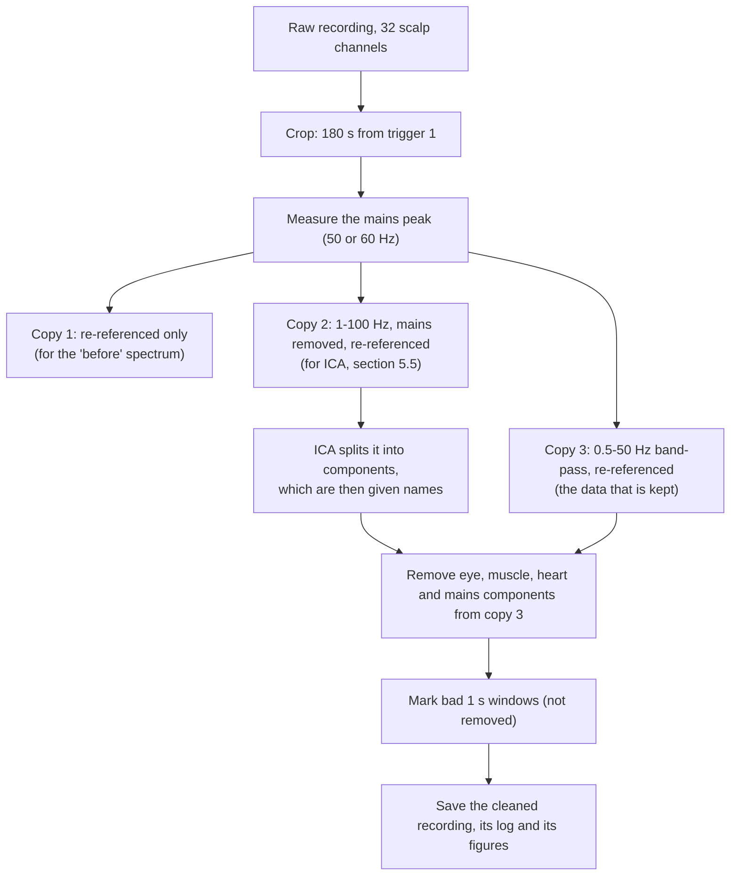

### 5.2 Crop

Every recording is cut to the same 180 s window ([preprocessing.yaml](../configs/preprocessing.yaml),
key `crop.duration`). The window starts at the trigger `1` where the recording has one, and at the
file start otherwise (`crop.start_event`). The config file notes: "44 of the 46 recordings carry
trigger "1" 2-29 s in (96 s for sub-pd6 ses-on) with at least 181 s after it; the dataset does not
document it". The QC report confirms 44 recordings started from the trigger and 2 from the file
start ([qc_preprocessing.md](../reports/qc_preprocessing.md)).

Giving every recording the same length makes their measurements comparable. For example, MFDFA's
largest window depends on the length. The function is `crop_window`. A recording too short to
supply 180 s raises `RecordingTooShort`.

### 5.3 Filtering

A **filter** removes some frequencies from a signal and keeps others. A **low-pass** filter keeps
the slow parts and removes fast ones. A **high-pass** filter keeps the fast parts and removes slow
ones. A **band-pass** filter does both, keeping only a band in the middle.

**Toy example.** The simplest low-pass filter is a moving average. Take the signal 1, 5, 1, 5, 1, 5,
which flips up and down as fast as possible. Replacing each point by the average of itself and its
two neighbours gives (1+5+1)/3 = 2.33, (5+1+5)/3 = 3.67, 2.33, 3.67. The swing has shrunk from 4
to 1.33. Fast wiggles are damped, while a slow trend would pass almost unchanged.

The project keeps **0.5 to 50 Hz** ([preprocessing.yaml](../configs/preprocessing.yaml), keys
`filter.l_freq`, `filter.h_freq`). A real filter cannot jump from "keep" to "remove" instantly. The
**transition band** is the range over which it fades from one to the other: 0.5 Hz wide at the low
edge (`l_trans_bandwidth`) and 5 Hz wide at the high edge (`h_trans_bandwidth`):

```
 kept
 fraction
  1.0 |        ______________________________________
      |       /                                      \
  0.5 |      /                                        \
      |     /                                          \
  0.0 |____/                                            \______________________
      0   0.5                                       50   55        60          Hz
          |<---------------- pass band: kept -------->|    |   mains noise here,
                                                      transition  in the stop band
```

The comment in the config explains the 5 Hz: "MNE's default here would be 12.5 Hz, which leaves
60 Hz mains inside the transition band. 5 Hz puts the stop band at 55 Hz."

Two more words from the config:

- **FIR** (finite impulse response) means the filter computes each output sample as a weighted sum
  of a fixed number of nearby input samples, like the moving average above but with carefully
  designed weights. `firwin` is the design method, and `hamming` is the shape that tapers the
  weights (`filter.fir_window`).
- **Zero-phase** (`filter.phase: zero`) means the filter does not shift the signal in time. A
  moving average that only looks *backwards* would make every bump appear late. A centred one
  does not. Zero-phase filters are centred in this sense.

The before/after spectrum of one recording shows the effect: above 50 Hz the cleaned signal
drops away, and the 60 Hz spike is gone.

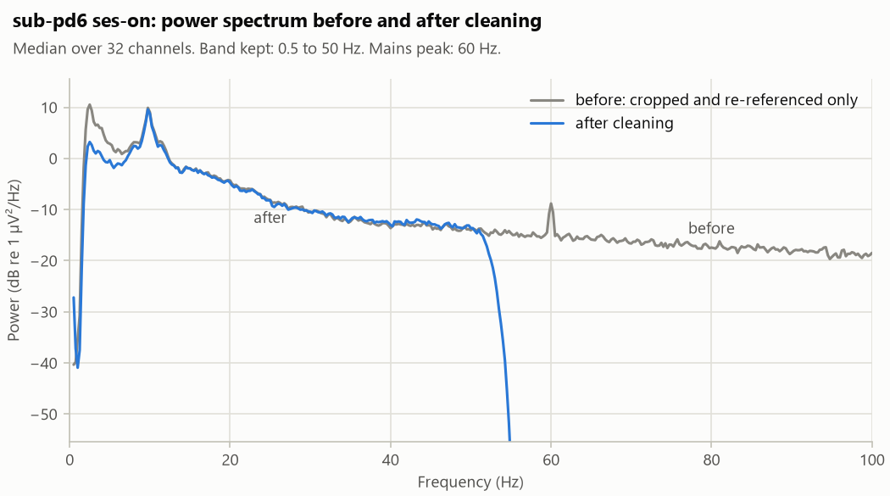

(This happens to be one of the two pre-filtered recordings of 4.6. Look at the far left: it
already has almost nothing below 1 Hz, even "before".)

**Which mains frequency?** The pipeline measures it in every recording: it tests 50 and 60 Hz,
and a candidate counts as present when its spectral peak is at least 3 times the neighbouring
spectrum ([preprocessing.yaml](../configs/preprocessing.yaml), key `line_noise`). The function is
`detect_line_noise`. The result: a 60 Hz peak in 37 recordings and none in 9, while 9 sidecar
files claim 50 Hz ([qc_preprocessing.md](../reports/qc_preprocessing.md)). So the project does not
trust the sidecars and uses `dataset.line_freq: 60.0` from [data.yaml](../configs/data.yaml).

### 5.4 Re-referencing

After filtering, the kept copy is re-referenced to the average of the 32 channels (chapter 3.4,
key `reference: average`). The code is `_reference`, which calls MNE's `set_eeg_reference`.

### 5.5 ICA and ICLabel

**The cocktail-party analogy.** Imagine a party with several people talking at once and several
microphones around the room. Each microphone records a different *mixture* of all the voices,
depending on where it stands. **Independent component analysis (ICA)** is a method that, given
only the microphone recordings, works out the separate voices. It assumes the voices are
statistically **independent**: knowing what one person is saying tells you nothing about another.

EEG is the same situation. Each electrode records a mixture of many sources: brain activity, the
eyes, scalp muscles, the heart. ICA splits the recording into **components**. Each one has a fixed
pattern over the scalp (how strongly it reaches each electrode) and its own time course. Some
components are clearly eye blinks, others clearly muscle. Set those to zero, mix the rest back
together, and you have the EEG without the blinks.

**Toy example.** Two sources over four instants: a blink `s1 = 0, 0, 10, 0` and a brain rhythm
`s2 = 1, −1, 1, −1`. Electrode Fp1 (forehead) records 0.9·s1 + 0.1·s2 = 0.1, −0.1, 9.1, −0.1, and
electrode Oz (back of the head) records 0.1·s1 + 0.9·s2 = 0.9, −0.9, 1.9, −0.9. Both are
contaminated. If ICA recovers `s1` and `s2` and we drop `s1`, Fp1 becomes 0.1, −0.1, 0.1, −0.1 and
Oz becomes 0.9, −0.9, 0.9, −0.9: pure rhythm, no blink.

The project's settings ([preprocessing.yaml](../configs/preprocessing.yaml), key `ica`):

- **Extended infomax** (`method: infomax`, `extended: true`), a standard ICA algorithm. "Extended"
  lets it find both peaky sources (like blinks) and flatter ones, and it is the version ICLabel was
  trained with.
- **As many components as the data rank** (`n_components: rank`), which is 31 (chapter 3.4).
  Asking for 32 would make ICA invent a component with no data in it (docstring of `fit_ica` in
  [`src/pdeeg/preprocessing/ica.py`](../src/pdeeg/preprocessing/ica.py)).
- `max_iter: 500`, and `random_state: 97`. A **random state** or **seed** is a fixed starting
  number for anything random, so that rerunning gives exactly the same result.
- **Fitted on a separate copy filtered 1 to 100 Hz and notched at 60 Hz.** A **notch filter**
  removes one narrow frequency. This is the input ICLabel expects. The comment adds that, left in,
  "mains noise took 7 of 31 components in a trial on sub-pd3 ses-off". The components found on that
  copy are then applied to the 0.5–50 Hz data.

**ICLabel** is a classifier trained by other researchers on thousands of hand-labelled
components (Pion-Tonachini et al. 2019). For each component it gives probabilities for seven
classes: brain, muscle artifact, eye blink, heart beat, line noise, channel noise and other. The
project uses it through the **mne-icalabel** package. The removal rule: a component goes if
ICLabel's most probable class is eye blink, muscle artifact, heart beat or line noise, with
probability at least 0.8 (`exclude_labels`, `threshold`). The code is `classify_components` and
`select_components`.

Here are the 7 components removed from one recording. Each scalp map shows where the component
is strong (red and blue are opposite signs), titled with ICLabel's class and probability:

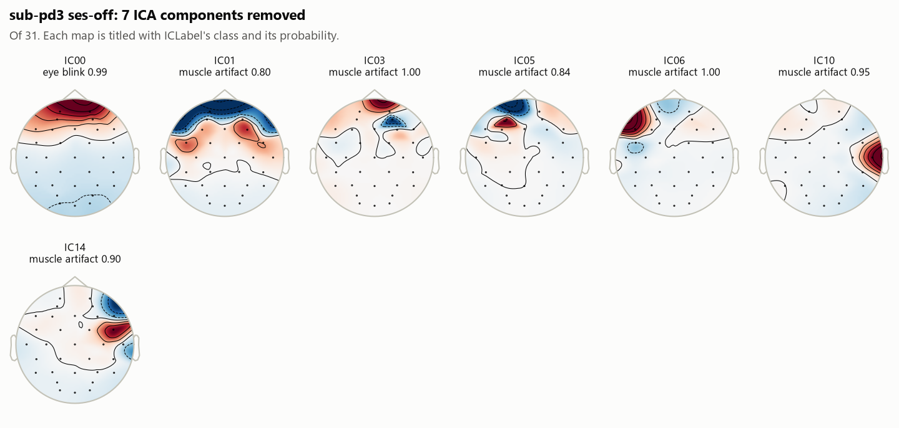

IC00 is a textbook blink: strong over the forehead only, labelled "eye blink 0.99". The muscle
components are small, sharp spots near the edges of the head, where scalp and jaw muscles are.

Across the dataset no heartbeat or line-noise component was ever removed. Between 1 and 3 eye
components and between 0 and 11 muscle components were removed per recording
([qc_preprocessing.md](../reports/qc_preprocessing.md), "Removed" column).

### 5.6 Marking bad stretches

After ICA, some stretches can still be bad (a cough, a moving cable). The recording is split into
**1 s windows** ([preprocessing.yaml](../configs/preprocessing.yaml), key `bad_segments`). A
window is marked bad if, in any channel, its **peak-to-peak amplitude** (the highest value minus
the lowest value in that window) is above **150 µV** (`BAD_peak`) or below **1 µV** (`BAD_flat`,
which means a dead channel). Neighbouring bad windows are merged into one marked stretch.

**Toy example.** A window holds the values 3, −2, 8, −4 µV. Its peak-to-peak amplitude is
8 − (−4) = 12 µV. That is fine, since it is between 1 and 150.

The marks are **annotations**: labels with a start time and a duration, stored with the
recording. Nothing is cut out. Every later measurement is then computed twice:

- **`full`**: using all of the recording.
- **`clean`**: leaving out every window that touches a bad stretch.

The analyses use the `clean` values ([stats.yaml](../configs/stats.yaml) and
[model.yaml](../configs/model.yaml), key `segments: clean`). 24 of the 46 recordings have at least
one bad stretch (0.6 to 12.2 % of their time). For the other 22, `clean` equals `full`
([qc_mfdfa.md](../reports/qc_mfdfa.md)). The code is `annotate_bad_segments` in
[`src/pdeeg/preprocessing/segments.py`](../src/pdeeg/preprocessing/segments.py).

### 5.7 Reading the QC report together

**QC (quality control)** means checking that each step did what it should. `pdeeg preprocess`
writes [`reports/qc_preprocessing.md`](../reports/qc_preprocessing.md). Open it alongside this
section.

**The big table**, one row per recording:

| Column | Meaning |
|---|---|
| Recording | Subject and session; flagged ones in bold |
| Group | PD or HC |
| Start (s) | Where the kept 180 s starts in the original file |
| Mains (Hz) | The mains peak found in the signal (60, or none) |
| Removed: eye / muscle / heart / line | How many ICA components of each class were removed |
| Brain components | How many components ICLabel called brain |
| Variance removed (%) | How much of the signal's total variance (a measure of how much it fluctuates) the ICA removal took out |
| Bad time (%) | Share of the 180 s marked bad |
| Longest clean stretch (s) | The longest run with no bad mark |
| Median SD (µV) | The typical channel's standard deviation after cleaning |
| Noisiest channel (× median SD) | The channel with the largest standard deviation, and how many times the median it is |
| Figures | Links to that recording's spectrum and removed components |

**How the flags work.** A recording is flagged when ([qc_preprocessing.md](../reports/qc_preprocessing.md),
[preprocessing.yaml](../configs/preprocessing.yaml) key `qc`):

- more than 10 % of it is marked bad (`max_bad_percent`);
- its longest clean stretch is under 60 s (`min_clean_stretch_s`), because MFDFA needs unbroken
  data;
- a signal metric lies more than 3 robust standard deviations from the median (`outlier_z`). The
  metrics are the number of components removed, the variance ICA removed, the median channel SD,
  the noisiest channel relative to the median, slow power before filtering, and power from 30 Hz
  to the end of the pass band after cleaning;
- its mains peak disagrees with the configuration.

**The robust z, by hand.** The ordinary z-score is (value − mean) / standard deviation. The robust
version replaces the mean with the **median** (the middle value) and the standard deviation with
the **MAD** (median absolute deviation: the median distance from the median), scaled by 1.4826 so
that it matches the standard deviation for normal data. The code is `robust_z` in
[`src/pdeeg/preprocessing/report.py`](../src/pdeeg/preprocessing/report.py).

**Toy example.** Six recordings have a metric of 5, 6, 5, 7, 6 and 30. The median is 6. The
distances from 6 are 1, 0, 1, 1, 0, 24, whose median is 1, so the MAD is 1 and the yardstick is
1.4826 × 1 = 1.4826. The odd one out gets z = (30 − 6) / 1.4826 = **16.19**: flagged. With the
ordinary mean and standard deviation, the 30 drags the mean up to 9.83 and inflates the standard
deviation to 9.91, so its z is only **2.04**, and it would *not* be flagged at 3. That is why the
QC uses the robust version: an outlier cannot hide by distorting the yardstick. (Both results were
computed with the project's `robust_z` and with pandas.)

**The nine flagged recordings**, and what each one is telling you
([qc_preprocessing.md](../reports/qc_preprocessing.md)):

| Recording | The report says | In plain words |
|---|---|---|
| sub-hc1 hc | 11.1 % marked bad (limit 10 %). F3 most often over the limit, in 11.1 %. Longest clean stretch 29 s. F3 has 3.9 × the median channel SD (robust z +3.4) | Electrode F3 was probably in poor contact for much of the recording |
| sub-pd6 on | Slow power −29 dB (robust z −16.9): already high-passed | The pre-filtered recording of 4.6 |
| sub-pd9 off | F7 has 5.3 × the median channel SD (robust z +5.8) | One noisy electrode |
| sub-pd16 on | Slow power −27 dB (robust z −16.3) | The other pre-filtered recording |
| sub-pd17 off | Longest clean stretch 50 s (minimum 60 s) | Bad marks scattered through the recording |
| sub-pd23 off | Power above 30 Hz after cleaning −5.4 dB, high for this dataset (robust z +3.2) | Muscle activity that ICA did not fully remove |
| sub-pd26 off | 12.2 % bad. F7 over the limit in 8.9 %. Longest clean stretch 26 s. Power above 30 Hz −5.3 dB (robust z +3.2) | Noisy, with leftover muscle |
| sub-hc29 hc | T7 has 4.9 × the median channel SD (robust z +5.1) | One noisy electrode |
| sub-hc31 hc | O1 has 10.6 × the median channel SD (robust z +14.5) | One very noisy electrode |

"A flag is a reason to look, not a verdict." The flagged recordings stay in the analysis, apart
from the two pre-filtered sessions in the paired analyses ([README.md](../README.md#limitations)).

**The overview figure** puts three columns of the table side by side. On the left is time marked
bad, with a dashed line at the 10 % limit. In the middle is the longest clean stretch, with a
dashed line at 60 s. On the right are the ICA components removed, coloured by class (blue eye
blink, orange muscle). Flagged recordings are in bold and carry their value:

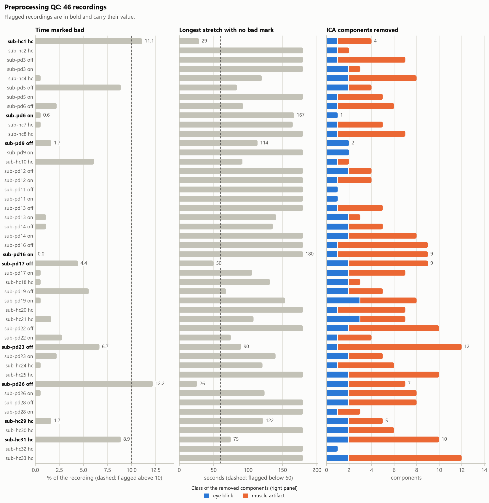

The spectrum overview (the figure in 3.7) draws flagged recordings in blue. In its left panel,
the line that plunges near 0 Hz belongs to the pre-filtered recordings. In the right panel, the
blue lines that stay high above 30 Hz are the ones with leftover muscle.

### 5.8 Where it lives

| What | File and function | Config key |
|---|---|---|
| Crop window | `crop_window` in [`preprocessing/pipeline.py`](../src/pdeeg/preprocessing/pipeline.py) | `crop` |
| Mains detection | `median_psd`, `detect_line_noise` (same file) | `line_noise`, `dataset.line_freq` |
| Filter, reference, the three copies | `preprocess_raw` (same file) | `filter`, `reference` |
| ICA and ICLabel | `fit_ica`, `classify_components`, `select_components` in [`preprocessing/ica.py`](../src/pdeeg/preprocessing/ica.py) | `ica` |
| Bad stretches | `annotate_bad_segments`, `window_peak_to_peak` in [`preprocessing/segments.py`](../src/pdeeg/preprocessing/segments.py) | `bad_segments` |
| Saving, logging, caching | `clean_recording`, `process_recording`, `is_current`, `config_hash`, `run` in `preprocessing/pipeline.py` | `output.dir`, `n_jobs` |
| QC table, flags, figures | `collect`, `robust_z`, `flag_outliers`, `write_report` in [`preprocessing/report.py`](../src/pdeeg/preprocessing/report.py). Figures in [`preprocessing/qc.py`](../src/pdeeg/preprocessing/qc.py) | `qc` |

The outputs are `data/interim/clean/sub-XX_ses-YY_clean.fif` (the cleaned recording, in MNE's
**FIF** file format) and `sub-XX_ses-YY_clean.json` (a log of everything that was done and
measured). A recording is not cleaned again while its log has the same `config_hash` and is newer
than its input files. `PIPELINE_VERSION` is raised when the code changes in a way the settings
cannot show.

### Key takeaways

- Every recording is cropped to the same 180 s, band-passed 0.5–50 Hz (zero-phase FIR), and
  average-referenced.
- ICA splits the recording into 31 components. ICLabel names them, and eye, muscle, heart and
  line components with probability ≥ 0.8 are removed.
- Bad 1 s windows (over 150 µV or under 1 µV peak-to-peak) are marked, never cut. Every feature
  then comes in a `full` and a `clean` version.
- The QC report flags 9 recordings using fixed rules and robust z-scores. A flag is a reason to
  look, not an exclusion.

### Check yourself

**Q1. Why does the project mark bad stretches instead of cutting them out?**
*Answer:* MFDFA needs unbroken data. Cutting and joining would create jumps that were never in the
signal.

**Q2. Why is the upper transition band 5 Hz rather than MNE's default?**
*Answer:* The default (12.5 Hz) would leave 60 Hz mains inside the transition band. 5 Hz puts the
stop band at 55 Hz, below the mains.

**Q3. Why is ICA fitted on a different copy (1–100 Hz, notched) from the data it cleans?**
*Answer:* That is the input ICLabel expects for labelling components, and notching stops mains
noise from using up components. The resulting unmixing is then applied to the 0.5–50 Hz data.

**Q4. Values 10, 11, 10, 12, 11 and 40: what is the robust z of 40?**
*Answer:* Median 11, distances 1, 0, 1, 1, 0, 29, so the MAD is 1. z = (40 − 11) / 1.4826 ≈ 19.6.

---

## 6. Band power (spectral features)

The first set of measurements answers a simple question: **how much of each brain wave is in the
recording?** These are the **baseline** features: the standard, well-understood description that
the newer MFDFA features are compared against.

### 6.1 Frequencies in a signal

The **Fourier transform** is the mathematical fact that any signal can be written as a sum of
sine waves of different frequencies, sizes and starting points, and the method that finds them.
A musical chord is several notes at once, and an ear (or a Fourier transform) can tell which
notes are in it. A prism splits white light into colours. The Fourier transform splits a signal
into frequencies.

**Toy example.** Suppose a signal is a big 2 Hz wave of amplitude 3 plus a small 10 Hz ripple of
amplitude 1. Its Fourier transform shows two spikes, at 2 Hz and at 10 Hz. **Power** goes with the
square of the amplitude, so the 2 Hz part has 3² / 1² = 9 times the power of the 10 Hz part.

### 6.2 The power spectrum, and Welch's method

The **power spectral density (PSD)**, or **power spectrum**, shows how a signal's power is spread
over frequencies, in µV² per Hz. EEG spectra have a typical shape: power falls steadily as
frequency rises, with a bump around 8–13 Hz, which is the alpha rhythm. You can see both in the
spectrum figures of chapters 3 and 5. In those figures the power axis is in dB relative to
1 µV²/Hz.

One Fourier transform of the whole 180 s gives a very jagged spectrum. **Welch's method** gives a
smoother, more reliable one:

1. Cut the recording into overlapping **segments**: 2 s long, each overlapping the previous by half
   ([psd.yaml](../configs/features/psd.yaml), keys `window_sec: 2.0`, `overlap: 0.5`).
2. Taper each segment with a **Hann window**, a bell-shaped weighting that fades the segment's ends
   to zero so its cut edges do not create false high frequencies.
3. Compute each segment's spectrum, and average them.

A 2 s segment gives a **frequency resolution** of 1 / 2 s = 0.5 Hz: frequencies are estimated in
steps of 0.5 Hz. With a 1 s step over 180 s there are 179 segments (the comment on `window_sec` in
`psd.yaml`). For the `clean` version, only segments that touch no bad sample are averaged. The
code is `segment_spectra` in [`src/pdeeg/features/psd.py`](../src/pdeeg/features/psd.py).

### 6.3 Relative power and the log scale

For each band, the code adds up the spectrum over the band's frequencies (from the lower edge up
to, but not including, the upper edge) to get the **band power**. Two more steps follow
([psd.yaml](../configs/features/psd.yaml), keys `relative`, `log`):

- **Relative power**: each band's power is divided by the total power from 1 to 48 Hz. This removes
  differences in overall signal size between people (skull thickness, electrode contact) and keeps
  the *balance* between bands.
- **Log scale**: the base-10 logarithm is taken. That turns ratios into differences and makes the
  values better behaved for statistics.

**Toy example.** A channel has band powers delta 8, theta 4, alpha 6, beta 1.5 and gamma 0.5, a
total of 20. The relative powers are 0.4, 0.2, 0.3, 0.075 and 0.025. Their log10 values are −0.40,
−0.70, −0.52, −1.12 and −1.60. (A log10 of −1 means one tenth of the total.)

The real values across all channels of all recordings, as the median with the 10th and 90th
percentile in brackets ([qc_mfdfa.md](../reports/qc_mfdfa.md), band power table). The **10th
percentile** is the value below which 10 % of the values lie, so the brackets hold the middle 80 %:

| Band | log10 relative power |
|---|---|
| delta | −0.56 [−0.87, −0.34] |
| theta | −0.90 [−1.12, −0.67] |
| alpha | −0.66 [−1.01, −0.34] |
| beta | −0.66 [−0.89, −0.45] |
| gamma | −1.20 [−1.59, −0.77] |

The feature's name in the tables is `log_relative_power` (function `feature_name`).

### 6.4 From 32 channels to 5 regions

Band power is computed for every channel: 5 bands × 32 channels. The group statistics (chapter 8)
use these channel values. The classifiers (chapter 9) use **region averages**: 5 bands × 5 regions
= **25 band-power features** ([methods.md](../reports/methods.md), section 7).

The data is stored in two shapes. A **long table** has one value per row, with columns saying
whose value it is and what it measures. A **wide table** has one row per recording and one column
per feature.

**Toy example.**

```
Long:  subject  session  name      band  value          Wide:  subject  session  ..._beta_parietal  ..._alpha_central
       pd3      off      parietal  beta  -0.62                 pd3      off      -0.62              -0.55
       pd3      off      central   alpha -0.55
```

A wide column is named `log_relative_power_<band>_<region>`, for example
`log_relative_power_beta_parietal` (function `psd_wide` in
[`src/pdeeg/features/tables.py`](../src/pdeeg/features/tables.py)). The tables are
`data/processed/psd_features_ds002778-1.0.5.parquet` (long) and
`psd_features_ds002778-1.0.5_wide.parquet` (wide).

### 6.5 Reading the spectrum figures

In the [spectrum overview](../reports/figures/qc_preprocessing/psd_overview.png) (chapter 3.7),
each grey line is one recording's spectrum, as the median over its channels.

- **Before** (left): power falls from left to right, with an alpha bump near 10 Hz, a sharp mains
  spike at 60 Hz, and everything above 50 Hz still there.
- **After cleaning** (right): the same falling shape and alpha bump, then a sharp drop above 50 Hz
  where the filter cuts off.

Recordings whose alpha bump sits at a different frequency, or whose line stays high above 30 Hz,
stand out at a glance.

### 6.6 Where it lives

| What | File and function | Config key |
|---|---|---|
| Segment spectra (Welch) | `segment_spectra` in [`features/psd.py`](../src/pdeeg/features/psd.py) | `method`, `window_sec`, `overlap` |
| Band powers | `band_powers` | `fmin`, `fmax`, `bands`, `relative`, `log` |
| One recording, `full` and `clean` | `recording_band_powers` | |
| All recordings, region averages | `build_psd_table`; `add_regions` in [`features/tables.py`](../src/pdeeg/features/tables.py) | `regions` in `data.yaml` |
| Wide table | `psd_wide` in `features/tables.py` | |

The command is `pdeeg psd-features`, which is also run as part of `pdeeg features`.

### Key takeaways

- The Fourier transform splits a signal into frequencies. The power spectrum shows power per
  frequency.
- Welch's method averages the spectra of 2 s Hann-tapered segments overlapping by half, giving
  0.5 Hz resolution from 179 segments.
- Each band's power is divided by total 1–48 Hz power and log10-transformed.
- 5 bands × 5 regions = 25 band-power features for the classifiers, and 5 bands × 32 channels for
  the statistics.

### Check yourself

**Q1. Why use relative rather than absolute power?**
*Answer:* It removes overall differences in signal size between people and keeps the balance
between bands.

**Q2. What frequency resolution does a 2 s Welch segment give?**
*Answer:* 0.5 Hz (1 divided by 2 s).

**Q3. A band holds 5 % of the total power. What is its log10 relative power?**
*Answer:* log10(0.05) ≈ −1.30.

---

## 7. MFDFA, the heart of the project

**MFDFA (multifractal detrended fluctuation analysis)** measures how the ups and downs of a
signal grow as you look at it over longer and longer stretches of time, separately for its small
and its large ups and downs. It produces the project's 105 main features. This chapter builds it
up slowly: first the ideas, then the simpler DFA by hand on ten numbers, then the "multi" part,
then how the project chose its settings and checked its code.

The method follows Kantelhardt et al. (2002), and the code is
[`src/pdeeg/features/mfdfa.py`](../src/pdeeg/features/mfdfa.py), whose docstring lists the six
steps this chapter teaches.

### 7.1 Fractals and self-similarity

A **fractal** is a shape that looks similarly detailed at every level of zoom. A coastline is the
classic example. On a world map it is wiggly. Zoom in to one bay and it is still wiggly. Zoom in
to one rock and it is still wiggly. There is no zoom level at which it suddenly becomes smooth.

A signal can be like that in time. A signal is **self-similar** if a short stretch, once you
stretch it out and rescale its height, looks statistically like a long stretch. For such a
signal, the typical size of its fluctuations grows with the length of the stretch `s` you look
at, following a **power law**:

```
size of fluctuations over a stretch of length s   ∝   s^H
```

where `∝` means "proportional to" and `H` is a fixed exponent. A power law becomes a straight line
on a **log-log plot**, one where both axes are logarithmic. Its slope is the exponent. So "find
the exponent" means "plot on log-log axes and measure the slope".

**Toy example.** If the fluctuation size is F(s) = 2 · s^0.7, then F(1) = 2 and F(10) = 2 · 10^0.7
= 10.0. On log10 axes, log F rises by 0.7 for every step of 1 in log s, which is one **decade** (a
factor of 10). The slope is 0.7.

### 7.2 Long-range correlation and the Hurst exponent

A signal has **memory**, or **correlation**, if its value now tells you something about its value
later. **Short-range** memory dies out quickly. With **long-range correlation** the memory fades
so slowly that trends persist across many time scales.

The **Hurst exponent** `H` (named after a hydrologist who studied decades of Nile floods)
measures this:

| H | Behaviour | Everyday picture |
|---|---|---|
| 0.5 | No memory (**white noise**, a sequence of independent random values) | Coin flips: the last flip says nothing about the next |
| above 0.5 | **Persistent**: ups tend to be followed by ups | A warm week tends to be followed by more warm days |
| below 0.5 | **Anti-persistent**: ups tend to be followed by downs | A thermostat overcorrecting back and forth |

DFA, the method of the next section, gives this exponent for noise-like signals, and gives values
above 1 for signals that wander like a random walk. Two reference points that come up again:

- A **random walk** (the running total of white noise: take a step left or right at random, again
  and again) has a DFA exponent of **1.5**.
- Noise whose power spectrum falls as 1/f^β has a DFA exponent of **(β + 1) / 2**: 0.5 for white
  noise (β = 0), 1 for **pink** or "1/f" noise (β = 1), and 1.5 for **brown** noise (β = 2, the
  random walk). This is from the docstring of `power_law_noise` in
  [`src/pdeeg/features/synthetic.py`](../src/pdeeg/features/synthetic.py).

### 7.3 DFA step by step, on ten numbers

**DFA (detrended fluctuation analysis)**, introduced by Peng et al. (1994), measures the exponent
of 7.1. MFDFA is DFA repeated for several "moment orders" (7.4), so DFA first.

**Toy example (worked in full).** The signal has 10 values:

```
x = 3, 5, 4, 6, 7, 5, 6, 8, 7, 9
```

**Step 1: the profile.** Subtract the mean (60 / 10 = 6) and take the running total:

```
x - mean   = -3, -1, -2,  0,  1, -1,  0,  2,  1,  3
profile Y  = -3, -4, -6, -6, -5, -6, -6, -4, -3,  0
```

Think of `x − mean` as each day's deposits and withdrawals and the profile as the bank balance.
The profile always ends at zero, because the deviations from the mean add up to zero. DFA
measures how far this "balance" wanders away from a straight trend, over windows of different
lengths.

**Step 2: cut the profile into windows** of length `s`. Take s = 5: the windows are
`[-3, -4, -6, -6, -5]` and `[-6, -6, -4, -3, 0]`. The code also counts windows from the *end* of
the profile, so that no sample is wasted when `s` does not divide the length evenly. Here 10 / 5 is
exact, so the windows counted from the end are the same two again, which makes four windows in
all.

**Step 3: detrend each window.** Fit the best straight line through the window (detrending order 1,
[mfdfa.yaml](../configs/features/mfdfa.yaml) key `detrend_order: 1`) and keep what is left over,
the **residuals**. For the first window, at positions t = 0, 1, 2, 3, 4, the best line is
−3.6 − 0.6 t:

```
window      -3.0  -4.0  -6.0  -6.0  -5.0
line        -3.6  -4.2  -4.8  -5.4  -6.0
residual     0.6   0.2  -1.2  -0.6   1.0
```

Detrending is what makes DFA robust to slow drifts. A trend inside a window is removed, so only
the fluctuations around it count.

**Step 4: the fluctuation.** Each window's **F²** is the mean of its squared residuals. For the
first window that is (0.36 + 0.04 + 1.44 + 0.36 + 1.00) / 5 = 3.2 / 5 = **0.64**. The second
window gives **0.46**. The fluctuation function at this scale is the square root of the average F²:

```
F(5) = sqrt( (0.64 + 0.46 + 0.64 + 0.46) / 4 ) = sqrt(0.55) = 0.742
```

**Step 5: repeat for other window lengths, and take the slope.** With a straight-line detrend the
shortest usable window is 3 samples, because a line through 2 points leaves no residual. Doing the
same for s = 3 and s = 4:

| s | window F² values | F(s) | log10 s | log10 F(s) |
|---|---|---|---|---|
| 3 | 0.0556, 0.2222, 0.0556, 0.2222, 0.0556, 0.2222 | 0.373 | 0.477 | −0.429 |
| 4 | 0.175, 0.575, 0.175, 0.175 | 0.524 | 0.602 | −0.280 |
| 5 | 0.64, 0.46, 0.64, 0.46 | 0.742 | 0.699 | −0.130 |

The least-squares slope of log F against log s is **1.34**. That is the DFA exponent of the toy
signal: it wanders like something between pink noise and a random walk, which makes sense since it
keeps climbing.

Ten numbers and three window sizes are far too few to estimate anything real. The point is only
the mechanics. The project's fits use 92160 samples and 12 window sizes per range. The project's
own function reproduces the table exactly:

```python
import numpy as np
from pdeeg.features.mfdfa import mfdfa

x = np.array([3, 5, 4, 6, 7, 5, 6, 8, 7, 9], float)
result = mfdfa(x, scales=[3, 4, 5], qs=[-2, 2], order=1)
result.Fq[1]  # F(s) for q = 2:  0.3727, 0.5244, 0.7416
result.h  # slopes for q = -2 and q = 2:  1.7456, 1.3395
```

The **scales** are the window lengths in samples. The `qs` are explained next.

### 7.4 Going "multi": the moment order q

In step 5 we averaged the windows' F² and took the square root. That is one particular way to
average. MFDFA generalises it with a **moment order** `q`:

```
Fq(s) = ( mean over windows of  F²(window, s)^(q/2) )^(1/q)
```

- **q = 2** gives back the root mean square of step 5: ordinary DFA.
- **Large positive q** (like 5) is dominated by the windows with the **largest** fluctuations.
- **Negative q** (like −5) is dominated by the windows with the **smallest** fluctuations.
- **q = 0** cannot use this formula (it would divide by zero), so the code uses its limit, a
  geometric mean: exp(½ × mean of log F²) (function `_fluctuation`).

**Toy example.** At s = 3 the toy's windows had F² of 0.0556 and 0.2222, so window fluctuations
F of 0.236 and 0.471. With q = 2, F₂(3) = 0.373, closer to the big one. With q = −2,
F₋₂(3) = 0.298, pulled towards the small one. (The numbers are from the run above.)

**An analogy.** Think of income in a town. An average that squares everyone's income first is
dominated by the rich. An average of inverses is dominated by the poor. If every income grows by
the same factor over the years, both averages grow at the same rate. If the rich get richer faster
than the poor, they grow at different rates. MFDFA asks the same question of fluctuations: do the
big ones and the small ones grow with the scale `s` at the same rate?

- If yes, the signal is **monofractal**: one exponent describes it.
- If no, it is **multifractal**: different parts of it scale differently, and a whole range of
  exponents is needed.

The project uses q from −5 to 5 in steps of 0.5, which is 21 values
([mfdfa.yaml](../configs/features/mfdfa.yaml), keys `q_min`, `q_max`, `q_step`; the function
`make_qs` builds the list so that 0 and 2 are exactly on it).

### 7.5 From h(q) to the singularity spectrum

For each q, the slope of log Fq(s) against log s is the **generalised Hurst exponent h(q)**. For a
monofractal signal h(q) is the same for every q. For a multifractal one it changes with q,
usually falling as q rises. From h(q) follow three more quantities (the module docstring, step 6):

```
tau(q)   = q · h(q) − 1                      the "mass exponent"
alpha(q) = d tau / d q                        the slope of tau at q
f(alpha) = q · alpha − tau                    the singularity spectrum
```

- **α (alpha)**, the **singularity strength**, describes how rough the signal is locally: how
  quickly fluctuations grow around a point. Each q picks out a kind of moment in the signal, and α
  is that kind's roughness.
- **f(α)** says how common that roughness is in the signal.
- Plotting f(α) against α gives the **singularity spectrum**. For a monofractal signal it is a
  single point. For a multifractal one it is an upside-down U, a hump. Its width says how much
  variety in local roughness there is.

```
 f(α)                                   f(α)
  1.0 |          *                       1.0 |          * *
      |                                      |       *       *
      |                                      |     *           *
      |                                      |    *             *
      +-------------------- α                +-------------------- α
        monofractal: one point                 multifractal: a hump
                                               width = Δα
```

**Toy example.** Suppose five q values gave these exponents:

| q | −2 | −1 | 0 | 1 | 2 |
|---|---|---|---|---|---|
| h(q) | 0.90 | 0.85 | 0.80 | 0.70 | 0.60 |
| τ(q) = q·h(q) − 1 | −2.80 | −1.85 | −1.00 | −0.30 | 0.20 |
| α(q) = slope of τ | 1.000 | 0.900 | 0.775 | 0.600 | 0.400 |
| f(α) = q·α − τ | 0.80 | 0.95 | 1.00 | 0.90 | 0.60 |

For example α at q = 0 is the slope of τ across its neighbours: (−0.30 − (−1.85)) / (1 − (−1)) =
0.775. And f at q = 0 is 0 × 0.775 − (−1.00) = 1.00. In fact f equals 1 at q = 0 for *every*
series, since τ(0) = −1 always. That is why every spectrum in the project's figures peaks at
exactly 1. At the two ends the code uses one-sided second-order slopes (`np.gradient` with
`edge_order=2`), so the width of the spectrum is measured properly.

### 7.6 The five features

From each MFDFA result the project keeps five numbers ([methods.md](../reports/methods.md),
section 5; function `spectrum_features`):

| Feature | Definition | In the toy | What it says | The app calls it ([`plain.py`](../app/restwave/plain.py)) |
|---|---|---|---|---|
| `h2` | h(2), the ordinary DFA exponent | 0.60 | Persistence, the overall memory | "Persistence of …" |
| `delta_h` | h(q_min) − h(q_max) | 0.90 − 0.60 = 0.30 | How differently small and large fluctuations scale | "Spread of persistence in …" |
| `delta_alpha` | width of the spectrum, max(α) − min(α) | 1.000 − 0.400 = 0.60 | How multifractal the signal is, its variety | "Irregularity of …" |
| `alpha0` | the α at which f(α) peaks | 0.775 | The typical roughness | "Typical roughness of …" |
| `asymmetry` | (left − right) / (left + right), with left = α0 − min α and right = max α − α0 | (0.375 − 0.225) / 0.6 = 0.25 | Which side of the hump is longer | "Balance of calm and bursty stretches in …" |

`asymmetry` lies between −1 and 1, is 0 for a symmetric spectrum, and is positive when the left
branch (q > 0, the large fluctuations) is the longer one. The toy values above were checked with
`spectrum_features` itself. In the project, `delta_h` uses q_min = −5 and q_max = 5.

`spectrum_features` also returns `min_r2`, the worst **R²** among the h(q) fits. R² measures how
well the straight line fits the points: 1 means perfectly, and lower means worse. It is a quality
check, not a feature.

### 7.7 How to read the plots

**The fluctuation-function fan.** This figure plots Fq(s) against s on log-log axes for five
values of q, for four channels of the eight inspected recordings:

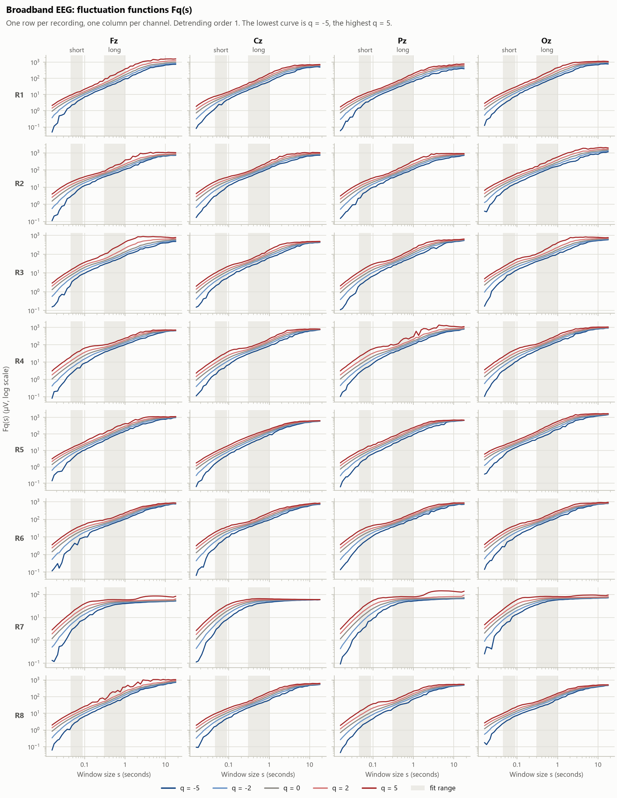

- Each panel is one channel of one recording. The lowest curve is q = −5 and the highest q = 5.
- **Straight** stretches are where a power law holds. **Bends** are crossovers (7.8).
- **Parallel** curves would mean monofractal. Curves that **fan out** or come together mean that h
  differs with q.
- The shaded bands are the fit ranges the project chose.
- Row R7 is different: its curves go flat from about 0.2 s on. The scaling report notes that R7
  "has almost no power below the alpha band" ([mfdfa.yaml](../configs/features/mfdfa.yaml)
  comment on `long`). The inspection never says which recording R7 is. That is deliberate (7.9).

**h(q) and f(α) by group.** This figure is in the statistics report. It averages each person's
channels, then each group, with 95 % intervals:

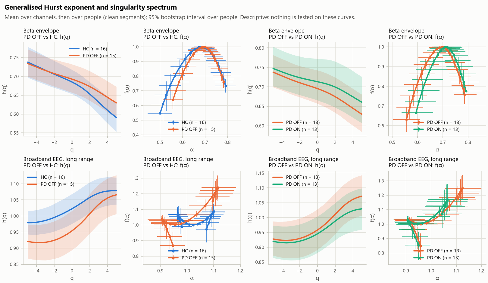

- **Beta envelope (top row):** h(q) falls as q rises, and f(α) is a neat hump, the textbook
  multifractal shape.
- **Broadband, long range (bottom row):** h(q) *rises* with q. The scaling report shows the same
  in its medians, h(−5) 0.91, h(2) 0.99 and h(5) 1.05
  ([mfdfa_scaling.md](../reports/mfdfa_scaling.md), "Fits over the configured ranges"). So
  `delta_h` is negative there, and f(α) is not a single hump but a hook. That is why the app's
  "Signal complexity" graph shows the beta envelope rather than the broadband signal: its caption
  ("wider = more irregular") only describes a hump ([app.yaml](../configs/app.yaml), comment on
  `complexity`).

### 7.8 Scales, fit ranges and crossovers

A **scale** is a window length `s`. The project uses 12 scales per **fit range**
([mfdfa.yaml](../configs/features/mfdfa.yaml), key `scales_per_range`). A fit range is a span of
window lengths over which h(q) is fitted. The scales are spaced evenly on a log axis and rounded to
whole samples. No window may be longer than a tenth of the series (`scale_max_frac: 0.1`), "so
every scale has at least 10 windows from each end".

Real signals rarely obey one power law over every scale. A **crossover** is a scale where the
slope changes, because a different process takes over. To find the straight stretches, the
project computes the **local slope**: the slope of log Fq against log s through 5 neighbouring
scales (`inspection.slope_half_width: 2`), over 50 scales (`inspection.n_scales`). A true power
law shows up as a **level** stretch of local slope.

The other key idea is to **compare with noise put through the same filters**. The cleaning filter
and the envelope filters can create bends of their own. So the inspection also analyses noise that
has *no* crossover: 1/f and 1/f² noise put through the 0.5–50 Hz band-pass, and white noise turned
into band envelopes exactly as the EEG is. An envelope traces a rhythm's strength over time, and
7.10 shows how it is made. Each noise is generated 40 times (40 **realisations**, independent random
draws). Unfiltered, such noise has the same slope at every scale, "so any departure is the filter's
doing" ([mfdfa_scaling.md](../reports/mfdfa_scaling.md)).

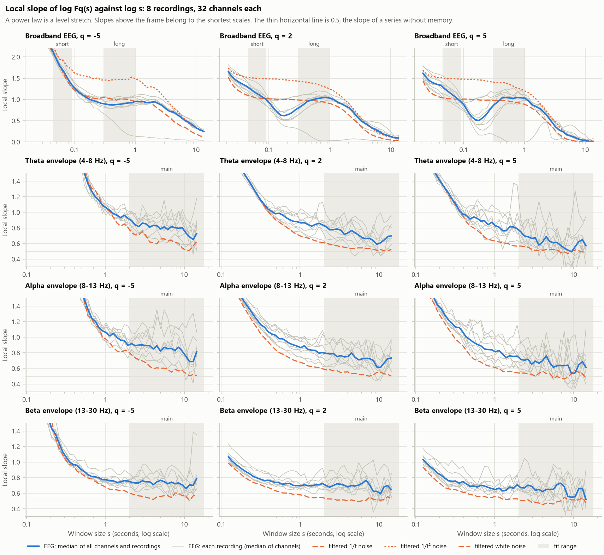

How to read it: x is the window size in seconds (log scale), and y is the local slope. The thick
blue line is the median EEG, the thin grey lines are individual recordings, and the dashed orange
lines are the filtered noises. The grey shaded bands are the chosen fit ranges.

**The broadband EEG** has three crossovers, two of them made by the filter
([mfdfa.yaml](../configs/features/mfdfa.yaml), comments under `broadband`, slopes for q = 2):

1. **Below about 0.05 s the 50 Hz low-pass has smoothed the signal.** Filtered 1/f noise, whose
   slope should be 1, shows 1.53 at 0.02 s, and is within 0.1 of 1 only from 0.049 s on.
2. **The alpha rhythm.** The EEG slope falls from 1.02 at 0.088 s to a minimum of 0.62 at 0.18 s,
   "just under two alpha periods", and is back at 0.82 by 0.32 s and 0.96 by 0.43 s.
3. **Above about 1 s the 0.5 Hz high-pass has left nothing to accumulate.** Filtered 1/f noise is
   at 0.93 at 0.88 s, 0.87 at 1.17 s and 0.16 at 4.9 s. The EEG is at 1.03 at 1 s, 0.80 at 2.1 s
   and 0.33 at 4.9 s.

That leaves two short stretches:

| Fit range | Seconds | Samples | Span | Features used |
|---|---|---|---|---|
| broadband `short` | 0.045 to 0.09 | 24 to 46 | 0.28 decades | `h2` only |
| broadband `long` | 0.3 to 1 | 154 to 512 | 0.52 decades | all five |
| envelope `main` | 2 to 17.8 | 1024 to 9113 | 0.95 decades | all five |

Why only `h2` on the short range: "on this range filtered monofractal 1/f noise has
delta_alpha = 1.08 (EEG: 1.07), so the width, delta_h and asymmetry measured here are those of the
low-pass filter, not of the signal" ([mfdfa.yaml](../configs/features/mfdfa.yaml), key
`broadband.wide_features`).

**The envelopes** (7.10) get one range, 2 to 17.8 s. The upper end is a tenth of the trimmed
envelope (178 s). The lower end is set by the band-pass filter, which gives even memoryless noise a
memory of its own. The envelope of white noise, which should have slope 0.5, has 0.70 / 0.68 / 0.58
(theta / alpha / beta) at 1 s and 0.60 / 0.59 / 0.54 at 2 s. Fitted from 2 s, its widths are down
to their finite-length floor ([mfdfa.yaml](../configs/features/mfdfa.yaml), comment on
`envelope.fit_ranges.main`).

**What the EEG looks like on these ranges**, against the matched noise (median [10th, 90th
percentile] over 256 channel fits, or over 40 noise realisations;
[mfdfa_scaling.md](../reports/mfdfa_scaling.md)):

| Series | Fit range | Source | h(2) | delta_alpha |
|---|---|---|---|---|
| Broadband | 0.045 to 0.09 s | EEG | 1.13 [0.96, 1.34] | 1.07 [0.57, 1.85] |
| | | filtered 1/f noise | 1.04 [1.02, 1.05] | 1.08 [0.77, 1.71] |
| Broadband | 0.3 to 1 s | EEG | 0.99 [0.13, 1.18] | 0.32 [0.11, 0.66] |
| | | filtered 1/f noise | 0.97 [0.94, 1.00] | 0.12 [0.07, 0.28] |
| Theta envelope | 2 to 17.8 s | EEG | 0.70 [0.56, 0.85] | 0.35 [0.15, 0.63] |
| | | white-noise envelope | 0.54 [0.48, 0.61] | 0.19 [0.08, 0.35] |
| Alpha envelope | 2 to 17.8 s | EEG | 0.74 [0.60, 0.88] | 0.35 [0.18, 0.67] |
| | | white-noise envelope | 0.53 [0.47, 0.59] | 0.17 [0.07, 0.26] |
| Beta envelope | 2 to 17.8 s | EEG | 0.69 [0.59, 0.87] | 0.23 [0.09, 0.55] |
| | | white-noise envelope | 0.52 [0.46, 0.58] | 0.13 [0.05, 0.27] |

In words: on the long broadband range and in every envelope, the EEG spectrum is wider than that
of matched noise, and the envelopes are more persistent (higher `h2`) than the filter alone makes
them. So the band amplitudes really are correlated over seconds. The filter adds a small bias of
about +0.02 to +0.04 to the envelopes' `h2`, "the same for every recording", so it shifts all
groups alike.

### 7.9 Why the fit ranges were chosen blind to the labels

The fit ranges are choices, and choices can be bent, even without meaning to, towards the result
you hope for. If you looked at patients and controls and picked the window lengths where they
differed most, you would almost certainly "find" a difference, even in pure noise. Trying many
ways of analysing the data and keeping the one that works is called the **garden of forking
paths**.

So the ranges were chosen **label-blind** ([methods.md](../reports/methods.md), section 5;
[mfdfa_scaling.md](../reports/mfdfa_scaling.md)):

- 8 of the 46 recordings were picked at random (seed 20261009) and shown only as **R1 to R8**.
- "No subject, session or group label was read to choose them or appears below, so nothing here
  can be tuned towards a group difference." The command that runs it reads only the `subject` and
  `session` columns of the recordings table: `pd.read_parquet(table, columns=["subject",
  "session"])` in `_mfdfa_scaling` in [`src/pdeeg/cli.py`](../src/pdeeg/cli.py).
- The ranges were approved on 2026-10-09 ([mfdfa.yaml](../configs/features/mfdfa.yaml)), two weeks
  before the group statistics were written down on 2026-10-23 ([stats.yaml](../configs/stats.yaml)).
- The reason for every end of every range is written next to it in `mfdfa.yaml`.

`pdeeg mfdfa-scaling` writes [`reports/mfdfa_scaling.md`](../reports/mfdfa_scaling.md). It is not
part of `pdeeg all`, since its job (choosing the ranges) is done and recorded in the config.

### 7.10 Amplitude envelopes and the Hilbert transform

Besides the cleaned EEG itself (the **broadband** series), MFDFA is run on three **amplitude
envelopes**: the theta, alpha and beta envelopes. An envelope is the outline of a wave's peaks. It
traces how strong a rhythm is from moment to moment. A song's melody is the fast part, and the
envelope is like the position of its volume knob over time.

```
beta-band signal (fast wiggles whose size changes):
       .-.  .-.                .-.  .-.  .-.  .-.
  .-..'   \/   \.-.._.-.._.-..'   \/   \/   \/   \.-.._
amplitude envelope (the outline, slow):
     ___/^^^^^^\______________/^^^^^^^^^^^^^^^^^\_____
```

How the project makes one ([methods.md](../reports/methods.md), section 5; function
`band_envelope` in [`src/pdeeg/features/envelope.py`](../src/pdeeg/features/envelope.py)):

1. **Band-pass to the band**: theta 4–8 Hz, alpha 8–13 Hz, beta 13–30 Hz
   ([mfdfa.yaml](../configs/features/mfdfa.yaml), key `envelope.bands`). It is a zero-phase FIR
   filter with 2 Hz transitions (`trans_bandwidth: 2.0`), "so that the filter is 1.65 s long for
   all of them".
2. **Hilbert transform.** The **Hilbert transform** makes a copy of a wave shifted by a quarter of
   a cycle (90°). Combining the wave with this copy gives the **analytic signal**, which you can
   picture as an arrow spinning round a clock face. Its length is the instantaneous amplitude:
   the envelope.

   **Toy example.** For x = 2 cos(t), the Hilbert copy is 2 sin(t), and the arrow's length is
   √(4 cos²t + 4 sin²t) = 2 at every moment. A steady wave has a flat envelope. A bursty rhythm
   has an envelope that rises and falls.
3. **Trim 1 s from each end** (`edge_trim: 1.0`), where the filter and the Hilbert transform only
   have data on one side. On 1/f noise the theta envelope was "5 % off a quarter to half a second
   from the edge and 0.7 % or less beyond 1 s". Each envelope is then 178 s, which is 91136 samples
   ([mfdfa_scaling.md](../reports/mfdfa_scaling.md)).

Why envelopes? The Parkinson's beta story (chapter 2) is about *how strong and how sustained* beta
activity is. MFDFA of the beta envelope measures how the strength of the beta rhythm fluctuates
over seconds: whether strong stretches persist, and how irregular the bursts are. Two of the three
pre-registered primary features are exactly these: `envelope_beta_main_h2` and
`envelope_beta_main_delta_alpha` ([stats.yaml](../configs/stats.yaml)).

### 7.11 Bad windows inside MFDFA

The `clean` values (5.6) are computed like this ([mfdfa.yaml](../configs/features/mfdfa.yaml),
section "Stretches marked bad"; the `exclude` argument of `mfdfa`):

- Every window that touches a bad sample is dropped where it stands. The other windows keep their
  places. The bad samples are replaced by the mean of the rest before the profile is made, so their
  values do not enter the result in any way.
- For an envelope, each bad stretch is first widened by 1 s on both sides, "because the band-pass
  spreads an artefact that far".
- A scale with fewer than 8 usable windows is left out of the fit (`bad_windows.min_windows: 8`).
  No fit is made on fewer than 8 scales (`min_scales: 8`), in which case the features are missing.
  The number of scales a fit used is stored as `n_scales`.

The comment records the consequence: "With 8, 43 recordings keep all 12 scales of the envelope
range and the other three keep 11, 9 and 8." Windows that are almost perfectly flat are also
dropped (`min_variance_ratio: 1.0e-12`), because "Flat windows would otherwise dominate the moments
for negative q".

A fit is reported as **poor** when its worst R² over q is below 0.9 (`poor_fit_r2`). The share of
poor channel fits was 3.5 % to 9.9 % depending on the series and segments
([qc_mfdfa.md](../reports/qc_mfdfa.md), "Fit quality").

### 7.12 Surrogates: is it really multifractal?

There is a catch. MFDFA can report a wide spectrum for reasons that have nothing to do with
multifractality: a skewed distribution of values, or plain linear correlations measured on a
finite signal. The test for this is a **surrogate**: a fake version of the series that keeps some
of its properties and destroys the others. If the real series' `delta_alpha` is no wider than its
surrogates', the width is explained by the properties the surrogates kept.

Two kinds are used ([methods.md](../reports/methods.md), section 6;
[`src/pdeeg/features/surrogates.py`](../src/pdeeg/features/surrogates.py)):

| Surrogate | How it is made | What it keeps | What it destroys |
|---|---|---|---|
| **Shuffled** | The same values in random order | The distribution of values (the histogram) | Every correlation, so h2 becomes 0.5 |
| **IAAFT** (iterative amplitude-adjusted Fourier transform; Schreiber and Schmitz 1996) | Start from a shuffle. Then repeatedly (a) give it the original's power spectrum, keeping its own timing, and (b) put the original's values back in the new rank order, until the order stops changing or after 100 rounds (`iaaft_max_iter`) | The distribution **and** (closely) the power spectrum, which means the linear correlations | Nonlinear structure: the particular way bursts line up in time |

The project makes 20 of each for every channel and series (`surrogates.n_iaaft: 20`,
`n_shuffle: 20`, seed 20261009) and summarises each comparison as a **z-score**: (real
`delta_alpha` − mean of the surrogates) / standard deviation of the surrogates. A z of 0 means "no
wider than the surrogates". A z above 2 means clearly wider.

The results ([qc_mfdfa.md](../reports/qc_mfdfa.md); median [10th, 90th percentile] over all
channels of all recordings):

| Series and fit range | z against IAAFT | Channels wider than all 20 IAAFT surrogates | Recordings with median z > 2 (IAAFT) | z against shuffles |
|---|---|---|---|---|
| Broadband, short | −0.3 [−1.5, 1.4] | 4.1 % | 0 of 46 | 32.9 [13.7, 60.0] |
| Broadband, long | 0.2 [−1.6, 3.2] | 17.7 % | 2 of 46 | 6.7 [1.6, 17.6] |
| Theta envelope | 0.0 [−1.3, 1.8] | 8.2 % | 0 of 46 | 3.8 [0.7, 8.9] |
| Alpha envelope | 0.1 [−1.2, 1.8] | 9.1 % | 0 of 46 | 4.7 [1.0, 11.0] |
| Beta envelope | 0.5 [−0.9, 2.6] | 17.5 % | 0 of 46 | 2.5 [−0.2, 6.8] |

For a series that is itself a surrogate, being wider than every one of 20 surrogates happens with
probability 1/21 ≈ 0.048, so about **4.8 %** of channels would pass by chance (stated in the
report).

**What this says, honestly.** Against shuffles, the EEG is far wider: its correlations matter.
Against IAAFT, the typical z is close to 0. In other words, *most* of the measured spectrum width
is what the power spectrum and the value distribution already produce. Only on the long broadband
range and in the beta envelope do noticeably more channels than chance (17.7 % and 17.5 %, against 4.8 %)
beat every IAAFT surrogate. The MFDFA features are therefore best read as careful descriptions of
correlation structure, not as proof of genuine nonlinear multifractality.

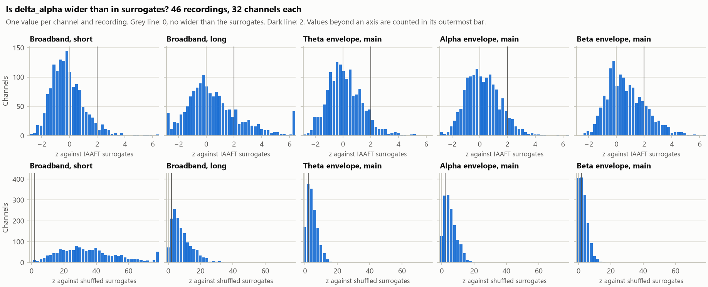

The top row's histograms are centred near 0 (grey line) with a tail past 2 (dark line). The
bottom row's sit far to the right. The surrogates also check themselves: IAAFT left `h2` where it
was (median difference 0.000 on the short broadband range) and shuffling moved it far from the
original, towards 0.5 ([qc_mfdfa.md](../reports/qc_mfdfa.md), last column). **No model feature
uses the surrogates.** They are a check.

### 7.13 How the tests prove the implementation

The MFDFA code was written for this project, so it has to be proven correct. The proof is to run
it on **synthetic signals** (made-up signals whose exponents are known exactly) and check that it
gets them right ([`tests/test_mfdfa.py`](../tests/test_mfdfa.py),
[`notebooks/01_mfdfa_validation.ipynb`](../notebooks/01_mfdfa_validation.ipynb)).

The signals, made by [`src/pdeeg/features/synthetic.py`](../src/pdeeg/features/synthetic.py):

- **White noise**: h(q) should be 0.5 for every q.
- **Random walk** (cumulative white noise): 1.5.
- **Fractional Gaussian noise (fGn)**: random noise built to have a chosen Hurst exponent H
  exactly (function `fgn`, Davies–Harte method), with H = 0.3, 0.7 and 0.9.
- **Binomial cascade**: a classic deterministic multifractal. Start with a mass of 1, split it 75 %
  / 25 % into two halves, split each half 75 / 25 again, and so on. Level 1 is 0.75, 0.25. Level 2
  is 0.5625, 0.1875, 0.1875, 0.0625. Its exact h(q) is known: with a = 0.75 it "falls from 1.80
  at q = −5 to 0.61 at q = 5", and the spectrum is 1.57 wide (the notebook).

Over 100 realisations of 65536 samples each (the notebook's table, quoted in the test file), as
mean ± standard deviation:

| Signal | Exact | h(−5) | h(2) | h(5) | delta_alpha |
|---|---|---|---|---|---|
| white noise | 0.5 | 0.510 ± 0.010 | 0.502 ± 0.010 | 0.499 ± 0.012 | 0.033 ± 0.017 |
| random walk | 1.5 | 1.534 ± 0.027 | 1.498 ± 0.022 | 1.489 ± 0.025 | 0.124 ± 0.040 |
| fGn, H = 0.3 | 0.3 | 0.310 ± 0.007 | 0.300 ± 0.008 | 0.297 ± 0.010 | 0.030 ± 0.012 |
| fGn, H = 0.7 | 0.7 | 0.708 ± 0.014 | 0.698 ± 0.014 | 0.692 ± 0.016 | 0.046 ± 0.021 |
| fGn, H = 0.9 | 0.9 | 0.910 ± 0.018 | 0.897 ± 0.016 | 0.890 ± 0.019 | 0.060 ± 0.027 |

Three things to notice:

1. `h(2)` is within 0.003 of the truth for every monofractal signal.
2. The spectrum width of a monofractal signal is not exactly 0 but a small positive number (0.03
   to 0.06, and 0.12 for the random walk). The estimator "leans towards a wider spectrum than the
   truth" at finite length. That is why real widths are judged against surrogates, never against
   zero.
3. Each test's tolerance is "the bias in that table plus four standard deviations, so a test fails
   for a wrong estimator and not for an unlucky seed".

Further tests check that:

- the cascade's spectrum is recovered as wide and symmetric (the notebook reports delta_alpha
  1.632 against the exact 1.572, "within 4 %");
- the code **agrees with an independent implementation**, the PyPI `MFDFA` package
  (`test_agrees_with_the_mfdfa_package`; the notebook says the two give "the same Fq to 11
  digits");
- detrending of order m removes polynomial trends of degree m exactly;
- leaving out a stretch gives the same result as if it had been cut out;
- flat windows are discarded, and bad inputs are refused.

### 7.14 Where it lives

**The algorithm**, in [`src/pdeeg/features/mfdfa.py`](../src/pdeeg/features/mfdfa.py), knows
nothing about EEG or the config. Every setting is an argument:

| Function or class | What it does |
|---|---|
| `make_qs` | The list of q values, with 0 and 2 exactly on it |
| `make_scales` | Log-spaced whole-sample window sizes |
| `_window_variances` | F² of every window: fits all windows' trends at once with an orthonormal Legendre polynomial basis, which is numerically stable |
| `_fluctuation` | Fq(s) for every q, computed with logarithms (`logsumexp`) so no power can overflow |
| `_loglog_fit` | Slope, intercept and R² of log Fq against log s |
| `mfdfa` | The whole method, including `exclude` (bad samples) and `min_windows`. Returns an `MfdfaResult` |
| `spectrum_features` | The five features plus `min_r2` |
| `TooFewScales` | Raised when fewer than 3 scales are left to fit |

**Running it on the EEG:**

| File | Role |
|---|---|
| [`features/scaling.py`](../src/pdeeg/features/scaling.py) | `analysis_series` (the broadband series and the envelopes of one recording), `scales_in_range`, and the label-blind `run_inspection` with `local_slopes` |
| [`features/envelope.py`](../src/pdeeg/features/envelope.py) | `band_envelope`, `trim_samples` |
| [`features/surrogates.py`](../src/pdeeg/features/surrogates.py) | `shuffle_surrogate`, `iaaft_surrogate` |
| [`features/extract.py`](../src/pdeeg/features/extract.py) | `channel_runs` (every run of one channel: original `full` and `clean`, and 20 + 20 surrogates), `fit_features`, `recording_runs`, `extract_recording` with per-recording caching (`config_hash`, `EXTRACT_VERSION`), `surrogate_seed` (a channel's surrogates do not depend on run order) |
| [`features/tables.py`](../src/pdeeg/features/tables.py) | `summarise_runs` (features and surrogate z-scores), `build_mfdfa_table`, `mfdfa_wide` |
| [`features/curves.py`](../src/pdeeg/features/curves.py) | The whole h(q) and f(α) curves, for figures |
| [`features/report.py`](../src/pdeeg/features/report.py), [`scaling_report.py`](../src/pdeeg/features/scaling_report.py) | The two QC reports |

**Counting the runs.** Per channel there are 2 broadband ranges plus 3 envelopes = 5 series-ranges,
each run 42 times (original `full`, original `clean`, 20 IAAFT, 20 shuffled), which makes 210 runs.
Over 32 channels that is 6720 MFDFA runs per recording. That matches the `n_runs` field in every
per-recording log in `data/interim/mfdfa/` (local files, not in git).

**The wide columns** are named `<series>_<fit range>_<feature>_<region>`, for example
`envelope_beta_main_h2_parietal` or `broadband_long_delta_alpha_central`. The count is 5 regions ×
(1 short-range `h2` + 5 long-range features + 3 envelopes × 5 features) = 5 + 25 + 75 =
**105 MFDFA features** ([methods.md](../reports/methods.md), section 7).

**Commands**: `pdeeg mfdfa-features` (runs and the QC report
[`qc_mfdfa.md`](../reports/qc_mfdfa.md)) and `pdeeg mfdfa-curves`, both part of `pdeeg features`.
Also `pdeeg mfdfa-scaling` (the label-blind inspection).

### Key takeaways

- DFA: profile → windows → detrend → fluctuation → slope on log-log axes. The slope is the Hurst
  exponent: 0.5 for no memory, above 0.5 for persistent.
- MFDFA repeats this for q from −5 to 5. Negative q follows small fluctuations, positive q large
  ones. h(q), τ(q), α and f(α) follow, and five features summarise them.
- The fit ranges (broadband 0.045–0.09 s and 0.3–1 s, envelopes 2–17.8 s) sit between crossovers
  made by filters and the alpha rhythm. They were chosen blind to the labels, from 8 random
  recordings.
- Envelopes (band-pass, then Hilbert magnitude) show how a rhythm's strength fluctuates. The beta
  envelope carries two of the three primary features.
- Against IAAFT surrogates most of the width is explained by linear correlations. The code is
  validated on signals with known exponents and against an independent package.

### Check yourself

**Q1. In DFA, why take the running total (the profile) first?**
*Answer:* It turns the signal into a path whose wandering grows with the window length in a way
the exponent describes, and detrending each window of the path removes slow drifts.

**Q2. What does q = −5 emphasise, and what does q = 5 emphasise?**
*Answer:* q = −5 emphasises the windows with the smallest fluctuations, and q = 5 those with the
largest.

**Q3. A spectrum has min α = 0.5, max α = 0.9 and peaks at α0 = 0.6. What are delta_alpha and
asymmetry?**
*Answer:* delta_alpha = 0.4. left = 0.6 − 0.5 = 0.1 and right = 0.9 − 0.6 = 0.3, so asymmetry =
(0.1 − 0.3) / 0.4 = −0.5.

**Q4. Why is only `h2` used on the short broadband range?**
*Answer:* There, filtered monofractal 1/f noise is as wide as the EEG (delta_alpha 1.08 against
1.07), so the width and shape measured there belong to the low-pass filter, not the brain.

**Q5. The EEG's delta_alpha is no wider than its IAAFT surrogates'. What does that mean?**
*Answer:* The width can be explained by the power spectrum (linear correlations) and the value
distribution alone. It gives no evidence of nonlinear multifractal structure.

**Q6. White noise gives a delta_alpha of 0.033, not 0. Is the code wrong?**
*Answer:* No. At finite length the estimator is slightly biased towards a wider spectrum. That is
known, measured over 100 realisations and built into the tolerances, and it is why real widths are
compared with surrogates rather than with zero.

---

## 8. Statistics

Statistics is the project's **primary analysis**: the main, pre-planned test of its questions.
The command is `pdeeg stats`. The plan is [`configs/stats.yaml`](../configs/stats.yaml), and the
results are [`reports/stats_results.md`](../reports/stats_results.md).

### 8.1 Hypotheses, and the courtroom

A **hypothesis** is a statement that can be tested. Statistics usually works with two:

- the **null hypothesis**, "there is no difference" (patients and controls have the same average
  value);
- the **alternative**, "there is a difference".

A test is like a trial in court. The defendant (the null hypothesis) is presumed innocent, and is
only convicted (rejected) if the evidence is strong. Note what an acquittal means: **"not
guilty" is not "innocent"**. Failing to find a difference does not show that there is none,
especially when the evidence is thin, as it is with 31 people. This point matters for this
project's results.

### 8.2 The p-value

The **p-value** is the probability of seeing a result at least as extreme as the one observed,
*if the null hypothesis were true*. A small p-value means "this would be surprising if nothing
were going on". By convention, p below 0.05 is called **significant**.

**Toy example.** You suspect a coin is biased, and it lands heads 9 times out of 10. If the coin is
fair, the chance of a result at least this extreme in either direction (9 or 10 heads, or 9 or 10
tails) is (1 + 10 + 10 + 1) / 1024 = 22/1024 ≈ 0.021. That would be fairly surprising for a fair
coin, so p ≈ 0.021.

What a p-value is **not**:

- not the probability that the null is true;
- not the size of the effect (a tiny, useless effect can have a tiny p in a huge sample);
- not a verdict on its own. p = 0.049 and p = 0.051 are practically the same evidence.

### 8.3 Permutation tests

A **permutation test** gets its p-value by shuffling. If the group labels truly do not matter,
then shuffling who is called "patient" and who "control" should give results as extreme as the
real one fairly often.

**Toy example.** Three patients score 6, 8 and 9, and three controls score 4, 5 and 7. The observed
difference of means is 7.667 − 5.333 = **2.333**. There are exactly 20 ways to choose which 3 of the
6 people are "patients". Computing the difference for all 20 gives values from −3.0 to +3.0, and
4 of the 20 are at least as far from zero as 2.333 (−3.0, −2.333, +2.333, +3.0). So the exact
two-sided p is **4/20 = 0.20**: not significant. (For comparison, the classic t-test of the next
section gives p = 0.135 on the same numbers.)

With more people there are too many arrangements to try them all, so the project draws 10000 at
random ([stats.yaml](../configs/stats.yaml), key `cluster.n_permutations`). For OFF against ON the
"shuffle" is different. Within a patient, OFF and ON can be swapped, which flips the sign of their
difference. With 13 pairs there are 2¹³ = 8192 sign patterns, or 4096 up to the symmetry of a
two-sided test, so the project uses **every one of them**: an **exact test**
([stats_results.md](../reports/stats_results.md): "PD OFF vs PD ON, 13 pairs: 4096 (every one,
exact)").

The permutation idea comes back in chapter 9, where whole machine-learning procedures are
re-run on shuffled labels.

### 8.4 The t statistic

**Student's t** measures a difference relative to its uncertainty, signal over noise:

```
t = (difference of means) / (standard error of that difference)
```

The **standard error** is how much the difference would vary from one sample of people to another.
It is smaller when the groups are larger or less spread out.

- **Two-sample t** (PD OFF against HC) uses the pooled spread of both groups.
- **One-sample t on the differences** (OFF minus ON within patients) asks whether the average
  difference is away from zero.

**Degrees of freedom** count the independent pieces of information left for estimating the
spread: n₁ + n₂ − 2 for two groups (15 + 16 − 2 = 29), and n − 1 for pairs (13 − 1 = 12). The
toy above has t = 1.87 with 4 degrees of freedom.

### 8.5 Multiple comparisons and the false discovery rate

Test 20 things that are all truly null, each at p < 0.05, and on average one will come out
"significant" by luck. Test many features at many electrodes and false alarms are guaranteed.
This is the problem of **multiple comparisons**, and the fix is to correct for the number of
tests.

A **family** is a set of tests that are corrected together. The **false discovery rate (FDR)** is
the expected share of false alarms among the results you call significant. The
**Benjamini-Hochberg** procedure controls it. It turns each p-value into a **q-value**, and a
result is significant at FDR 5 % when its q is below 0.05.

**Toy example.** Five tests give p = 0.001, 0.008, 0.039, 0.041 and 0.20. Benjamini-Hochberg sorts
them and multiplies the k-th smallest by 5/k (0.001 × 5, 0.008 × 5/2, 0.039 × 5/3, 0.041 × 5/4,
0.20 × 5/5). Then, going from the top, it keeps each value no larger than the one after it. The
q-values are **0.005, 0.020, 0.051, 0.051 and 0.200**. Four tests had p < 0.05, but only **two**
survive with q < 0.05. (Computed with SciPy's `false_discovery_control`, which the project's
`benjamini_hochberg` calls.)

The project's families ([stats.yaml](../configs/stats.yaml), key `fdr_q`;
[stats_results.md](../reports/stats_results.md)):

- **Primary**: the 3 pre-registered features × the 2 main contrasts (PD OFF against HC, OFF
  against ON).
- **Exploratory**: the other 23 features × the 2 contrasts, corrected separately.
- A test that finds no cluster at all counts as one p-value of 1.
- Each **sensitivity analysis** (a variant of an analysis run to check that the conclusion does
  not depend on one choice) is corrected as if it had replaced the main analysis of its contrast.

### 8.6 Cluster-based permutation tests over the scalp

Each feature has 32 values per person, one per channel. Testing each channel separately would be
32 tests per feature. But neighbouring electrodes see overlapping brain areas, so a real effect
shows up as a **patch** of neighbouring channels, while noise shows up as scattered single
channels. The **cluster-based permutation test** (Maris and Oostenveld 2007) uses this:

1. Compute t at every channel.
2. Keep the channels where |t| is above the threshold for p = 0.05 at the test's degrees of
   freedom (`cluster_forming_p: 0.05`). For 29 degrees of freedom that threshold is |t| > 2.045
   (computed from the t distribution).
3. Kept channels that are **neighbours** form a **cluster**. Neighbours come from the FieldTrip
   template for the biosemi32 cap that ships with MNE: "3 to 8 neighbours per channel, median 6,
   none further apart than 7.7 cm" ([stats.yaml](../configs/stats.yaml), key `cluster.adjacency`).
4. A cluster's **mass** is the sum of its t-values.
5. Shuffle the labels (10000 times, or all 4096 sign flips), redo steps 1–4 each time, and record
   **the largest |mass| anywhere on the scalp**.
6. A cluster's p-value is the share of shuffles whose largest |mass| reaches its own.

Comparing against the *largest* cluster of each shuffle is what controls false alarms across all
32 channels at once.

**A real example** ([stats_results.md](../reports/stats_results.md)): for `delta_alpha` of the
beta envelope, PD OFF against HC, two neighbouring right-side channels formed a cluster with
patients lower:

```
            ...          FC6
       C4          T8   <- t = -3.21 (the peak)
            CP2     CP6  <- t about -2.1 (the mass minus T8's t)
```

Its mass was −5.3, its p-value 0.086, and after the FDR correction its q-value was 0.471. It was
not significant.

The code calls MNE's `permutation_cluster_test` and `permutation_cluster_1samp_test` through
`two_sample_test` and `paired_test` in
[`src/pdeeg/stats/cluster.py`](../src/pdeeg/stats/cluster.py). The neighbour matrix is
`channel_adjacency`.

### 8.7 Effect sizes and power

A p-value says *whether* an effect is likely real, and an **effect size** says *how big* it is.

- **Cohen's d** is the difference of means divided by the **pooled standard deviation** (the
  spread within the two groups, combined): how many "spreads" apart the groups are.
- **Hedges' g** is d with a small-sample correction: g = d × (1 − 3 / (4(n₁ + n₂) − 9)) (function
  `hedges_g`).
- For pairs, **g_z** is the mean difference divided by the standard deviation of the differences,
  with a similar correction (`paired_hedges_g`). It measures how *consistent* the change is within
  people, and it is "not comparable with a between-group g".

**Toy example.** Patients 6, 8, 9 and controls 4, 5, 7: the difference is 2.333 and the pooled
standard deviation is 1.528, so d = 1.528. The correction is 1 − 3/(4 × 6 − 9) = 0.8, so
g = 1.222. (Computed with the project's `hedges_g`.) As a rough convention, 0.2 is called small,
0.5 medium and 0.8 large.

**Power** is the probability that a test detects an effect of a given size if it is really there.
The report states what this sample can see ([stats_results.md](../reports/stats_results.md)):
"With 15 and 16 people, a single two-sided t-test has 80% power only for differences of about
g = 1.04 or more; with 13 pairs, for d_z = 0.85 or more." Those are large effects. Smaller real
effects would easily be missed. The function is `detectable_effect` in
[`src/pdeeg/stats/descriptive.py`](../src/pdeeg/stats/descriptive.py).

### 8.8 Bootstrap confidence intervals

A **confidence interval** is a range of plausible values for something you estimated. A 95 %
interval is built so that, over many repetitions of the study, it would contain the true value
95 % of the time.

The **bootstrap** builds one by resampling. Draw a new sample of the same size from your own data,
*with replacement* (so someone can be drawn twice and someone else not at all), recompute the
estimate, repeat thousands of times, and take the middle 95 % of the results (the **percentile**
interval).

**Toy example.** Three people score 2, 4 and 9 (mean 5). One bootstrap draw might be 4, 4, 9
(mean 5.67), another 2, 2, 4 (mean 2.67). After 2000 draws, the 2.5th and 97.5th percentiles of
the 2000 means are the interval.

The project always resamples **participants**, keeping each person's data together, because the
person is the unit being generalised over. Group means in the figures use 2000 resamples
([stats.yaml](../configs/stats.yaml), key `bootstrap`; function `bootstrap_mean_ci`). Chapter 9
uses the same idea for classifier scores.

### 8.9 Pre-registration

The statistics were **pre-registered**: written down in full before any feature was compared
between groups. The header of [`configs/stats.yaml`](../configs/stats.yaml) reads: "Written on
2026-10-23, before the MFDFA feature tables existed and before any feature had been compared
between groups or sessions." The report records the file's SHA-256 fingerprint (a **SHA-256 hash**, also called a **digest**,
is a 64-character fingerprint of a file's exact contents: change one character and it changes
completely) so that any later edit would show. "A change to it since would make the analysis it
affects exploratory."

Why it matters: it closes the garden of forking paths (7.9). If the features, contrasts, test,
threshold and correction are fixed first, the result cannot be tuned. It is like calling your shot
in pool before you take it.

What was fixed:

- **The three primary features**: `envelope_beta_main_h2`, `envelope_beta_main_delta_alpha`, and
  `broadband_long_delta_alpha`. The broadband one uses the long range because "on the short range
  the spectrum width is the low-pass filter's".
- **The contrasts**: PD OFF (session `off`) against HC between people, and OFF minus ON within
  patients without pd6 and pd16.
- **The values**: `clean` segments.
- **The test, threshold, permutations, correction, covariates and seed** (20261023).

Everything else is **exploratory**: worth reporting, but a lead rather than a finding.

### 8.10 Confounds: age and sex

A **confound** is a third factor linked to both the groups and the measurement, which could fake a
difference. If the patients were much older, an EEG difference might just be age.

The project checks and adjusts ([stats.yaml](../configs/stats.yaml), key `covariates`;
[`src/pdeeg/stats/confounds.py`](../src/pdeeg/stats/confounds.py)):

- **Age** is compared with **Welch's t-test**, a t-test that does not assume equal spreads:
  t(28.7) = −0.07, p = 0.943.
- **Sex** is compared with **Fisher's exact test**, a test for counts in a small table: odds ratio
  1.12, p = 1.000 ([stats_results.md](../reports/stats_results.md)).
- **Adjusted analysis**: the PD OFF against HC tests are repeated on **residuals**, what is left of
  each channel's values after a least-squares fit on age and sex (with an intercept, over both
  groups together; function `residualise`), with the degrees of freedom reduced to match.

The report adds a caution worth repeating in an interview: "Neither differs between the groups at
p < 0.05; with groups this small that does not prove they are matched, which is why the adjusted
analysis is reported too." Age and sex do not change within a patient, so the paired analysis is
not adjusted.

### 8.11 The actual results, in plain words

**The primary features.** One row per feature and analysis. The "best cluster" is the one with the
smallest p ([stats_results.md](../reports/stats_results.md)):

| Feature | Analysis | Best cluster | Its p | Its q |
|---|---|---|---|---|
| h2, beta envelope | PD OFF vs HC | no cluster | – | 1.000 |
| h2, beta envelope | PD OFF vs HC, adjusted for age and sex | no cluster | – | 1.000 |
| h2, beta envelope | PD OFF vs PD ON, 13 pairs | PD OFF < PD ON (FC5) | 0.411 | 0.707 |
| h2, beta envelope | PD OFF vs PD ON, all 15 pairs | PD OFF < PD ON (O2, P8) | 0.168 | 0.449 |
| delta_alpha, beta envelope | PD OFF vs HC | PD OFF < HC (CP6, T8) | 0.086 | 0.471 |
| delta_alpha, beta envelope | PD OFF vs HC, adjusted for age and sex | PD OFF < HC (P4, CP6, T8) | 0.045 | 0.353 |
| delta_alpha, beta envelope | PD OFF vs PD ON, 13 pairs | PD OFF > PD ON (O1, Oz) | 0.064 | 0.471 |
| delta_alpha, beta envelope | PD OFF vs PD ON, all 15 pairs | PD OFF > PD ON (O1, Oz, O2) | 0.045 | 0.343 |
| delta_alpha, broadband EEG, long range | PD OFF vs HC | PD OFF > HC (AF3) | 0.611 | 0.707 |
| delta_alpha, broadband EEG, long range | PD OFF vs HC, adjusted for age and sex | PD OFF > HC (Cz) | 0.537 | 0.665 |
| delta_alpha, broadband EEG, long range | PD OFF vs PD ON, 13 pairs | PD OFF > PD ON (P7) | 0.216 | 0.707 |
| delta_alpha, broadband EEG, long range | PD OFF vs PD ON, all 15 pairs | PD OFF > PD ON (FC6) | 0.553 | 0.735 |

**In plain words:**

- **No pre-registered feature differed between patients and controls, or between OFF and ON,
  after correction.** The smallest q was 0.471 in both contrasts. The age-and-sex-adjusted analysis
  and the all-15-pairs analysis gave the same answer.
- The strongest hint was `delta_alpha` of the beta envelope: somewhat narrower in patients OFF than
  in controls at right-side channels (adjusted p = 0.045), and wider OFF than ON at the back of the
  head (all-pairs p = 0.045). Each is below 0.05 on its own, but neither survives the correction
  for the family of tests (q 0.353 and 0.343).
- `h2` of the beta envelope did not even form a cluster between patients and controls.

**Exploratory features.** "0 of the 23 exploratory features had a cluster that survived the
correction" in either contrast. The leads with the smallest q in the main analyses, from 0.147
to 0.161 (each "a lead, not a finding"; [stats_results.md](../reports/stats_results.md)):

- PD OFF vs HC: theta-envelope `delta_alpha` (p 0.006, q 0.147) and `delta_h` (p 0.007, q 0.147),
  higher in patients over left and back channels, and theta power (p 0.019, q 0.161), higher in
  patients over most of the scalp.
- PD OFF vs PD ON: theta power, lower OFF than ON over most of the scalp (13 pairs: p 0.008,
  q 0.147), and alpha-envelope `delta_alpha` and `delta_h`, higher OFF over the back and right
  (p 0.012 and 0.013, q 0.147).

**The figures.**

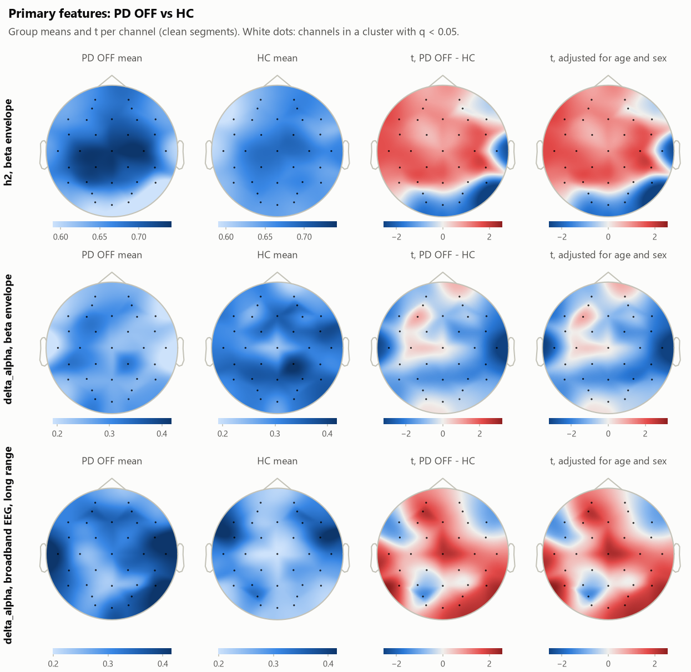

Each row is one primary feature. The columns are the patients' mean over the scalp, the
controls' mean, the t-map of their difference (red where patients are higher, blue where lower),
and the same t-map after adjusting for age and sex. White dots would mark channels in a
significant cluster. There are none. The other figures in the report are drawn the same way:
[primary_off_vs_on.png](../reports/figures/stats/primary_off_vs_on.png) and the exploratory maps
[exploratory_pd_vs_hc.png](../reports/figures/stats/exploratory_pd_vs_hc.png) and
[exploratory_off_vs_on.png](../reports/figures/stats/exploratory_off_vs_on.png).

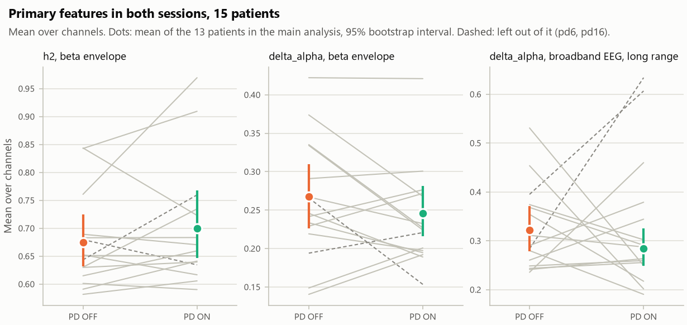

Each grey line is one patient, OFF on the left and ON on the right (the mean over channels).
Dashed lines are pd6 and pd16, left out of the main analysis. The dots are the mean of the 13 with
a 95 % bootstrap interval. The lines cross in every direction: there is no consistent OFF-to-ON
change.

### 8.12 Where it lives

| What | File and function | Config key |
|---|---|---|
| Which features, primary or exploratory | `catalogue` in [`stats/features.py`](../src/pdeeg/stats/features.py) | `features.primary`, `features.exploratory_tables` |
| Who is compared | `between_recordings`, `paired_subjects` (same file) | `between`, `paired` |
| The four analyses (`pd_vs_hc`, `pd_vs_hc_adjusted`, `off_vs_on`, `off_vs_on_all_pairs`) | `ANALYSES`, `run_analysis`, `add_fdr`, `random_stream` in [`stats/analysis.py`](../src/pdeeg/stats/analysis.py) | `seed`, `fdr_q` |
| Cluster tests, effect sizes, residuals, FDR | `two_sample_test`, `paired_test`, `t_threshold`, `hedges_g`, `paired_hedges_g`, `residualise`, `benjamini_hochberg`, `channel_adjacency` in [`stats/cluster.py`](../src/pdeeg/stats/cluster.py) | `cluster` |
| Age and sex | `compare_age`, `compare_sex`, `covariate_matrix` in [`stats/confounds.py`](../src/pdeeg/stats/confounds.py) | `covariates` |
| Bootstrap and detectable effect | `bootstrap_mean_ci`, `detectable_effect` in [`stats/descriptive.py`](../src/pdeeg/stats/descriptive.py) | `bootstrap` |
| The report and its figures | [`stats/report.py`](../src/pdeeg/stats/report.py), [`viz/stats.py`](../src/pdeeg/viz/stats.py) | `report`, `figures_dir`, `curves` |

The results tables are `data/processed/stats_*_ds002778-1.0.5.parquet`: `tests`, `clusters`,
`channels` and `demographics`.

### Key takeaways

- A p-value is how surprising the data would be if nothing were going on. "Not significant" is not
  "no difference".
- Permutation tests get p by shuffling labels. With 13 pairs all 4096 sign flips are used (an exact
  test).
- Cluster permutation tests find patches of neighbouring channels and compare them with the largest
  patch of each shuffle. Benjamini-Hochberg q-values then correct across the family of tests.
- The plan was pre-registered on 2026-10-23. Nothing primary survived (smallest q 0.471), and this
  sample can reliably see only large effects (g ≈ 1.04, d_z ≈ 0.85).
- Age and sex did not differ, and adjusting for them changed nothing.

### Check yourself

**Q1. Why compare a cluster with the largest cluster of each shuffle, not with clusters at the same
place?**
*Answer:* Because you would have reported a cluster anywhere on the scalp. Comparing with the
maximum over the whole scalp controls the chance of any false cluster across all channels.

**Q2. Four of five tests have p < 0.05 but only two have q < 0.05. Which do you report as
significant?**
*Answer:* The two with q < 0.05. The others may be false discoveries once you account for running
five tests.

**Q3. The adjusted delta_alpha test had p = 0.045. Why is it not a finding?**
*Answer:* After the Benjamini-Hochberg correction across the primary family its q is 0.353, far
above 0.05.

**Q4. A friend says "no significant difference, so patients' EEG is the same as controls'". What
do you answer?**
*Answer:* Absence of evidence is not evidence of absence. With 15 and 16 people only differences
of about g = 1.04 or more are reliably detectable, so smaller real differences could easily be
missed.

---

## 9. Machine learning

Machine learning is the project's **secondary, exploratory** analysis. The command is
`pdeeg classify`. The settings are in [`configs/model.yaml`](../configs/model.yaml), "Written on
2026-10-23, before any classifier was run on the data", and the results are in
[`reports/classification_results.md`](../reports/classification_results.md).

### 9.1 Features, labels and models

- A **feature** is one number describing an example. Here an example is one recording, and it has
  up to 130 features.
- A **label** is the answer you want to predict: patient or control, OFF or ON.
- A **model** is a rule, learned from examples, that maps features to a label. **Training** (or
  **fitting**) means adjusting the rule to the examples. **Predicting** means applying it to a new
  one.

**An analogy.** You learn to tell ripe from unripe mangoes by colour and softness (the features)
from mangoes someone has already labelled. The real test is a new mango you have never touched.

The **feature sets** compared ([model.yaml](../configs/model.yaml), key `feature_sets`;
[classification_results.md](../reports/classification_results.md)):

| Name | What | Number of features |
|---|---|---|
| `psd` | band power, region level | 25 |
| `mfdfa` | MFDFA, region level | 105 |
| `psd_mfdfa` | both | 130 |
| `age_sex` | age and sex only (a confound baseline) | 2 |

The **confound baseline** answers a sharp question: could a model do as well knowing only age and
sex? If yes, the EEG adds nothing.

### 9.2 Training, testing and overfitting

A model must be judged on data it **did not train on**. Otherwise you are only checking its
memory. **Overfitting** is when a model learns the quirks of its training examples instead of the
general pattern, so it looks brilliant on them and fails on new ones. A student who memorises last
year's exam answers aces last year's exam and fails this year's.

The risk is extreme here: up to 130 features and only 31 people. With more features than people,
some combination of features can "explain" almost any labelling, even a random one.

### 9.3 The three models

**Logistic regression.** It computes a weighted sum of the features plus an **intercept** (a
constant), and squashes the sum through the S-shaped **logistic function** into a probability
between 0 and 1.

**Toy example.** With two features, score z = 0.8·x₁ − 0.5·x₂ + 0.1. For x₁ = 1 and x₂ = 2,
z = −0.1, and the probability is 1 / (1 + e^0.1) = 0.475: slightly on the "negative" side.

**Linear SVM (support vector machine).** It draws the straight boundary (a flat "hyperplane" in
many dimensions) that separates the two classes with the widest possible margin. Its score is the
signed distance from the boundary. It does not give probabilities by itself.

**Gradient boosting.** It builds many tiny **decision trees**, each a short list of if-then
questions ("is beta power at the back below −0.7?"), one after another, each new tree correcting
the errors of the trees so far. Trees of depth 1 (a single question) are called **stumps**. It can
capture curved, non-linear patterns, but with 31 people it also overfits easily.

**Regularisation** is a penalty that keeps a model simple (small weights), which fights
overfitting. Its strength is a **hyperparameter**: a setting chosen before training rather than
learned from the data. The project's grids ([model.yaml](../configs/model.yaml), key
`classifiers`):

| Model | Hyperparameters tried |
|---|---|
| Logistic regression (`saga` solver) | `C` 0.01, 0.1, 1 (small C = strong penalty); `l1_ratio` 0 (**L2**: shrink every weight), 0.5 (**elastic net**: half and half), 1 (**L1**: set many weights exactly to zero) |
| Linear SVM | `C` 0.001, 0.01, 0.1, 1 |
| Gradient boosting | 100 trees, depth 1 or 2, learning rate 0.1 ("small: 100 stumps or depth-2 trees") |

So the ablation runs 3 feature sets × 3 models = **9 combinations** per task, plus the age-and-sex
baseline with each model for the tasks between people. An **ablation** is a systematic comparison
of variants, here of feature sets and models.

### 9.4 Scaling, and why it must sit inside a Pipeline

Features come in different units: a band power near −0.7, an `h2` near 0.7. Regularisation
treats all weights alike, so the features are first standardised by a **StandardScaler**: from each
feature subtract its mean, then divide by its standard deviation.

The trap: **the mean and standard deviation must come from the training data only.**

**Toy example.** Training values 1, 1, 3, 3 have mean 2 and standard deviation 1. A test value of
10 is scaled to (10 − 2) / 1 = 8. If instead the scaler had been fitted on training *and* test
values together, the test value would have pulled the mean and spread towards itself, so the
training step would have "seen" a property of the test data. That is a small leak (9.7).

A scikit-learn **Pipeline** chains the steps (scaler, then model) into one object that is fitted as
a unit. When cross-validation refits it on each training set, the scaler is refitted too, on that
training set only ([model.yaml](../configs/model.yaml): "Every model follows a StandardScaler ...
in one Pipeline, so all of it is fitted on training folds only"). **scikit-learn** is the Python
machine-learning library the project uses.

### 9.5 Cross-validation, and nested cross-validation

With 31 people you cannot afford to lock a third of them away as a test set. **Cross-validation**
reuses the data. Split the people into k groups called **folds**. Train on k − 1 folds and test on
the remaining one, and rotate until every fold has been the test fold once. Every recording then
gets one **out-of-fold** prediction: a prediction from a model that never saw it.

```
5-fold cross-validation (each row is one round):
round 1:  [TEST ] [train] [train] [train] [train]
round 2:  [train] [TEST ] [train] [train] [train]
round 3:  [train] [train] [TEST ] [train] [train]
round 4:  [train] [train] [train] [TEST ] [train]
round 5:  [train] [train] [train] [train] [TEST ]
```

**Stratified** folds keep the class ratio (patients to controls) about the same in every fold.

But the hyperparameters (C and so on) must also be chosen, and choosing them by their score on the
test fold would be cheating: the curators' "third split". So **nested cross-validation** runs a
second, **inner** cross-validation inside each outer training set, to choose the hyperparameters
by **grid search** (trying every combination in the grid). Only the chosen model is then scored on
the outer test fold.

```
outer fold k:  [ training people ............................ ] [ test people ]
                  inner 3-fold grid search on the training people only:
                  [ in-train ][ in-train ][ in-test ]   -> score each C
                  [ in-train ][ in-test ][ in-train ]
                  [ in-test ][ in-train ][ in-train ]
                  pick the best C, refit on all training people
               -> predict the test people once
```

The project's settings ([model.yaml](../configs/model.yaml), key `cv`): the outer loop is
stratified **5-fold**, keeping "6 or 7 test participants and the class ratio in every fold". The
inner loop is **3-fold**, also grouped and stratified. The inner loop is scored by
**balanced accuracy** (9.8). The config explains why not ROC AUC, a score of how well a model ranks
positives above negatives (also in 9.8): "on synthetic data
(tests/test_models.py) it chose models so regularised that their scores ranked people well while
their intercept put everyone in one class."

Why not leave-one-person-out, which wastes less data? It was timed first: "one nested run of task A
on 31 participants and 130 features took 104 s with logistic regression and 321 s with gradient
boosting ..., and every p-value needs 1000 such runs, which comes to weeks of CPU"
([model.yaml](../configs/model.yaml), comment on `outer`).

### 9.6 Grouping by participant

A patient has two recordings. If one were in training and the other in testing, the model could
recognise the *person* (chapter 9.7). So every split is **grouped by participant**: all of a
person's recordings are always on the same side (`cv.group_key: participant_id`).

The project does not just trust this, it enforces it:

- The splitter is scikit-learn's `StratifiedGroupKFold`.
- `check_grouped` in [`src/pdeeg/models/cv.py`](../src/pdeeg/models/cv.py) raises a
  **`LeakageError`** if any participant appears in both train and test.
- `nested_cv` (in [`models/evaluate.py`](../src/pdeeg/models/evaluate.py)) calls it on every outer
  split. The inner splitter is wrapped in `CheckedSplitter`, which calls it on every inner split.
- [`tests/test_leakage.py`](../tests/test_leakage.py) checks every splitter of every task, and of
  both stages of the cascade.

### 9.7 Data leakage: recognising the person, not the disease

**Data leakage** is any way in which information about the test data reaches the model during
training. It makes the score look better than the model will really do on new people. It is the
most common reason for spectacular accuracies in small EEG studies.

**The analogy: recognising the person, not the disease.** EEG is a little like a fingerprint.
Every person's recordings share things that have nothing to do with disease: their skull, how
the cap sat, their own alpha frequency. Suppose you cut every recording into 1-second pieces and
split the *pieces* at random into training and test sets. Nearly every test piece then has a
sibling from the same person in the training set. A model can simply recognise whose recording
it is and copy that person's label. It scores close to 100 % and has learned nothing about
Parkinson's disease.

**Toy example.** Ann and Ben have PD, Cat and Dan are healthy, and in this toy the disease changes
nothing. Each recording is cut into 3 pieces, 12 pieces in all, and each person's pieces look
alike. Put 8 random pieces in training and 4 in testing. A "nearest neighbour" model labels a test
piece like the most similar training piece, which is almost always a sibling from the same person.
So it is right almost every time. Now split by person instead: train on Ann, Ben and Cat, test on
Dan. Dan's siblings are not in training, and the model is back to guessing.

**The project proves this with its own test.**
`test_rows_of_one_person_cannot_carry_a_random_label_across_a_grouped_split` in
[`tests/test_leakage.py`](../tests/test_leakage.py) builds 40 synthetic people, each with two
near-identical rows, and gives each person a label that is **pure chance**. A split by recording
with a 1-nearest-neighbour model must reach a balanced accuracy above 0.8 (the test asserts it).
The project's grouped nested cross-validation must stay below 0.75. Since the labels are random,
everything above chance in the first case is leakage.

**Other leaks the design closes**:

| Leak | How it happens | What prevents it here |
|---|---|---|
| Same person in train and test | splitting recordings or epochs instead of people | grouped splits plus the `LeakageError` guard |
| Scaler fitted on all data | the test data's mean and spread shape the training | scaler inside the `Pipeline` |
| Hyperparameters tuned on the test fold | picking C by its test score | nested cross-validation |
| Features selected on all data | choosing "the best channels" with test data included | selection (at channel level) inside the `Pipeline` (`SelectKBest`, [model.yaml](../configs/model.yaml) key `channel_k`) |
| Best model chosen on its own score | reporting the maximum of 9 | q-values, a configuration fixed in advance, and the 10 other splits (9.11) |
| Patient centring that peeks | centring with group information | centring uses "nothing but that one patient's two recordings, and no label" ([model.yaml](../configs/model.yaml)) |

### 9.8 Metrics: reading a 2×2 table

A **confusion matrix** counts what the model called each example against what it really was.

**Toy example.** 10 patients and 20 controls:

| | called patient | called control |
|---|---|---|
| **really patient** | 8 (true positives) | 2 (false negatives) |
| **really control** | 6 (false positives) | 14 (true negatives) |

- **Accuracy** = right / all = (8 + 14) / 30 = **0.733**.
- **Sensitivity** = patients found = 8 / 10 = **0.80**.
- **Specificity** = controls correctly called controls = 14 / 20 = **0.70**.
- **Balanced accuracy** = (sensitivity + specificity) / 2 = **0.75**.

Why balanced accuracy? A lazy model that calls *everyone* a control gets accuracy 20/30 = 0.667,
which looks decent, but balanced accuracy (0 + 1) / 2 = **0.5**, which exposes it. Balanced
accuracy's chance level is always 0.5 for two classes, whatever the class sizes. In this project,
"Sensitivity is the share of the first class found" (the patients, or the OFF recordings)
([classification_results.md](../reports/classification_results.md)).

**ROC AUC** (area under the receiver operating characteristic curve) ignores the cut-off. It is
the probability that a randomly chosen patient gets a higher score than a randomly chosen control.
0.5 is chance and 1 is perfect.

**Toy example.** Patients score 0.9, 0.6 and 0.4, and controls 0.7, 0.3 and 0.2. Of the 3 × 3 = 9
patient–control pairs, the patient is higher in 7, so AUC = 7/9 = **0.78**.

For stage 1's task, where each patient has two recordings, every metric weighs each **participant**
once (0.5 per recording of a patient with two).

### 9.9 Bootstrap intervals for scores

The 95 % intervals use the bootstrap of 8.8 on the out-of-fold predictions: "2000 bootstrap
resamples of participants, with all their recordings" ([methods.md](../reports/methods.md),
section 9). The predictions themselves stay fixed, so the interval reflects *which people happened
to be in the sample*, not how the models would change with other training data. The 10 other
splits (9.11) show part of the latter.

### 9.10 Permutation p-values for a whole pipeline

Is a balanced accuracy of 0.71 better than luck, with 31 people and 130 features? The project
answers with the permutation idea of 8.3, applied to **the entire nested procedure**:

1. Shuffle the labels, respecting the design (`permuted_labels` in
   [`models/cv.py`](../src/pdeeg/models/cv.py)). Between people, whole people swap labels. Within
   patients, each patient's OFF and ON are kept or swapped by a coin flip.
2. Run the whole nested cross-validation (inner grid search included) on the shuffled labels, and
   record the score.
3. Repeat **1000 times** (`cv.n_permutations: 1000`).

Then p = (1 + number of shuffles scoring at least as well) / (1 + 1000). The smallest possible
value is 1/1001, which the report prints as "< 0.001". The **95th percentile of the null** (the
score that only 5 % of shuffles beat) is drawn as a tick in the ablation figure.

### 9.11 The best of nine, q-values and other splits

If you try 9 combinations and report the best, you have picked the one that was luckiest on these
very predictions. Its score "flatters itself". The project offers three fairer views:

1. **q-values**: Benjamini-Hochberg over the balanced-accuracy p-values of all the evaluations of a
   task (function `summary_table` in [`models/classify.py`](../src/pdeeg/models/classify.py)).
   That is 9 for the within-patient tasks, and 12 for the two tasks between people, whose 3
   age-and-sex baselines are counted too.
2. **A configuration fixed in advance**: band power + MFDFA with logistic regression, the
   cascade's, chosen before any result.
3. **Other splits**: the whole procedure repeated on 10 other outer splits (`cv.split_repeats`),
   to show "what the split alone does".

### 9.12 Calibration and Platt scaling

A model's probability is **calibrated** if it means what it says: among recordings given 0.7,
about 70 % really are positive. A model can rank people well and still give probabilities that
are too extreme or shifted.

Measures used ([`src/pdeeg/models/calibration.py`](../src/pdeeg/models/calibration.py)):

- **Brier score**: the mean squared difference between the probability and the 0/1 label. Lower is
  better. It is compared with the Brier score of always predicting the **prevalence** (the share of
  positives).

  **Toy example.** Labels 1, 0, 1, 0 and probabilities 0.8, 0.3, 0.6, 0.5 give
  (0.04 + 0.09 + 0.16 + 0.25) / 4 = **0.135**. Always saying 0.5 gives 0.25. The **Brier skill** is
  1 − 0.135/0.25 = 0.46 (positive means better than the prevalence).
- **Calibration slope** b and **calibration in the large** a, from fitting
  `logit P(y) = a + b · logit(p)`. Here the **logit** is log(p / (1 − p)), the logistic function in
  reverse. Ideal is b = 1 and a = 0. b below 1 means the probabilities are too extreme, a typical
  sign of overfitting.
- **Reliability diagram**: sort recordings into 5 bins of equal count, and plot each bin's mean
  predicted probability against the share that were really positive, with a **Wilson interval** (a
  confidence interval for a proportion that behaves well with small counts). Perfect calibration
  lies on the diagonal.

**Platt scaling** fixes miscalibration by fitting a small logistic regression that maps the model's
scores to probabilities ("sigmoid"). To avoid leakage it is learned on the model's predictions in
grouped inner folds of the training data (function `platt` in
[`models/cv.py`](../src/pdeeg/models/cv.py)). The alternative, isotonic regression, was rejected:
"it is a free step function, and with about 25 training participants per fold it would overfit"
([model.yaml](../configs/model.yaml), key `cascade.calibration`).

The **rule**, fixed before any classifier was run: a stage is poorly calibrated if its Brier score
is not below that of predicting the prevalence, or the interval of its slope leaves out 1, or that
of its calibration in the large leaves out 0 (function `miscalibration`).

### 9.13 The uncertain band

A probability of 0.52 is barely different from 0.48, so should it get a label at all? The project
decides from the evidence, not by eye. This is the **uncertain band**: the range of probabilities
that get no label ([predict.yaml](../configs/predict.yaml), key `band`; function `uncertain_band`
in [`models/calibration.py`](../src/pdeeg/models/calibration.py)):

1. Take the stage's out-of-fold Platt-scaled probabilities.
2. Resample participants 2000 times. In each resample, fit the recalibration of 9.12, a curve that
   maps a probability p to what it *turned out* to mean, P(y = 1 | p).
3. For each p on a grid of step 0.005, look at the 95 % interval of those 2000 curves.
4. p **keeps its label** only if the whole interval lies on the same side of the 0.5 threshold as p
   itself. Every other p is **in the band**.

**Toy example.** For p = 0.8 the curves give P(y = 1 | 0.8) between 0.55 and 0.95. The whole
interval is above 0.5, so 0.8 keeps the label "positive". For p = 0.6 they give 0.45 to 0.75. The
interval straddles 0.5, so 0.6 is uncertain. If a model is no better than a coin, every interval
straddles 0.5, and the band is the whole range 0 to 1: the model never gives a label.

### 9.14 The four tasks and their results

| Task | Status | Question | Recordings and weights |
|---|---|---|---|
| `pd_vs_hc` | pre-registered | PD OFF against HC | one per participant: 31 |
| `off_vs_on` | pre-registered | which of a patient's two recordings is OFF | 2 per patient, each patient's features centred on their own mean. 13 patients (pd6, pd16 left out), 26 recordings |
| `pd_any_vs_hc` | added for the tool (stage 1) | a patient's recording (OFF or ON) against a control's | both of a patient's recordings at 0.5 each. 31 participants, 44 recordings |
| `off_vs_on_single` | added for the tool (stage 2) | OFF or ON from one recording on its own | 2 per patient, not centred. 13 patients, 26 recordings |

([methods.md](../reports/methods.md), section 9; [classification_results.md](../reports/classification_results.md)).
Chapter 10 explains why the last two were added.

**The results.** BA is balanced accuracy, with its 95 % interval in brackets
([classification_results.md](../reports/classification_results.md),
[README.md](../README.md#classification-exploratory)):

| Task | Fixed in advance: band power + MFDFA, logistic regression | Best of 9 | Combinations with p < 0.05 before / after correction |
|---|---|---|---|
| `pd_vs_hc` | 0.61 [0.43, 0.78], p 0.123, q 0.295 | MFDFA, logistic regression: 0.71 [0.55, 0.86], p 0.025, q 0.295 | 1 / 0 |
| `off_vs_on` | 0.62 [0.38, 0.85], p 0.234, q 0.263 | band power, logistic regression: **held back for the audit** (see below) | 2 / 0 |
| `pd_any_vs_hc` | 0.68 [0.52, 0.83], p 0.044, q 0.176 | band power + MFDFA, linear SVM: 0.71 [0.55, 0.85], p 0.020, q 0.176 | 3 / 0 |
| `off_vs_on_single` | 0.62 [0.46, 0.77], p 0.148, q 0.266 | band power, logistic regression: 0.77 [0.65, 0.92], p < 0.001, q 0.009 | 1 / 1 |

- **Only one combination survives correction**: band power with logistic regression for OFF
  against ON on single recordings (q 0.009). It became stage 2 of the tool. Over 10 other splits
  its balanced accuracy ranged from 0.58 to 0.77.
- **Age and sex alone** reached 0.58 [0.40, 0.76] for PD OFF against HC and 0.51 [0.35, 0.70] for
  stage 1's task, both with gradient boosting. So the EEG models are not just picking up age or sex.
- **The ranges over 10 other splits** show how much luck moves things: the best `pd_vs_hc`
  combination ranged 0.55–0.71, and the best `pd_any_vs_hc` 0.55–0.72.

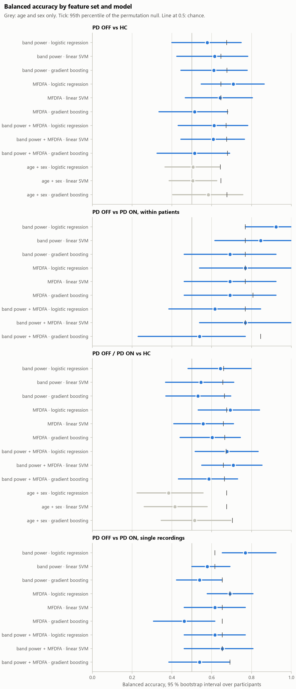

Read the ablation figure like this: each dot is one combination's balanced accuracy with its
95 % interval as a line. The vertical line at 0.5 is chance. The small tick on each line is the
95th percentile of that combination's permutation null, so a dot right of its tick has p < 0.05.
Grey rows are the age-and-sex baselines.

**The audited score.** The report's table for `off_vs_on` lists band power with logistic
regression at **0.92 [0.77, 1.00], p 0.013, q 0.117**, and its audit section says: "Balanced
accuracy above 0.85 in: off_vs_on / psd / logistic_regression (0.92). These are not reported as
results until the audit is written here." The rule (`AUDIT_ABOVE = 0.85` in
[`models/classify.py`](../src/pdeeg/models/classify.py)) was fixed in advance: any balanced
accuracy above 0.85 gets a leakage and confound audit before it counts. That audit has not been
written, so the README and the model card leave the number out, and so should you when presenting
results. Three things to know about it anyway:

- Even at face value it is **not significant after correction** (q 0.117).
- It is the **best of 9** on 13 patients.
- In the paired task, centring makes a patient's two rows mirror images of each other, so a
  patient's pair is either both right or both wrong. 0.92 is what 12 of the 13 pairs right gives
  (12/13 = 0.923). That is arithmetic on the report's numbers, not a separate result. One patient
  more or less moves the score by 0.077.

**What the best models leaned on.** The report lists the largest average weights. For example, the
single-recording OFF/ON model's top weights are `log_relative_power_gamma_temporal` (+0.918, towards
OFF), `log_relative_power_beta_parietal` (−0.623) and `log_relative_power_theta_frontal` (−0.509)
([classification_results.md](../reports/classification_results.md)). The report warns: "with
correlated features a coefficient is shared out arbitrarily among them, so read the pattern, not
single values." One interpretive caution of this guide's own: gamma power at the temporal channels
is where scalp muscle activity shows most (3.7 and the `data.yaml` comment on regions), so part of
what that model uses may be muscle tension that differed between sessions rather than brain
activity.

### 9.15 Where it lives

| What | File and function | Config key |
|---|---|---|
| A task's rows, labels, groups, weights, centring | `task_data`, `task_rows`, `centre_within`, `participant_weights`, `wide_features` in [`models/data.py`](../src/pdeeg/models/data.py) | `tasks`, `feature_sets`, `segments`, `level` |
| Splitters, guard, models, grids, Platt, permutations | `outer_splitter`, `inner_splitter`, `CheckedSplitter`, `check_grouped`, `LeakageError`, `classifier`, `search`, `platt`, `permuted_labels` in [`models/cv.py`](../src/pdeeg/models/cv.py) | `cv`, `classifiers`, `random_state` |
| Nested CV, metrics, bootstrap, nulls, other splits | `nested_cv`, `metrics`, `bootstrap_metrics`, `permutation_null`, `permutation_p`, `split_repeats`, `evaluate` in [`models/evaluate.py`](../src/pdeeg/models/evaluate.py) | `cv.n_bootstrap`, `cv.n_permutations`, `cv.split_repeats` |
| The ablation and its summary | `planned`, `run_classification`, `summary_table`, `best_result`, `weight_table`, `AUDIT_ABOVE` in [`models/classify.py`](../src/pdeeg/models/classify.py) | |
| Calibration and the band | `brier`, `recalibration`, `uncertain_band`, `reliability_table`, `miscalibration` in [`models/calibration.py`](../src/pdeeg/models/calibration.py) | `cascade.calibration` in `model.yaml`, `band` in `predict.yaml` |
| Saving and reloading evaluations | [`models/store.py`](../src/pdeeg/models/store.py) | |
| MLflow runs | [`models/tracking.py`](../src/pdeeg/models/tracking.py) | `tracking` |
| Report and figures | [`models/report.py`](../src/pdeeg/models/report.py), [`viz/classification.py`](../src/pdeeg/viz/classification.py) | `report`, `figures_dir` |

Each evaluation is saved under
`data/processed/classification/<task>/<feature set>/<model>/` (`predictions.parquet`,
`permutation_null.parquet`, `weights.parquet`, `evaluation.json`), so the report can be rewritten
without recomputing.

### Key takeaways

- Judge a model only on people it never saw. With 130 features and 31 people, overfitting is the
  main danger.
- Nested cross-validation: the outer 5-fold loop scores and the inner 3-fold loop tunes. Every split
  is grouped by participant and checked at run time (`LeakageError`).
- Data leakage, such as recognising the person rather than the disease, produces near-perfect
  scores even on random labels. The project's own test shows it.
- Balanced accuracy (chance 0.5), bootstrap intervals over participants, 1000 permutations of the
  whole procedure, and q-values for picking the best of several.
- Only single-recording OFF against ON survived correction (0.77 [0.65, 0.92], q 0.009). One score
  above 0.85 is held back by a pre-set audit rule.

### Check yourself

**Q1. Why must the scaler sit inside the Pipeline?**
*Answer:* So that each training fold computes its own mean and spread. Fitting it on all the data
would let test data shape the training.

**Q2. What is the difference between the inner and the outer loop?**
*Answer:* The inner loop, inside each outer training set, chooses hyperparameters. The outer loop
scores the chosen model on people it never saw. Using one loop for both would make the score
optimistic.

**Q3. A model calls everyone "control" in a dataset of 10 patients and 20 controls. What are its
accuracy and balanced accuracy?**
*Answer:* Accuracy 0.667, balanced accuracy 0.5.

**Q4. Why permute labels through the whole nested procedure, not just the final predictions?**
*Answer:* Tuning and selection can themselves find patterns in noise. Only re-running everything
on shuffled labels shows what this whole procedure scores when there is nothing to find.

**Q5. Why is a q-value fairer than a p-value for "the best of 9"?**
*Answer:* The best of 9 was picked because it scored highest on these predictions. The q-value
adjusts for the number of combinations tried.

---

## 10. The two-stage prediction tool

### 10.1 Why two stages

The tool answers two questions about **one** recording: is it a patient's or a control's, and,
if a patient's, OFF or ON medication? Neither pre-registered task fits
([cascade_results.md](../reports/cascade_results.md), "Why it was added"):

- `pd_vs_hc` only ever sees OFF recordings, "while a patient seen in practice is usually ON".
- `off_vs_on` centres each patient on their own two recordings, "so it needs both and cannot label
  one recording on its own".

So on 2026-10-26, after the pre-registration and before any classifier had been run, two tasks
were added: `pd_any_vs_hc` (stage 1) and `off_vs_on_single` (stage 2). `off_vs_on` stays as the
**paired** mode of stage 2. Running stage 1 and then stage 2 is called a **cascade**.

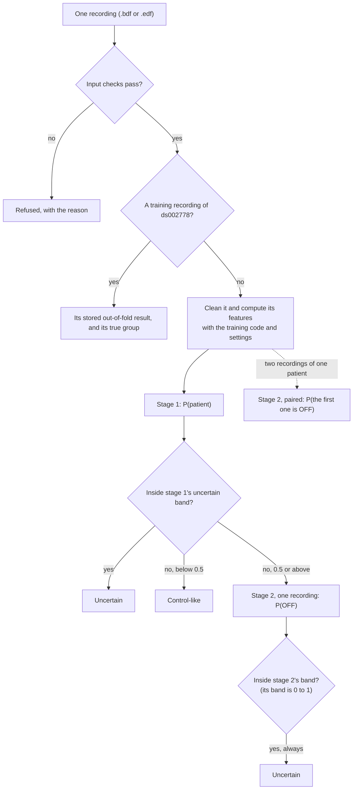

### 10.2 The three stages

| Stage | Question | Task | Final features | Final model |
|---|---|---|---|---|
| Stage 1 | patient's recording or control's? | `pd_any_vs_hc` | band power + MFDFA (130) | linear SVM |
| Stage 2, one recording | OFF or ON? | `off_vs_on_single` | band power (25) | logistic regression |
| Stage 2, paired | which of a patient's two recordings is OFF? | `off_vs_on` | band power (25) | logistic regression |

([MODEL_CARD.md](../MODEL_CARD.md), [model.yaml](../configs/model.yaml) key `final`).

**How paired centring works.** For each patient, every feature is replaced by its value minus the
mean of that patient's two recordings (`centre_within` in
[`models/data.py`](../src/pdeeg/models/data.py)).

**Toy example.** One feature, OFF = 3.0 and ON = 1.0. The patient's mean is 2.0, so after centring
OFF = +1.0 and ON = −1.0. Everything about the person that is the same in both sessions has gone,
and the model only sees which recording is higher. At prediction time the same is done to a pair
(`centred = pair - pair.mean(axis=0)` in `predict_files`). The two probabilities are then turned
into one: P(first is OFF) = p₁ / (p₁ + p₂) ([methods.md](../reports/methods.md), section 12).

### 10.3 The cascade evaluation

The cascade was tested as a whole, in one nested cross-validation
([cascade_results.md](../reports/cascade_results.md), "Design"; code in
[`models/cascade.py`](../src/pdeeg/models/cascade.py), function `run_cascade`):

- **One configuration, fixed before any result**: band power + MFDFA (130 features) with logistic
  regression, for both stages ([model.yaml](../configs/model.yaml), key `cascade`). "Nothing was
  picked on these data."
- **The data**: 31 participants and 44 recordings, namely HC 16, PD_OFF 15 and PD_ON 13. The ON
  sessions of pd6 and pd16 are left out. Their OFF recordings stay in.
- **In every outer fold**, grouped by participant: stage 1 is tuned and fitted on all the training
  participants' recordings (weighted so each person counts once), and stage 2 on the training
  patients' recordings only. Each has its own 3-fold inner loop.
- **Every held-out recording** is called HC if stage 1 says so, and otherwise PD_OFF or PD_ON by
  stage 2. Stage 2 also scores the recordings stage 1 sent to the controls, "so its errors on true
  patients are measured apart from stage 1's".
- **p-values**: 1000 relabellings of participants, each through the whole cascade. Patient or
  control is shuffled among the participants, and every new "patient" gets OFF and ON by a coin
  flip.
- **"Beats chance"** means p < 0.05 **and** a 95 % interval that excludes chance.

### 10.4 Reading the 3×3 confusion matrix, cell by cell

Rows are the true class and columns the cascade's call ([cascade_results.md](../reports/cascade_results.md);
the percentages are from the figure below):

| True class \ called | HC | PD_OFF | PD_ON | Sensitivity [95 % CI] |
|---|---|---|---|---|
| HC (16) | **9** (56 %) | 3 (19 %) | 4 (25 %) | 0.56 [0.31, 0.80] |
| PD_OFF (15) | 6 (40 %) | **7** (47 %) | 2 (13 %) | 0.47 [0.21, 0.74] |
| PD_ON (13) | 5 (38 %) | 3 (23 %) | **5** (38 %) | 0.38 [0.12, 0.67] |

Cell by cell:

- **Top row, the 16 controls.** 9 were correctly called HC. 7 were wrongly called patients by
  stage 1: 3 as OFF and 4 as ON.
- **Middle row, the 15 OFF recordings.** 6 were missed by stage 1 (called HC). Of the 9 that stage 1
  passed on, stage 2 called 7 correctly OFF and 2 wrongly ON.
- **Bottom row, the 13 ON recordings.** 5 were missed by stage 1. Of the 8 passed on, 5 were
  correctly called ON and 3 wrongly OFF.
- **The diagonal** (bold) holds the correct calls. Each class's **sensitivity** is its diagonal
  cell divided by its row total.
- **Macro balanced accuracy** is the mean of the three sensitivities: (0.5625 + 0.4667 +
  0.3846) / 3 = 0.47. With three classes, chance is 1/3 = 0.33.

The report also groups the errors ([cascade_results.md](../reports/cascade_results.md), "Where the
errors come from"): of the patients' recordings, 39 % were called controls (stage 1 missed), 18 %
were called patients in the wrong state, and 43 % were called right. Of the controls' recordings,
44 % were called patients (stage 1 false alarm). You can check these from the matrix: 11 of the 28
patient recordings sit in the HC column, 5 in the wrong-state cells, 12 on the diagonal, and 7 of
the 16 controls are off the diagonal.

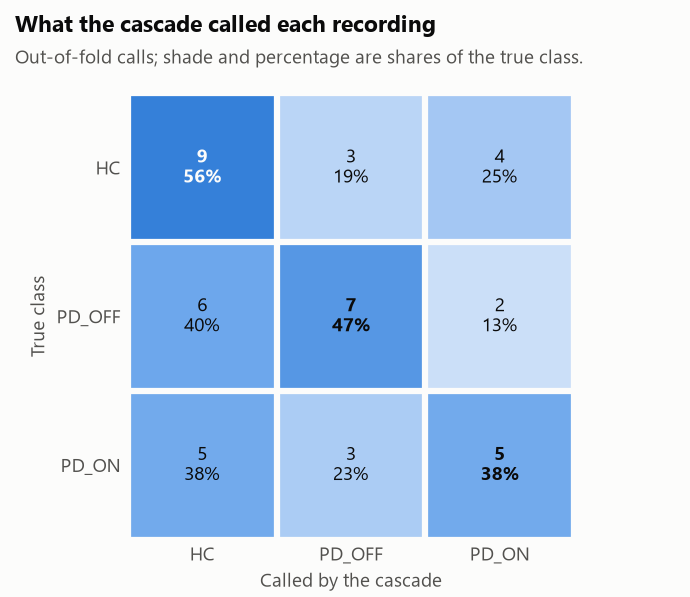

### 10.5 The honest results

([cascade_results.md](../reports/cascade_results.md))

| | Balanced accuracy [95 % CI] | p | Beats chance? |
|---|---|---|---|
| Three classes (macro) | 0.47 [0.32, 0.61], chance 0.33 | 0.035 | **No**: p < 0.05, but the interval includes 0.33 |
| Stage 1: PD OFF / PD ON vs HC | 0.58 [0.40, 0.74] | 0.163 | **No** |
| Stage 2: PD OFF vs PD ON, single recordings (true patients) | 0.71 [0.58, 0.84] | 0.031 | **Yes**: p < 0.05 and the interval excludes 0.5 |

Over 10 other outer splits ([cascade_results.md](../reports/cascade_results.md), "Other outer
splits"):

| Metric | Minimum | Median | Maximum |
|---|---|---|---|
| Three classes, macro balanced accuracy | 0.44 | 0.47 | 0.50 |
| Stage 1, balanced accuracy | 0.61 | 0.67 | 0.69 |
| Stage 2 on true patients, balanced accuracy | 0.54 | 0.57 | 0.75 |

Notice that stage 1's main-split score (0.58) is *below* all ten other splits (0.61–0.69), while
stage 2's (0.71) is near the top of its range (0.54–0.75). One split is one draw. That is why the
other splits are reported.

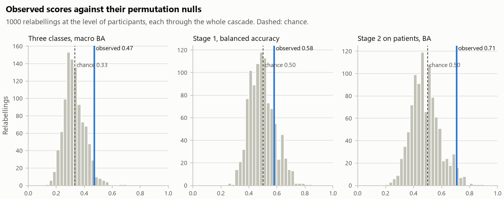

Each histogram is the 1000 scores from shuffled labels, the dashed line is chance, and the blue
line is the real score. A blue line far into the right tail means a small p-value.

**What this means for the tool's verdicts.** Stage 1, the "Parkinson's pattern" part, was not
shown to work better than chance, and the app says so in words. Stage 2 on one recording is
better than chance as a ranking, but (10.7) it never gives a label. The tool is a demonstration
of the method and of its limits, not something whose verdicts mean anything for a person.

### 10.6 Calibration in the cascade

([cascade_results.md](../reports/cascade_results.md), "Calibration")

| Stage | Probabilities | Brier | Brier of the prevalence | Calibration slope | Rule says |
|---|---|---|---|---|---|
| Stage 1 | raw | 0.277 [0.203, 0.355] | 0.250 | 0.125 [−0.527, 1.032] | poorly calibrated: Brier not below the prevalence's |
| Stage 1 | Platt | 0.240 [0.191, 0.292] | 0.250 | 0.683 [−0.424, 1.849] | well calibrated |
| Stage 2 | raw | 0.211 [0.156, 0.267] | 0.249 | 0.972 [0.048, 3.235] | well calibrated |
| Stage 2 | Platt | 0.260 [0.229, 0.288] | 0.249 | 0.256 [−0.420, 1.196] | poorly calibrated: Brier not below the prevalence's |

The three-class probabilities, P(HC) = 1 − p₁, P(OFF) = p₁·p₂ and P(ON) = p₁·(1 − p₂), had a Brier
score of 0.695 raw and 0.687 Platt-scaled, against 0.664 for simply predicting the class shares.
So "Its three-class probabilities are therefore no better than knowing the class shares"
([README.md](../README.md#the-two-stage-cascade-exploratory)).

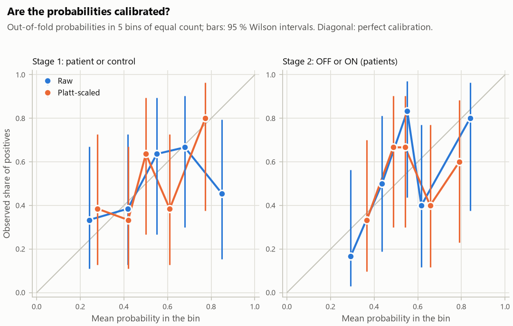

In the reliability diagrams, points on the grey diagonal would be perfect, and the long vertical
bars show how uncertain each bin is with only 5 to 9 recordings in it.

**A mismatch to know about.** The final models use Platt-scaled probabilities for every stage. In
this evaluation Platt scaling helped stage 1 but made stage 2 worse by the rule. The model card
says so in "Caveats and recommendations": "A probability from a stage flagged there should be read
as a ranking more than as a frequency."

### 10.7 The final models: `pdeeg train-final`

The tool's models are fitted on everyone eligible, after the evaluation
([methods.md](../reports/methods.md), section 11; code in
[`src/pdeeg/predict/final.py`](../src/pdeeg/predict/final.py)).

**1. Choice.** For each stage, the feature set and model with the best cross-validated balanced
accuracy of its task (ties to the higher ROC AUC), with age and sex alone excluded. It is written
into `final:` in [model.yaml](../configs/model.yaml), and `train-final` refuses any other
(`check_final`, which prints the block to paste if the file is wrong).

**2. Out-of-fold check.** The stage's nested cross-validation is run again with the ablation's own
seed, and its decisions must equal those the ablation stored, or it stops ("run `pdeeg classify
--force`"). This run also gives Platt-scaled out-of-fold probabilities (`plan_stage`).

**3. Uncertain band**, from those probabilities, by the rule of 9.13. `train-final` "saves nothing
until `configs/predict.yaml` holds the bands the rule gives" (`check_bands`, which prints the
values to set).

**4. Fit.** The model is tuned by the grouped inner loop on all of the task's participants, refitted
on all of them, and then given Platt scaling fitted on its grouped inner-fold predictions
(`fit_final`).

**5. Better than chance?** The rule in [predict.yaml](../configs/predict.yaml) (key
`better_than_chance`) is: the **q-value** below 0.05 **and** the whole 95 % interval above 0.5. It
uses q rather than p because the final configuration was picked as the best, "so its own p is too
small". This rule was fixed after the pre-registered tasks' p- and q-values had been seen, and
before any result of the two added tasks.

The outcome ([README.md](../README.md#the-final-models), [MODEL_CARD.md](../MODEL_CARD.md)):

| Stage | Configuration | Balanced accuracy [95 % CI] | p | q | Better than chance? | Uncertain band |
|---|---|---|---|---|---|---|
| Stage 1 | band power + MFDFA, linear SVM | 0.71 [0.55, 0.85] | 0.020 | 0.176 | **no** | no label from 0.305 to 0.68 |
| Stage 2, one recording | band power, logistic regression | 0.77 [0.65, 0.92] | < 0.001 | 0.009 | yes | 0 to 1: never gives a label |
| Stage 2, paired | band power, logistic regression | held back for the audit | – | – | **no** | none (0.5 itself is uncertain) |

These scores are those of each configuration in the ablation, so they are optimistic: each was
picked as the best of 9.

**A puzzle worth understanding: stage 2 is "better than chance" but never gives a label.** "Better
than chance" asks whether the model, used at the 0.5 cut-off over all recordings, does better than
guessing *on average*. The band asks something stricter about *each probability*: when this model
says 0.7, is the real chance of OFF reliably above 0.5? The out-of-fold probabilities "never backed
a label" ([README.md](../README.md#the-final-models)): for every value, the bootstrap interval of
what it really meant straddled 0.5. So the model ranks recordings somewhat better than chance, but
no single output is trustworthy enough to name. The tool says "uncertain" every time.

**Why the paired band is [0.5, 0.5].** Each pair's two probabilities sum to 1, so the recalibration
is symmetric about 0.5, and the rule only asks whether its slope is positive
([predict.yaml](../configs/predict.yaml) comment). It is, so every probability except exactly 0.5
keeps its label.

**What is saved** (git ignores `models/`):

- `models/<stage>/model.joblib`: the fitted scikit-learn pipeline (scaling, model, Platt scaling).
  **joblib** is a Python library for saving such objects to disk.
- `models/<stage>/feature_columns.json`: the feature names, in order.
- `models/<stage>/oof_predictions.parquet`: the out-of-fold predictions.
- `models/<stage>/metadata.json`: the digests of the settings, the dataset version, the git commit,
  the library versions, the cross-validated metrics with intervals, the thresholds and band, and a
  model card.
- `models/training_recordings.parquet`: every training recording with the SHA-256 of its file and
  of its signal.

Every final model is also an MLflow run (chapter 12).

### 10.8 `pdeeg predict`

```bash
pdeeg predict recording.bdf                        # one recording
pdeeg predict first.bdf --paired second.bdf        # two recordings of the same patient
make predict FILE=recording.bdf [PAIRED=second.bdf]
```

The code is `predict_files` in [`src/pdeeg/predict/predictor.py`](../src/pdeeg/predict/predictor.py).
The app calls the same function.

**1. Input checks, before anything else** (`read_recording` in
[`predict/inputs.py`](../src/pdeeg/predict/inputs.py); limits in
[predict.yaml](../configs/predict.yaml); table from [README.md](../README.md#what-an-input-must-be)):

| Check | Requirement | Otherwise |
|---|---|---|
| File | a `.bdf` or `.edf` file, or the EEG file of a BIDS dataset | refused |
| Channels | all 32 channels of the biosemi32 cap. Names are compared ignoring case, an "EEG " prefix and a reference suffix such as "-REF". The old names T3, T4, T5 and T6 are read as T7, T8, P7 and P8 | refused, naming the missing channels |
| Sampling rate | 512 Hz, as in training | resampled to 512 Hz, with a note (the models never saw resampled data) |
| Duration | at least 180 s from trigger `1`, or from the file start (with a note) | refused |
| Amplitude | median channel standard deviation after a 1–40 Hz band-pass between 0.1 and 1000 µV | refused: the units are probably wrong |

The amplitude check catches files saved in the wrong units. The config notes that "ds002778
recordings sit near 5 µV".

**2. Features, made by the training code.** The recording is cleaned by the same `clean_recording`,
and its MFDFA and band power are computed by the same functions with the same settings, in a
working folder under `predictions/` (`recording_tables` in
[`predict/features.py`](../src/pdeeg/predict/features.py)). The one difference: no surrogates,
"because no feature uses them". A **digest** (a SHA-256 fingerprint) of every setting that affects
the features is compared with the one stored with the models, and any mismatch is refused. A test
marked `dataset` checks on a real ds002778 recording that this path gives the training tables'
values.

**3. Stages**, as in the flow diagram of 10.1.

**4. Output.** For every stage: the probability, its label or "uncertain", the threshold and
band, the cross-validated metrics with the "better than chance" verdict, and the five features that
moved the prediction most (`n_top_features: 5`). For a linear model these are coefficient ×
standardised value (`contributions`). The result is written as `<name>_prediction.json` and a
readable `<name>_prediction.txt`, both carrying the disclaimer "Research demo – not a diagnostic
tool" ([predict.yaml](../configs/predict.yaml), key `disclaimer`).

### 10.9 Why training recordings get out-of-fold answers

The final models were trained on every ds002778 recording. Asking them about one of those
recordings would be like grading a student on the exact questions they studied: the answer says
nothing about how they do on new questions.

So `identify_training` (in [`predict/inputs.py`](../src/pdeeg/predict/inputs.py)) recognises a
training recording in three ways:

1. by its BIDS subject and session;
2. by the SHA-256 of the file;
3. by a hash of its signal (rounded to 0.01 µV), "which survives renaming the file or editing its
   header".

Such a recording gets its **stored out-of-fold prediction** instead, which was made by models that
never saw that participant, with an explanation and its true group.

### 10.10 Where it lives

| What | File and function | Config |
|---|---|---|
| The cascade evaluation | `cascade_data`, `run_cascade`, `cascade_metrics`, `evaluate_cascade`, `assess_calibration` in [`models/cascade.py`](../src/pdeeg/models/cascade.py). Report in [`models/cascade_report.py`](../src/pdeeg/models/cascade_report.py), figures in [`viz/cascade.py`](../src/pdeeg/viz/cascade.py) | `model.yaml` `cascade` |
| Final models | `check_final`, `plan_stage`, `check_bands`, `fit_final`, `metadata`, `training_registry`, `train_final` in [`predict/final.py`](../src/pdeeg/predict/final.py) | `model.yaml` `final`, `predict.yaml` `band`, `stages` |
| Input checks and fingerprints | `read_recording`, `map_channels`, `median_amplitude_uv`, `signal_digest`, `identify_training` in [`predict/inputs.py`](../src/pdeeg/predict/inputs.py) | `predict.yaml` `sfreq`, `amplitude_uv`, `channel_aliases` |
| Features of one recording | `clean_input`, `recording_tables`, `feature_vector`, `feature_digest` in [`predict/features.py`](../src/pdeeg/predict/features.py) | |
| Prediction | `predict_files`, `load_stage`, `call`, `contributions`, `stage_result`, `stage_evidence`, `summary_text` in [`predict/predictor.py`](../src/pdeeg/predict/predictor.py) | `predict.yaml` `better_than_chance`, `n_top_features`, `disclaimer` |

### Key takeaways

- Stage 1 asks patient or control. Stage 2 asks OFF or ON on one recording, or, with two recordings,
  which one is OFF.
- The cascade, tested end to end with a configuration fixed in advance, was not shown to beat
  chance (macro BA 0.47 [0.32, 0.61]). Only its stage 2 did (0.71 [0.58, 0.84], p 0.031).
- The final models are the best of each task's ablation, so their scores are optimistic. Only
  stage 2 on one recording is "better than chance" by the q-based rule, and its uncertain band
  [0, 1] means it never gives a label.
- `pdeeg predict` checks inputs first, recomputes features with the training code, refuses
  mismatched settings, and gives training recordings their out-of-fold results.

### Check yourself

**Q1. Why was the pre-registered `off_vs_on` task not enough for the tool?**
*Answer:* It centres each patient on their own two recordings, so it needs both and cannot label a
single recording.

**Q2. The cascade's p-value was 0.035. Why is it "not shown to beat chance"?**
*Answer:* The project's rule needs both p < 0.05 and a 95 % interval that excludes chance. The
interval [0.32, 0.61] includes 0.33.

**Q3. In the confusion matrix, how many OFF recordings did stage 1 send to the controls?**
*Answer:* 6 of 15.

**Q4. How can a stage be better than chance yet never give a label?**
*Answer:* "Better than chance" is about average accuracy at the 0.5 cut-off. The band asks whether
each individual probability reliably lies on one side of 0.5, and for stage 2 none did.

**Q5. Why does a ds002778 recording not get a fresh prediction?**
*Answer:* The final models were trained on it. Its stored out-of-fold prediction comes from models
that never saw that person, which is the honest answer.

---

## 11. The app

### 11.1 Two apps

**Streamlit** is a Python library for building web pages from a Python script. The project has two
Streamlit apps:

| | The page ("Restwave") | The research view ("NeuroLab") |
|---|---|---|
| File | [`app/streamlit_app.py`](../app/streamlit_app.py) | [`app/research_app.py`](../app/research_app.py) |
| Start | `make app` | `make research` |
| Address | http://localhost:8501 | http://localhost:8502 ([app.yaml](../configs/app.yaml), key `research_url`) |
| For | anyone: one page with a verdict and four graphs | researchers: every check, figure and number |

Both are served **on this computer only** (`--server.address localhost` in the
[Makefile](../Makefile)), because uploads are people's health data. Neither has model code of its
own: both call `pdeeg.predict.predictor.predict_files` and describe the cleaned data with
[`src/pdeeg/demo.py`](../src/pdeeg/demo.py).

### 11.2 The page, top to bottom

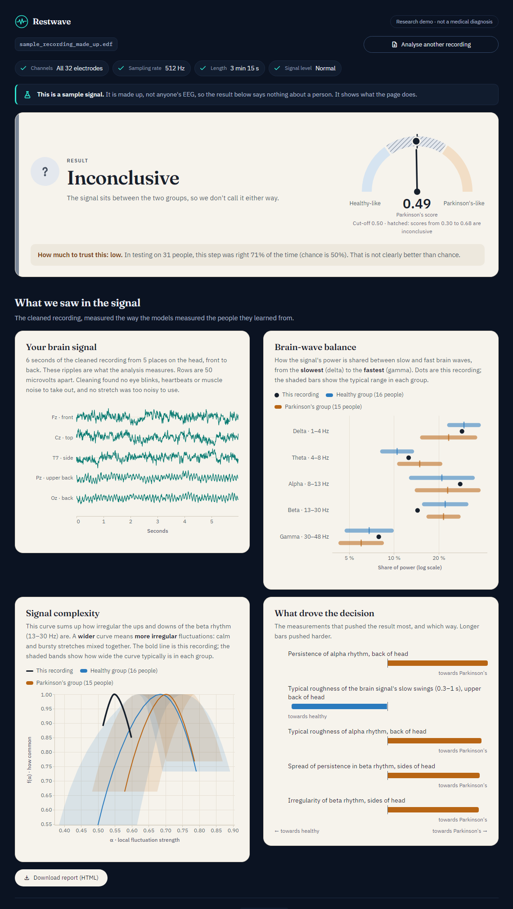

The screenshot shows a run on the made-up sample recording. Its result means nothing about anyone,
and the page says so in a banner. Section by section, as the script lays it out:

1. **Upload.** Drop a `.bdf` or `.edf` file, or both of one patient's OFF and ON recordings. Or press
   **Try a sample recording**, which makes up a signal with `pdeeg.demo.synthetic_recording`
   ([app.yaml](../configs/app.yaml), keys `sample: synthetic` and `sample_seed: 7`).
2. **Input check chips.** Channels, sampling rate, length and signal level, in plain words (here
   "All 32 electrodes", "512 Hz", "3 min 15 s", "Normal"). If a check fails, the page says what is
   wrong and how to fix it, and stops.
3. **Two files?** A checkbox asks you to confirm they are one patient's OFF and ON recordings.
4. **Processing.** The real steps of `predict_files` as they happen: cleaning, MFDFA, band power,
   running the models. A file is analysed once and remembered by its digest.
5. **The verdict** of stage 1: "Parkinson's pattern detected", "not detected", or "Inconclusive"
   (inside the uncertain band). The **gauge** shows the score, the 0.50 cut-off, and the uncertain
   band hatched (the screenshot shows 0.49, inside the band "from 0.30 to 0.68", which is 0.305 to
   0.68 rounded).
   - **"How much to trust this"** is one sentence built from the stage's stored evaluation
     (`stage_evidence`). In the screenshot: "In testing on 31 people, this step was right 71% of the
     time (chance is 50%). That is not clearly better than chance." The 71 % is stage 1's balanced
     accuracy of 0.71.
   - The level is "low" or "moderate", never "high", "nothing was tested outside one dataset"
     ([`app/restwave/verdict.py`](../app/restwave/verdict.py)).
   - A score above the audit threshold is not given.
6. **Medication**, only after "detected" (on one recording it is always inconclusive), or, for a
   pair, which recording looks like the OFF one.
7. **"What we saw in the signal"**: four graphs (11.3).
8. **Report**: the whole analysis as one printable HTML file. Print it to PDF from the browser.

A recording from ds002778 gets a banner ("Test result, not a new prediction") and its out-of-fold
result (10.9).

### 11.3 Explaining each graph to a non-expert

**"Your brain signal."** Six seconds of the cleaned recording from five places on the head, front
to back: Fz, Cz, T7, Pz, Oz, one per region ([app.yaml](../configs/app.yaml), key `signal`). It
takes "the first stretch this long with no window marked bad".
*How to explain it:* "These wiggly lines are the electrical activity the cap picked up, after
cleaning. Each line is one spot on the head, from the forehead at the top to the back of the head
at the bottom. Everything else on the page is measured from signals like these."

**"Brain-wave balance."** For each band, the dot is this recording's share of power (relative power,
on a log scale). The shaded bars are the typical range in each group: the group mean ± 1 standard
deviation over people (`groups.sd: 1.0`), "Every person counts once: a patient's OFF and ON
recordings are averaged first".
*How to explain it:* "Brain activity mixes slow and fast waves, like the bass and treble in music.
This shows how much of each this recording has, next to the usual range for healthy people and for
people with Parkinson's. The two ranges overlap a lot, which is part of why the verdict is so
uncertain."

**"Signal complexity."** The singularity spectrum f(α) of the beta envelope (`complexity.series:
beta`, `fit_range: main`), averaged over channels, against the groups' typical ranges.
*How to explain it:* "This curve sums up how irregular the ups and downs of the fast beta rhythm
are. A wider curve means more irregular: calm and bursty stretches mixed together."

**"What drove the decision."** The five measurements that pushed stage 1's score most for *this*
recording, as bars towards "healthy" or towards "Parkinson's". The size is coefficient ×
standardised value (10.8), and the names are put into plain words by
[`app/restwave/plain.py`](../app/restwave/plain.py) (for example "Persistence of alpha rhythm, back
of head" for `envelope_alpha_main_h2_occipital`).
*How to explain it:* "These are the measurements the model leaned on most for this recording. It
explains what the model did, not what is happening in the brain, and the model itself was not shown
to beat chance."

### 11.4 The research view

The research view's eight pages ([README.md](../README.md#the-research-view)):

- **Overview**: upload, paired mode, where the pipeline stands.
- **Recording Analysis**: every input check, the processing timeline, what the cleaning did.
- **EEG Signal Quality**: the window before and after cleaning, the spectrum, each channel's
  amplitude and bad time.
- **Multifractal Analysis**: fluctuation functions, h(q) and f(α) of any channel and series, scalp
  maps, the feature table.
- **Scalp Topography**: one feature over the scalp.
- **Model Evaluation**: each stage's score against the out-of-fold scores, its band, its
  cross-validated balanced accuracy with interval, chance and permutation p. A stage that is not
  better than chance is greyed out.
- **Research Report**: the printable HTML, and the JSON and text of `pdeeg predict`.
- **About & Methodology**: the pipeline as configured, and its limits.

The pages are in [`app/views/`](../app/views/), and their building blocks in
[`app/neurolab/`](../app/neurolab/).

### 11.5 Privacy and caching

- **Local only.** Both apps listen on `localhost`. The page handles uploads in a temporary directory
  that is deleted afterwards ([README.md](../README.md#ethical-considerations)).
- **Caching.** Streamlit reruns the whole script on every click. To avoid cleaning a file again on
  every click, the analysis is cached on the file's digest with `st.cache_data`
  ([`app/restwave/analysis.py`](../app/restwave/analysis.py), function `analyse`).
- **Settings.** Display settings only are in [`configs/app.yaml`](../configs/app.yaml): "nothing
  here changes a feature, a model, a threshold or what the models are given."

### 11.6 Where it lives

| File | Role |
|---|---|
| [`app/streamlit_app.py`](../app/streamlit_app.py) | The page's layout, top to bottom |
| [`app/restwave/analysis.py`](../app/restwave/analysis.py) | One run: `predict_files`, then what the graphs and report need. The group ranges. The sample recording |
| [`app/restwave/verdict.py`](../app/restwave/verdict.py) | What a result says, in words: `diagnosis`, `medication`, `paired`, `trust` |
| [`app/restwave/plain.py`](../app/restwave/plain.py) | Every plain-word name: regions, bands, features, input checks |
| [`app/restwave/charts.py`](../app/restwave/charts.py) | The gauge, the three charts (Altair, a Python charting library), the driver bars |
| [`app/restwave/blocks.py`](../app/restwave/blocks.py), [`theme.py`](../app/restwave/theme.py), [`settings.py`](../app/restwave/settings.py) | HTML pieces, colours and styles, the `app.yaml` loader |
| [`app/research_app.py`](../app/research_app.py), [`app/views/`](../app/views/), [`app/neurolab/`](../app/neurolab/) | The research view |
| [`app/.streamlit/config.toml`](../app/.streamlit/config.toml) | Streamlit's own settings |

### Key takeaways

- Two local-only Streamlit apps: the one-page verdict (8501) and the research view (8502). Both call
  the same `predict_files` as the command line.
- The verdict always comes with how much to trust it, read from the stage's own cross-validation.
  Stage 1 is described as not clearly better than chance.
- The four graphs show the cleaned signal, the band balance, the beta-envelope spectrum against the
  group ranges, and the features that moved the score.

### Check yourself

**Q1. Why are the apps served on localhost only?**
*Answer:* Uploads are people's EEG, which is health data. It should not leave the computer.

**Q2. Where does the number in "this step was right 71% of the time" come from?**
*Answer:* From stage 1's stored cross-validated balanced accuracy (0.71), read by `stage_evidence`.

**Q3. What do the shaded bars in "Brain-wave balance" show?**
*Answer:* Each group's mean ± 1 standard deviation over people, with each person counted once.

---

## 12. The code, a guided tour

### 12.1 The folder structure

```
configs/                 every setting, in YAML (12.3)
  data.yaml              dataset, paths, sessions, regions
  preprocessing.yaml     crop, filter, reference, ICA, bad stretches, QC
  features/mfdfa.yaml    q range, detrending, fit ranges and their reasons, surrogates
  features/psd.yaml      Welch settings and bands
  stats.yaml             the pre-registered statistics
  model.yaml             tasks, feature sets, grids, cross-validation, cascade, final models
  predict.yaml           input checks, thresholds, uncertain bands, "better than chance"
  app.yaml               the page's display settings (read by the app only)
src/pdeeg/               the Python package (12.2)
app/                     the two Streamlit apps (chapter 11)
tests/                   pytest tests on synthetic data (12.7)
notebooks/               01_mfdfa_validation.ipynb
reports/                 generated reports and figures, and methods.md
scripts/download_data.py the same as `pdeeg download --force`
docker/entrypoint.sh     the container's start script
.github/workflows/ci.yml continuous integration
data/                    raw/, interim/, processed/ (contents not in git)
models/, predictions/    final models and prediction outputs (not in git)
mlflow.db, mlruns/       MLflow tracking (not in git)
pyproject.toml           the package definition and exact dependency versions
Makefile, Dockerfile     shortcuts and the container image
README.md, MODEL_CARD.md the project's main documents
```

**YAML** is a plain-text format for settings: `key: value` lines, with indentation for nesting.
A **package** is a folder of Python modules installed under one name, here `pdeeg`. A **module** is
one `.py` file. Four tools in the tree are explained later in this chapter, and here is a sentence
on each now:

- **pytest** (12.7) runs the tests.
- **CI** (12.8) runs the checks automatically on GitHub.
- **Docker** (12.8) packages the project so it runs the same on any computer.
- **Make** (12.8) runs named shortcuts.

### 12.2 Every module of `src/pdeeg`, one row each

| Module | What it does |
|---|---|
| [`__init__.py`](../src/pdeeg/__init__.py) | The package's version |
| [`cli.py`](../src/pdeeg/cli.py) | The `pdeeg` command: parses arguments and calls the steps |
| [`config.py`](../src/pdeeg/config.py) | Loads and validates every YAML file into typed, read-only settings |
| [`pipeline.py`](../src/pdeeg/pipeline.py) | Every step (`download_step` … `cascade_step`, `train_final_step`, `report_step`, `all_steps`), each skipped while current |
| [`stages.py`](../src/pdeeg/stages.py) | `Stage`: records and checks a step's settings, inputs and outputs |
| [`demo.py`](../src/pdeeg/demo.py) | Describes one cleaned recording for the apps, and `synthetic_recording` (the made-up sample) |
| [`data/bids.py`](../src/pdeeg/data/bids.py) | `list_recordings`, `load_raw`: the BIDS dataset in, the recordings table and scalp EEG out |
| [`data/download.py`](../src/pdeeg/data/download.py) | Fetches the dataset with openneuro-py and checks its version |
| [`preprocessing/pipeline.py`](../src/pdeeg/preprocessing/pipeline.py) | Crop, mains detection, filter, reference, ICA, bad stretches, saving and caching |
| [`preprocessing/ica.py`](../src/pdeeg/preprocessing/ica.py) | Fitting ICA and labelling components with ICLabel |
| [`preprocessing/segments.py`](../src/pdeeg/preprocessing/segments.py) | Marking bad 1 s windows |
| [`preprocessing/qc.py`](../src/pdeeg/preprocessing/qc.py) | Preprocessing QC figures |
| [`preprocessing/report.py`](../src/pdeeg/preprocessing/report.py) | The QC table, flags (robust z) and report |
| [`features/mfdfa.py`](../src/pdeeg/features/mfdfa.py) | The MFDFA algorithm and the five features |
| [`features/envelope.py`](../src/pdeeg/features/envelope.py) | Band-pass + Hilbert amplitude envelopes |
| [`features/surrogates.py`](../src/pdeeg/features/surrogates.py) | Shuffled and IAAFT surrogates |
| [`features/synthetic.py`](../src/pdeeg/features/synthetic.py) | Test signals with known exponents (fGn, power-law noise, binomial cascade) |
| [`features/scaling.py`](../src/pdeeg/features/scaling.py) | The series to analyse, scales of a fit range, and the label-blind scaling inspection |
| [`features/scaling_report.py`](../src/pdeeg/features/scaling_report.py) | Writes `mfdfa_scaling.md` |
| [`features/extract.py`](../src/pdeeg/features/extract.py) | Every MFDFA run of every channel, with surrogates and per-recording caching |
| [`features/psd.py`](../src/pdeeg/features/psd.py) | Welch spectra and band powers |
| [`features/tables.py`](../src/pdeeg/features/tables.py) | Long and wide feature tables, region averages |
| [`features/curves.py`](../src/pdeeg/features/curves.py) | Whole h(q) and f(α) curves for figures |
| [`features/report.py`](../src/pdeeg/features/report.py) | Writes `qc_mfdfa.md` |
| [`stats/features.py`](../src/pdeeg/stats/features.py) | Which features are tested (primary or exploratory) and on whose recordings |
| [`stats/analysis.py`](../src/pdeeg/stats/analysis.py) | The four analyses of every feature, with FDR |
| [`stats/cluster.py`](../src/pdeeg/stats/cluster.py) | Cluster permutation tests, Hedges' g, residualising, Benjamini-Hochberg |
| [`stats/confounds.py`](../src/pdeeg/stats/confounds.py) | Age and sex tests and covariates |
| [`stats/descriptive.py`](../src/pdeeg/stats/descriptive.py) | Bootstrap intervals and the detectable effect size |
| [`stats/report.py`](../src/pdeeg/stats/report.py) | Writes `stats_results.md` |
| [`models/data.py`](../src/pdeeg/models/data.py) | A task's rows, labels, groups, weights and features |
| [`models/cv.py`](../src/pdeeg/models/cv.py) | Grouped splitters, the leakage guard, models and grids, Platt scaling, permutations |
| [`models/evaluate.py`](../src/pdeeg/models/evaluate.py) | Nested CV, metrics, bootstrap, permutation nulls, other splits |
| [`models/classify.py`](../src/pdeeg/models/classify.py) | The ablation, its summary, the best result, the audit threshold |
| [`models/calibration.py`](../src/pdeeg/models/calibration.py) | Brier, recalibration, reliability bins, the calibration rule, the uncertain band |
| [`models/cascade.py`](../src/pdeeg/models/cascade.py) | The two-stage cascade evaluation |
| [`models/cascade_report.py`](../src/pdeeg/models/cascade_report.py) | Writes `cascade_results.md` |
| [`models/store.py`](../src/pdeeg/models/store.py) | Saves and reloads evaluations |
| [`models/tracking.py`](../src/pdeeg/models/tracking.py) | MLflow runs |
| [`models/report.py`](../src/pdeeg/models/report.py) | Writes `classification_results.md` |
| [`predict/inputs.py`](../src/pdeeg/predict/inputs.py) | Reads and checks a new recording, and fingerprints it |
| [`predict/features.py`](../src/pdeeg/predict/features.py) | One recording's features, made by the training code |
| [`predict/final.py`](../src/pdeeg/predict/final.py) | `pdeeg train-final` |
| [`predict/predictor.py`](../src/pdeeg/predict/predictor.py) | `pdeeg predict` (`predict_files`) and each stage's evidence |
| [`viz/style.py`](../src/pdeeg/viz/style.py) | The shared look of every report figure |
| [`viz/scaling.py`](../src/pdeeg/viz/scaling.py), [`features_qc.py`](../src/pdeeg/viz/features_qc.py), [`stats.py`](../src/pdeeg/viz/stats.py), [`classification.py`](../src/pdeeg/viz/classification.py), [`cascade.py`](../src/pdeeg/viz/cascade.py) | The figures of each report |
| [`viz/predict.py`](../src/pdeeg/viz/predict.py), [`viz/demo.py`](../src/pdeeg/viz/demo.py) | Figures for the apps |

### 12.3 How the configs drive everything

"No location is hard-coded in the package" ([`config.py`](../src/pdeeg/config.py) docstring).
`load_config`:

1. Finds the config directory: `--config-dir`, else the environment variable `PDEEG_CONFIG_DIR`,
   else `configs/` in the current directory. The project root is its parent, and every relative
   path in the YAML is resolved from there.
2. Reads each file into a **frozen dataclass**, a read-only Python record with named, typed fields
   (`DataConfig`, `PreprocessingConfig`, `MfdfaConfig`, `PsdConfig`, `ModelConfig`, `StatsConfig`,
   `PredictConfig`, collected in `Config`).
3. **Every key is required and unknown keys are rejected**, "so a typo fails at load time instead of
   silently falling back to a default". The error reads, for example,
   `stats: unknown key(s): fdr_qq`.
4. Checks that span files (`_validate`): for example, that every task's conditions exist in
   `sessions` of `data.yaml`, that no channel is in two regions, that `q_min < q_max`, and that each fit range
   has a `wide_features` entry.

`pdeeg config` prints the whole resolved configuration. `configs/app.yaml` is the one file `pdeeg`
never reads: the app loads it with [`app/restwave/settings.py`](../app/restwave/settings.py).

Settings also feed **digests**. Each step's cache key includes a digest of its settings (12.5),
and the final models store a digest of every feature setting, so `pdeeg predict` refuses to run if
those settings change (10.8).

### 12.4 The commands, and the order to run them

From [`cli.py`](../src/pdeeg/cli.py):

| Command | What it does | Writes |
|---|---|---|
| `pdeeg download` | Fetch the dataset from OpenNeuro, or check the copy on disk | `data/raw/ds002778/` |
| `pdeeg recordings` | Index the raw dataset into the recordings table | `data/interim/recordings.parquet` |
| `pdeeg preprocess` | Clean every recording, write the QC report | `data/interim/clean/`, `reports/qc_preprocessing.md` |
| `pdeeg mfdfa-scaling` | The label-blind scaling inspection (not part of `all`) | `reports/mfdfa_scaling.md` |
| `pdeeg features` | Band power, MFDFA with surrogates, and h(q) curves. Its parts are `pdeeg psd-features`, `pdeeg mfdfa-features`, `pdeeg mfdfa-curves` | `data/interim/mfdfa/`, `data/processed/*_features_*.parquet`, `reports/qc_mfdfa.md` |
| `pdeeg stats` | The pre-registered cluster tests | `reports/stats_results.md` |
| `pdeeg classify` | The nested-CV ablation, tracked in MLflow | `reports/classification_results.md` |
| `pdeeg cascade` | The two-stage cascade evaluation | `reports/cascade_results.md` |
| `pdeeg report` | Rewrite every report from stored results without recomputing | `reports/` |
| `pdeeg train-final` | The final models (not part of `all`) | `models/` |
| `pdeeg predict FILE [--paired FILE2]` | One recording, or a patient's two, through the final models | `predictions/` |
| `pdeeg config` | Print the resolved configuration | (screen) |
| `pdeeg all` | download → recordings → preprocess → features → stats → classify → cascade | all of the above |

Common options: `--force` runs a step even if it is current, and `--n-jobs N` sets the number of
processes for the parallel steps. `--config-dir PATH` comes *before* the command:
`pdeeg --config-dir other/configs stats`. `pdeeg preprocess --config FILE` uses another
preprocessing YAML. Every command has a `make` target of the same name, with `FORCE=1`,
`N_JOBS=n` and `CONFIG_DIR=path` ([Makefile](../Makefile)).

**From scratch**, the order is: `download`, `recordings`, `preprocess`, `features`, `stats`,
`classify`, `cascade` (or simply `pdeeg all`), then `train-final`, then `predict` or the app. Run
`mfdfa-scaling` only if you want to revisit the fit ranges.

### 12.5 Caching: why rerunning is safe

"Every step is skipped when it is current" ([`pipeline.py`](../src/pdeeg/pipeline.py)). Two
mechanisms are used:

- **Stage stamps** ([`stages.py`](../src/pdeeg/stages.py)). After a step finishes, `Stage.done()`
  writes `data/interim/stages/<step>.json` with a digest of its settings and the SHA-256 of every
  input and output file. `is_current()` is true while all of them are unchanged. Files are compared
  by *content*, so rewriting a file with the same bytes keeps the later steps current. Paths are
  recorded relative to the project root, "so a copy of the project in another place (a container,
  a fresh clone) finds its stamps current". `STEP_VERSIONS` is raised when a step's code changes in
  a way its settings cannot show. On the development machine the stamps are `download`,
  `recordings`, `psd`, `curves`, `stats`, `classify-<task>` (one per task) and `cascade`.
- **Per-recording caches** for the two slow steps. A cleaned recording is reused while its log's
  `config_hash` matches and it is newer than its inputs (`is_current` in
  `preprocessing/pipeline.py`). A recording's MFDFA runs are reused while their `config_hash`
  matches (`is_current` in `features/extract.py`). Raising `PIPELINE_VERSION` or `EXTRACT_VERSION`
  invalidates them.

Reports are always rewritten from what is stored, "which takes seconds and gives the same files for
the same inputs". `tests/test_pipeline.py` checks that reports are "byte for byte the same".

### 12.6 MLflow

**MLflow** is a tool for **experiment tracking**: it records, for every run, its parameters,
metrics, files ("artifacts") and tags, so you can compare runs later and know exactly what produced
each one. Every classification evaluation, the cascade and every final model is an MLflow run in
the experiment `pdeeg` ([model.yaml](../configs/model.yaml), key `tracking`). The runs are stored in
a SQLite database, `mlflow.db`, with artifacts in `mlruns/`. The config notes that "MLflow 3.17 no
longer accepts a plain ./mlruns directory as the tracking store". Each run is tagged with the
configuration digest, the dataset and version, the feature tables' digests and the git commit,
"marked dirty when the working tree had uncommitted changes"
([`models/tracking.py`](../src/pdeeg/models/tracking.py)).

**To open the MLflow UI**, from the project root with the environment activated:

```bash
mlflow ui --backend-store-uri sqlite:///mlflow.db
```

Then open http://127.0.0.1:5000 (MLflow's default port; `--port` changes it). Runs are named like
`pd_vs_hc/psd/logistic_regression`, `cascade/psd_mfdfa/logistic_regression` and `final/stage1`. On
the development machine the database held 49 runs (counted from `mlflow.db` on 2026-10-27; not in
git).

### 12.7 The tests

**pytest** is the Python testing tool. A **test** is a small function that runs some code and
checks the result. The tests run on **synthetic data**, made-up recordings and tables, so they need
no download. The two tests marked `dataset` read the real dataset and are skipped without it.

```bash
pytest -m "not dataset"                 # everything that needs no download
pytest tests/test_mfdfa.py              # one file
pytest tests/test_mfdfa.py -k white     # tests whose name contains "white"
```

In the run on 2026-10-27 on the development machine: 340 passed, 2 deselected (the `dataset`
tests), in 502 s. Each test file guards one part:

| Test file | What it protects |
|---|---|
| [`test_config.py`](../tests/test_config.py) | The configs load, invalid settings are refused, and the pre-registered primary features are the ones in `stats.yaml` |
| [`test_bids.py`](../tests/test_bids.py) | Groups come from session labels. Bad layouts are refused. Only scalp EEG with the montage is loaded |
| [`test_preprocessing.py`](../tests/test_preprocessing.py) | One continuous recording of the right length, the blink component removed, the crop at the trigger, mains read from the spectrum, bad stretches marked not removed, caching |
| [`test_stages.py`](../tests/test_stages.py) | A step is current until its settings, inputs or outputs change, and a copy of the project elsewhere is current |
| [`test_pipeline.py`](../tests/test_pipeline.py) | Steps run once and are then skipped. Reports are byte-for-byte the same. A missing input says what to run |
| [`test_synthetic.py`](../tests/test_synthetic.py) | The synthetic signals themselves have the properties claimed |
| [`test_mfdfa.py`](../tests/test_mfdfa.py) | MFDFA recovers known exponents (white noise, random walk, fGn, cascade), agrees with the PyPI `MFDFA` package, detrends exactly, and handles excluded stretches and flat windows |
| [`test_envelope.py`](../tests/test_envelope.py) | Envelopes recover a slow amplitude modulation, keep the band, and lose the filter's memory above 2 s |
| [`test_surrogates.py`](../tests/test_surrogates.py) | Shuffles keep the distribution only. IAAFT keeps the distribution and the spectrum and the Hurst exponent |
| [`test_scaling.py`](../tests/test_scaling.py) | Scales, local slopes and crossovers. The inspection is reproducible and needs no labels |
| [`test_extract.py`](../tests/test_extract.py) | Bad-sample masks, every run of a channel, results independent of order and process count, caching |
| [`test_psd.py`](../tests/test_psd.py) | The mean of segment spectra is Welch's spectrum. Band edges and `clean` segments |
| [`test_tables.py`](../tests/test_tables.py) | Region means, surrogate summaries, and wide tables with only the chosen features |
| [`test_curves.py`](../tests/test_curves.py) | The curves hold the same `h2` as the tables |
| [`test_stats_cluster.py`](../tests/test_stats_cluster.py) | Thresholds, Hedges' g, residuals and Benjamini-Hochberg by hand. Planted effects are found, and without an effect clusters appear about as often as alpha |
| [`test_stats_analysis.py`](../tests/test_stats_analysis.py) | Every feature through every analysis, planted disease and medication effects found, FDR within each family |
| [`test_models.py`](../tests/test_models.py) | Task rows and centring, metrics and bootstrap by hand, a planted signal classified and noise not, MLflow runs, the report's audit |
| [`test_leakage.py`](../tests/test_leakage.py) | No participant is ever on both sides of any split, for every task and both cascade stages. Permutations keep the design. The nearest-neighbour leakage demonstration (9.7) |
| [`test_cascade.py`](../tests/test_cascade.py) | Cascade metrics and Brier scores by hand, the calibration rule, a planted three-class effect recovered, noise not classified |
| [`test_predict.py`](../tests/test_predict.py) | Input checks and refusals, training recordings recognised, uncertain bands, the better-than-chance rule, `train-final` refusals, end-to-end prediction, a model with other settings refused |
| [`test_demo.py`](../tests/test_demo.py) | The research view's description of a recording, every page opens, it predicts only through `pdeeg predict` |
| [`test_app.py`](../tests/test_app.py) | The page's verdicts for every case, the cache, refusals, paired mode, plain words for every model column, the trust line read from the evaluation |

The app tests use **Streamlit AppTest**, which runs a Streamlit script without a browser and lets
the test click and read the page.

### 12.8 Ruff, CI, Docker and the Makefile

- **Ruff** is a **linter** (it flags likely mistakes and style problems) and **formatter** (it lays
  code out consistently). The rules are set in [`pyproject.toml`](../pyproject.toml): line length
  100, rule sets E, F, W, I, UP, B, SIM, PTH. Check with `ruff check .` and `ruff format --check .`,
  or fix with `make format`.
- **CI (continuous integration)** runs checks automatically on every push. The
  [workflow](../.github/workflows/ci.yml) has two jobs on GitHub's servers. **test** (Ubuntu,
  Python 3.11) installs the package, runs Ruff, dry-runs the Makefile targets and runs
  `pytest -m "not dataset"`. **docker** builds the image and checks that it starts.
- **Docker** packages the program with everything it needs into an **image** that runs the same
  everywhere, as a **container**. The [Dockerfile](../Dockerfile) starts from Python 3.12.14 slim,
  installs the pinned dependencies, links `reports`, `mlruns`, `mlflow.db`, `models` and
  `predictions` into the mounted `data/` folder, runs as a non-root user (uid 1000), and runs
  `pdeeg all` by default:

  ```bash
  docker build -t pdeeg .
  docker run --rm -v "$PWD/data:/app/data" pdeeg            # pdeeg all
  docker run --rm -v "$PWD/data:/app/data" pdeeg stats      # any other command
  ```
- **Make** runs named shortcuts from the [Makefile](../Makefile). Plain `make` prints the list
  "rather than starting a pipeline that can take hours". The project targets are `install`,
  `install-app`, `test`, `lint`, `format`, `docker-build`, `docker-run`, `docker-train-final`,
  `docker-predict`, `app` and `research`, plus one target per `pdeeg` command.

### 12.9 Recipes: "if you want to change X, edit Y"

Before any recipe, remember what changing settings *after seeing results* means. The statistics
were pre-registered (8.9). Changing a primary feature's definition, a contrast or the test makes
that analysis **exploratory**, and the report must say so.

**Change the band-power bands.**
1. Edit `bands` in [`configs/features/psd.yaml`](../configs/features/psd.yaml). Each band is
   `[low, high)` in Hz and must lie within `fmin`–`fmax`. The config check refuses `low >= high`.
2. Run `pdeeg all`. The band-power step's key includes its settings, so it reruns, and stats,
   classify and cascade follow because their inputs changed.
3. Run `pdeeg train-final` again. The old models will refuse to predict, because their feature
   digest no longer matches.

The envelope bands are separate: `envelope.bands` in `mfdfa.yaml`.

**Change the q range.**
1. Edit `q_min`, `q_max` and `q_step` in [`configs/features/mfdfa.yaml`](../configs/features/mfdfa.yaml).
   The range must be a whole number of steps (`make_qs`) and must include q = 2, which `h2` needs.
2. Everything MFDFA reruns, because the q values are in the MFDFA cache key (`config_hash` in
   `features/extract.py`). That is the slowest part of the pipeline (13.4).
3. `delta_h` and every spectrum feature change meaning, including the primary ones, so the primary
   analysis becomes exploratory.

**Add a model.**
1. In [`src/pdeeg/config.py`](../src/pdeeg/config.py), add a dataclass for its grid and a field
   in `ClassifiersConfig`. Add the model's name to the allowed names in `_validate_final`.
2. Add its section under `classifiers` in [`configs/model.yaml`](../configs/model.yaml). Every key
   is required.
3. In [`src/pdeeg/models/cv.py`](../src/pdeeg/models/cv.py), add the name to `MODELS` and a branch
   in `classifier()` returning the estimator and its grid, with names prefixed `model__`.
4. Add its display name in [`src/pdeeg/models/report.py`](../src/pdeeg/models/report.py).
5. If it has neither `coef_` nor `feature_importances_`, extend `_weights` in `models/evaluate.py`
   and `contributions` in `predict/predictor.py`.
6. Run `pytest`. The leakage and model tests run over every model.

Each model adds a combination to every task, and each combination costs 1000 nested
cross-validations for its p-value.

**Add an MFDFA feature.**
1. Compute it in `spectrum_features` and add its name to `FEATURE_NAMES` in
   [`features/mfdfa.py`](../src/pdeeg/features/mfdfa.py).
2. Raise `EXTRACT_VERSION` in [`features/extract.py`](../src/pdeeg/features/extract.py), because the
   stored runs only hold the old features.
3. List it under `features` and the relevant `wide_features` in `mfdfa.yaml`.
4. Give it plain words in `MEASURES` in [`app/restwave/plain.py`](../app/restwave/plain.py).
   `test_app.py` checks that every column a model can use has them.

**Add a band-power feature.** Add a band (see above) or extend `band_powers` in
[`features/psd.py`](../src/pdeeg/features/psd.py).

**Add a whole new kind of feature.** A new feature table needs a module like `psd.py`, a table kind
in `table_paths` and in `pipeline._tables`, a feature set in `model.yaml` `feature_sets`, a pipeline
step with its own `Stage` name in `STEP_VERSIONS`, and plain words for the app.

**Rerun one step.**
- `pdeeg stats --force`, or `make stats FORCE=1`.
- To rewrite the reports only: `pdeeg report`.
- To redo one recording's cleaning, delete its log `data/interim/clean/sub-XX_ses-YY_clean.json`.
  "The log marks a finished recording", so without it the recording counts as not done. The same
  works for its MFDFA log in `data/interim/mfdfa/`.

**Change a fit range.** Look again first with `pdeeg mfdfa-scaling`, which stays label-blind. Edit
`fit_ranges` in `mfdfa.yaml`, writing the reason next to the value as the existing comments do. All
MFDFA reruns.

**Point the project at other folders.** Edit `paths` in `data.yaml`, or keep a second config
folder and use `pdeeg --config-dir path` (or set `PDEEG_CONFIG_DIR`).

### 12.10 A short history from git

`git log --oneline` shows how the package was built, step by step: the BIDS loader and the
preprocessing pipeline (2026-10-08), the MFDFA implementation, its validation and feature
extraction (2026-10-09), the group statistics, the classification without leakage and the
engineering polish (2026-10-23), the README, methods and model card (2026-10-24), the new tasks,
the cascade, the final models and `pdeeg predict` (2026-10-26), and the app with its documentation
(2026-10-27). The dates match those recorded in the config files.

### Key takeaways

- Every setting lives in YAML under `configs/`, is loaded into frozen dataclasses, and is checked
  strictly, so typos fail at load time.
- `pdeeg all` runs download → recordings → preprocess → features → stats → classify → cascade.
  `train-final` and `predict` come after. Every step is skipped while its settings, inputs and
  outputs are unchanged.
- MLflow records every evaluation and model. Open it with
  `mlflow ui --backend-store-uri sqlite:///mlflow.db`.
- The tests run on synthetic data and guard each part, leakage included. Ruff, CI and Docker keep
  the code clean and portable.

### Check yourself

**Q1. You add `fdr_qq: 0.05` to `stats.yaml` by mistake. What happens?**
*Answer:* Loading fails with "unknown key(s): fdr_qq", because every key is checked.

**Q2. You rerun `pdeeg all` without changing anything. What runs?**
*Answer:* Nothing heavy. Every step finds its stamp current and is skipped.

**Q3. Which two steps are not part of `pdeeg all`?**
*Answer:* `mfdfa-scaling` (its result is already in the config) and `train-final` (plus
`predict`, which needs a file).

**Q4. After changing the bands, why does `pdeeg predict` refuse to run?**
*Answer:* The final models stored a digest of the feature settings. It no longer matches, so you
must run `pdeeg train-final` again.

---

## 13. Running it yourself

### 13.1 What you need

- **Python 3.11 or 3.12** ([pyproject.toml](../pyproject.toml): `requires-python = ">=3.11,<3.13"`).
  3.13 is not supported.
- **Git**, to get the code.
- **Disk space.** On the development machine (measured on 2026-10-27, not in any report),
  `data/raw` took 546 MB, `data/interim` 537 MB (520 MB of it cleaned recordings) and
  `data/processed` 14 MB.
- **CPU.** The configs ask for many parallel processes: preprocessing 6, MFDFA extraction 16, stats
  8 and classification 18 (`n_jobs` in each file). On a smaller machine, lower them with
  `--n-jobs` or in the files. The comments say this "does not affect the results". The development
  machine has 20 logical processors.
- Optional: **Docker**, and **Make**. Windows does not have `make` by default, but every target has
  a plain `pdeeg` equivalent.

A **virtual environment** ("venv") is a private folder of Python packages for one project, so its
exact versions do not clash with anything else on your computer.

### 13.2 Windows (PowerShell), from scratch

```powershell
git clone https://github.com/yeah-sh/Parkinson-s-disease.git pdeeg
cd pdeeg
py -3.12 -m venv .venv                 # or: python -m venv .venv
.\.venv\Scripts\Activate.ps1
python -m pip install --upgrade pip
pip install -e ".[dev,app]"            # the package, its tests and the app
pytest -m "not dataset"                # about 8 minutes; nothing is downloaded

pdeeg all                              # download -> ... -> cascade (hours)
pdeeg train-final                      # the tool's models, into models\

python -m streamlit run app/streamlit_app.py --server.address localhost
python -m streamlit run app/research_app.py --server.address localhost --server.port 8502
```

`pip install -e ".[dev,app]"` installs the package in **editable** mode (your code changes take
effect without reinstalling), with the optional `dev` and `app` extras of
[`pyproject.toml`](../pyproject.toml).

### 13.3 Linux or macOS, from scratch

```bash
git clone https://github.com/yeah-sh/Parkinson-s-disease.git pdeeg
cd pdeeg
python3.12 -m venv .venv
source .venv/bin/activate
python -m pip install --upgrade pip
make install-app                       # = pip install -e ".[dev,app]"
pytest -m "not dataset"

make all                               # the whole pipeline
make train-final
make app                               # http://localhost:8501
make research                          # http://localhost:8502
```

With Docker instead: `make docker-build`, then `make docker-run` (the whole pipeline on `./data`).

### 13.4 Order and expected runtimes

No report records how long the whole pipeline takes. Here is what the files do say:

| Step | What the repository says about time | Source |
|---|---|---|
| `pdeeg download` | (not recorded) the raw data is 546 MB on disk | measured on the development machine |
| `pdeeg preprocess` | "Preprocessing and the MFDFA surrogates take hours" | [README.md](../README.md#the-analysis) |
| `pdeeg features` (MFDFA) | median 323 s per recording (243 to 848 s), 5.1 h over the 46 recordings, with 16 processes | the `seconds` field of `data/interim/mfdfa/*_mfdfa.json` (local logs, not in git) |
| `pdeeg classify` | each p-value is 1000 nested cross-validations. Leave-one-person-out would have taken "weeks of CPU" | [model.yaml](../configs/model.yaml) |
| `pdeeg all --force` | "run every step again, preprocessing and MFDFA included (hours)" | help text in [cli.py](../src/pdeeg/cli.py) |
| `pytest -m "not dataset"` | 340 passed in 502 s | the run on 2026-10-27 |
| The validation notebook | "about a minute" | [the notebook](../notebooks/01_mfdfa_validation.ipynb) |

Because every step is cached, an interrupted `pdeeg all` resumes where it stopped.

### 13.5 Common errors and fixes

| You see | What it means | Fix |
|---|---|---|
| `config directory not found: ... (pass --config-dir or set PDEEG_CONFIG_DIR)` | You are not in the project root | `cd` to the folder that holds `configs/`, or pass `--config-dir` |
| `...: unknown key(s): ...` or `missing key(s)` | A typo or a missing setting in a YAML file | Fix the key the message names. `pdeeg config` shows what loaded |
| `` data/interim/recordings.parquet not found; run `pdeeg recordings` first `` | Steps run out of order | Run the step the message names, or `pdeeg all` |
| `` ... not found; run `pdeeg features` first `` (or `classify`, `cascade`) | The same | The same |
| Many small files fail during `pdeeg download` | A network that blocks HTTP/3 over UDP. The code already forces TCP for openneuro-py (`_http3_disabled`) | Rerun `pdeeg download`: it skips what is already verified |
| `... holds ..., expected ds002778.v1.0.5` | The folder holds files of another dataset version | Delete `data/raw/ds002778` and download again |
| pip refuses to install: requires Python >=3.11,<3.13 | Wrong Python version | Use 3.11 or 3.12 |
| PowerShell: "running scripts is disabled on this system" | Windows blocks the venv activation script | `Set-ExecutionPolicy -Scope CurrentUser -ExecutionPolicy RemoteSigned`, then activate again |
| `make` is not recognised (Windows) | Make is not installed | Use the `pdeeg ...` command the Makefile target runs |
| `` no model in models\stage1; run `pdeeg train-final` first `` | No final models on this computer | `pdeeg train-final` (needs `classify` and `cascade` results). The app says "The models are not set up on this computer." |
| `` ... the model was saved with scikit-learn X, this is Y; run `pdeeg train-final` again `` | Library versions changed | Reinstall the pinned versions, or retrain |
| `... the model was trained with other preprocessing or feature settings ...` | A feature setting changed since training | `pdeeg train-final` again |
| `configs/predict.yaml has other thresholds than the model was trained with` | Thresholds or bands were edited | Restore them, or retrain |
| `model.final is not the best of the ablation for ... It should read: ...` | `final:` in `model.yaml` does not match the ablation | Paste the printed block into `model.yaml` |
| `configs/predict.yaml does not hold the uncertain bands the rule gives ... Set: ...` | The bands must come from the rule | Paste the printed values into `predict.yaml` `stages` |
| `` ... the out-of-fold decisions differ from the stored ablation; run `pdeeg classify --force` `` | The stored ablation is out of date | Do as it says |
| `pdeeg predict` refuses a file | It failed an input check: missing channels, too short, implausible amplitude ("are the units in the file right?") | Read the reason. The file must have all 32 biosemi32 channels and 180 s of EEG |
| Very slow, or out of memory | Too many parallel processes for your machine | `--n-jobs 2`, or lower `n_jobs` in the configs |
| Docker on Linux cannot write `data/` | The container runs as uid 1000 | Add `--user "$(id -u):$(id -g)"` (the Dockerfile comment) |

### Key takeaways

- Python 3.11 or 3.12, a virtual environment, `pip install -e ".[dev,app]"`, then `pytest -m "not
  dataset"`.
- `pdeeg all` then `pdeeg train-final` then the app. Preprocessing and MFDFA take hours, and the
  rest is cached.
- Most errors name the command that fixes them.

### Check yourself

**Q1. Why `pip install -e`?**
*Answer:* Editable mode: your changes to the code take effect without reinstalling.

**Q2. The app says the models are not set up. What do you run?**
*Answer:* `pdeeg train-final`, after `pdeeg all` has produced the classification and cascade
results.

**Q3. Your laptop has 4 cores. What do you change?**
*Answer:* Pass `--n-jobs 4` (or less) to the parallel steps, or lower the `n_jobs` settings. The
results do not change.

---

## 14. Limitations and ethics

The README's limitations and the model card's caveats are the authoritative lists
([README.md](../README.md#limitations), [MODEL_CARD.md](../MODEL_CARD.md)). This chapter explains
them in plain words, so you can discuss them without notes.

### 14.1 Sample size

- **31 participants:** 15 patients and 16 controls. Only large group differences are detectable:
  80 % power only for g ≈ 1.04 between groups and d_z ≈ 0.85 within patients
  ([stats_results.md](../reports/stats_results.md)).
- **Every interval is wide.** With 13 patients in a within-patient task, one patient more or less
  right moves balanced accuracy by 1/13 ≈ 0.077 (simple arithmetic). The model card says "a single
  misclassified person moves balanced accuracy by several points".
- **Effects that do reach significance in small samples tend to overstate the true size**
  ([stats_results.md](../reports/stats_results.md)).

### 14.2 One site, one system, no external test set

- Everyone was recorded at one university with one 32-channel BioSemi system at 512 Hz.
- **There is no external test set**: no second group of people, kept apart and tested once. Every
  number comes from cross-validation within this one dataset. "How the tool would do on people or
  equipment from anywhere else is unknown" ([README.md](../README.md#limitations)).
- Recordings at other sampling rates are resampled, "which the models never saw".
- **No leave-one-subject-out**: it was timed and would have taken weeks with the full permutation
  test. 5-fold estimates depend on the split, which is why 10 other splits are reported.

### 14.3 Not diagnostic, and the curators' request

- No output of this repository says whether a person has Parkinson's disease or is on medication.
  Every output carries the disclaimer.
- The curators' warning (4.5) is respected: the classification of these patients against controls
  is not presented as a finding, and anyone writing a manuscript with the data should contact them
  first.
- **Selection makes scores optimistic.** The final models were the best of 9 on the same
  cross-validation. The configuration fixed in advance and the q-values give the fairer picture.

### 14.4 Medication, and the two pre-filtered sessions

- **Stage 1 learns from ON recordings too.** It was trained on OFF and ON sessions (15 and 13
  recordings). "The ON recordings carry the effects of whatever medication those patients took, at
  doses and times this project does not model, so stage 1 may partly learn the medication rather
  than the disease" ([README.md](../README.md#limitations)).
- **Stage 2 learns whatever differs between sessions.** "Anything other than the medication that
  differs systematically between OFF and ON sessions would be learnt as well"
  ([cascade_results.md](../reports/cascade_results.md)). That could include alertness, time of day
  or muscle tension (see the temporal-gamma caution in 9.14).
- **sub-pd6 and sub-pd16 ON** came pre-filtered. They are excluded from the main paired analyses and
  from training the tool, which leaves 13 pairs.

### 14.5 Method limits

- **Short recordings and short scaling ranges.** 180 s per recording. The broadband EEG scales only
  over two short ranges (0.28 and 0.52 decades), and on the shorter one the width belongs to the
  filter.
- **Finite-size bias.** MFDFA widths are biased upward at finite length, so they are judged against
  surrogates, not zero. Against IAAFT surrogates, most of the width is explained by linear
  correlations (7.12).
- **Filter-induced memory.** Band-passing gives even white noise an envelope `h2` above 0.5 (0.54,
  0.53 and 0.52 on the fit range). The bias is the same for everyone, so it shifts all groups
  alike, "but the absolute envelope exponents should not be read as the brain's alone".
- **Judgement in the fit ranges.** They were read by eye from 8 recordings. No label was seen, "but
  it remains a choice that other analysts could make differently".
- **Confounds not modelled**: cognition, disease duration and medication dose. Age and sex are
  tested and adjusted for, but not removed from the classifiers.
- **Flagged recordings are kept** (except as noted), since a flag is a reason to look, not to
  exclude.

### 14.6 Ethics

([README.md](../README.md#ethical-considerations), [MODEL_CARD.md](../MODEL_CARD.md))

- **Misleading people is the main risk.** The curators "strongly advise against using any such
  approach because it would mislead patients and people who are interested in knowing if they have
  Parkinson's disease". The tool's whole design (the trust line, the uncertain band, "not better
  than chance" said in words) exists to avoid that.
- **Health data stays local.** The app runs on localhost and deletes uploads afterwards.
  `pdeeg predict` writes its work files under `predictions/`, which git ignores.
- **No predictions on training data**: training recordings get their out-of-fold results.
- **Subgroups.** "The sample is too small to evaluate any subgroup, by age, sex, disease stage or
  medication." Performance for any group of people is unknown.

### 14.7 What would make it clinically meaningful

These are this guide's suggestions, not plans in the repository:

1. **Much more data, from several sites and EEG systems**: hundreds of patients, so that results
   are not at the mercy of one or two people and can be checked across hospitals (for example by
   leaving one site out at a time).
2. **A locked model tested once on an external cohort**: fix every setting and the model in
   advance, then evaluate once on people recorded elsewhere. That is the only honest estimate of
   real-world performance.
3. **A clear clinical question and comparator**: diagnosis against what, at which disease stage,
   and compared with what a neurologist already achieves.
4. **Controlled medication information**: drug, dose and time since the last dose, for every ON
   recording.
5. **Longer and repeated recordings**: longer recordings give longer scaling ranges, and repeated
   sessions show test–retest reliability (whether a person's value is stable from day to day).
6. **Subgroup, fairness and safety evaluation**, then prospective studies and regulatory review
   before any clinical use.

### Key takeaways

- 31 people, one site, one system, no external test set: the results describe this sample only.
- Not diagnostic. The curators' warning is respected, and every output says so.
- Medication effects, and anything else that differed between sessions, are mixed into stage 1 and
  stage 2.
- Clinical meaning would need large multi-site data, a locked model tested once externally, and a
  defined clinical question.

### Check yourself

**Q1. Why is "no external test set" such a big limitation?**
*Answer:* Every number comes from cross-validation within one dataset from one site and system.
Nothing shows how the models do on other people or equipment, which is what matters in practice.

**Q2. Why might stage 1 partly learn medication rather than disease?**
*Answer:* Half of its patient recordings are ON, so patterns caused by the drugs also separate its
"patients" from controls.

**Q3. Name two things needed before any clinical use.**
*Answer:* For example, a large multi-site dataset, and a locked model evaluated once on an external
cohort, plus a defined clinical question and comparator.

---

## 15. Interview preparation

A rule for every answer: **say the real numbers, never rounded up, and present the null results as
what they are.** A careful negative result, with a method that cannot fool itself, is a strength
in an interview. Overselling it is the one thing that would undo that. Use only claims you can
explain in depth. That is what the rest of this guide is for.

### 15.1 The 30-second pitch

> "I built pdeeg, a reproducible Python pipeline that asks whether the multifractal structure of
> resting-state EEG differs in Parkinson's disease, using a public dataset of 31 people: 15
> patients recorded off and on medication, and 16 controls. It cleans the EEG with ICA, extracts
> MFDFA and band-power features, runs pre-registered cluster-permutation statistics and
> leakage-guarded nested cross-validation, and ships a two-stage demo tool with a command line and
> a Streamlit app. The honest result is mostly null. No pre-registered difference survived
> correction, and only one classification held up after correction: telling off from on
> medication from a single recording, at a balanced accuracy of 0.77, and even that stage is too
> uncertain to label any individual recording. The value is the method: it is built so that it
> cannot fool itself."

### 15.2 The 2-minute walkthrough

1. **The question.** Parkinson's disease is linked to abnormal, overly synchronised beta activity.
   I asked whether the *temporal structure* of the EEG (how its fluctuations scale over time, via
   MFDFA) differs between patients and controls, and within patients between off and on
   medication.
2. **The data.** OpenNeuro ds002778: 46 resting-state recordings, 32 channels at 512 Hz. Its
   curators warn against presenting patient-versus-control classification as a finding, so I made
   the statistics primary and the machine learning exploratory.
3. **Cleaning.** Each recording is cropped to 180 s, band-passed 0.5–50 Hz and average-referenced.
   ICA with ICLabel removes eye and muscle components. Bad seconds are marked, not cut, because
   MFDFA needs continuous data. The QC found two recordings that had been pre-filtered before
   release, from the signal alone.
4. **Features.** MFDFA of the cleaned EEG and of its theta, alpha and beta amplitude envelopes, with
   fit ranges chosen blind to the labels from 8 random recordings, and checked against IAAFT and
   shuffled surrogates. Band power is the baseline. That makes 130 features per recording.
5. **Statistics.** Three pre-registered primary features, cluster-based permutation tests over the
   scalp, and Benjamini-Hochberg across the family. Nothing survived (smallest q = 0.471). The
   sample can only reliably see effects of about g = 1.04 or larger.
6. **Machine learning.** Nested cross-validation grouped by participant, with a runtime guard that
   raises an error if a person ever lands on both sides of a split, 1000 permutations of the whole
   procedure for p-values, and bootstrap intervals over people. The only combination that survived
   correction was single-recording OFF against ON (0.77 [0.65, 0.92], q 0.009).
7. **The tool.** Stage 1 (patient or control) and then stage 2 (OFF or ON), evaluated end to end,
   was not shown to beat chance (0.47 against 0.33 chance, interval [0.32, 0.61]). The final
   models carry calibrated probabilities and a data-driven abstention band, and the app always
   says how much to trust each answer.
8. **Engineering.** One package, every setting in validated YAML, caching keyed on content, MLflow
   tracking, 340 synthetic-data tests including leakage tests, CI and Docker.

### 15.3 Resume bullets (real numbers only)

- Built an end-to-end, configuration-driven Python pipeline (MNE-Python, scikit-learn, MLflow) for
  46 resting-state EEG recordings from 31 people (OpenNeuro ds002778): ICA/ICLabel cleaning,
  multifractal (MFDFA) and spectral features, statistics and machine learning.
- Pre-registered the primary analysis (cluster-based permutation tests with FDR correction), and
  reported the null result transparently: no primary difference survived correction
  (smallest q = 0.471).
- Designed participant-grouped nested cross-validation with a runtime leakage guard,
  1000-permutation p-values over the whole procedure and 2000-resample bootstrap intervals. Only
  single-recording OFF-vs-ON medication survived correction (balanced accuracy 0.77 [0.65, 0.92],
  q = 0.009).
- Implemented and validated MFDFA on signals with known exponents (white noise h(2) =
  0.502 ± 0.010 over 100 realisations) and against an independent package. Chose fit ranges
  label-blind and tested them against IAAFT and shuffled surrogates.
- Delivered a two-stage research tool (CLI and local Streamlit app) with Platt-calibrated
  probabilities, bootstrap-derived abstention bands and strict input validation, backed by 340
  automated tests, CI and Docker.

### 15.4 Twenty likely questions, with strong answers

**1. "Walk me through the project."**
Use 15.2. Start from the question, mention the curators' warning early (it explains every design
choice), and end with the honest result and what the engineering guarantees.

**2. "Why is your accuracy so low?"**
"Because it is measured honestly on 31 people. Every split is by participant, hyperparameters are
tuned inside an inner loop, and p-values come from permuting labels through the whole procedure.
With that design, the configuration fixed in advance scored balanced accuracies between 0.61 and
0.68 on the four tasks, with intervals as wide as [0.38, 0.85], and that is what this sample
supports. Very high accuracies in small EEG studies usually come from leakage, such as
splitting one person's epochs across train and test. My own test shows that a split by recording
reaches above 0.8 on *random* labels. The low number is the real one, and it matches the
statistics, which found no robust group difference either."

**3. "What is data leakage, and how did you prevent it?"**
"Leakage is any path by which test information reaches training, so the score overstates
performance on new people. The classic one in EEG is the same person in train and test: the model
recognises the person rather than the disease. I split by participant with StratifiedGroupKFold
and wrapped every splitter so it raises a LeakageError if a participant appears on both sides. The
scaler and any feature selection sit inside a scikit-learn Pipeline so they are fitted on training
folds only. Hyperparameters are tuned in a nested inner loop. And `tests/test_leakage.py` checks
every splitter of every task, including a demonstration that a recording-level split scores above
0.8 on random labels while the grouped procedure stays near chance."

**4. "How did you clean the EEG?"**
"Crop to 180 s from a trigger, then a zero-phase FIR band-pass from 0.5 to 50 Hz with the stop band
at 55 Hz, below the 60 Hz mains. Average reference, since BioSemi is reference-free. Extended
infomax ICA with as many components as the data rank (31), fitted on a 1–100 Hz notched copy, as
ICLabel expects. Components ICLabel calls eye, muscle, heart or line noise with probability ≥ 0.8
are removed. Then I mark 1-second windows over 150 µV or under 1 µV peak-to-peak instead of cutting
them, because MFDFA needs continuous data, and compute every feature with and without the marked
windows. A QC report flags outliers with robust z-scores. That is how it found two recordings that
had been pre-filtered before release."

**5. "What is nested cross-validation, and why did you need it?"**
"The outer loop estimates performance on unseen people. The inner loop, inside each outer training
set, chooses hyperparameters. If you tune and score on the same folds, the score is optimistic,
because you have picked the settings that happened to suit those test people. The dataset's
curators make exactly this point about needing a third split to choose a method."

**6. "Why balanced accuracy?"**
"Its chance level is 0.5 for two classes whatever the class sizes, so a model that predicts the
majority class cannot look good. It is the mean of sensitivity and specificity. For stage 1, where
patients have two recordings, I weight each participant once so that the people count, not the
files."

**7. "The cascade had p = 0.035. Why don't you say it beats chance?"**
"My rule, fixed in advance, needs both p < 0.05 and a 95 % interval that excludes chance. The
macro balanced accuracy was 0.47 with interval [0.32, 0.61], and chance for three classes is 0.33,
which is inside the interval. A permutation p-value and a bootstrap interval answer slightly
different questions. When they disagree I report the more cautious reading."

**8. "One configuration scored 0.92. Why isn't that your headline?"**
"A rule fixed in advance holds back any balanced accuracy above 0.85 until a leakage and confound
audit is written, and that audit has not been done. Even at face value it is the best of 9
combinations on 13 patients, its q-value is 0.117, which is not significant, and in the paired task
a patient's two recordings are mirror images after centring, so 0.92 is 12 of 13 patients. One
patient changes it by 0.077. It is exactly the kind of number that should not be quoted without
the audit."

**9. "Why MFDFA?"**
"Band power describes how much activity there is at each frequency. MFDFA describes how
fluctuations scale over time, separately for small and large fluctuations: persistence (h2), how
differently they scale (delta_h), and the variety of local behaviour (the spectrum width). The
Parkinson's literature emphasises abnormal, sustained beta synchrony, so applying MFDFA to the beta
amplitude envelope asks whether strong beta stretches persist and how bursty they are, something
band power cannot capture. I kept band power as the baseline so the new features had to earn their
place."

**10. "How did you choose the MFDFA fit ranges without biasing the results?"**
"Label-blind. A command picks 8 recordings at random, shows them only as R1 to R8, and reads only
the subject and session columns, never the group. I compared local slopes of the fluctuation
functions with noise put through the same filters, to see which bends were made by the filter and
which by the brain. The chosen ranges and the reason for every endpoint are written in the config,
approved before the statistics were pre-registered."

**11. "What did the surrogates tell you?"**
"IAAFT surrogates keep the value distribution and the power spectrum, while shuffles keep only the
distribution. Against shuffles the EEG is far more multifractal. Against IAAFT the median z-score
is close to 0, so most of the spectrum width is explained by linear correlations and the
distribution. Only on the long broadband range and the beta envelope did 17.7 % and 17.5 % of channels
beat every IAAFT surrogate, against 4.8 % expected by chance. So I describe the features as
measures of correlation structure, not as proof of nonlinear multifractality."

**12. "How do you know your MFDFA implementation is correct?"**
"It is tested on signals whose exponents are known exactly: white noise gives h(2) = 0.502 ± 0.010
over 100 realisations, a random walk 1.498, fractional Gaussian noise its Hurst exponent, and a
binomial cascade its known spectrum width within 4 %. Tolerances are bias plus four standard
deviations. It also agrees with the independent PyPI MFDFA package, and the tests check detrending,
excluded stretches and flat windows."

**13. "Explain the cluster-based permutation test and the FDR correction."**
"At each channel I compute a t-value. Neighbouring channels above the p = 0.05 threshold form
clusters, and a cluster's mass is the sum of its t-values. I shuffle the labels 10000 times (or
take all 4096 sign flips for 13 pairs), each time recording the largest cluster mass anywhere on
the scalp. A cluster's p-value is the share of shuffles with a larger maximum, which controls false
clusters across all 32 channels. Then Benjamini-Hochberg across the family of tests controls the
expected share of false discoveries."

**14. "Why pre-register, and what did you pre-register?"**
"Because analysis choices made after seeing results can manufacture findings, the garden of forking
paths. Before any feature was compared, I fixed the three primary features (beta-envelope h2 and
delta_alpha, and broadband long-range delta_alpha), the contrasts, the test, the threshold, the
permutations, the FDR family and the covariates, in a YAML file whose SHA-256 the report records.
The classification tasks were also fixed before any classifier ran. The tasks added later for the
tool are labelled as added."

**15. "What are calibration, Platt scaling and your uncertain band?"**
"A probability is calibrated if 70 % means right 70 % of the time. I check the Brier score against
predicting the prevalence, the calibration slope and calibration in the large, with bootstrap
intervals, against a rule fixed in advance. Platt scaling maps a model's scores to probabilities
with a small logistic regression, fitted on grouped inner-fold predictions to avoid leakage. The
uncertain band then asks, for each probability, whether its recalibrated meaning is reliably on one
side of 0.5 across 2000 bootstrap resamples of participants. If not, the tool abstains."

**16. "Your stage 2 is better than chance, yet it never gives a label. Isn't that a contradiction?"**
"No. 'Better than chance' is about average accuracy at the 0.5 cut-off across all recordings. The
band asks a stricter question about each individual probability. Stage 2 ranks recordings better
than chance on average, but no single output was reliable enough, so its band is the whole range
and the tool says 'uncertain' every time. I think that is the right behaviour."

**17. "Why not deep learning?"**
"Thirty-one people is far too few. Deep networks need thousands of independent examples, and the
usual trick of cutting recordings into many short epochs does not add independent people. It
mostly adds the risk of the leakage I just described. Interpretable features with known behaviour,
simple regularised models and rigorous validation were the right fit. With a large multi-site
dataset, and splits by participant and by site, I would try it."

**18. "What would you do with more data?"**
"First, an external, held-out cohort: lock the model and evaluate it once. Then multi-site data,
with leave-one-site-out validation, which would also allow leave-one-subject-out and subgroup
analyses. I would want controlled medication timing and dose, and longer recordings, which would
lengthen the usable MFDFA scaling ranges."

**19. "How did you make it reproducible?"**
"Every parameter is in YAML with the reason next to it, loaded into frozen dataclasses that reject
unknown or missing keys. Every random step has a seed. Every step records a digest of its settings
and the SHA-256 of its inputs and outputs, and is skipped while they are unchanged. Dependencies are
pinned exactly, every evaluation is an MLflow run tagged with the git commit, and the final models
refuse to run if the feature settings or the scikit-learn version change. There are 340 tests on
synthetic data, CI and a Docker image."

**20. "What are the main limitations, and is this ethical to build?"**
"Thirty-one people from one site and one EEG system, no external test set, optimistic selection of
the final models, and medication effects mixed into both stages. It is not diagnostic, and the tool
is built to say so: every answer comes with its cross-validated performance, 'not better than
chance' is said in words, uncertain probabilities get no label, data stays on the local machine, and
training recordings get out-of-fold answers. It respects the curators' request not to present
classification as a finding."

### Key takeaways

- Lead with the method and the honest result. Never round numbers up.
- Have the key numbers ready: 31 people, 46 recordings, smallest q 0.471, cascade 0.47
  [0.32, 0.61] against chance 0.33, stage 2 0.71 [0.58, 0.84], single-recording OFF/ON 0.77
  [0.65, 0.92] q 0.009.
- Expect questions on leakage, nested CV, MFDFA, surrogates and the 0.92. Each has a clear answer
  above.

### Check yourself

**Q1. In one sentence, why is your negative result credible?**
*Answer:* Because every split is by participant and checked, tuning is nested, p-values come from
permuting the whole procedure, and the primary analysis was fixed before looking.

**Q2. What is the one number you must never present as a result, and why?**
*Answer:* The 0.92 for paired OFF/ON with band power. It is held back by the pre-set audit rule, and
it is not significant after correction anyway (q 0.117).

---

## 16. Glossary

Every term the guide defines, A to Z. The number in brackets is the section that explains it.

- **Ablation** (9.3): a systematic comparison of variants, here every feature set with every model.
- **Alpha (α), singularity strength** (7.5): in MFDFA, the local roughness of a signal, α =
  dτ/dq. Not the same thing as the alpha band.
- **Alpha band** (3.6): brain activity from 8 to 13 Hz, the strongest rhythm of the relaxed, awake
  brain.
- **`alpha0`** (7.6): the α at which the singularity spectrum peaks: the typical roughness.
- **Alternative hypothesis** (8.1): the statement that there is a difference.
- **Amplitude** (3.1): the size of a wave's swings.
- **Amplitude envelope** (7.10): the outline of a band-passed signal's peaks, its moment-to-moment
  strength.
- **Analytic signal** (7.10): a wave combined with its Hilbert-transformed copy. Its length is the
  envelope.
- **Annotation** (5.6): a label with a start and duration stored with a recording, used here to
  mark bad stretches.
- **Artifact** (3.7): anything in the recording that does not come from the brain.
- **`asymmetry`** (7.6): (left − right) / (left + right) of the spectrum around α0, from −1 to 1.
- **Audit threshold** (9.14): the rule (balanced accuracy above 0.85) that holds a result back until
  a leakage and confound audit is written.
- **Average reference** (3.4): subtracting the mean of all channels from each channel at every
  instant.
- **Balanced accuracy** (9.8): the mean of sensitivity and specificity (or of all classes'
  sensitivities). Chance is 0.5 for two classes.
- **Band power** (6.3): the signal's power summed over a frequency band.
- **Band-pass filter** (5.3): a filter that keeps one range of frequencies and removes the rest.
- **Basal ganglia** (2.4): deep brain structures that work with the cortex in a loop to select and
  start movements.
- **Base-10 logarithm (log10)** (4.6): the power of 10 that gives a number: log10(100) = 2, log10(0.01) = −2.
- **Baseline** (6): the standard method that a new one is compared against. Here band power is the
  baseline for MFDFA, and age and sex are the confound baseline (9.1).
- **BDF / EDF** (4.2): the BioSemi Data Format and the European Data Format, file formats for EEG.
- **Benjamini-Hochberg** (8.5): a procedure that turns p-values into q-values controlling the false
  discovery rate.
- **Beta band / beta rhythm** (2.4, 3.6): brain activity from 13 to 30 Hz, abnormally synchronised in
  Parkinson's disease.
- **BIDS** (4.1): Brain Imaging Data Structure, a standard way to name files and folders of
  neuroimaging data. EEG-BIDS is its EEG extension.
- **BioSemi** (3.3): the maker of the 32-channel ActiveTwo EEG system used for this dataset.
- **Bootstrap** (8.8): estimating uncertainty by resampling the data with replacement many times.
- **Brier score** (9.12): the mean squared difference between predicted probabilities and 0/1
  labels. Lower is better.
- **Brier skill** (9.12): 1 − Brier / Brier of predicting the prevalence. Positive means better than
  the prevalence.
- **Broadband** (7.10): in this project, the cleaned EEG itself (0.5–50 Hz), as opposed to a band
  envelope.
- **Calibration** (9.12): whether predicted probabilities match observed frequencies.
- **Calibration in the large** (9.12): the intercept a of logit P(y) = a + logit(p). 0 is ideal.
- **Calibration slope** (9.12): b in logit P(y) = a + b·logit(p). 1 is ideal, and below 1 means
  probabilities that are too extreme.
- **Cascade** (10.1): running stage 1 and then, for patients, stage 2.
- **CC0** (4.1): a "no rights reserved" licence that places data in the public domain.
- **Channel** (3.3): the recorded signal of one electrode.
- **CI (continuous integration)** (12.8): automatic checks run on every push to the repository.
- **Classifier** (1.3): a model that sorts examples into classes.
- **`clean` / `full`** (5.6): every feature computed without, or with, the windows that touch a bad
  stretch.
- **CLI** (command-line interface): a program you run by typing commands, here `pdeeg`.
- **Cluster** (8.6): a set of neighbouring channels that all pass the threshold. Its **mass** is the
  sum of their t-values.
- **Cluster-based permutation test** (8.6): a test that finds clusters and compares their mass with
  the largest cluster of each label shuffle.
- **Cohen's d** (8.7): the difference of means divided by the pooled standard deviation.
- **Component (ICA)** (5.5): one of the independent sources ICA finds, with a scalp map and a time
  course.
- **Confidence interval** (8.8): a range of plausible values. A 95 % interval would contain the true
  value in 95 % of repeated studies.
- **Confound** (8.10): a third factor linked to both group and measurement that could fake a
  difference.
- **Confusion matrix** (9.8): a table of true classes against predicted classes.
- **Container / image (Docker)** (12.8): a packaged program with everything it needs, which runs the
  same everywhere.
- **Correlation, memory** (7.2): when a signal's value now says something about its value later.
- **Cortex** (2.4): the brain's outer layer, nearest the scalp.
- **Crossover** (7.8): a scale where the scaling slope changes.
- **Cross-validation** (9.5): rotating which part of the data is held out for testing, so every
  example gets an out-of-fold prediction.
- **Dataclass, frozen** (12.3): a read-only Python record with named, typed fields.
- **Decade** (7.1): a factor of 10, one unit on a log10 axis.
- **Decibel (dB)** (4.6): 10 × log10 of a power ratio. −10 dB is a tenth.
- **Degrees of freedom** (8.4): the independent pieces of information left for estimating spread.
- **Delta band** (3.6): brain activity from 1 to 4 Hz.
- **`delta_alpha`** (7.6): the width of the singularity spectrum, max α − min α.
- **`delta_h`** (7.6): h(q_min) − h(q_max), how differently small and large fluctuations scale.
- **Detrending** (7.3): removing a fitted trend (here a straight line) from each window.
- **DFA** (7.3): detrended fluctuation analysis. Profile, windows, detrend, fluctuation, log-log
  slope.
- **Digest / hash (SHA-256)** (8.9, 10.8): a fixed-length fingerprint of exact contents. Any change
  changes it.
- **Docker** (12.8): a tool for building and running containers.
- **Dopamine** (2.1): the neurotransmitter lost in Parkinson's disease, essential for movement.
- **EEG** (1.1): electroencephalography, recording the brain's electrical activity at the scalp.
- **Effect size** (8.7): how big a difference is, independently of sample size.
- **Elastic net** (9.3): regularisation mixing L1 and L2.
- **Electrode** (1.1): a sensor on the scalp that picks up voltage.
- **Epoch** (5.1): a short piece cut from a recording. This project does not use epochs.
- **Exact test** (8.3): a permutation test that uses every possible relabelling.
- **Experiment tracking** (12.6): recording every run's settings, results and files, here with
  MLflow.
- **Exploratory** (8.9): an analysis that was not fixed in advance. Its results are leads, not
  findings.
- **Extended infomax** (5.5): the ICA algorithm used, able to find both peaky and flat sources.
- **External test set** (14.2): data from other people, kept apart and tested once. This project has
  none.
- **f(α), singularity spectrum** (7.5): how common each local roughness α is. A hump for a
  multifractal signal.
- **False discovery rate (FDR)** (8.5): the expected share of false alarms among the results called
  significant.
- **Family (of tests)** (8.5): the set of tests corrected together.
- **Feature** (9.1): one number describing an example.
- **Feature set** (9.1): a group of features used together (`psd`, `mfdfa`, `psd_mfdfa`, `age_sex`).
- **fGn (fractional Gaussian noise)** (7.13): random noise with a chosen Hurst exponent.
- **FIF** (5.8): MNE's file format, used for the cleaned recordings.
- **Filter** (5.3): an operation that removes some frequencies from a signal and keeps others.
- **FIR filter** (5.3): a filter that computes each output as a weighted sum of nearby input samples.
- **Fisher's exact test** (8.10): a test for counts in a small table, used for sex.
- **Fit range** (7.8): the span of window lengths over which h(q) is fitted.
- **Fluctuation function Fq(s)** (7.4): the q-order average fluctuation at window length s.
- **Fold** (9.5): one of the parts the data is split into for cross-validation.
- **Fourier transform** (6.1): splitting a signal into sine waves of different frequencies.
- **Fractal** (7.1): a shape that looks similarly detailed at every zoom level.
- **Frequency band** (3.6): a range of frequencies, such as theta or beta.
- **Frequency resolution** (6.2): the spacing between estimated frequencies, here 0.5 Hz.
- **Gamma band** (3.6): brain activity from 30 to 48 Hz here, easily contaminated by muscle.
- **Garden of forking paths** (7.9): trying many analysis choices and keeping the one that works,
  which manufactures findings.
- **Generalised Hurst exponent h(q)** (7.5): the slope of log Fq(s) against log s for each q.
- **git, GitHub** (How to use this guide): the version-control tool that records every change to the code, and the website that hosts the repository.
- **Gradient boosting** (9.3): a model built from many small decision trees, each correcting the
  previous ones.
- **Grid search** (9.5): trying every combination of hyperparameters in a grid.
- **Grouped split** (9.6): a split that keeps all of a participant's recordings on one side.
- **g_z** (8.7): the paired effect size, mean difference over the standard deviation of the
  differences.
- **`h2`** (7.6): h(2), the ordinary DFA exponent: persistence.
- **Hann window** (6.2): a bell-shaped taper that fades a segment's ends to zero.
- **Healthy control (HC)** (1.1): a person without the disease, recorded for comparison.
- **Hedges' g** (8.7): Cohen's d with a small-sample correction.
- **Hertz (Hz)** (2.4): cycles per second.
- **High-pass filter** (4.6): a filter that removes slow changes and keeps faster ones.
- **Hilbert transform** (7.10): a copy of a wave shifted by a quarter cycle, used to compute the
  envelope.
- **Hurst exponent** (7.2): a measure of memory: 0.5 none, above 0.5 persistent, below 0.5
  anti-persistent.
- **Hyperparameter** (9.3): a model setting chosen before training, such as C.
- **Hypothesis** (8.1): a statement that can be tested.
- **IAAFT surrogate** (7.12): a surrogate that keeps the value distribution and the power spectrum,
  with randomised phases.
- **ICA** (5.5): independent component analysis, unmixing recorded signals into independent sources.
- **ICLabel** (5.5): a pretrained classifier that labels ICA components (brain, eye blink, muscle
  and so on).
- **Inner loop / outer loop** (9.5): in nested cross-validation, the inner loop tunes and the outer
  loop scores.
- **Intercept** (9.3): the constant term added to a model's weighted sum.
- **joblib** (10.7): a Python library for saving fitted models to disk (and for running work in
  parallel).
- **JSON** (4.2): a plain-text format for structured data, used for sidecars, logs and model metadata.
- **L1 / L2 regularisation** (9.3): penalties that set many weights to zero (L1) or shrink all
  weights (L2).
- **Label** (9.1): the answer to be predicted.
- **Label-blind** (7.9): done without reading any group or session labels.
- **Leakage (data leakage)** (9.7): test information reaching training, which inflates scores.
- **`LeakageError`** (9.6): the error the project raises if a participant is on both sides of a
  split.
- **Levodopa** (2.2): the main Parkinson's drug, converted to dopamine in the brain.
- **Line noise, mains** (3.7): electrical hum at the power-line frequency, 60 Hz in the USA.
- **Linear SVM** (9.3): a model that finds the widest-margin straight boundary between classes.
- **Linter / formatter** (12.8): tools that flag likely mistakes, or lay code out consistently (here
  Ruff).
- **Local slope** (7.8): the slope of log Fq against log s over a few neighbouring scales.
- **Logistic regression** (9.3): a weighted sum of features squashed into a probability by the
  logistic function.
- **Logit** (9.12): log(p / (1 − p)), the inverse of the logistic function.
- **Log-log plot** (7.1): a plot with both axes logarithmic, on which a power law is a straight
  line.
- **Long table / wide table** (6.4): one value per row, or one row per recording with one column per
  feature.
- **Long-range correlation** (7.2): memory that fades so slowly that trends persist across many
  scales.
- **Low-pass filter** (5.3): a filter that keeps slow changes and removes fast ones.
- **Machine learning** (1.2): letting a computer learn a rule from examples.
- **Macro balanced accuracy** (10.4): the mean of the sensitivities of all classes. Chance is 1/3
  for three classes.
- **MAD** (5.7): median absolute deviation, the median distance from the median.
- **Median** (5.7): the middle value of a sorted list.
- **MEG** (4.1): magnetoencephalography, which records the brain's magnetic fields.
- **MFDFA** (7): multifractal detrended fluctuation analysis, DFA for several moment orders q.
- **Microvolt (µV)** (3.1): a millionth of a volt.
- **MLflow** (12.6): the experiment-tracking tool used for every evaluation and model.
- **MNE-Python, MNE-BIDS, mne-icalabel** (4.1, 5.5): Python libraries for EEG analysis, for reading
  BIDS datasets, and for ICLabel.
- **Model** (9.1): a rule learned from examples that maps features to a label.
- **Module, package** (12.1): one Python file, and a folder of modules installed under one name.
- **Moment order q** (7.4): the setting that makes MFDFA emphasise small (negative q) or large
  (positive q) fluctuations.
- **Monofractal / multifractal** (7.4): one exponent describes all the fluctuations, or different
  parts scale differently.
- **Montage** (3.3): the map from electrode names to positions on the head, here `biosemi32`.
- **Multiple comparisons** (8.5): running many tests, which makes false alarms likely without
  correction.
- **Nested cross-validation** (9.5): cross-validation with an inner loop for tuning inside each
  outer training set.
- **Neurotransmitter** (2.1): a chemical one nerve cell releases to signal to the next.
- **Notch filter** (5.5): a filter that removes one narrow frequency.
- **Null hypothesis** (8.1): the statement that there is no difference.
- **Nyquist frequency** (3.2): half the sampling rate, the fastest oscillation a recording can
  represent.
- **Odds ratio** (4.3): compares two groups' balance of two categories (here men and women). 1 means the same balance.
- **OFF / ON** (2.2): a patient recorded with medication withheld for at least 12 h, or taken as
  usual.
- **OpenNeuro** (4.1): a public website for sharing neuroimaging and EEG data.
- **Oscillation** (2.4): activity that rises and falls rhythmically.
- **Out-of-fold prediction** (9.5): a prediction from a model that never saw that example.
- **Overfitting** (9.2): learning the training examples' quirks instead of the general pattern.
- **Paired design** (2.3): every measurement has a partner from the same person in the other
  condition.
- **Parkinson's disease (PD)** (1.1, 2.1): a disease in which dopamine-making brain cells die,
  mainly affecting movement.
- **Parquet** (4.4): a compact file format for tables.
- **Peak-to-peak amplitude** (5.6): the highest value minus the lowest value in a window.
- **Percentile** (6.3): the value below which a given share of the data lies.
- **Permutation test** (8.3): getting a p-value by shuffling labels.
- **Pipeline (scikit-learn)** (9.4): a chain of steps (scaler, model) fitted as one unit.
- **Platt scaling** (9.12): a small logistic regression that maps scores to calibrated
  probabilities.
- **Pooled standard deviation** (8.7): the spread within two groups, combined.
- **Power** (4.6, 6.1): the strength of a signal's fluctuations. It grows with the square of the
  amplitude.
- **Power law** (7.1): a relation y ∝ x^H, a straight line on log-log axes.
- **Power spectral density, power spectrum** (6.2): how a signal's power is spread over frequency.
- **Power (statistical)** (8.7): the probability that a test detects a real effect of a given size.
- **Preprocessing** (5): turning a raw recording into a clean one.
- **Pre-registration** (1.3, 8.9): writing the analysis plan down before looking at results.
- **Prevalence** (9.12): the share of positives in the data.
- **Primary analysis** (8): the main, pre-planned test of the study's question.
- **Profile** (7.3): the running total of a signal's deviations from its mean.
- **p-value** (8.2): the probability, if nothing were going on, of a result at least as extreme as
  the one observed.
- **pytest** (12.7): the Python testing tool.
- **Python** (1.2): the programming language the project is written in.
- **QC (quality control)** (5.7): checking that each step did what it should.
- **q-value** (8.5): a p-value adjusted for multiple comparisons (here by Benjamini-Hochberg).
- **R²** (7.6): how well a straight line fits the points. 1 is perfect.
- **Random state, seed** (5.5): a fixed starting number for randomness, so reruns give identical
  results.
- **Random walk** (7.2): the running total of white noise. Its DFA exponent is 1.5.
- **Rank** (3.4): the number of independent signals in the data, 31 after average referencing.
- **Realisation** (7.8): one independent random draw of a noise signal.
- **Reference** (3.4): the point a voltage is measured against.
- **Region** (3.3): one of 5 groups of channels (frontal, central, temporal, parietal, occipital).
- **Regularisation** (9.3): a penalty that keeps a model simple to fight overfitting.
- **Relative power** (6.3): a band's power divided by the total power from 1 to 48 Hz.
- **Reliability diagram** (9.12): predicted probability against the observed share of positives,
  per bin.
- **Repository** (How to use this guide): a project's folder of code and documents, tracked by git.
- **Residuals** (7.3, 8.10): what is left after removing a fitted line or fit.
- **Resting state** (3.5): a recording in which the person does no task.
- **Robust z** (4.6, 5.7): (value − median) / (1.4826 × MAD), an outlier score that one odd value
  cannot distort.
- **ROC AUC** (9.8): the probability that a random positive scores higher than a random negative.
  0.5 is chance.
- **Ruff** (12.8): the linter and formatter used by the project.
- **Sampling rate** (3.2): measurements per second, here 512 Hz.
- **Scale** (7.8): a window length in MFDFA.
- **scikit-learn** (9.4): the Python machine-learning library used.
- **Self-similar** (7.1): a short stretch, rescaled, looks statistically like a long one.
- **Sensitivity** (9.8): the share of true positives found.
- **Sensitivity analysis** (8.5): a variant of an analysis that checks whether the conclusion depends
  on one choice.
- **Session** (4.2): one recording visit (`off`, `on` or `hc`).
- **Shuffled surrogate** (7.12): the same values in random order. It keeps the distribution and
  destroys correlations.
- **Sidecar** (4.2): a small file next to a data file that describes it.
- **Significant** (8.2): by convention, p (or q) below 0.05.
- **Specificity** (9.8): the share of true negatives correctly called negative.
- **Stage stamp** (12.5): the file recording a pipeline step's settings and file digests, so it can
  be skipped while current.
- **Stage (the tool)** (10.2): stage 1 (patient or control), stage 2 single (OFF or ON), stage 2
  paired.
- **Standard deviation (SD)** (3.1): a measure of how spread out values are.
- **Standard error** (8.4): how much an estimate would vary from one sample of people to another.
- **StandardScaler** (9.4): subtracts each feature's mean and divides by its standard deviation.
- **Stratified** (9.5): folds that keep the class ratio.
- **Streamlit, AppTest** (11.1, 12.7): a Python library for web apps, and its tool for testing them
  without a browser.
- **Substantia nigra** (2.1): the deep brain region whose dopamine cells die in Parkinson's disease.
- **Surrogate** (7.12): a fake series keeping some properties of the original and destroying others.
- **Synchronised** (2.4): many cells firing in step.
- **Synthetic data** (7.13, 12.7): made-up data with known properties, used for testing.
- **t statistic** (8.4): a difference divided by its standard error, signal over noise.
- **Tau, τ(q), the mass exponent** (7.5): q·h(q) − 1.
- **Theta band** (3.6): brain activity from 4 to 8 Hz.
- **Training / fitting** (9.1): adjusting a model to examples.
- **Transition band** (5.3): the frequency range over which a filter fades from keeping to removing.
- **Trigger** (4.2): a marker in the recording, here value `1`, used to start the crop.
- **TSV** (4.2): a plain-text table with tab-separated columns.
- **Uncertain band** (9.13): the probabilities that get no label because the evidence does not back
  them.
- **Variance** (5.7): the average squared deviation from the mean, a measure of fluctuation.
- **Virtual environment** (13.1): a private folder of Python packages for one project.
- **Voltage** (3.1): a difference in electrical "pressure" between two points.
- **Welch's method** (6.2): averaging the spectra of overlapping, tapered segments.
- **Welch's t-test** (8.10): a t-test that does not assume equal spreads, used for age.
- **White noise** (7.2): independent random values with no memory. Its Hurst exponent is 0.5.
- **Wilson interval** (9.12): a confidence interval for a proportion that works well with small
  counts.
- **YAML** (12.1): a plain-text settings format of `key: value` lines.
- **Zero-phase filter** (5.3): a filter that does not shift the signal in time.
- **z-score** (5.7, 7.12): (value − mean) / standard deviation, or against surrogates (value −
  surrogate mean) / surrogate standard deviation.

---

## 17. Further reading

Every link below was checked on 2026-10-27, and every DOI against the Crossref or DataCite record.

### The dataset and the papers it asks you to cite

Reproduced exactly as `data/raw/ds002778/README` gives them (and as in the
[README](../README.md#citations-requested-by-the-dataset)):

1. Nicko Jackson, Scott R. Cole, Bradley Voytek, Nicole C. Swann. Characteristics of Waveform Shape
   in Parkinson's Disease Detected with Scalp Electroencephalography. eNeuro 20 May 2019, 6 (3)
   ENEURO.0151-19.2019; DOI: 10.1523/ENEURO.0151-19.2019.
   [doi.org/10.1523/ENEURO.0151-19.2019](https://doi.org/10.1523/ENEURO.0151-19.2019)
2. Swann NC, de Hemptinne C, Aron AR, Ostrem JL, Knight RT, Starr PA. Elevated synchrony in
   Parkinson disease detected with electroencephalography. Ann Neurol. 2015 Nov;78(5):742-50. doi:
   10.1002/ana.24507. Epub 2015 Sep 2. PMID: 26290353; PMCID: PMC4623949.
   [doi.org/10.1002/ana.24507](https://doi.org/10.1002/ana.24507)
3. George JS, Strunk J, Mak-McCully R, Houser M, Poizner H, Aron AR. Dopaminergic therapy in
   Parkinson's disease decreases cortical beta band coherence in the resting state and increases
   cortical beta band power during executive control. Neuroimage Clin. 2013 Aug 8;3:261-70. doi:
   10.1016/j.nicl.2013.07.013. PMID: 24273711; PMCID: PMC3814961.
   [doi.org/10.1016/j.nicl.2013.07.013](https://doi.org/10.1016/j.nicl.2013.07.013)
4. Appelhoff, S., Sanderson, M., Brooks, T., Vliet, M., Quentin, R., Holdgraf, C., Chaumon, M.,
   Mikulan, E., Tavabi, K., Höchenberger, R., Welke, D., Brunner, C., Rockhill, A., Larson, E.,
   Gramfort, A. and Jas, M. (2019). MNE-BIDS: Organizing electrophysiological data into the BIDS
   format and facilitating their analysis. Journal of Open Source Software 4: (1896).
   [doi.org/10.21105/joss.01896](https://doi.org/10.21105/joss.01896)
5. Pernet, C. R., Appelhoff, S., Gorgolewski, K. J., Flandin, G., Phillips, C., Delorme, A.,
   Oostenveld, R. (2019). EEG-BIDS, an extension to the brain imaging data structure for
   electroencephalography. Scientific Data, 6, 103. https://doi.org/10.1038/s41597-019-0104-8.

The dataset itself: Rockhill, A. P., Jackson, N., George, J., Aron, A. and Swann, N. C. *UC San
Diego Resting State EEG Data from Patients with Parkinson's Disease*. OpenNeuro.
[doi:10.18112/openneuro.ds002778.v1.0.5](https://doi.org/10.18112/openneuro.ds002778.v1.0.5).
Dataset page: [openneuro.org/datasets/ds002778/versions/1.0.5](https://openneuro.org/datasets/ds002778/versions/1.0.5).

### MFDFA and surrogates

- Kantelhardt, J. W., Zschiegner, S. A., Koscielny-Bunde, E., et al. (2002). Multifractal detrended
  fluctuation analysis of nonstationary time series. *Physica A* 316, 87–114. The method this
  project implements.
  [doi.org/10.1016/S0378-4371(02)01383-3](https://doi.org/10.1016/S0378-4371(02)01383-3)
- Peng, C.-K., Buldyrev, S. V., Havlin, S., et al. (1994). Mosaic organization of DNA nucleotides.
  *Physical Review E* 49, 1685–1689. The original DFA.
  [doi.org/10.1103/PhysRevE.49.1685](https://doi.org/10.1103/PhysRevE.49.1685)
- Ihlen, E. A. F. (2012). Introduction to multifractal detrended fluctuation analysis in Matlab.
  *Frontiers in Physiology* 3. The gentlest introduction, with figures. Read it after chapter 7.
  [doi.org/10.3389/fphys.2012.00141](https://doi.org/10.3389/fphys.2012.00141)
- Schreiber, T. and Schmitz, A. (1996). Improved surrogate data for nonlinearity tests. *Physical
  Review Letters* 77, 635–638. IAAFT.
  [doi.org/10.1103/PhysRevLett.77.635](https://doi.org/10.1103/PhysRevLett.77.635)
- The PyPI `MFDFA` package, used only as an independent check:
  [pypi.org/project/MFDFA](https://pypi.org/project/MFDFA/)

### EEG, cleaning and Parkinson's beta

- Gramfort, A., et al. (2013). MEG and EEG data analysis with MNE-Python. *Frontiers in
  Neuroscience* 7. [doi.org/10.3389/fnins.2013.00267](https://doi.org/10.3389/fnins.2013.00267)
- Pion-Tonachini, L., Kreutz-Delgado, K. and Makeig, S. (2019). ICLabel: an automated
  electroencephalographic independent component classifier, dataset, and website. *NeuroImage*
  198, 181–197. [doi.org/10.1016/j.neuroimage.2019.05.026](https://doi.org/10.1016/j.neuroimage.2019.05.026)
- Little, S. and Brown, P. (2014). The functional role of beta oscillations in Parkinson's disease.
  *Parkinsonism & Related Disorders* 20, S44–S48.
  [doi.org/10.1016/S1353-8020(13)70013-0](https://doi.org/10.1016/S1353-8020(13)70013-0)
- Gorgolewski, K. J., Auer, T., Calhoun, V. D., et al. (2016). The brain imaging data structure, a
  format for organizing and describing outputs of neuroimaging experiments. *Scientific Data* 3.
  [doi.org/10.1038/sdata.2016.44](https://doi.org/10.1038/sdata.2016.44)
- Parkinson's UK, "What is Parkinson's?", a plain-language introduction to the disease:
  [parkinsons.org.uk/information-and-support/what-parkinsons](https://www.parkinsons.org.uk/information-and-support/what-parkinsons)

### Statistics and validation

- Maris, E. and Oostenveld, R. (2007). Nonparametric statistical testing of EEG- and MEG-data.
  *Journal of Neuroscience Methods* 164, 177–190. Cluster-based permutation tests.
  [doi.org/10.1016/j.jneumeth.2007.03.024](https://doi.org/10.1016/j.jneumeth.2007.03.024)
- Benjamini, Y. and Hochberg, Y. (1995). Controlling the false discovery rate: a practical and
  powerful approach to multiple testing. *Journal of the Royal Statistical Society, Series B* 57,
  289–300. [doi.org/10.1111/j.2517-6161.1995.tb02031.x](https://doi.org/10.1111/j.2517-6161.1995.tb02031.x)
- Varoquaux, G. (2018). Cross-validation failure: small sample sizes lead to large error bars.
  *NeuroImage* 180, 68–77. Why intervals are wide with ~30 people.
  [doi.org/10.1016/j.neuroimage.2017.06.061](https://doi.org/10.1016/j.neuroimage.2017.06.061)
- Cawley, G. C. and Talbot, N. L. C. (2010). On over-fitting in model selection and subsequent
  selection bias in performance evaluation. *Journal of Machine Learning Research* 11. Why nested
  cross-validation. [jmlr.org/papers/v11/cawley10a.html](https://jmlr.org/papers/v11/cawley10a.html)
- Ojala, M. and Garriga, G. C. (2010). Permutation tests for studying classifier performance.
  *Journal of Machine Learning Research* 11.
  [jmlr.org/papers/v11/ojala10a.html](https://jmlr.org/papers/v11/ojala10a.html)

### Documentation of the tools

- MNE-Python: [mne.tools/stable](https://mne.tools/stable/index.html). In particular the tutorials
  on [filtering](https://mne.tools/stable/auto_tutorials/preprocessing/25_background_filtering.html),
  [ICA](https://mne.tools/stable/auto_tutorials/preprocessing/40_artifact_correction_ica.html) and
  [cluster permutation tests](https://mne.tools/stable/auto_tutorials/stats-sensor-space/75_cluster_ftest_spatiotemporal.html).
- MNE-BIDS: [mne.tools/mne-bids/stable](https://mne.tools/mne-bids/stable/index.html), and
  mne-icalabel: [mne.tools/mne-icalabel/stable](https://mne.tools/mne-icalabel/stable/index.html).
- The BIDS specification: [bids-specification.readthedocs.io](https://bids-specification.readthedocs.io/en/stable/).
- scikit-learn:
  - [cross-validation](https://scikit-learn.org/stable/modules/cross_validation.html);
  - [`StratifiedGroupKFold`](https://scikit-learn.org/stable/modules/generated/sklearn.model_selection.StratifiedGroupKFold.html);
  - [nested cross-validation](https://scikit-learn.org/stable/auto_examples/model_selection/plot_nested_cross_validation_iris.html);
  - [common pitfalls, including data leakage](https://scikit-learn.org/stable/common_pitfalls.html);
  - [probability calibration](https://scikit-learn.org/stable/modules/calibration.html).
- SciPy: [`welch`](https://docs.scipy.org/doc/scipy/reference/generated/scipy.signal.welch.html)
  and [`hilbert`](https://docs.scipy.org/doc/scipy/reference/generated/scipy.signal.hilbert.html).
- MLflow: [mlflow.org/docs/latest](https://mlflow.org/docs/latest/). Streamlit:
  [docs.streamlit.io](https://docs.streamlit.io/). Ruff: [docs.astral.sh/ruff](https://docs.astral.sh/ruff/).
  pytest: [docs.pytest.org](https://docs.pytest.org/).

---

## Appendix: mismatches and clarifications

While writing this guide, every number was read from the files. These are the places where two
files disagree, a sentence in the repository is slightly off, or a number the outline asked for is
not recorded anywhere. None of them changes a result.

1. **The pre-filtered recordings and the mains peak.** The comment on `paired.exclude_subjects` in
   [stats.yaml](../configs/stats.yaml) describes the ON sessions of pd6 and pd16 as "high-passed, no
   mains peak, unlike every other recording". The QC report shows that sub-pd6 ses-on *does* have a
   60 Hz peak, and that 9 recordings in all have none
   ([qc_preprocessing.md](../reports/qc_preprocessing.md)). The high-pass part is correct. The
   guide follows the QC report.
2. **"21 combinations".** The leave-one-subject-out timing comment in [model.yaml](../configs/model.yaml)
   speaks of "the 21 task, feature set and model combinations". That was written when only the two
   pre-registered tasks existed (12 + 9). With all four tasks the ablation ran 42 combinations
   ([classification_results.md](../reports/classification_results.md), "Many comparisons").
3. **What the q-value corrects for (corrected on 2026-10-27).** The README described a final
   stage's q as "adjusted for having picked the best of 9 combinations", and the model card as
   Benjamini-Hochberg "within each task's combinations". In the code (`summary_table` in
   `models/classify.py`), Benjamini-Hochberg runs over *all* evaluations of the task. For
   `pd_vs_hc` and `pd_any_vs_hc` that includes the three age-and-sex baselines, so 12 p-values.
   Over the 9 alone, stage 1's q would be 0.132 rather than 0.176 (computed from the stored
   summary table). The conclusion (not below 0.05) is the same either way. Both files now say
   what the code does.
4. **Platt scaling for stage 2.** The final models use Platt-scaled probabilities for every stage,
   although in the cascade's calibration check Platt scaling made stage 2 *poorly* calibrated by
   the rule, and the raw ones were well calibrated ([cascade_results.md](../reports/cascade_results.md)).
   The model card acknowledges it ("Platt scaling for every stage").
5. **Stage 1's split luck.** Inside the cascade, stage 1 scored 0.58 on the main split, below every
   one of its 10 other splits (0.61 to 0.69). It is not an error. It shows how much one split can
   move a score with 31 people.
6. **The audited 0.92.** [classification_results.md](../reports/classification_results.md) prints
   0.92 [0.77, 1.00] for `off_vs_on` with band power and logistic regression, flagged for audit.
   The README and the model card leave it out by the audit rule. This guide shows it with the flag
   and explains why it is not a result (9.14).
7. **The dataset paper's ages.** Jackson et al. (2019) report the patients' mean age as 63.2 ± 8.2
   years and the controls' as 63.5 ± 9.6. The project's statistics report computes 63.3 ± 8.2 and
   63.5 ± 9.7 from `participants.tsv` ([stats_results.md](../reports/stats_results.md)). The guide
   uses the report's values.
8. **How many tests need the dataset (corrected on 2026-10-27).** The comment in
   [ci.yml](../.github/workflows/ci.yml) said "the one test that reads it is marked `dataset`". Two
   tests carry that marker (in `test_bids.py` and `test_predict.py`), and `pytest -m "not dataset"`
   reports 2 deselected. The comment now says two.
9. **Runtimes and disk space are not in any report.** The figures in 13.1 and 13.4 come from the
   development machine: `du` for disk use, the `seconds` fields of the git-ignored MFDFA logs, and a
   test run on 2026-10-27. The rest are the qualitative statements of the README, `cli.py` and
   `model.yaml`.
10. **The app's displayed band.** The page shows stage 1's band as "0.30 to 0.68". That is
    [predict.yaml](../configs/predict.yaml)'s 0.305 to 0.68, rounded for display.
