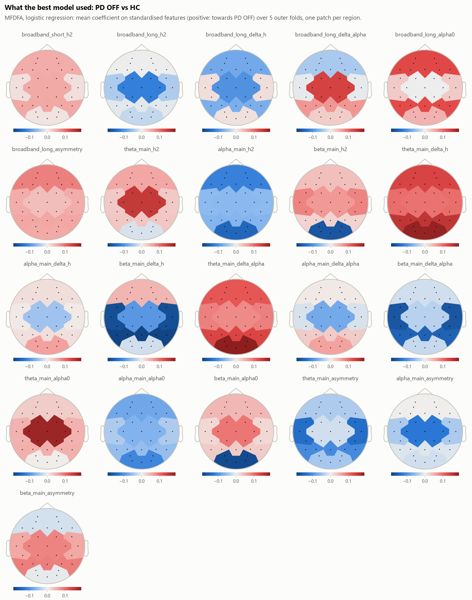
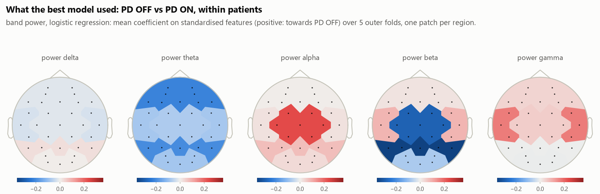
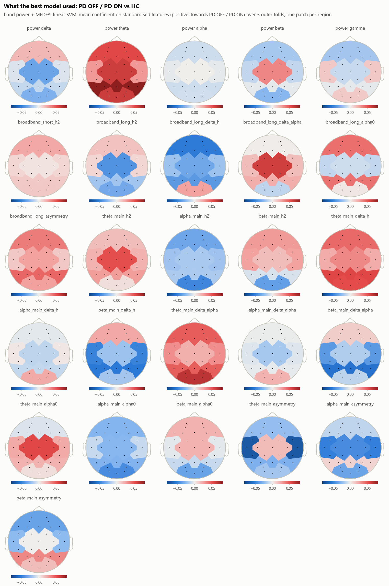
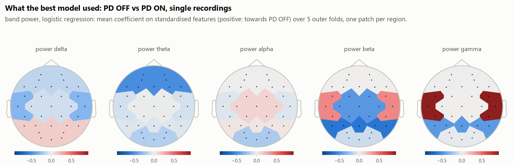

# Classification (exploratory)

Written by `pdeeg classify`. Settings: `configs/model.yaml`, SHA-256 `7f2b1081ec2a0fc6ba242673973584da215a7ebfb4f7a9a7eae58e067dfee0d9`, written before any classifier was run. Every evaluation is an MLflow run in experiment `pdeeg` (`mlflow.db`, artifacts in `mlruns/`).

Classification is secondary here. With about 30 people, the group statistics (`reports/stats_results.md`) are the primary result.

## Summary in plain language

- **PD OFF vs HC** (31 participants). The best of the 9 feature-based combinations was MFDFA with logistic regression: balanced accuracy 0.71 [0.55, 0.86], permutation p = 0.025. It was picked as the best on these same predictions, which flatters it. 1 of 9 combinations had p < 0.05 before correction and 0 after Benjamini-Hochberg across the task. Age and sex alone reached 0.58 [0.40, 0.76] (gradient boosting). Over 10 other outer splits, the balanced accuracy of the best combination ranged from 0.55 to 0.71: the split alone moves it that much.
- **PD OFF vs PD ON, within patients** (13 participants). The best of the 9 feature-based combinations was band power with logistic regression: balanced accuracy 0.92 [0.77, 1.00], permutation p = 0.013. It was picked as the best on these same predictions, which flatters it. 2 of 9 combinations had p < 0.05 before correction and 0 after Benjamini-Hochberg across the task. Over 10 other outer splits, the balanced accuracy of the best combination ranged from 0.69 to 0.92: the split alone moves it that much.
- **PD OFF / PD ON vs HC** (31 participants). The best of the 9 feature-based combinations was band power + MFDFA with linear SVM: balanced accuracy 0.71 [0.55, 0.85], permutation p = 0.020. It was picked as the best on these same predictions, which flatters it. 3 of 9 combinations had p < 0.05 before correction and 0 after Benjamini-Hochberg across the task. Age and sex alone reached 0.51 [0.35, 0.70] (gradient boosting). Over 10 other outer splits, the balanced accuracy of the best combination ranged from 0.55 to 0.72: the split alone moves it that much.
- **PD OFF vs PD ON, single recordings** (13 participants). The best of the 9 feature-based combinations was band power with logistic regression: balanced accuracy 0.77 [0.65, 0.92], permutation p = < 0.001. It was picked as the best on these same predictions, which flatters it. 1 of 9 combinations had p < 0.05 before correction and 1 after Benjamini-Hochberg across the task. Over 10 other outer splits, the balanced accuracy of the best combination ranged from 0.58 to 0.77: the split alone moves it that much.
- **Audit.** Some balanced accuracy exceeds 0.85; see the audit section before reading anything into it.
- **What this is not.** None of this is a diagnostic test. The intervals are wide because the sample is small, there is no independent test set, and the dataset's curators warn specifically against presenting classification of these patients as diagnostic. The group statistics (reports/stats_results.md) are the primary result.

## Design

- **PD OFF vs HC:** 31 participants, 31 recordings. One recording per participant; labels are permuted across participants.
- **PD OFF vs PD ON, within patients:** 13 participants, 26 recordings; left out: pd6, pd16 (ON sessions exported already preprocessed). Each patient's features are centred on the mean of their two recordings, so the question is which of a patient's two recordings is OFF; labels are permuted within patients.
- **PD OFF / PD ON vs HC:** 31 participants, 44 recordings; recordings left out: pd6 on, pd16 on (exported already preprocessed). Every recording of a participant is used, weighted so that each participant counts once (0.5 per recording of a patient with two) in training, in the inner-loop scores and in every metric; all recordings of a participant are on the same side of a split, and labels are permuted across participants.
- **PD OFF vs PD ON, single recordings:** 13 participants, 26 recordings; left out: pd6, pd16 (ON sessions exported already preprocessed). Every recording is classified on its own, without centring; both recordings of a patient are always on the same side of a split, and labels are permuted within patients.
- **Features:** `clean` segments, region level: band power 25; MFDFA 105; band power + MFDFA 130; age + sex 2. Age and sex are age, sex (sex 1 for m).
- **Outer loop:** stratified group kfold, 5 folds, grouped by participant and stratified by class. Leave-one-subject-out was timed first and would have taken weeks of CPU with 1000 permutations of the nested procedure (configs/model.yaml has the numbers).
- **Inner loop:** 3-fold grouped and stratified, scored by balanced accuracy, inside every outer training set. Scaling and the model form one scikit-learn Pipeline, so all of it is fitted on training participants only. Grids: logistic regression C [0.01, 0.1, 1.0], l1_ratio [0.0, 0.5, 1.0]; linear SVM C [0.001, 0.01, 0.1, 1.0]; gradient boosting n_estimators [100], max_depth [1, 2], learning_rate [0.1].
- **No leakage across participants:** every outer and inner split is checked at run time to share no participant, and `tests/test_leakage.py` checks every splitter of every task.
- **Metrics:** on the pooled out-of-fold predictions. Intervals: 2000 bootstrap resamples of participants, 95%. p-values: 1000 relabellings, each through the whole nested procedure; p = (1 + number at least as good) / (1 + relabellings). q: Benjamini-Hochberg over the balanced-accuracy p-values of a task. Sensitivity is the share of the first class found.
- **Other splits:** the whole procedure repeated on 10 other outer splits; the range of balanced accuracy shows what the split alone does.

## Results

### PD OFF vs HC

| Features | Model | n features | Balanced accuracy [95 % CI] | p | q | ROC AUC [95 % CI] | p (AUC) | Sensitivity [95 % CI] | Specificity [95 % CI] | BA over 10 other splits |
|---|---|---|---|---|---|---|---|---|---|---|
| band power | logistic regression | 25 | 0.58 [0.40, 0.75] | 0.212 | 0.330 | 0.67 [0.47, 0.85] | 0.079 | 0.47 [0.21, 0.73] | 0.69 [0.44, 0.92] | 0.52-0.74 |
| band power | linear SVM | 25 | 0.61 [0.42, 0.78] | 0.101 | 0.295 | 0.65 [0.42, 0.85] | 0.105 | 0.67 [0.41, 0.90] | 0.56 [0.32, 0.81] | 0.54-0.71 |
| band power | gradient boosting | 25 | 0.61 [0.45, 0.78] | 0.177 | 0.330 | 0.62 [0.41, 0.82] | 0.177 | 0.53 [0.28, 0.79] | 0.69 [0.45, 0.91] | 0.55-0.68 |
| MFDFA | logistic regression | 105 | 0.71 [0.55, 0.86] | 0.025 | 0.295 | 0.76 [0.57, 0.91] | 0.020 | 0.67 [0.42, 0.90] | 0.75 [0.53, 0.94] | 0.55-0.71 |
| MFDFA | linear SVM | 105 | 0.64 [0.47, 0.80] | 0.068 | 0.295 | 0.73 [0.52, 0.89] | 0.033 | 0.53 [0.27, 0.79] | 0.75 [0.50, 0.94] | 0.54-0.71 |
| MFDFA | gradient boosting | 105 | 0.51 [0.34, 0.68] | 0.489 | 0.489 | 0.51 [0.29, 0.73] | 0.478 | 0.47 [0.22, 0.72] | 0.56 [0.31, 0.81] | 0.36-0.58 |
| band power + MFDFA | logistic regression | 130 | 0.61 [0.43, 0.78] | 0.123 | 0.295 | 0.68 [0.48, 0.86] | 0.069 | 0.60 [0.35, 0.84] | 0.62 [0.38, 0.86] | 0.55-0.71 |
| band power + MFDFA | linear SVM | 130 | 0.61 [0.45, 0.77] | 0.116 | 0.295 | 0.74 [0.54, 0.90] | 0.029 | 0.47 [0.21, 0.71] | 0.75 [0.53, 0.94] | 0.55-0.80 |
| band power + MFDFA | gradient boosting | 130 | 0.51 [0.33, 0.69] | 0.462 | 0.489 | 0.53 [0.32, 0.75] | 0.401 | 0.47 [0.20, 0.73] | 0.56 [0.31, 0.80] | 0.39-0.71 |
| age + sex | logistic regression | 2 | 0.51 [0.37, 0.64] | 0.414 | 0.489 | 0.49 [0.29, 0.70] | 0.465 | 0.20 [0.00, 0.42] | 0.81 [0.60, 1.00] | 0.39-0.52 |
| age + sex | linear SVM | 2 | 0.50 [0.39, 0.62] | 0.389 | 0.489 | 0.44 [0.23, 0.64] | 0.609 | 0.13 [0.00, 0.33] | 0.88 [0.69, 1.00] | 0.38-0.47 |
| age + sex | gradient boosting | 2 | 0.58 [0.40, 0.76] | 0.220 | 0.330 | 0.54 [0.32, 0.75] | 0.348 | 0.67 [0.41, 0.90] | 0.50 [0.24, 0.75] | 0.39-0.61 |

### PD OFF vs PD ON, within patients

| Features | Model | n features | Balanced accuracy [95 % CI] | p | q | ROC AUC [95 % CI] | p (AUC) | Sensitivity [95 % CI] | Specificity [95 % CI] | BA over 10 other splits |
|---|---|---|---|---|---|---|---|---|---|---|
| band power | logistic regression | 25 | 0.92 [0.77, 1.00] | 0.013 | 0.117 | 0.93 [0.77, 1.00] | 0.011 | 0.92 [0.77, 1.00] | 0.92 [0.77, 1.00] | 0.69-0.92 |
| band power | linear SVM | 25 | 0.85 [0.62, 1.00] | 0.041 | 0.184 | 0.80 [0.52, 1.00] | 0.090 | 0.85 [0.62, 1.00] | 0.85 [0.62, 1.00] | 0.69-0.92 |
| band power | gradient boosting | 25 | 0.69 [0.46, 0.92] | 0.175 | 0.245 | 0.70 [0.38, 0.99] | 0.145 | 0.69 [0.46, 0.92] | 0.69 [0.46, 0.92] | 0.35-0.69 |
| MFDFA | logistic regression | 105 | 0.77 [0.54, 1.00] | 0.077 | 0.216 | 0.80 [0.53, 1.00] | 0.068 | 0.77 [0.54, 1.00] | 0.77 [0.54, 1.00] | 0.46-0.85 |
| MFDFA | linear SVM | 105 | 0.69 [0.46, 0.92] | 0.170 | 0.245 | 0.72 [0.41, 0.97] | 0.137 | 0.69 [0.46, 0.92] | 0.69 [0.46, 0.92] | 0.54-0.77 |
| MFDFA | gradient boosting | 105 | 0.69 [0.46, 0.92] | 0.191 | 0.245 | 0.59 [0.28, 0.89] | 0.320 | 0.69 [0.46, 0.92] | 0.69 [0.46, 0.92] | 0.50-0.85 |
| band power + MFDFA | logistic regression | 130 | 0.62 [0.38, 0.85] | 0.234 | 0.263 | 0.66 [0.35, 0.95] | 0.196 | 0.62 [0.38, 0.85] | 0.62 [0.38, 0.85] | 0.69-0.85 |
| band power + MFDFA | linear SVM | 130 | 0.77 [0.54, 1.00] | 0.096 | 0.216 | 0.83 [0.56, 1.00] | 0.063 | 0.77 [0.54, 1.00] | 0.77 [0.54, 1.00] | 0.62-0.85 |
| band power + MFDFA | gradient boosting | 130 | 0.54 [0.23, 0.77] | 0.471 | 0.471 | 0.57 [0.25, 0.85] | 0.325 | 0.54 [0.23, 0.77] | 0.54 [0.23, 0.77] | 0.38-0.69 |

### PD OFF / PD ON vs HC

| Features | Model | n features | Balanced accuracy [95 % CI] | p | q | ROC AUC [95 % CI] | p (AUC) | Sensitivity [95 % CI] | Specificity [95 % CI] | BA over 10 other splits |
|---|---|---|---|---|---|---|---|---|---|---|
| band power | logistic regression | 25 | 0.64 [0.48, 0.80] | 0.073 | 0.219 | 0.70 [0.49, 0.86] | 0.044 | 0.60 [0.38, 0.82] | 0.69 [0.45, 0.90] | 0.58-0.72 |
| band power | linear SVM | 25 | 0.55 [0.37, 0.71] | 0.227 | 0.340 | 0.72 [0.51, 0.89] | 0.029 | 0.47 [0.22, 0.71] | 0.62 [0.38, 0.86] | 0.53-0.68 |
| band power | gradient boosting | 25 | 0.53 [0.37, 0.70] | 0.351 | 0.468 | 0.55 [0.35, 0.76] | 0.308 | 0.50 [0.30, 0.71] | 0.56 [0.31, 0.80] | 0.52-0.66 |
| MFDFA | logistic regression | 105 | 0.69 [0.53, 0.84] | 0.031 | 0.176 | 0.70 [0.51, 0.88] | 0.049 | 0.70 [0.50, 0.89] | 0.69 [0.43, 0.90] | 0.53-0.69 |
| MFDFA | linear SVM | 105 | 0.56 [0.41, 0.71] | 0.204 | 0.340 | 0.61 [0.40, 0.80] | 0.137 | 0.30 [0.08, 0.54] | 0.81 [0.62, 1.00] | 0.55-0.74 |
| MFDFA | gradient boosting | 105 | 0.60 [0.44, 0.74] | 0.141 | 0.338 | 0.53 [0.33, 0.74] | 0.395 | 0.77 [0.56, 0.94] | 0.44 [0.21, 0.69] | 0.40-0.60 |
| band power + MFDFA | logistic regression | 130 | 0.68 [0.52, 0.83] | 0.044 | 0.176 | 0.74 [0.55, 0.90] | 0.035 | 0.67 [0.43, 0.89] | 0.69 [0.45, 0.89] | 0.63-0.71 |
| band power + MFDFA | linear SVM | 130 | 0.71 [0.55, 0.85] | 0.020 | 0.176 | 0.79 [0.61, 0.93] | 0.012 | 0.67 [0.46, 0.87] | 0.75 [0.50, 0.94] | 0.55-0.72 |
| band power + MFDFA | gradient boosting | 130 | 0.59 [0.43, 0.73] | 0.180 | 0.340 | 0.63 [0.44, 0.81] | 0.127 | 0.73 [0.55, 0.90] | 0.44 [0.20, 0.69] | 0.47-0.61 |
| age + sex | logistic regression | 2 | 0.38 [0.22, 0.56] | 0.899 | 0.899 | 0.42 [0.22, 0.63] | 0.623 | 0.27 [0.07, 0.50] | 0.50 [0.27, 0.75] | 0.25-0.52 |
| age + sex | linear SVM | 2 | 0.41 [0.26, 0.58] | 0.740 | 0.808 | 0.33 [0.13, 0.53] | 0.883 | 0.27 [0.07, 0.50] | 0.56 [0.33, 0.80] | 0.38-0.47 |
| age + sex | gradient boosting | 2 | 0.51 [0.35, 0.70] | 0.526 | 0.632 | 0.58 [0.38, 0.79] | 0.302 | 0.47 [0.21, 0.75] | 0.56 [0.32, 0.79] | 0.33-0.58 |

### PD OFF vs PD ON, single recordings

| Features | Model | n features | Balanced accuracy [95 % CI] | p | q | ROC AUC [95 % CI] | p (AUC) | Sensitivity [95 % CI] | Specificity [95 % CI] | BA over 10 other splits |
|---|---|---|---|---|---|---|---|---|---|---|
| band power | logistic regression | 25 | 0.77 [0.65, 0.92] | < 0.001 | 0.009 | 0.76 [0.62, 0.93] | < 0.001 | 0.77 [0.54, 1.00] | 0.77 [0.54, 1.00] | 0.58-0.77 |
| band power | linear SVM | 25 | 0.58 [0.50, 0.69] | 0.205 | 0.307 | 0.64 [0.53, 0.76] | 0.066 | 0.69 [0.38, 0.92] | 0.46 [0.23, 0.69] | 0.58-0.73 |
| band power | gradient boosting | 25 | 0.54 [0.42, 0.65] | 0.393 | 0.483 | 0.56 [0.40, 0.72] | 0.295 | 0.46 [0.23, 0.69] | 0.62 [0.38, 0.85] | 0.46-0.58 |
| MFDFA | logistic regression | 105 | 0.69 [0.58, 0.81] | 0.052 | 0.234 | 0.69 [0.53, 0.85] | 0.067 | 0.77 [0.54, 1.00] | 0.62 [0.38, 0.85] | 0.50-0.77 |
| MFDFA | linear SVM | 105 | 0.62 [0.46, 0.77] | 0.144 | 0.266 | 0.61 [0.39, 0.82] | 0.181 | 0.62 [0.38, 0.85] | 0.62 [0.38, 0.85] | 0.46-0.73 |
| MFDFA | gradient boosting | 105 | 0.46 [0.31, 0.62] | 0.688 | 0.688 | 0.41 [0.24, 0.59] | 0.778 | 0.54 [0.31, 0.77] | 0.38 [0.15, 0.62] | 0.35-0.54 |
| band power + MFDFA | logistic regression | 130 | 0.62 [0.46, 0.77] | 0.148 | 0.266 | 0.64 [0.42, 0.83] | 0.117 | 0.69 [0.38, 0.92] | 0.54 [0.31, 0.77] | 0.46-0.65 |
| band power + MFDFA | linear SVM | 130 | 0.65 [0.46, 0.81] | 0.083 | 0.249 | 0.68 [0.53, 0.83] | 0.050 | 0.69 [0.46, 0.92] | 0.62 [0.38, 0.85] | 0.54-0.69 |
| band power + MFDFA | gradient boosting | 130 | 0.54 [0.38, 0.69] | 0.430 | 0.483 | 0.54 [0.35, 0.74] | 0.389 | 0.46 [0.23, 0.69] | 0.62 [0.38, 0.85] | 0.27-0.58 |

## Audit

Balanced accuracy above 0.85 in: off_vs_on / psd / logistic_regression (0.92). These are not reported as results until the audit is written here.

## What the best models used

### PD OFF vs HC

MFDFA with logistic regression, the highest balanced accuracy of the task. Weights are coefficients on standardised features, averaged over the outer folds; with correlated features a coefficient is shared out arbitrarily among them, so read the pattern, not single values.

| Feature | Mean weight | SD over folds | Folds using it |
|---|---|---|---|
| envelope_theta_main_delta_alpha_occipital | +0.189 | 0.184 | 5 of 5 |
| envelope_beta_main_delta_h_parietal | -0.185 | 0.170 | 5 of 5 |
| envelope_theta_main_delta_h_occipital | +0.183 | 0.190 | 5 of 5 |
| envelope_theta_main_alpha0_central | +0.179 | 0.157 | 5 of 5 |
| envelope_beta_main_alpha0_occipital | -0.178 | 0.184 | 5 of 5 |
| envelope_beta_main_delta_h_temporal | -0.174 | 0.163 | 5 of 5 |
| envelope_beta_main_h2_occipital | -0.165 | 0.165 | 5 of 5 |
| envelope_beta_main_delta_alpha_temporal | -0.165 | 0.138 | 5 of 5 |
| envelope_theta_main_delta_h_parietal | +0.154 | 0.154 | 5 of 5 |
| envelope_beta_main_delta_alpha_parietal | -0.150 | 0.126 | 5 of 5 |

### PD OFF vs PD ON, within patients

band power with logistic regression, the highest balanced accuracy of the task. Weights are coefficients on standardised features, averaged over the outer folds; with correlated features a coefficient is shared out arbitrarily among them, so read the pattern, not single values.

| Feature | Mean weight | SD over folds | Folds using it |
|---|---|---|---|
| log_relative_power_beta_parietal | -0.358 | 0.431 | 5 of 5 |
| log_relative_power_beta_central | -0.286 | 0.353 | 5 of 5 |
| log_relative_power_alpha_central | +0.237 | 0.254 | 5 of 5 |
| log_relative_power_theta_frontal | -0.216 | 0.207 | 5 of 5 |
| log_relative_power_theta_parietal | -0.198 | 0.183 | 5 of 5 |
| log_relative_power_gamma_temporal | +0.168 | 0.136 | 5 of 5 |
| log_relative_power_beta_temporal | +0.089 | 0.080 | 4 of 5 |
| log_relative_power_theta_occipital | -0.084 | 0.057 | 5 of 5 |
| log_relative_power_theta_temporal | -0.083 | 0.077 | 4 of 5 |
| log_relative_power_beta_occipital | -0.075 | 0.097 | 5 of 5 |

### PD OFF / PD ON vs HC

band power + MFDFA with linear SVM, the highest balanced accuracy of the task. Weights are coefficients on standardised features, averaged over the outer folds; with correlated features a coefficient is shared out arbitrarily among them, so read the pattern, not single values.

| Feature | Mean weight | SD over folds | Folds using it |
|---|---|---|---|
| log_relative_power_theta_parietal | +0.082 | 0.037 | 5 of 5 |
| envelope_theta_main_asymmetry_temporal | -0.070 | 0.073 | 5 of 5 |
| envelope_theta_main_delta_alpha_occipital | +0.067 | 0.018 | 5 of 5 |
| log_relative_power_theta_occipital | +0.062 | 0.027 | 5 of 5 |
| log_relative_power_theta_central | +0.061 | 0.038 | 5 of 5 |
| broadband_long_delta_alpha_central | +0.061 | 0.037 | 5 of 5 |
| envelope_beta_main_delta_alpha_parietal | -0.057 | 0.008 | 5 of 5 |
| envelope_theta_main_delta_h_parietal | +0.056 | 0.013 | 5 of 5 |
| log_relative_power_theta_frontal | +0.055 | 0.035 | 5 of 5 |
| envelope_theta_main_alpha0_central | +0.055 | 0.026 | 5 of 5 |

### PD OFF vs PD ON, single recordings

band power with logistic regression, the highest balanced accuracy of the task. Weights are coefficients on standardised features, averaged over the outer folds; with correlated features a coefficient is shared out arbitrarily among them, so read the pattern, not single values.

| Feature | Mean weight | SD over folds | Folds using it |
|---|---|---|---|
| log_relative_power_gamma_temporal | +0.918 | 0.203 | 5 of 5 |
| log_relative_power_beta_parietal | -0.623 | 0.139 | 5 of 5 |
| log_relative_power_theta_frontal | -0.509 | 0.138 | 5 of 5 |
| log_relative_power_beta_central | -0.455 | 0.140 | 5 of 5 |
| log_relative_power_gamma_parietal | -0.447 | 0.283 | 4 of 5 |
| log_relative_power_beta_temporal | +0.394 | 0.105 | 5 of 5 |
| log_relative_power_delta_temporal | -0.305 | 0.332 | 4 of 5 |
| log_relative_power_alpha_occipital | -0.195 | 0.138 | 4 of 5 |
| log_relative_power_theta_occipital | -0.174 | 0.166 | 4 of 5 |
| log_relative_power_delta_frontal | -0.137 | 0.121 | 5 of 5 |

## Limitations

- **Sample size.** PD OFF vs HC: 31 participants; PD OFF vs PD ON, within patients: 13 participants; PD OFF / PD ON vs HC: 31 participants; PD OFF vs PD ON, single recordings: 13 participants. Each misclassified participant moves balanced accuracy by several points, the intervals are correspondingly wide, and with this many people a classifier can look good or bad by chance; the spread over other splits shows how much.
- **The curators' caution.** The dataset's README warns against presenting machine-learning classification of these patients against controls as a diagnostic result, because 15 patients are too few for reliable test statistics.
- **No external test set.** Every number comes from cross-validation within one dataset from one site and one EEG system. Nothing here has been checked on people recorded elsewhere, and performance there is unknown.
- **Many comparisons.** 42 combinations were run; the q-values correct the p-values within a task, but the best combination is still selected on the data it is scored on.
- **Uncertainty left out.** The bootstrap resamples participants with their predictions fixed, so it does not include how the models would change with other training data; the spread over other splits shows part of that.
- **Pooled scores.** ROC AUC pools decision values of models fitted in different folds, whose scales can differ.
- **Confounds.** Age and sex are tested as a baseline, not removed. Medication history, disease duration and recording conditions are not modelled, and anything that differs between groups at recording time can be learned as if it were disease.
