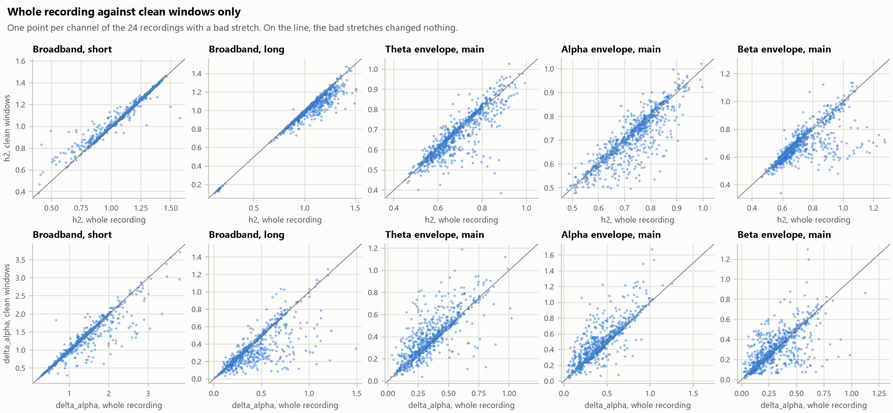

# MFDFA feature QC

Written by `pdeeg mfdfa-features`. 46 recordings, 32 channels each. Nothing below compares groups.

## What was computed

- **Series:** the cleaned EEG (broadband) and the Hilbert envelope in theta, alpha, beta.
- **Fit ranges:** broadband, short (0.045-0.09 s); broadband, long (0.3-1 s); theta envelope, main (2-17.8 s); alpha envelope, main (2-17.8 s); beta envelope, main (2-17.8 s). 12 scales per range, q from -5 to 5 in steps of 0.5, detrending order 1.
- **Segments:** `full` uses every window. `clean` drops every window that touches a stretch annotated BAD (widened by 1 s on both sides for an envelope); nothing is cut out and joined. A scale with fewer than 8 clean windows is left out of the fit, and no fit is made on fewer than 8 scales. 24 of the 46 recordings have a bad stretch (0.6 to 12.2 % of the time); for the others `clean` equals `full`.
- **Surrogates:** 20 IAAFT and 20 shuffled per channel and series, made from the whole series and analysed like `full`.

## Fit quality

A fit is poor when its worst R² over q is below 0.9. R² is low when the points scatter about the line, and also when the line is nearly level: a fluctuation function that does not rise has no slope to explain.

| Series and fit range | Segments | Channel fits | Poor fits | min R²: median [10 %, 90 %] | Fits on fewer scales | Fits not made |
|---|---|---|---|---|---|---|
| Broadband, short (0.045-0.09 s) | full | 1472 | 9.9 % | 0.966 [0.901, 0.986] | 0 | 0 |
| Broadband, short (0.045-0.09 s) | clean | 1472 | 7.7 % | 0.967 [0.908, 0.986] | 0 | 0 |
| Broadband, long (0.3-1 s) | full | 1472 | 9.4 % | 0.987 [0.905, 0.995] | 0 | 0 |
| Broadband, long (0.3-1 s) | clean | 1472 | 7.7 % | 0.988 [0.932, 0.995] | 0 | 0 |
| Theta envelope, main (2-17.8 s) | full | 1472 | 4.2 % | 0.969 [0.932, 0.984] | 0 | 0 |
| Theta envelope, main (2-17.8 s) | clean | 1472 | 8.4 % | 0.964 [0.910, 0.982] | 96 | 0 |
| Alpha envelope, main (2-17.8 s) | full | 1472 | 3.5 % | 0.967 [0.930, 0.983] | 0 | 0 |
| Alpha envelope, main (2-17.8 s) | clean | 1472 | 9.6 % | 0.963 [0.903, 0.982] | 96 | 0 |
| Beta envelope, main (2-17.8 s) | full | 1472 | 3.5 % | 0.972 [0.932, 0.985] | 0 | 0 |
| Beta envelope, main (2-17.8 s) | clean | 1472 | 7.1 % | 0.969 [0.918, 0.984] | 96 | 0 |

Recordings in which a quarter or more of the channels fit poorly on some range (whole recording):

| Recording | Broadband, short | Broadband, long | Theta envelope, main | Alpha envelope, main | Beta envelope, main |
|---|---|---|---|---|---|
| sub-pd16 on | 9.4 % | 100.0 % | 0.0 % | 0.0 % | 0.0 % |
| sub-pd6 on | 9.4 % | 100.0 % | 3.1 % | 0.0 % | 0.0 % |
| sub-hc29 hc | 12.5 % | 46.9 % | 3.1 % | 3.1 % | 3.1 % |
| sub-pd23 on | 43.8 % | 12.5 % | 9.4 % | 21.9 % | 15.6 % |
| sub-hc7 hc | 6.2 % | 3.1 % | 34.4 % | 15.6 % | 15.6 % |
| sub-hc1 hc | 6.2 % | 0.0 % | 0.0 % | 34.4 % | 28.1 % |
| sub-pd23 off | 25.0 % | 6.2 % | 0.0 % | 0.0 % | 0.0 % |
| sub-pd9 on | 3.1 % | 0.0 % | 25.0 % | 3.1 % | 3.1 % |

38 of the 46 recordings have fewer than a quarter of their channels fitting poorly on every range.

## Recordings without slow power

Median over channels of h2 on each broadband range, per recording. A recording that was high-pass filtered before it reached this pipeline has a flat fluctuation function on the long range, so its h2 there is near zero whatever the brain did.

| Recording | Median h2, long | Robust z | Median h2, short | Power below 0.5 Hz before filtering (dB re 1-4 Hz) |
|---|---|---|---|---|
| sub-pd16 on | 0.11 | -6.1 | 1.20 | -27 |
| sub-pd6 on | 0.15 | -5.8 | 1.28 | -29 |

Listed: more than 3 robust standard deviations below the median. The other 44 recordings have a median h2 on the long range between 0.80 and 1.25, and power below 0.5 Hz before filtering between 7 and 17 dB.

## Surrogates: is the multifractality more than the spectrum and the distribution?

An IAAFT surrogate has the amplitude distribution of the series and, closely, its power spectrum, with the Fourier phases randomised. If delta_alpha of the series is no wider than that of its IAAFT surrogates, its width is explained by linear correlations and the distribution. A shuffled surrogate keeps the distribution alone.

z is (delta_alpha - mean of the surrogates) / their standard deviation. The rank test asks whether the series is wider than every one of its surrogates; for a series that is itself such a surrogate that happens with probability 0.048, so 4.8 % of channels would pass by chance. Channels of one recording are not independent, so the last-but-one column counts recordings instead.

| Series and fit range | Surrogate | delta_alpha | Surrogate mean | z | z > 2 | Wider than every surrogate | z < -2 | Recordings with median z > 2 | h2 - surrogate h2 |
|---|---|---|---|---|---|---|---|---|---|
| Broadband, short (0.045-0.09 s) | iaaft | 1.21 [0.62, 2.01] | 1.32 [1.01, 1.72] | -0.3 [-1.5, 1.4] | 4.8 % | 4.1 % | 2.4 % | 0 of 46 | 0.000 [-0.009, 0.009] |
| Broadband, short (0.045-0.09 s) | shuffle | 1.21 [0.62, 2.01] | 0.11 [0.08, 0.24] | 32.9 [13.7, 60.0] | 99.5 % | 99.4 % | 0.1 % | 46 of 46 | 0.611 [0.346, 0.837] |
| Broadband, long (0.3-1 s) | iaaft | 0.28 [0.11, 0.65] | 0.27 [0.17, 0.43] | 0.2 [-1.6, 3.2] | 19.8 % | 17.7 % | 6.2 % | 2 of 46 | -0.003 [-0.021, 0.015] |
| Broadband, long (0.3-1 s) | shuffle | 0.28 [0.11, 0.65] | 0.06 [0.05, 0.07] | 6.7 [1.6, 17.6] | 86.9 % | 84.4 % | 0.1 % | 46 of 46 | 0.535 [0.290, 0.730] |
| Theta envelope, main (2-17.8 s) | iaaft | 0.33 [0.14, 0.63] | 0.32 [0.20, 0.56] | 0.0 [-1.3, 1.8] | 7.0 % | 8.2 % | 2.5 % | 0 of 46 | -0.001 [-0.030, 0.025] |
| Theta envelope, main (2-17.8 s) | shuffle | 0.33 [0.14, 0.63] | 0.10 [0.09, 0.12] | 3.8 [0.7, 8.9] | 75.4 % | 72.1 % | 0.1 % | 42 of 46 | 0.171 [0.055, 0.333] |
| Alpha envelope, main (2-17.8 s) | iaaft | 0.38 [0.17, 0.70] | 0.35 [0.22, 0.61] | 0.1 [-1.2, 1.8] | 8.4 % | 9.1 % | 2.0 % | 0 of 46 | -0.003 [-0.043, 0.026] |
| Alpha envelope, main (2-17.8 s) | shuffle | 0.38 [0.17, 0.70] | 0.10 [0.09, 0.12] | 4.7 [1.0, 11.0] | 79.5 % | 76.0 % | 0.0 % | 43 of 46 | 0.220 [0.090, 0.344] |
| Beta envelope, main (2-17.8 s) | iaaft | 0.24 [0.09, 0.51] | 0.18 [0.12, 0.32] | 0.5 [-0.9, 2.6] | 18.3 % | 17.5 % | 0.6 % | 0 of 46 | -0.003 [-0.037, 0.029] |
| Beta envelope, main (2-17.8 s) | shuffle | 0.24 [0.09, 0.51] | 0.10 [0.09, 0.12] | 2.5 [-0.2, 6.8] | 55.8 % | 53.2 % | 0.0 % | 26 of 46 | 0.169 [0.067, 0.380] |

Cells with brackets are the median with the 10th and 90th percentile over all channels of all recordings. The last column checks the surrogates themselves: IAAFT should leave h2 where it was, and shuffling should bring it to 0.5.

## Whole recording against clean windows

For the channels of the 24 recordings with a bad stretch: the absolute difference between a feature on clean windows and on the whole recording. The spread is the standard deviation of the feature over those same channels, as a yardstick.

| Series and fit range | Feature | Channel pairs | Median difference | 90th percentile | Largest | Spread | Spearman r |
|---|---|---|---|---|---|---|---|
| Broadband, short (0.045-0.09 s) | h2 | 768 | 0.003 | 0.059 | 0.495 | 0.207 | 0.98 |
| Broadband, short (0.045-0.09 s) | delta_h | 768 | 0.007 | 0.191 | 1.286 | 0.331 | 0.93 |
| Broadband, short (0.045-0.09 s) | delta_alpha | 768 | 0.012 | 0.295 | 1.432 | 0.581 | 0.93 |
| Broadband, short (0.045-0.09 s) | alpha0 | 768 | 0.002 | 0.058 | 2.462 | 0.265 | 0.93 |
| Broadband, short (0.045-0.09 s) | asymmetry | 768 | 0.011 | 0.315 | 1.817 | 0.406 | 0.84 |
| Broadband, long (0.3-1 s) | h2 | 768 | 0.009 | 0.111 | 0.412 | 0.235 | 0.93 |
| Broadband, long (0.3-1 s) | delta_h | 768 | 0.014 | 0.161 | 0.926 | 0.198 | 0.82 |
| Broadband, long (0.3-1 s) | delta_alpha | 768 | 0.018 | 0.250 | 1.141 | 0.239 | 0.81 |
| Broadband, long (0.3-1 s) | alpha0 | 768 | 0.011 | 0.322 | 1.075 | 0.350 | 0.82 |
| Broadband, long (0.3-1 s) | asymmetry | 768 | 0.000 | 0.659 | 2.000 | 0.817 | 0.78 |
| Theta envelope, main (2-17.8 s) | h2 | 768 | 0.020 | 0.080 | 0.497 | 0.109 | 0.87 |
| Theta envelope, main (2-17.8 s) | delta_h | 768 | 0.025 | 0.150 | 0.585 | 0.140 | 0.79 |
| Theta envelope, main (2-17.8 s) | delta_alpha | 768 | 0.033 | 0.203 | 0.679 | 0.173 | 0.79 |
| Theta envelope, main (2-17.8 s) | alpha0 | 768 | 0.021 | 0.101 | 0.538 | 0.118 | 0.82 |
| Theta envelope, main (2-17.8 s) | asymmetry | 768 | 0.106 | 0.563 | 2.000 | 0.473 | 0.71 |
| Alpha envelope, main (2-17.8 s) | h2 | 768 | 0.018 | 0.096 | 0.388 | 0.099 | 0.85 |
| Alpha envelope, main (2-17.8 s) | delta_h | 768 | 0.029 | 0.178 | 0.597 | 0.167 | 0.82 |
| Alpha envelope, main (2-17.8 s) | delta_alpha | 768 | 0.037 | 0.261 | 0.854 | 0.213 | 0.81 |
| Alpha envelope, main (2-17.8 s) | alpha0 | 768 | 0.021 | 0.107 | 0.431 | 0.116 | 0.85 |
| Alpha envelope, main (2-17.8 s) | asymmetry | 768 | 0.090 | 0.521 | 2.000 | 0.471 | 0.70 |
| Beta envelope, main (2-17.8 s) | h2 | 768 | 0.022 | 0.150 | 0.564 | 0.144 | 0.79 |
| Beta envelope, main (2-17.8 s) | delta_h | 768 | 0.032 | 0.203 | 0.778 | 0.150 | 0.66 |
| Beta envelope, main (2-17.8 s) | delta_alpha | 768 | 0.037 | 0.248 | 0.736 | 0.177 | 0.69 |
| Beta envelope, main (2-17.8 s) | alpha0 | 768 | 0.020 | 0.131 | 0.630 | 0.132 | 0.80 |
| Beta envelope, main (2-17.8 s) | asymmetry | 768 | 0.161 | 1.012 | 2.000 | 0.584 | 0.52 |

## Band power

`log_relative_power` per channel, from the Welch spectrum (2 s segments, 50 % overlap) between 1 and 48 Hz. The difference columns are for the channels of the 24 recordings with a bad stretch: clean segments against all segments.

| Band | Median [10 %, 90 %] | Median difference | 90th percentile | Largest |
|---|---|---|---|---|
| delta | -0.56 [-0.87, -0.34] | 0.009 | 0.108 | 0.545 |
| theta | -0.90 [-1.12, -0.67] | 0.006 | 0.083 | 0.579 |
| alpha | -0.66 [-1.01, -0.34] | 0.007 | 0.099 | 0.707 |
| beta | -0.66 [-0.89, -0.45] | 0.005 | 0.052 | 0.846 |
| gamma | -1.20 [-1.59, -0.77] | 0.011 | 0.191 | 0.810 |
