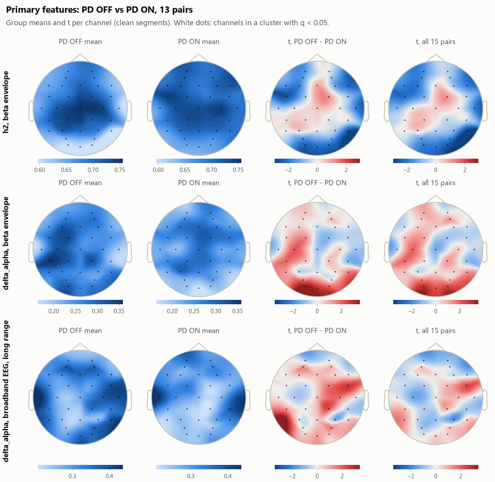
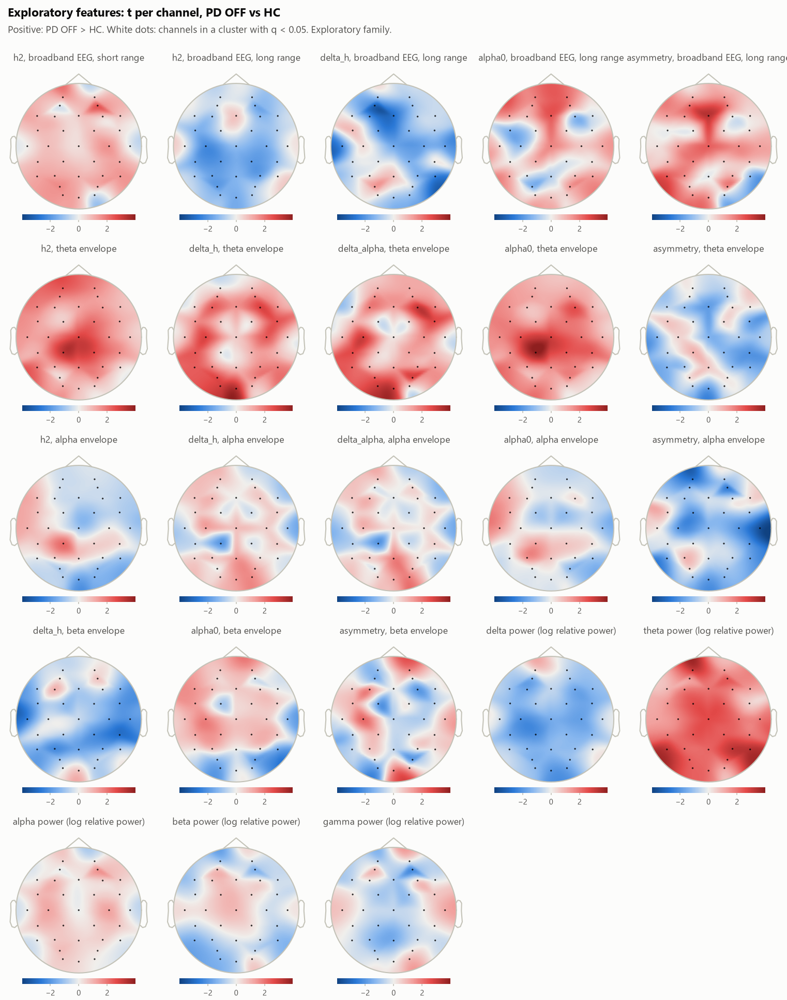
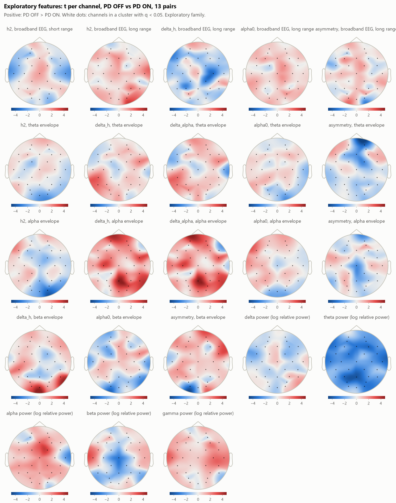

# Statistical analysis

Written by `pdeeg stats`. Pre-registered in `configs/stats.yaml`, SHA-256 `881c7b20fe3c3b8607c071e8867b482825a32a2df1226360f122dfbe14722096`; the file was written before any group was compared, and a change to it since would make the analysis it affects exploratory.

## Summary in plain language

- **PD OFF (15) against HC (16).** No cluster of channels in any of the 3 pre-registered features survived the false discovery rate correction (smallest q = 0.471, for delta_alpha, beta envelope). The sensitivity analysis (adjusted for age and sex) gives the same answer.
- **PD OFF against PD ON (13 patients).** No cluster of channels in any of the 3 pre-registered features survived the false discovery rate correction (smallest q = 0.471, for delta_alpha, beta envelope). The sensitivity analysis (all 15 pairs) gives the same answer.
- **Exploratory, PD OFF vs HC.** 0 of the 23 exploratory features had a cluster that survived the correction within the exploratory family.
- **Exploratory, PD OFF vs PD ON, 13 pairs.** 0 of the 23 exploratory features had a cluster that survived the correction within the exploratory family.
- **Age and sex.** PD OFF: age 63.3 ± 8.2, 7 m / 8 f; HC: age 63.5 ± 9.7, 7 m / 9 f. Neither differs between the groups at p < 0.05; with groups this small that does not prove they are matched, which is why the adjusted analysis is reported too.
- **What this sample can see.** With 15 and 16 people, a single two-sided t-test has 80% power only for differences of about g = 1.04 or more; with 13 pairs, for d_z = 0.85 or more. Effects smaller than that are easily missed, so a test without a significant cluster does not show that the groups are alike. Effects that do reach significance in samples this small tend to overstate the true size.
- **What this is not.** These are group averages from one dataset of 31 people at one site. No result here is a diagnostic test or a biomarker, and the dataset's curators warn specifically against presenting classification of these patients as diagnostic. Exploratory results are leads for an independent dataset.

## What was tested

- **PD vs HC:** PD OFF (session `off`, 15 patients) against HC (16 controls), one recording per person.
- **OFF vs ON:** the difference PD OFF - PD ON within 13 patients. Left out: pd6, pd16, whose on-medication recordings were exported already preprocessed. The sensitivity analysis keeps all 15.
- **Primary features** (pre-registered): h2, beta envelope (`envelope_beta_main_h2`); delta_alpha, beta envelope (`envelope_beta_main_delta_alpha`); delta_alpha, broadband EEG, long range (`broadband_long_delta_alpha`). **Exploratory:** the other 23 features of the mfdfa and psd tables.
- **Values:** one per channel (32 channels, biosemi32), from the `clean` segments (windows touching a stretch marked bad left out).
- **Test:** cluster-based permutation test across channels (MNE). Student's t per channel, two-sided: two-sample with pooled variance for PD vs HC, one-sample on the differences for OFF vs ON. Channels with |t| above the two-sided p = 0.05 quantile that are neighbours (biosemi32 template) form a cluster; its mass is the sum of its t-values, and its p-value is the share of relabellings whose largest |mass| reaches it. Relabellings: PD OFF vs HC: 10000; PD OFF vs HC, adjusted for age and sex: 10000; PD OFF vs PD ON, 13 pairs: 4096 (every one, exact); PD OFF vs PD ON, all 15 pairs: 10000. Seed 20261023, a separate stream per test.
- **Effect size:** Hedges' g per channel for PD vs HC (difference of means over the pooled standard deviation, corrected for small samples), Hedges' g_z for OFF vs ON (mean difference over the standard deviation of the differences). The two are not on the same scale.
- **Multiple comparisons:** within a cluster test the p-values already account for the channels. Across tests, Benjamini-Hochberg over the cluster p-values of the primary family in both contrasts, and separately of the exploratory family; a test without a cluster counts as one p-value of 1. Each sensitivity analysis is corrected in the family as it would be had it replaced the main analysis of its contrast. Significant: q < 0.05.
- **Confounds:** age (Welch's t-test) and sex (Fisher's exact test) compared between the groups; the PD vs HC tests repeated on the residuals of a least-squares fit of every channel on age and sex with an intercept, over both groups together, with the degrees of freedom of the threshold reduced accordingly. Residualising without the group in the model removes any group difference that age or sex can account for, so it leans conservative when the groups differ in them.

## Age and sex

| Variable | PD OFF (n = 15) | HC (n = 16) | Test | Statistic | p |
|---|---|---|---|---|---|
| age | 63.3 ± 8.2 | 63.5 ± 9.7 | Welch's t-test | t(28.7) = -0.07 | 0.943 |
| sex | 7 m / 8 f | 7 m / 9 f | Fisher's exact test | odds ratio = 1.12 | 1.000 |

Age is mean ± standard deviation in years.

## Primary features

One row per feature and analysis. The best cluster is the one with the smallest p. g is Hedges' g (PD vs HC) or g_z (OFF vs ON), signed as the direction column says (a > b is positive). n is patients / controls, or pairs. When no cluster formed, the q column is that of the test's stand-in p-value of 1.

| Feature | Analysis | n | Clusters | Best cluster | Its channels | Its p | Its mean g | Its q | Largest |g| (channel) |
|---|---|---|---|---|---|---|---|---|---|
| h2, beta envelope | PD OFF vs HC | 15 / 16 | 0 | none |  |  |  | 1.000 | 0.60 (P8) |
| h2, beta envelope | PD OFF vs HC, adjusted for age and sex | 15 / 16 | 0 | none |  |  |  | 1.000 | 0.61 (C4) |
| h2, beta envelope | PD OFF vs PD ON, 13 pairs | 13 | 3 | PD OFF < PD ON | FC5 | 0.411 | -0.66 | 0.707 | 0.66 (FC5) |
| h2, beta envelope | PD OFF vs PD ON, all 15 pairs | 15 | 1 | PD OFF < PD ON | O2, P8 | 0.168 | -0.65 | 0.449 | 0.71 (P8) |
| delta_alpha, beta envelope | PD OFF vs HC | 15 / 16 | 2 | PD OFF < HC | CP6, T8 | 0.086 | -0.94 | 0.471 | 1.12 (T8) |
| delta_alpha, beta envelope | PD OFF vs HC, adjusted for age and sex | 15 / 16 | 2 | PD OFF < HC | P4, CP6, T8 | 0.045 | -0.91 | 0.353 | 1.13 (T8) |
| delta_alpha, beta envelope | PD OFF vs PD ON, 13 pairs | 13 | 1 | PD OFF > PD ON | O1, Oz | 0.064 | +0.83 | 0.471 | 0.92 (O1) |
| delta_alpha, beta envelope | PD OFF vs PD ON, all 15 pairs | 15 | 1 | PD OFF > PD ON | O1, Oz, O2 | 0.045 | +0.59 | 0.343 | 0.68 (O1) |
| delta_alpha, broadband EEG, long range | PD OFF vs HC | 15 / 16 | 2 | PD OFF > HC | AF3 | 0.611 | +0.75 | 0.707 | 0.75 (AF3) |
| delta_alpha, broadband EEG, long range | PD OFF vs HC, adjusted for age and sex | 15 / 16 | 2 | PD OFF > HC | Cz | 0.537 | +0.77 | 0.665 | 0.77 (Cz) |
| delta_alpha, broadband EEG, long range | PD OFF vs PD ON, 13 pairs | 13 | 2 | PD OFF > PD ON | P7 | 0.216 | +0.88 | 0.707 | 0.88 (P7) |
| delta_alpha, broadband EEG, long range | PD OFF vs PD ON, all 15 pairs | 15 | 1 | PD OFF > PD ON | FC6 | 0.553 | +0.56 | 0.735 | 0.56 (FC6) |

Every cluster of the primary features:

| Feature | Analysis | Cluster | Direction | Channels | Mass (sum of t) | p | q | Mean g | Peak channel |
|---|---|---|---|---|---|---|---|---|---|
| h2, beta envelope | PD OFF vs PD ON, 13 pairs | 1 | PD OFF < PD ON | FC5 | -2.6 | 0.411 | 0.707 | -0.66 | FC5 (t = -2.56, g = -0.66) |
| h2, beta envelope | PD OFF vs PD ON, 13 pairs | 2 | PD OFF < PD ON | P8 | -2.5 | 0.448 | 0.707 | -0.64 | P8 (t = -2.47, g = -0.64) |
| h2, beta envelope | PD OFF vs PD ON, 13 pairs | 3 | PD OFF < PD ON | O1 | -2.3 | 0.544 | 0.707 | -0.59 | O1 (t = -2.27, g = -0.59) |
| h2, beta envelope | PD OFF vs PD ON, all 15 pairs | 1 | PD OFF < PD ON | O2, P8 | -5.3 | 0.168 | 0.449 | -0.65 | P8 (t = -2.92, g = -0.71) |
| delta_alpha, beta envelope | PD OFF vs HC | 1 | PD OFF < HC | CP6, T8 | -5.3 | 0.086 | 0.471 | -0.94 | T8 (t = -3.21, g = -1.12) |
| delta_alpha, beta envelope | PD OFF vs HC | 2 | PD OFF < HC | T7 | -2.2 | 0.469 | 0.707 | -0.78 | T7 (t = -2.22, g = -0.78) |
| delta_alpha, beta envelope | PD OFF vs HC, adjusted for age and sex | 1 | PD OFF < HC | P4, CP6, T8 | -7.8 | 0.045 | 0.353 | -0.91 | T8 (t = -3.22, g = -1.13) |
| delta_alpha, beta envelope | PD OFF vs HC, adjusted for age and sex | 2 | PD OFF < HC | T7 | -2.3 | 0.395 | 0.665 | -0.82 | T7 (t = -2.35, g = -0.82) |
| delta_alpha, beta envelope | PD OFF vs PD ON, 13 pairs | 1 | PD OFF > PD ON | O1, Oz | +6.4 | 0.064 | 0.471 | +0.83 | O1 (t = +3.53, g = +0.92) |
| delta_alpha, beta envelope | PD OFF vs PD ON, all 15 pairs | 1 | PD OFF > PD ON | O1, Oz, O2 | +7.3 | 0.045 | 0.343 | +0.59 | O1 (t = +2.77, g = +0.68) |
| delta_alpha, broadband EEG, long range | PD OFF vs HC | 1 | PD OFF > HC | AF3 | +2.1 | 0.611 | 0.707 | +0.75 | AF3 (t = +2.13, g = +0.75) |
| delta_alpha, broadband EEG, long range | PD OFF vs HC | 2 | PD OFF > HC | Cz | +2.1 | 0.643 | 0.707 | +0.74 | Cz (t = +2.11, g = +0.74) |
| delta_alpha, broadband EEG, long range | PD OFF vs HC, adjusted for age and sex | 1 | PD OFF > HC | Cz | +2.2 | 0.537 | 0.665 | +0.77 | Cz (t = +2.19, g = +0.77) |
| delta_alpha, broadband EEG, long range | PD OFF vs HC, adjusted for age and sex | 2 | PD OFF > HC | AF3 | +2.1 | 0.616 | 0.677 | +0.74 | AF3 (t = +2.12, g = +0.74) |
| delta_alpha, broadband EEG, long range | PD OFF vs PD ON, 13 pairs | 1 | PD OFF > PD ON | P7 | +3.4 | 0.216 | 0.707 | +0.88 | P7 (t = +3.40, g = +0.88) |
| delta_alpha, broadband EEG, long range | PD OFF vs PD ON, 13 pairs | 2 | PD OFF > PD ON | FC6 | +2.6 | 0.420 | 0.707 | +0.68 | FC6 (t = +2.63, g = +0.68) |
| delta_alpha, broadband EEG, long range | PD OFF vs PD ON, all 15 pairs | 1 | PD OFF > PD ON | FC6 | +2.3 | 0.553 | 0.735 | +0.56 | FC6 (t = +2.27, g = +0.56) |

## Exploratory features

Not pre-registered. The q-values are corrected within the exploratory family only, and a significant result here is a lead, not a finding.

| Feature | Analysis | n | Clusters | Best cluster | Its channels | Its p | Its mean g | Its q | Largest |g| (channel) |
|---|---|---|---|---|---|---|---|---|---|
| h2, broadband EEG, short range | PD OFF vs HC | 15 / 16 | 1 | PD OFF > HC | AF4 | 0.175 | +0.86 | 0.499 | 0.86 (AF4) |
| h2, broadband EEG, short range | PD OFF vs HC, adjusted for age and sex | 15 / 16 | 1 | PD OFF > HC | AF4 | 0.163 | +0.88 | 0.468 | 0.88 (AF4) |
| h2, broadband EEG, short range | PD OFF vs PD ON, 13 pairs | 13 | 0 | none |  |  |  | 1.000 | 0.56 (T8) |
| h2, broadband EEG, short range | PD OFF vs PD ON, all 15 pairs | 15 | 1 | PD OFF < PD ON | T8 | 0.307 | -0.63 | 0.590 | 0.63 (T8) |
| h2, broadband EEG, long range | PD OFF vs HC | 15 / 16 | 1 | PD OFF < HC | C3 | 0.253 | -0.77 | 0.562 | 0.77 (C3) |
| h2, broadband EEG, long range | PD OFF vs HC, adjusted for age and sex | 15 / 16 | 1 | PD OFF < HC | C3 | 0.262 | -0.77 | 0.568 | 0.77 (C3) |
| h2, broadband EEG, long range | PD OFF vs PD ON, 13 pairs | 13 | 2 | PD OFF > PD ON | O2 | 0.377 | +0.63 | 0.649 | 0.63 (O2) |
| h2, broadband EEG, long range | PD OFF vs PD ON, all 15 pairs | 15 | 2 | PD OFF > PD ON | O2 | 0.096 | +0.61 | 0.431 | 0.61 (O2) |
| delta_h, broadband EEG, long range | PD OFF vs HC | 15 / 16 | 3 | PD OFF < HC | AF3, F3, Fz | 0.025 | -0.94 | 0.190 | 1.14 (AF3) |
| delta_h, broadband EEG, long range | PD OFF vs HC, adjusted for age and sex | 15 / 16 | 3 | PD OFF < HC | AF3, F3, Fz | 0.028 | -0.95 | 0.179 | 1.15 (AF3) |
| delta_h, broadband EEG, long range | PD OFF vs PD ON, 13 pairs | 13 | 2 | PD OFF < PD ON | CP2, C4 | 0.067 | -0.83 | 0.335 | 0.88 (C4) |
| delta_h, broadband EEG, long range | PD OFF vs PD ON, all 15 pairs | 15 | 3 | PD OFF < PD ON | CP2, C4 | 0.103 | -0.82 | 0.431 | 0.87 (CP2) |
| alpha0, broadband EEG, long range | PD OFF vs HC | 15 / 16 | 2 | PD OFF > HC | Fz | 0.364 | +0.86 | 0.649 | 0.86 (Fz) |
| alpha0, broadband EEG, long range | PD OFF vs HC, adjusted for age and sex | 15 / 16 | 2 | PD OFF > HC | Fz | 0.359 | +0.86 | 0.608 | 0.86 (Fz) |
| alpha0, broadband EEG, long range | PD OFF vs PD ON, 13 pairs | 13 | 0 | none |  |  |  | 1.000 | 0.46 (PO4) |
| alpha0, broadband EEG, long range | PD OFF vs PD ON, all 15 pairs | 15 | 3 | PD OFF > PD ON | CP2, FC2 | 0.197 | +0.55 | 0.474 | 0.61 (PO4) |
| asymmetry, broadband EEG, long range | PD OFF vs HC | 15 / 16 | 2 | PD OFF > HC | AF3, Fz, Cz | 0.015 | +0.91 | 0.147 | 1.15 (Fz) |
| asymmetry, broadband EEG, long range | PD OFF vs HC, adjusted for age and sex | 15 / 16 | 2 | PD OFF > HC | AF3, Fz, Cz | 0.016 | +0.91 | 0.141 | 1.15 (Fz) |
| asymmetry, broadband EEG, long range | PD OFF vs PD ON, 13 pairs | 13 | 0 | none |  |  |  | 1.000 | 0.49 (F3) |
| asymmetry, broadband EEG, long range | PD OFF vs PD ON, all 15 pairs | 15 | 0 | none |  |  |  | 1.000 | 0.45 (F3) |
| h2, theta envelope | PD OFF vs HC | 15 / 16 | 2 | PD OFF > HC | CP1, CP2, FC2, Cz | 0.046 | +0.95 | 0.287 | 1.13 (CP1) |
| h2, theta envelope | PD OFF vs HC, adjusted for age and sex | 15 / 16 | 2 | PD OFF > HC | CP1, CP2, FC2, Cz | 0.049 | +0.97 | 0.241 | 1.16 (CP1) |
| h2, theta envelope | PD OFF vs PD ON, 13 pairs | 13 | 0 | none |  |  |  | 1.000 | 0.54 (Oz) |
| h2, theta envelope | PD OFF vs PD ON, all 15 pairs | 15 | 1 | PD OFF < PD ON | Oz, O2 | 0.191 | -0.58 | 0.474 | 0.62 (Oz) |
| delta_h, theta envelope | PD OFF vs HC | 15 / 16 | 2 | PD OFF > HC | F3, C3, CP5, P7, PO3, O1, Oz | 0.007 | +0.93 | 0.147 | 1.16 (Oz) |
| delta_h, theta envelope | PD OFF vs HC, adjusted for age and sex | 15 / 16 | 2 | PD OFF > HC | F3, C3, CP5, P7, PO3, O1, Oz | 0.007 | +0.97 | 0.141 | 1.20 (Oz) |
| delta_h, theta envelope | PD OFF vs PD ON, 13 pairs | 13 | 1 | PD OFF > PD ON | CP5, P7 | 0.189 | +0.66 | 0.501 | 0.68 (CP5) |
| delta_h, theta envelope | PD OFF vs PD ON, all 15 pairs | 15 | 1 | PD OFF > PD ON | CP5, P7 | 0.172 | +0.63 | 0.469 | 0.67 (P7) |
| delta_alpha, theta envelope | PD OFF vs HC | 15 / 16 | 2 | PD OFF > HC | C3, CP5, P7, PO3, O1, Oz, PO4 | 0.006 | +0.94 | 0.147 | 1.11 (F4) |
| delta_alpha, theta envelope | PD OFF vs HC, adjusted for age and sex | 15 / 16 | 2 | PD OFF > HC | C3, CP5, P7, PO3, O1, Oz, PO4 | 0.005 | +0.98 | 0.141 | 1.13 (F4) |
| delta_alpha, theta envelope | PD OFF vs PD ON, 13 pairs | 13 | 1 | PD OFF > PD ON | CP5 | 0.494 | +0.64 | 0.695 | 0.64 (CP5) |
| delta_alpha, theta envelope | PD OFF vs PD ON, all 15 pairs | 15 | 1 | PD OFF > PD ON | CP5, P7 | 0.178 | +0.60 | 0.469 | 0.60 (P7) |
| alpha0, theta envelope | PD OFF vs HC | 15 / 16 | 2 | PD OFF > HC | C3, CP1, CP6, CP2, Cz | 0.030 | +1.00 | 0.209 | 1.39 (CP1) |
| alpha0, theta envelope | PD OFF vs HC, adjusted for age and sex | 15 / 16 | 1 | PD OFF > HC | C3, CP1, CP6, CP2, C4, F4, Cz | 0.022 | +0.96 | 0.172 | 1.42 (CP1) |
| alpha0, theta envelope | PD OFF vs PD ON, 13 pairs | 13 | 0 | none |  |  |  | 1.000 | 0.44 (O2) |
| alpha0, theta envelope | PD OFF vs PD ON, all 15 pairs | 15 | 0 | none |  |  |  | 1.000 | 0.49 (O2) |
| asymmetry, theta envelope | PD OFF vs HC | 15 / 16 | 0 | none |  |  |  | 1.000 | 0.70 (CP6) |
| asymmetry, theta envelope | PD OFF vs HC, adjusted for age and sex | 15 / 16 | 1 | PD OFF < HC | CP6 | 0.554 | -0.78 | 0.708 | 0.78 (CP6) |
| asymmetry, theta envelope | PD OFF vs PD ON, 13 pairs | 13 | 2 | PD OFF < PD ON | FC2, Fz | 0.091 | -0.65 | 0.349 | 0.91 (Fp2) |
| asymmetry, theta envelope | PD OFF vs PD ON, all 15 pairs | 15 | 1 | PD OFF < PD ON | Fp2 | 0.168 | -1.00 | 0.469 | 1.00 (Fp2) |
| h2, alpha envelope | PD OFF vs HC | 15 / 16 | 1 | PD OFF > HC | CP1 | 0.336 | +0.74 | 0.644 | 0.74 (CP1) |
| h2, alpha envelope | PD OFF vs HC, adjusted for age and sex | 15 / 16 | 1 | PD OFF > HC | CP1 | 0.253 | +0.79 | 0.568 | 0.79 (CP1) |
| h2, alpha envelope | PD OFF vs PD ON, 13 pairs | 13 | 1 | PD OFF < PD ON | O2 | 0.222 | -0.86 | 0.529 | 0.86 (O2) |
| h2, alpha envelope | PD OFF vs PD ON, all 15 pairs | 15 | 1 | PD OFF < PD ON | Oz, O2 | 0.136 | -0.73 | 0.469 | 0.90 (O2) |
| delta_h, alpha envelope | PD OFF vs HC | 15 / 16 | 0 | none |  |  |  | 1.000 | 0.70 (CP1) |
| delta_h, alpha envelope | PD OFF vs HC, adjusted for age and sex | 15 / 16 | 1 | PD OFF < HC | CP1 | 0.289 | -0.80 | 0.569 | 0.80 (CP1) |
| delta_h, alpha envelope | PD OFF vs PD ON, 13 pairs | 13 | 3 | PD OFF > PD ON | Pz, Oz, O2, PO4, P8, CP6, FC6 | 0.013 | +0.81 | 0.147 | 1.21 (Pz) |
| delta_h, alpha envelope | PD OFF vs PD ON, all 15 pairs | 15 | 3 | PD OFF > PD ON | Pz, PO4, P8, CP6, FC6 | 0.037 | +0.73 | 0.293 | 0.94 (FC6) |
| delta_alpha, alpha envelope | PD OFF vs HC | 15 / 16 | 0 | none |  |  |  | 1.000 | 0.70 (CP1) |
| delta_alpha, alpha envelope | PD OFF vs HC, adjusted for age and sex | 15 / 16 | 1 | PD OFF < HC | CP1 | 0.308 | -0.80 | 0.580 | 0.80 (CP1) |
| delta_alpha, alpha envelope | PD OFF vs PD ON, 13 pairs | 13 | 3 | PD OFF > PD ON | Pz, Oz, O2, PO4, P8, CP6, FC6 | 0.012 | +0.78 | 0.147 | 1.22 (Pz) |
| delta_alpha, alpha envelope | PD OFF vs PD ON, all 15 pairs | 15 | 3 | PD OFF > PD ON | Pz, PO4, P4, P8, CP6, FC6 | 0.022 | +0.71 | 0.252 | 0.85 (FC6) |
| alpha0, alpha envelope | PD OFF vs HC | 15 / 16 | 0 | none |  |  |  | 1.000 | 0.55 (P3) |
| alpha0, alpha envelope | PD OFF vs HC, adjusted for age and sex | 15 / 16 | 0 | none |  |  |  | 1.000 | 0.56 (P3) |
| alpha0, alpha envelope | PD OFF vs PD ON, 13 pairs | 13 | 0 | none |  |  |  | 1.000 | 0.54 (F7) |
| alpha0, alpha envelope | PD OFF vs PD ON, all 15 pairs | 15 | 0 | none |  |  |  | 1.000 | 0.42 (F7) |
| asymmetry, alpha envelope | PD OFF vs HC | 15 / 16 | 2 | PD OFF < HC | Fp1, AF4 | 0.080 | -0.88 | 0.343 | 1.24 (T8) |
| asymmetry, alpha envelope | PD OFF vs HC, adjusted for age and sex | 15 / 16 | 3 | PD OFF < HC | CP6, C4, T8 | 0.029 | -0.90 | 0.179 | 1.25 (T8) |
| asymmetry, alpha envelope | PD OFF vs PD ON, 13 pairs | 13 | 1 | PD OFF < PD ON | Cz | 0.571 | -0.66 | 0.773 | 0.66 (Cz) |
| asymmetry, alpha envelope | PD OFF vs PD ON, all 15 pairs | 15 | 0 | none |  |  |  | 1.000 | 0.50 (Cz) |
| delta_h, beta envelope | PD OFF vs HC | 15 / 16 | 3 | PD OFF < HC | CP6, CP2 | 0.109 | -0.86 | 0.397 | 0.99 (CP6) |
| delta_h, beta envelope | PD OFF vs HC, adjusted for age and sex | 15 / 16 | 3 | PD OFF < HC | CP6, CP2, T8 | 0.044 | -0.86 | 0.241 | 1.07 (CP6) |
| delta_h, beta envelope | PD OFF vs PD ON, 13 pairs | 13 | 3 | PD OFF > PD ON | O1, Oz | 0.084 | +0.85 | 0.343 | 1.02 (Oz) |
| delta_h, beta envelope | PD OFF vs PD ON, all 15 pairs | 15 | 3 | PD OFF > PD ON | O1, Oz | 0.138 | +0.66 | 0.469 | 0.72 (Oz) |
| alpha0, beta envelope | PD OFF vs HC | 15 / 16 | 0 | none |  |  |  | 1.000 | 0.62 (PO4) |
| alpha0, beta envelope | PD OFF vs HC, adjusted for age and sex | 15 / 16 | 0 | none |  |  |  | 1.000 | 0.63 (PO4) |
| alpha0, beta envelope | PD OFF vs PD ON, 13 pairs | 13 | 1 | PD OFF < PD ON | O1 | 0.480 | -0.65 | 0.695 | 0.65 (O1) |
| alpha0, beta envelope | PD OFF vs PD ON, all 15 pairs | 15 | 3 | PD OFF < PD ON | FC1 | 0.493 | -0.59 | 0.700 | 0.59 (FC1) |
| asymmetry, beta envelope | PD OFF vs HC | 15 / 16 | 1 | PD OFF > HC | C3 | 0.655 | +0.76 | 0.858 | 0.76 (C3) |
| asymmetry, beta envelope | PD OFF vs HC, adjusted for age and sex | 15 / 16 | 1 | PD OFF > HC | C3 | 0.511 | +0.80 | 0.666 | 0.80 (C3) |
| asymmetry, beta envelope | PD OFF vs PD ON, 13 pairs | 13 | 2 | PD OFF > PD ON | FC6, F8, Fp2 | 0.015 | +0.61 | 0.147 | 0.79 (O1) |
| asymmetry, beta envelope | PD OFF vs PD ON, all 15 pairs | 15 | 1 | PD OFF > PD ON | C3 | 0.793 | +0.53 | 0.954 | 0.53 (C3) |
| delta power (log relative power) | PD OFF vs HC | 15 / 16 | 1 | PD OFF < HC | C3, CP1 | 0.149 | -0.74 | 0.472 | 0.74 (CP1) |
| delta power (log relative power) | PD OFF vs HC, adjusted for age and sex | 15 / 16 | 1 | PD OFF < HC | C3, CP1 | 0.143 | -0.74 | 0.449 | 0.74 (C3) |
| delta power (log relative power) | PD OFF vs PD ON, 13 pairs | 13 | 0 | none |  |  |  | 1.000 | 0.46 (FC5) |
| delta power (log relative power) | PD OFF vs PD ON, all 15 pairs | 15 | 0 | none |  |  |  | 1.000 | 0.48 (P8) |
| theta power (log relative power) | PD OFF vs HC | 15 / 16 | 1 | PD OFF > HC | Fp1, FC1, CP1, P7, P3, Pz, PO3, O1, Oz, PO4, P4, P8, CP2, FC2, AF4, Cz | 0.019 | +0.89 | 0.161 | 1.17 (P8) |
| theta power (log relative power) | PD OFF vs HC, adjusted for age and sex | 15 / 16 | 1 | PD OFF > HC | Fp1, FC1, CP1, P7, P3, Pz, PO3, O1, Oz, PO4, P4, P8, CP2, C4, FC2, AF4, Cz | 0.016 | +0.94 | 0.141 | 1.22 (P8) |
| theta power (log relative power) | PD OFF vs PD ON, 13 pairs | 13 | 1 | PD OFF < PD ON | AF3, F7, FC1, FC5, T7, C3, P3, Pz, PO3, O2, PO4, P4, CP2, C4, T8, FC6, F4, F8, AF4, Fp2, Fz | 0.008 | -0.75 | 0.147 | 1.06 (Pz) |
| theta power (log relative power) | PD OFF vs PD ON, all 15 pairs | 15 | 1 | PD OFF < PD ON | AF3, F7, F3, FC1, FC5, T7, C3, CP1, CP5, P7, P3, Pz, PO3, O2, PO4, P4, P8, CP2, C4, T8, FC6, F4, F8, Fz, Cz | 0.003 | -0.76 | 0.170 | 1.10 (Pz) |
| alpha power (log relative power) | PD OFF vs HC | 15 / 16 | 0 | none |  |  |  | 1.000 | 0.52 (AF4) |
| alpha power (log relative power) | PD OFF vs HC, adjusted for age and sex | 15 / 16 | 0 | none |  |  |  | 1.000 | 0.52 (AF4) |
| alpha power (log relative power) | PD OFF vs PD ON, 13 pairs | 13 | 1 | PD OFF > PD ON | FC2, Fz | 0.129 | +0.76 | 0.444 | 0.87 (FC2) |
| alpha power (log relative power) | PD OFF vs PD ON, all 15 pairs | 15 | 1 | PD OFF < PD ON | T8 | 0.283 | -0.66 | 0.559 | 0.66 (T8) |
| beta power (log relative power) | PD OFF vs HC | 15 / 16 | 0 | none |  |  |  | 1.000 | 0.49 (P7) |
| beta power (log relative power) | PD OFF vs HC, adjusted for age and sex | 15 / 16 | 0 | none |  |  |  | 1.000 | 0.50 (P7) |
| beta power (log relative power) | PD OFF vs PD ON, 13 pairs | 13 | 2 | PD OFF < PD ON | Cz | 0.280 | -0.80 | 0.568 | 0.80 (Cz) |
| beta power (log relative power) | PD OFF vs PD ON, all 15 pairs | 15 | 2 | PD OFF < PD ON | Cz | 0.238 | -0.84 | 0.497 | 0.84 (Cz) |
| gamma power (log relative power) | PD OFF vs HC | 15 / 16 | 1 | PD OFF < HC | AF4 | 0.373 | -0.78 | 0.649 | 0.78 (AF4) |
| gamma power (log relative power) | PD OFF vs HC, adjusted for age and sex | 15 / 16 | 1 | PD OFF < HC | AF4 | 0.342 | -0.79 | 0.605 | 0.79 (AF4) |
| gamma power (log relative power) | PD OFF vs PD ON, 13 pairs | 13 | 2 | PD OFF > PD ON | C4, T8 | 0.181 | +0.62 | 0.499 | 0.63 (C4) |
| gamma power (log relative power) | PD OFF vs PD ON, all 15 pairs | 15 | 1 | PD OFF > PD ON | CP6, C4, T8 | 0.081 | +0.68 | 0.408 | 0.74 (C4) |

Exploratory clusters with p < 0.05 before the correction (the clusters table has all of them):

| Feature | Analysis | Cluster | Direction | Channels | Mass (sum of t) | p | q | Mean g | Peak channel |
|---|---|---|---|---|---|---|---|---|---|
| delta_h, broadband EEG, long range | PD OFF vs HC | 1 | PD OFF < HC | AF3, F3, Fz | -8.1 | 0.025 | 0.190 | -0.94 | AF3 (t = -3.25, g = -1.14) |
| delta_h, broadband EEG, long range | PD OFF vs HC, adjusted for age and sex | 1 | PD OFF < HC | AF3, F3, Fz | -8.1 | 0.028 | 0.179 | -0.95 | AF3 (t = -3.29, g = -1.15) |
| asymmetry, broadband EEG, long range | PD OFF vs HC | 1 | PD OFF > HC | AF3, Fz, Cz | +7.8 | 0.015 | 0.147 | +0.91 | Fz (t = +3.29, g = +1.15) |
| asymmetry, broadband EEG, long range | PD OFF vs HC, adjusted for age and sex | 1 | PD OFF > HC | AF3, Fz, Cz | +7.8 | 0.016 | 0.141 | +0.91 | Fz (t = +3.29, g = +1.15) |
| h2, theta envelope | PD OFF vs HC | 1 | PD OFF > HC | CP1, CP2, FC2, Cz | +10.8 | 0.046 | 0.287 | +0.95 | CP1 (t = +3.24, g = +1.13) |
| h2, theta envelope | PD OFF vs HC, adjusted for age and sex | 1 | PD OFF > HC | CP1, CP2, FC2, Cz | +11.1 | 0.049 | 0.241 | +0.97 | CP1 (t = +3.32, g = +1.16) |
| delta_h, theta envelope | PD OFF vs HC | 1 | PD OFF > HC | F3, C3, CP5, P7, PO3, O1, Oz | +18.6 | 0.007 | 0.147 | +0.93 | Oz (t = +3.30, g = +1.16) |
| delta_h, theta envelope | PD OFF vs HC, adjusted for age and sex | 1 | PD OFF > HC | F3, C3, CP5, P7, PO3, O1, Oz | +19.4 | 0.007 | 0.141 | +0.97 | Oz (t = +3.43, g = +1.20) |
| delta_h, theta envelope | PD OFF vs HC, adjusted for age and sex | 2 | PD OFF > HC | C4, FC6, F4 | +7.8 | 0.048 | 0.241 | +0.91 | F4 (t = +2.81, g = +0.99) |
| delta_alpha, theta envelope | PD OFF vs HC | 1 | PD OFF > HC | C3, CP5, P7, PO3, O1, Oz, PO4 | +18.8 | 0.006 | 0.147 | +0.94 | Oz (t = +3.04, g = +1.06) |
| delta_alpha, theta envelope | PD OFF vs HC, adjusted for age and sex | 1 | PD OFF > HC | C3, CP5, P7, PO3, O1, Oz, PO4 | +19.5 | 0.005 | 0.141 | +0.98 | Oz (t = +3.16, g = +1.10) |
| alpha0, theta envelope | PD OFF vs HC | 1 | PD OFF > HC | C3, CP1, CP6, CP2, Cz | +14.2 | 0.030 | 0.209 | +1.00 | CP1 (t = +3.98, g = +1.39) |
| alpha0, theta envelope | PD OFF vs HC, adjusted for age and sex | 1 | PD OFF > HC | C3, CP1, CP6, CP2, C4, F4, Cz | +19.1 | 0.022 | 0.172 | +0.96 | CP1 (t = +4.05, g = +1.42) |
| delta_h, alpha envelope | PD OFF vs PD ON, 13 pairs | 1 | PD OFF > PD ON | Pz, Oz, O2, PO4, P8, CP6, FC6 | +21.8 | 0.013 | 0.147 | +0.81 | Pz (t = +4.64, g = +1.21) |
| delta_h, alpha envelope | PD OFF vs PD ON, all 15 pairs | 1 | PD OFF > PD ON | Pz, PO4, P8, CP6, FC6 | +15.0 | 0.037 | 0.293 | +0.73 | FC6 (t = +3.85, g = +0.94) |
| delta_alpha, alpha envelope | PD OFF vs PD ON, 13 pairs | 1 | PD OFF > PD ON | Pz, Oz, O2, PO4, P8, CP6, FC6 | +21.0 | 0.012 | 0.147 | +0.78 | Pz (t = +4.69, g = +1.22) |
| delta_alpha, alpha envelope | PD OFF vs PD ON, all 15 pairs | 1 | PD OFF > PD ON | Pz, PO4, P4, P8, CP6, FC6 | +17.5 | 0.022 | 0.252 | +0.71 | FC6 (t = +3.49, g = +0.85) |
| asymmetry, alpha envelope | PD OFF vs HC, adjusted for age and sex | 1 | PD OFF < HC | CP6, C4, T8 | -7.7 | 0.029 | 0.179 | -0.90 | T8 (t = -3.56, g = -1.25) |
| delta_h, beta envelope | PD OFF vs HC, adjusted for age and sex | 1 | PD OFF < HC | CP6, CP2, T8 | -7.4 | 0.044 | 0.241 | -0.86 | CP6 (t = -3.06, g = -1.07) |
| asymmetry, beta envelope | PD OFF vs PD ON, 13 pairs | 1 | PD OFF > PD ON | FC6, F8, Fp2 | +7.0 | 0.015 | 0.147 | +0.61 | FC6 (t = +2.50, g = +0.65) |
| theta power (log relative power) | PD OFF vs HC | 1 | PD OFF > HC | Fp1, FC1, CP1, P7, P3, Pz, PO3, O1, Oz, PO4, P4, P8, CP2, FC2, AF4, Cz | +40.8 | 0.019 | 0.161 | +0.89 | P8 (t = +3.34, g = +1.17) |
| theta power (log relative power) | PD OFF vs HC, adjusted for age and sex | 1 | PD OFF > HC | Fp1, FC1, CP1, P7, P3, Pz, PO3, O1, Oz, PO4, P4, P8, CP2, C4, FC2, AF4, Cz | +45.5 | 0.016 | 0.141 | +0.94 | P8 (t = +3.47, g = +1.22) |
| theta power (log relative power) | PD OFF vs PD ON, 13 pairs | 1 | PD OFF < PD ON | AF3, F7, FC1, FC5, T7, C3, P3, Pz, PO3, O2, PO4, P4, CP2, C4, T8, FC6, F4, F8, AF4, Fp2, Fz | -60.4 | 0.008 | 0.147 | -0.75 | Pz (t = -4.10, g = -1.06) |
| theta power (log relative power) | PD OFF vs PD ON, all 15 pairs | 1 | PD OFF < PD ON | AF3, F7, F3, FC1, FC5, T7, C3, CP1, CP5, P7, P3, Pz, PO3, O2, PO4, P4, P8, CP2, C4, T8, FC6, F4, F8, Fz, Cz | -77.4 | 0.003 | 0.170 | -0.76 | Pz (t = -4.52, g = -1.10) |

## Files

`data/processed/stats_*_ds002778-1.0.5.parquet`: `tests` (one row per analysis and feature), `clusters` (every cluster found), `channels` (means, t and g per channel), `demographics`.
